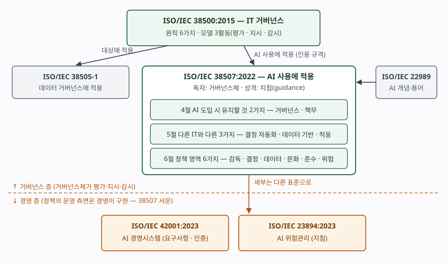

## 들어가며

조직이 생성형 AI를 들여오면 대개 먼저 "AI 윤리 원칙"을 선언하고, 그다음 보안팀과 법무팀이 각자 점검표를 만든다. 그런데 어떤 업무까지 AI에 결정을 맡길지, 그 결정이 틀렸을 때 누가 책임지는지는 점검표가 정하지 못한다. 그 질문은 경영진 위의 거버넌스체(이사회 등)가 답할 일이고, ISO/IEC 38507은 그 층을 위한 지침이다. 시험에서는 AI 거버넌스 문항의 근거 표준으로 나오며, **42001(경영시스템)과 층을 구분하는지**가 점수를 가른다.

> 실행 검증 없음. ISO/IEC 38507:2022와 38500:2015는 유료 표준이라 공개 미리보기(표지·목차·머리말·서문·1~3절 앞부분)만 근거로 썼다. **4~6절 본문은 열지 못했으므로 절 제목까지만 근거로 삼았고, 그 아래 설명은 제목과 서문을 풀어 쓴 것이다.**

---

## 정의

**ISO/IEC 38507은 조직의 거버넌스체가 AI 사용을 가능하게 하고 다스려, 조직 안에서 AI가 효과적·효율적이고 수용 가능하게 쓰이도록 하기 위한 지침을 주는 국제표준이다.**

적용 범위(1절)를 그대로 옮긴 정의다. 정식 제목은 *Governance implications of the use of artificial intelligence by organizations*이고, ISO/IEC JTC 1의 **SC 40(IT 서비스 관리·IT 거버넌스)과 SC 42(인공지능)가 공동으로** 만들어 2022년 4월 제1판으로 냈다(머리말). 인용 규격(2절)은 **2개**, AI 용어 표준 ISO/IEC 22989와 IT 거버넌스 표준 **ISO/IEC 38500:2015**다. 즉 새 거버넌스 틀을 만든 것이 아니라 38500의 원칙과 모델을 AI 사용에 적용한 문서다.

정의의 단어 셋은 따로 읽어야 한다.

- **"수용 가능(acceptable)"** — 38500의 용어 정의(2.1)는 이해관계자의 기대 가운데 합당하다고 보일 수 있는 것을 충족하는 상태로 정한다. 합법이나 이익만이 기준이 아니라는 뜻이다.
- **"사용(use of AI)"** — 서문은 이를 가장 넓게 잡는다. 생애주기 어느 단계에서든 AI 시스템을 **개발하거나 적용하는 것** 전부이고, 그런 시스템을 **공급하거나 쓰는 상대방과의 관계**까지 포함한다. 외부 모델을 구독해 쓰는 조직도 대상이다.
- **"거버넌스"** — 서문은 강조점이 AI 기술이 아니라 **사람이 수행하는 거버넌스**에 있다고 적고, 정책의 운영 측면은 **경영(management)이 구현한다**고 선을 긋는다.

## 등장 배경

38500은 2008년 제1판, 2015년 제2판이 나온 IT 거버넌스 표준이다. 서문은 IT 투자가 성과로 이어지지 못하는 주된 이유를 IT 활동의 기술·재무·일정 측면만 보고 **업무 맥락 전체를 보지 않는 데** 있다고 진단하고, 최고 의사결정층이 IT 사용을 평가·지시·감시할 원칙·정의·모델을 준다. 그리고 거버넌스와 경영은 다르다고 명시한다.

AI는 이 틀로 다 덮이지 않는다. 38507은 AI가 다른 정보기술과 다른 점을 **3가지**로 따로 절을 세웠다(5.2). 사람이 내리던 결정을 시스템이 내리는 **의사결정 자동화**, 규칙이 코드가 아니라 데이터에서 나오는 **데이터 기반 문제 해결**, 배포 뒤에도 동작이 바뀌는 **적응형 시스템**이다. 서문은 강력한 도구가 늘 그렇듯 AI 사용도 새 위험과 책임을 낳으며, AI 자체가 공정하거나 편향된 것이 아니라 **사용이 그렇게 되거나 그렇게 보일 수 있다**고 적는다. 대상은 기술이 아니라 사용이라는 이 관점이 문서 전체의 출발점이다.

## 구성요소 — 상위 모델과 본문 3개 절

### 가. 38500에서 물려받는 것 — 원칙 6가지, 활동 3가지

| 구분 | 내용 | 근거 |
|---|---|---|
| 원칙 6가지 | ① 책임(Responsibility) ② 전략(Strategy) ③ 획득(Acquisition) ④ 성과(Performance) ⑤ 적합(Conformance) ⑥ 인간 행동(Human Behaviour) | 38500:2015 목차 5.2~5.7 |
| 모델 3활동 | **평가(Evaluate) · 지시(Direct) · 감시(Monitor)** | 38500:2015 서문, 목차 4.2 |

### 나. 38507 본문의 3개 절

| 절 | 제목 | 하위 항목 (개수) |
|---|---|---|
| 4절 | 조직의 AI 사용이 거버넌스에 주는 함의 | AI 도입 시 **거버넌스 유지**(4.2), **책무 유지**(4.3) — 2가지 |
| 5절 | AI와 AI 시스템 개요 | 다른 IT와의 차이(5.2.1~5.2.3) **3가지**, AI 생태계(5.3), 편익(5.4), 제약(5.5) |
| 6절 | AI 사용을 다루는 정책 | 감독(6.2) · 의사결정(6.3) · 데이터 사용(6.4) · 문화와 가치(6.5) · 컴플라이언스(6.6) · 위험(6.7) — **6가지** |

6절의 두 영역은 하위 절이 더 있다. 컴플라이언스는 의무와 관리 **2개**(6.6.1~6.6.2), 위험은 위험 성향과 관리·위험관리·목표·위험원·통제 **5개**(6.7.1~6.7.5)다. 부속서 A는 **규정(normative)** 부속서로 거버넌스와 조직의 의사결정을 다룬다.

## 도식

> **출처**: [ISO/IEC 38507:2022 공개 미리보기 — Foreword, Introduction, Contents, 1 Scope, 2 Normative references](https://www.vde-verlag.de/iec-normen/preview-pdf/info_isoiec38507%7Bed1.0%7Den.pdf) · [ISO/IEC 38500:2015 공개 미리보기 — Introduction, Contents](https://www.vde-verlag.de/iec-normen/preview-pdf/info_isoiec38500%7Bed2.0%7Den.pdf) · [ISO/IEC 38505-1 표준 정보](https://www.iso.org/standard/87195.html) · [ISO/IEC 42001:2023 표준 정보](https://www.iso.org/standard/81230.html) · [ISO/IEC 23894:2023 표준 정보](https://www.iso.org/standard/77304.html)

위가 거버넌스 층, 아래가 경영 층이다. 38500의 원칙과 모델이 대상별로 내려가 데이터에는 38505-1이, AI 사용에는 38507이 된다. 38507 안에서는 4절이 "AI를 들여와도 거버넌스와 책무는 거버넌스체에 남는다"는 전제를 세우고, 5절이 왜 AI에 별도 지침이 필요한지를 3가지 차이로 설명하며, 6절이 거버넌스체가 정책으로 내려보낼 영역 6가지를 정한다. 그 정책을 절차·기록·통제로 돌리는 일은 서문이 말한 대로 경영의 몫이고, 세부는 다른 표준(경영시스템·위험관리 등)으로 넘긴다.

## 비교

### 가. AI 관련 ISO/IEC 표준의 층 구분

| 구분 | ISO/IEC 38507 | ISO/IEC 42001 | ISO/IEC 23894 | ISO/IEC 38505-1 |
|---|---|---|---|---|
| 층 | 거버넌스 | 경영시스템 | 위험관리 | 거버넌스 |
| 대상 | AI 사용 | AI 경영시스템 | AI 관련 위험 | 데이터 사용 |
| 독자 | 거버넌스체 | 경영진·실무 조직 | 실무 조직 | 거버넌스체 |
| 문서 성격 | 지침 | **요구사항 (인증 대상)** | 지침 | 지침 |
| 뿌리 | 38500 | 경영시스템 공통 구조 | ISO 31000 | 38500 |

답안에서 가장 흔한 실수는 38507을 인증 규격처럼 쓰는 것이다. 인증 대상은 42001이고, 38507은 거버넌스체가 무엇을 물어야 하는지를 적은 지침이다.

### 나. 판 표기 — 38500은 그 뒤에 개정됐다

38507의 인용 규격은 **38500:2015로 연도가 붙어 있다.** 연도가 붙은 인용은 그 판만 적용된다는 것이 2절의 규칙이므로, 38507을 읽을 때 기준이 되는 원칙 6가지는 2015판의 것이다. 38500은 그 뒤 2024년 제3판이 나왔고, 같은 계열의 38505-1 제2판(2026)은 개정 사유를 38500:2024와의 정렬이라고 밝혔다. 38507은 아직 2022년 제1판이므로, 답안에 판을 적을 때 **38507:2022 — 38500:2015 인용**으로 짝을 맞춘다.

## 적용 시 고려사항

아래 넷은 표준의 절 제목과 서문을 실무 판단으로 옮긴 것이다. 표준 본문의 문장이 아니다.

① **AI 목록부터 만든다.** 감독(6.2)은 무엇을 감독할지 알아야 시작된다. "사용"이 외부 서비스와의 관계까지 포함하므로, 현업이 SaaS에 붙은 생성형 AI 기능을 켜는 것도 목록에 올라야 한다. 조달·계약 단계에서 AI 포함 여부를 신고받는 절차를 정보시스템 도입 심의에 넣는다.

② **결정의 경계를 시스템에 기록한다.** 의사결정 거버넌스(6.3)와 책무 유지(4.3)가 실제로 작동하려면, 어떤 결정을 AI가 내렸고 사람이 언제 확인·번복했는지가 로그로 남아야 한다. 고객 대상 자동 결정은 사람 검토 필수, 내부 업무 보조는 사후 표본 점검처럼 **용도 등급별 기준**을 거버넌스체가 정하고, 그 등급을 시스템 설정과 연결한다.

③ **데이터 계보를 데이터 거버넌스와 하나로 관리한다.** 데이터 기반 문제 해결(5.2.2)은 학습·추론 데이터의 출처와 사용 권한이 곧 AI의 품질과 적법성이라는 뜻이다. 데이터 사용 정책(6.4)을 38505-1 기반의 데이터 거버넌스와 따로 만들면 같은 데이터에 승인 절차가 둘이 된다.

④ **승인을 한 번으로 끝내지 않는다.** 적응형 시스템(5.2.3)은 승인 뒤에도 동작이 바뀐다. 성능 저하·드리프트·이의 제기 건수를 정기 보고 지표로 두고, 모델 교체나 학습 데이터 변경 같은 **중대한 변경이 있으면 재승인**하도록 정해야 평가·지시·감시가 반복된다.

## 정리

- **정의** — 거버넌스체가 AI 사용을 효과적·효율적·수용 가능하게 다스리기 위한 지침. 38500을 AI 사용에 적용, SC 40·SC 42 공동, 2022-04 제1판
- **숫자로 외우기 — "6·3·2·3·6"**
  - 38500 원칙 **6** (책·전·획·성·적·인)
  - 모델 **3**활동 (평가·지시·감시)
  - 4절 유지할 것 **2** (거버넌스·책무)
  - 5절 AI의 차이 **3** (결정 자동화·데이터 기반·적응형)
  - 6절 정책 영역 **6** (감독·결정·데이터·문화·준수·위험)
- **층 구분** — 거버넌스(38507) ≠ 경영시스템(42001, 인증) ≠ 위험관리(23894)
- **판 짝** — 38507:2022는 38500:2015를 연도 붙여 인용한다

> 기출 답안: [기출문제 — AI 거버넌스: 거버넌스체의 평가·지시·감시와 정책 영역 6가지](../../exam/2026-11-08-ai-governance-iso-iec-38507/index.md)
>
> 함께 볼 글: [ISO/IEC 38505-1 데이터 거버넌스 — 데이터 책임 지도와 가치·위험·제약](../2026-10-20-iso-iec-38505-1-data-accountability-map/index.md)
>
> 함께 볼 글: [ISO/IEC 23894 인공지능 위험관리 — ISO 31000을 AI에 옮긴 세 덩어리와 부속서 3개](../2026-10-29-iso-iec-23894-ai-risk-management/index.md)

## 참고 자료

- [ISO/IEC 38507:2022, Information technology — Governance of IT — Governance implications of the use of artificial intelligence by organizations](https://www.iso.org/standard/56641.html) — 발행처 공식 목록. 제1판 2022-04
- [ISO/IEC 38507:2022 공개 미리보기 (VDE Verlag)](https://www.vde-verlag.de/iec-normen/preview-pdf/info_isoiec38507%7Bed1.0%7Den.pdf) — 머리말(SC 40·SC 42 공동), 서문("사용"의 정의, 경영과의 구분), 목차, 1절 적용 범위, 2절 인용 규격
- [ISO/IEC 38500:2015, Information technology — Governance of IT for the organization](https://www.iso.org/standard/62816.html) — 제2판 2015-02-15
- [ISO/IEC 38500:2015 공개 미리보기 (VDE Verlag)](https://www.vde-verlag.de/iec-normen/preview-pdf/info_isoiec38500%7Bed2.0%7Den.pdf) — 서문(평가·지시·감시, 거버넌스와 경영의 구분), 목차(원칙 6가지), 1절, 2.1 acceptable 정의
- [ISO/IEC 42001:2023, Information technology — Artificial intelligence — Management system](https://www.iso.org/standard/81230.html)
- [ISO/IEC 23894:2023, Information technology — Artificial intelligence — Guidance on risk management](https://www.iso.org/standard/77304.html)
- [ISO/IEC 38505-1, Information technology — Governance of IT — Governance of data — Part 1: Application of ISO/IEC 38500 to the governance of data](https://www.iso.org/standard/87195.html)
