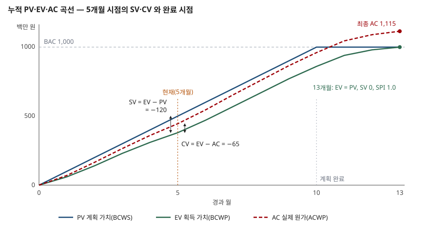

## 들어가며

정보시스템 구축 사업을 감리하거나 PMO 로 관리하다 보면 "예산의 45% 를 썼으니 계획(50%)보다 덜 썼다"는 보고를 받는다. 그런데 이 숫자만으로는 일이 얼마나 끝났는지 알 수 없다. 획득가치관리(EVM)는 여기에 **끝낸 일의 가치**라는 세 번째 값을 넣어 일정과 원가를 같은 단위로 판정한다. 공식이 짧고 계산 문제로 내기 좋아 기술사 시험의 프로젝트 관리 영역에 자주 나온다. 이 글은 공식마다 GAO 원가 산정 지침을 근거로 달고, 가상 프로젝트로 직접 계산해 검산했다.

## 정의

> 획득가치관리(Earned Value Management)는 일정 기간에 수행한 작업의 가치를 측정해, 그 기간에 계획된 작업의 가치 및 수행한 작업의 실제 원가와 비교하는 원가·일정 성과 분석 기법이다.

미국 회계감사원(GAO)의 원가 산정·평가 지침(GAO-20-195G)이 EVM 을 이렇게 설명한다. 같은 지침은 계획 원가와 완료된 작업의 계획 원가, 실제 원가를 비교해 원가와 일정 상태를 측정한다고 덧붙인다.

## 등장 배경

예산과 집행액만 비교하는 방식은 **일의 진척을 보지 못한다.** GAO 지침의 철로 예시가 이를 보여 준다. 4주 동안 철로 4마일을 400만 달러에 까는 계약에서 3주가 지났는데 200만 달러만 썼다. 집행액만 보면 예산보다 덜 쓴 것이다. 그런데 실제로 깐 철로는 1마일, 25% 다. 지침은 이 속도라면 총원가 800만 달러, 기간 12주가 된다고 계산한다. 직접 계산해도 CPI 0.500, SPI 0.333 이고 BAC/CPI 는 8.0, 4주/SPI 는 12.0 주였다.

지침은 EVM 이 서로 다른 일(케이블 길이, 판금 면적, 설계 노력)을 **예산이라는 같은 단위**로 합칠 수 있다는 점도 장점으로 든다. 작업이 잘 정의된 단위로 나뉘어 있으면 어떤 일이든 진척을 금액으로 바꿔 합산할 수 있다.

## 구성요소 / 절차

**기본 값 4개, 분석 지표 4개, 예측 지표 4개 — 모두 12개**다. GAO 지침은 BCWS·BCWP·ACWP 라는 이름을 쓰고, 각주에서 PV·EV·AC 로 부르는 문헌도 있다고 밝힌다.

| 구분 | 지표 | 식 | 뜻 |
|---|---|---|---|
| 기본 값 | PV (BCWS) | — | 기간 안에 하기로 계획한 작업의 예산 합 |
| | EV (BCWP) | — | 기간 안에 끝낸 작업(진행 중인 일의 완료분 포함)의 예산 합 |
| | AC (ACWP) | — | 끝낸 작업에 실제로 든 원가 |
| | BAC | — | 모든 원가 요소 예산의 합 |
| 분석 | SV | EV − PV | 0 보다 작으면 계획보다 늦음(금액 단위) |
| | CV | EV − AC | 0 보다 작으면 예산 초과 |
| | SPI | EV ÷ PV | 1.0 보다 작으면 계획보다 적게 수행 |
| | CPI | EV ÷ AC | 1.0 보다 작으면 수행한 일에 비해 많이 씀 |
| 예측 | EAC | AC + (BAC − EV) ÷ 효율 지수 | 완료 시점의 총원가 추정 |
| | ETC | EAC − AC | 남은 일에 들 원가 |
| | VAC | BAC − EAC | 완료 시점의 예산 차이 |
| | TCPI | (BAC − EV) ÷ (목표 − AC) | 목표(BAC 또는 EAC)를 지키려면 남은 일에서 내야 할 원가 효율 |

EAC 는 하나의 식이 아니다. 지침은 **효율 지수 자리에 무엇을 넣느냐**로 EAC 가 갈린다고 설명한다. 이 글에서는 세 가지를 계산했다.

1. **효율 1.0** — 남은 일은 예산대로 된다고 본다. `AC + (BAC − EV)`
2. **누적 CPI** — 지금까지의 원가 효율이 이어진다고 본다. 식을 풀면 `BAC ÷ CPI` 와 같다
3. **CPI × SPI** — 늦은 일정을 따라잡느라 원가가 더 든다고 본다. 지침은 이를 최악 사례 예측으로 부른다

## 도식



> **출처**: [GAO-20-195G Cost Estimating and Assessment Guide](https://www.gao.gov/products/gao-20-195g) — Table 22 Contract Performance Report Data Elements: Format 1 (246쪽), Table 23 EVM Performance Indexes (257쪽). 곡선의 값은 이 글의 계산 예제(`code/evm_calc.py`) 결과다.

답안지에는 가로축(기간)과 세로축(금액) 위에 세 곡선을 그리고, 현재 시점에서 PV−EV 사이를 SV, EV−AC 사이를 CV 로 표시하면 된다.

## 계산과 검산

전체 소스: [`code/evm_calc.py`](code/evm_calc.py) · 수행 기록: [`code/output.txt`](code/output.txt)

BAC 1,000(백만 원)을 10개월에 매달 100씩 쓰기로 계획했는데, 실제로는 13개월 걸려 1,115 를 쓴 가상 프로젝트다.

```text
  월 |   PV |   EV |   AC |   SV |   CV |   SPI |   CPI
   3 |  300 |  230 |  265 |  -70 |  -35 | 0.767 | 0.868
   5 |  500 |  380 |  445 | -120 |  -65 | 0.760 | 0.854
   8 |  800 |  670 |  760 | -130 |  -90 | 0.838 | 0.882
  10 | 1000 |  860 |  960 | -140 | -100 | 0.860 | 0.896
  11 | 1000 |  940 | 1045 |  -60 | -105 | 0.940 | 0.900
  12 | 1000 |  980 | 1090 |  -20 | -110 | 0.980 | 0.899
  13 | 1000 | 1000 | 1115 |    0 | -115 | 1.000 | 0.897
```

(수행 기록의 13개월 중 일부 행이다.)

**5개월 시점의 예측.** 실제 최종 원가는 1,115 였다.

| 지표 | 값 | 해석 |
|---|---|---|
| EAC(1.0) | 1,065.000 | 실제보다 50 낮음 |
| EAC(CPI) | 1,171.053 | 실제보다 56 높음. `BAC ÷ CPI` 도 1,171.053 으로 같았다 |
| EAC(CPI×SPI) | 1,400.332 | 실제보다 285 높음 |
| TCPI(BAC) | 1.117 | 지금 CPI 0.854 보다 0.263 높다 |

GAO 지침은 TCPI 가 CPI 보다 5%p 넘게 높으면 그 목표가 지나치게 낙관적이라는 경험칙을 소개한다. 여기서는 26%p 차이라 BAC 1,000 안에 끝내기 어렵다는 판정이 나오고, 실제로도 1,115 가 들었다.

**완료 시점의 일정 지표.** 계획보다 3개월 늦게 끝났는데 13개월 시점의 SPI 는 1.000, SV 는 0 이었다. 10개월이 지나면 PV 가 BAC 에서 멈추고, EV 는 일이 끝날 때 결국 BAC 에 닿기 때문이다. GAO 지침도 SPI 는 사업이 진행될수록 예측력을 잃고 완료 시점에 1.0 으로 돌아간다고 적는다. 반면 CPI 는 0.897 로 원가 초과를 끝까지 보여 줬다.

예상과 달랐던 점도 있다. 지침은 누적 CPI 로 낸 EAC 가 대개 **가장 낮은 쪽(최선 사례)** 이 된다고 적는다. 실제 사업에서는 CPI 가 완료로 갈수록 나빠지는 경향이 있어서다. 이 가상 데이터에서는 후반 원가 효율이 0.854 → 0.897 로 좋아지도록 만들었기 때문에 EAC(CPI) 가 오히려 실제보다 높았다. EAC 의 맞고 틀림은 **효율 지수가 앞으로도 유지된다는 가정**이 맞는지에 달려 있다.

## 비교

| 구분 | 예산 대비 집행 비교 | 획득가치관리(EVM) |
|---|---|---|
| 쓰는 값 | 계획 집행액, 실제 집행액 | PV, EV, AC |
| 진척 반영 | 하지 않음 | EV 로 반영 |
| 판정 | 덜 썼다·더 썼다 | 늦다·빠르다, 초과·절감을 따로 |
| 철로 예시 3주차 | 계획 300만 달러 중 200만 달러 집행 → 양호로 보임 | SPI 0.333, CPI 0.500 → 부진 |

| 구분 | SV·SPI (일정) | CV·CPI (원가) |
|---|---|---|
| 비교 대상 | EV 와 PV | EV 와 AC |
| 단위 | 금액(시간이 아님) | 금액 |
| 완료 시점 | SV 0, SPI 1.0 으로 돌아감 | 초과분이 남음 |
| 한계 | 주 공정 경로 지연 여부를 따로 봐야 함 | 회계 처리 오류가 지수를 왜곡할 수 있음 |

## 적용 시 고려사항

1. **EV 를 잡는 규칙을 먼저 정한다.** EV 는 "얼마나 끝났나"를 금액으로 바꾼 값이라 진척 측정 기준이 흔들리면 모든 지표가 흔들린다. GAO 지침은 유리한 지수도 시스템 오류에서 나올 수 있다고 경고한다.
2. **SV 는 금액 단위다.** 지침은 일정 차이가 시간이 아니라 금액으로 표현되며, 지연이 주 공정 경로에서 일어나는지 따로 봐야 한다고 적는다. 사업 후반에는 SPI 대신 공정표로 지연을 판정한다.
3. **EAC 는 여러 개를 내고 범위로 본다.** 지침은 EAC 를 하나 이상 계산하는 것을 모범 사례로 든다. 계산 예제에서도 세 식이 1,065~1,400 으로 갈렸다.
4. **TCPI 와 CPI 를 나란히 본다.** 남은 일에 요구되는 효율이 지금까지의 효율보다 크게 높으면 그 목표는 현실성이 낮다.
5. **WBS 하위 수준에서도 계산한다.** 지침은 상위에서만 보면 잘되는 영역이 부진한 영역을 가린다고 적는다. 통제 계정과 작업 패키지 구조는 [WBS 와 통제 계정](../2026-09-29-wbs-scope-baseline-control-account/index.md) 글을 참고한다.

## 정리

- **세 값 PV·EV·AC**, 분석 **2쌍(SV·CV, SPI·CPI)**, 예측 **4개(EAC·ETC·VAC·TCPI)** 와 BAC 로 모두 12개
- 공식 암기 단서: **"EV 가 항상 앞"** — SV = EV − PV, CV = EV − AC, SPI = EV ÷ PV, CPI = EV ÷ AC
- EAC = AC + (BAC − EV) ÷ 효율 지수. 지수 1.0 / CPI / CPI×SPI 의 세 가정
- SPI 는 완료 시점에 1.0 으로 돌아가므로 후반 일정 판정에는 공정표를 함께 본다

## 참고 자료

- [GAO-20-195G Cost Estimating and Assessment Guide (2020-03-12)](https://www.gao.gov/products/gao-20-195g) — 17장 What EVM Is(207쪽, 정의와 철로 예시), Table 22(246쪽, BCWS·BCWP·ACWP·CV·SV·VAC 정의), Table 23(257쪽, CPI·SPI·TCPI 식), 258쪽(TCPI 와 CPI 차이 5%p 경험칙), 265~267쪽(EAC 일반식, Table 24 효율 지수별 EAC, SPI 가 완료 시점에 1.0 으로 돌아간다는 설명)
- [GAO-20-195G 전문 PDF](https://www.gao.gov/assets/d20195G.pdf) — 위 쪽 번호는 인쇄 쪽 번호다. PDF 쪽 번호는 인쇄 쪽 + 12
- [WBS 와 통제 계정](../2026-09-29-wbs-scope-baseline-control-account/index.md) — 같은 저장소에서 성과 측정 기준선과 통제 계정 구조를 다룬 글
