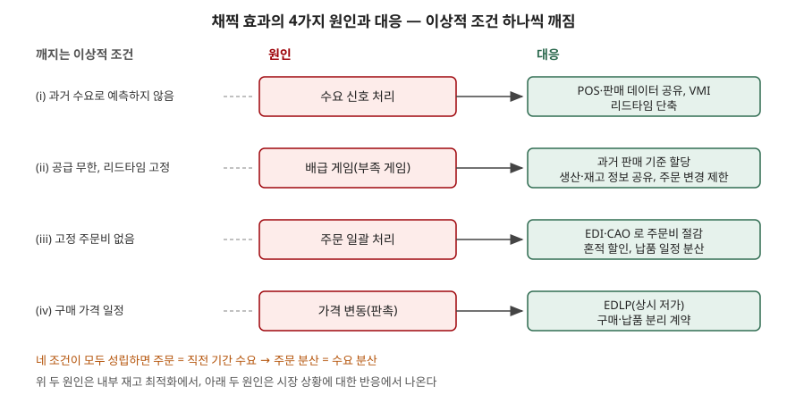

## 들어가며

공급망관리(SCM)를 묻는 기출에서 채찍 효과는 SCM 이 왜 필요한지를 보여 주는 배경으로 거의 빠지지 않는다. 소비자 판매는 고르게 움직이는데 제조사가 받는 주문은 크게 출렁이고, 그 출렁임에 맞춰 재고와 생산 능력을 잡으면 비용이 커진다. 이 현상을 처음으로 원인별로 모형화한 것이 Lee·Padmanabhan·Whang(1997)이고, 원인 4가지와 대응이 거의 모두 **정보시스템이 무엇을 공유하느냐**로 이어진다. 이 글은 원 논문의 정리를 근거로 원인과 대응을 정리하고, 논문의 분산 식 두 개를 직접 시뮬레이션해 검산했다.

> 개념 정리의 근거는 원 논문(1차 자료)이다. 분산 식은 파이썬으로 계산해 검산했다(`code/output.txt`).

## 정의

> 채찍 효과(Bullwhip Effect)는 공급망에서 하류 구성원이 상류로 보내는 주문의 분산이 실제 판매의 분산보다 크고, 그 왜곡이 상류로 갈수록 커지는 현상이다.

Lee·Padmanabhan·Whang(1997)의 초록이 이렇게 정의한다. 논문은 주문 형태로 전달되는 정보가 왜곡되어 상류의 재고·생산 결정을 잘못 이끈다고 보고, 이 현상을 정보 왜곡(information distortion)의 문제로 다룬다.

## 등장 배경

전통적인 유통 경로에서 상류 공급자는 **바로 아래 구성원의 주문 데이터만** 본다. 소비자가 실제로 얼마나 샀는지는 소매점만 안다. 논문은 이 구조에서 공급자가 실제 수요 패턴을 놓치고, 왜곡된 정보로 재고를 운영하게 된다고 지적한다.

논문의 출발점은 왜곡이 없는 이상적 상황이다. 다음 4가지 조건이 모두 성립하면 정기 발주에서 목표재고(order-up-to-S) 정책이 최적이고, 매 기간 주문량은 **직전 기간 수요와 정확히 같다.** 그러면 주문과 수요의 분산도 같다.

1. 과거 수요를 예측에 쓰지 않는다(수요가 정상적이다)
2. 공급이 무한하고 리드타임이 고정이다
3. 고정 주문비가 없다
4. 구매 가격이 시간에 따라 변하지 않는다

논문은 이 조건을 **하나씩 풀 때마다 원인이 하나씩 생긴다**고 설명한다. 채찍 효과는 구성원이 비합리적이어서가 아니라 각자 합리적으로 최적화한 결과로 생긴다는 것이 이 논문의 핵심 주장이다.

## 구성요소 / 절차

**원인 4가지**다. 논문은 앞의 두 원인이 내부 재고 운영의 최적화에서, 뒤의 두 원인이 시장 상황에 대한 반응에서 나온다고 묶는다.

| 원인 | 깨지는 조건 | 왜 분산이 커지나 | 논문의 결과 |
|---|---|---|---|
| ① 수요 신호 처리 | 조건 1 | 수요가 늘면 미래 수요도 늘 것으로 보고 목표재고를 올려, 판매보다 많이 주문한다 | 정리 1: 0 < ρ < 1 이면 주문 분산 > 판매 분산, 리드타임이 길수록 커진다 |
| ② 배급 게임 | 조건 2 | 공급 부족으로 주문량에 비례해 배분될 것을 예상하면 필요보다 부풀려 주문한다 | 정리 2: 배급 게임의 최적 주문량은 신문팔이 해 이상 |
| ③ 주문 일괄 처리 | 조건 3 | 주문비 때문에 여러 기간 수요를 모아 한 번에 주문한다 | 정리 3: 동조 주문 ≥ 무작위 주문 ≥ 균형 주문 ≥ 판매 분산 |
| ④ 가격 변동 | 조건 4 | 할인 기간에 미리 사 두고 정상가 기간에는 사지 않는다 | 정리 5: 주문 분산 > 수요 분산 |

정리 1 의 근거 모형은 이렇다. 소매점 수요가 AR(1) 과정 `D_t = d + ρD_{t-1} + u_t` (u_t 는 평균 0, 분산 σ² 인 정규분포)를 따르고 리드타임이 v 일 때, 최적 주문량은 식 (3.3) 이다.

```text
z = D_0 + k (D_0 − D_{-1}),   k = ρ(1 − ρ^(v+1)) / (1 − ρ)
```

첫째 항은 직전 기간 판매만큼 채우는 몫이고, 둘째 항은 수요 변화를 보고 목표재고를 옮기는 몫이다. 이 둘째 항이 판매에 없던 변동을 주문에 얹는다. 논문은 그 결과를 식 (3.5) 로 적는다.

```text
Var(z) = Var(D) + 2ρ(1 − ρ^(v+1))(1 − ρ^(v+2)) σ² / ((1 + ρ)(1 − ρ)²)
```

대응도 원인별로 짝지어 있다. 논문의 Table 1 은 원인마다 기여 요인과 대응, 당시 업계 사례를 정리한다.

| 원인 | 대응 | 정보시스템 관점 |
|---|---|---|
| ① 수요 신호 처리 | POS·판매(sell-through) 데이터 공유, 한 구성원이 예측·발주를 맡는 VMI, 리드타임 단축 | 기업 간 판매 데이터 교환(EDI), 공동 예측 |
| ② 배급 게임 | 과거 판매 실적 기준 할당, 생산·재고 정보 공유, 주문 변경 폭을 제한하는 계약 | 공급 능력·재고 가시성 제공 |
| ③ 주문 일괄 처리 | EDI·CAO 로 주문 처리 비용 절감, 여러 품목 혼적 할인, 납품 일정 분산 | 종이 없는 자동 발주 |
| ④ 가격 변동 | 상시 저가(EDLP), 대량 구매와 분할 납품을 분리하는 계약 | 활동기준원가(ABC)로 선구매 비용 가시화 |

논문 요약 절은 대응을 판매 데이터, 재고 상태 정보 교환, 주문 조정, 단순한 가격 체계의 **조합**으로 정리하고, 한 가지로는 충분하지 않다고 본다.

## 도식



> **출처**: [Lee·Padmanabhan·Whang, Information Distortion in a Supply Chain: The Bullwhip Effect, Management Science 43(4), 1997 — §3 The Causes of the Bullwhip Effect, §4 Managerial Implications, Table 1](https://courses.ie.bilkent.edu.tr/ie102/wp-content/uploads/sites/12/2019/02/Lee-Padmanabhan-Whang-1997-MS.pdf)

답안지에는 가운데 원인 4개를 세로로 쓰고, 왼쪽에 깨지는 조건, 오른쪽에 대응을 화살표로 붙이면 된다.

## 검산 — 논문의 분산 식을 직접 돌려 보기

### 정리 1: 수요 신호 처리

AR(1) 수요를 20만 기간 만들고(σ = 10, d = 100) 식 (3.3) 의 주문을 계산해 분산을 쟀다. 모든 칸에서 식 (3.5) 와 시뮬레이션이 소수 첫째 자리 근처까지 맞았다.

```text
   ρ  v   Var(D) 식   Var(z) 식   Var(D) 실측   Var(z) 실측     배율 식     배율 실측
 0.5  0      133.3      233.3       133.5       233.9     1.75      1.75
 0.5  1      133.3      308.3       133.5       309.2     2.31      2.32
 0.5  2      133.3      352.1       133.5       353.1     2.64      2.64
 0.5  4      133.3      387.6       133.5       388.7     2.91      2.91
 0.8  0      277.8      437.8       279.9       439.5     1.58      1.57
 0.8  1      277.8      668.2       279.9       669.4     2.41      2.39
 0.8  2      277.8      918.0       279.9       918.6     3.30      3.28
 0.8  4      277.8     1380.2       279.9      1379.7     4.97      4.93
  v=0, ρ=0.5: Var(z)-Var(D) = 100.0  (2ρσ² = 100.0)
```

리드타임 v 가 길수록 배율이 커지는 것은 정리 1(b) 그대로다. 예상과 달랐던 것은 **리드타임 0 의 두 행**이다. 자기상관이 강한 ρ = 0.8 쪽이 더 크게 증폭될 것으로 봤는데 배율은 1.58 로, ρ = 0.5 의 1.75 보다 작았다. 증가분 자체는 2ρσ² 라서 ρ = 0.8 쪽이 160 으로 더 크지만, 판매 분산 σ²/(1−ρ²) 도 함께 커져 비율로는 작아진다. 리드타임이 1 이상이면 순서가 뒤집혀 ρ = 0.8 쪽이 더 커진다. **"수요 변동이 클수록 채찍 효과가 크다"는 문장은 리드타임과 함께 말해야 맞다.**

마지막 줄은 논문 본문의 서술을 확인한 것이다. 논문은 v = 0 이면 `Var(z1) = Var(D0) + 2ρ` 라고 적는데, 식 (3.5) 에 v = 0 을 넣으면 증가분은 2ρσ² 다. σ = 10 에서 계산값 100.0 이 2ρσ² 와 맞으므로 본문의 `2ρ` 는 σ² 가 빠진 표기다.

### 정리 3: 주문 일괄 처리

논문이 든 예(소매점 N = 23 곳, 주문 주기 R = 5 기간)를 그대로 썼다. 각 소매점의 기간 판매는 평균 m = 10, 표준편차 σ = 3 이고, 주문하는 기간에 지난 R 기간 판매량을 한 번에 주문한다. 10만 번 표본을 뽑아 공급자가 한 기간에 받는 주문 Z 의 분산을 쟀다.

```text
  소매점 판매 합계의 기간당 분산 Nσ² = 207
방식             E(Z) 실측   Var(Z) 식   Var(Z) 실측    Nσ² 대비
correlated       231.1     211807      212465    1026.4
random           230.2       9407        9349      45.2
balanced         230.0        807         811       3.9
```

세 방식 모두 평균은 Nm = 230 근처로 같고 분산만 갈린다. 식 (3.11)~(3.13) 과 실측이 맞았다. 모든 소매점이 같은 날 주문하는 동조 주문은 판매 분산의 약 1,026 배, 무작위는 45 배, 그룹을 나눠 요일을 정한 균형 주문은 3.9 배였다. 균형 주문이 1 배가 아닌 것은 23 이 5 로 나누어떨어지지 않아(k = 3) 그룹 크기가 5 와 4 로 갈리기 때문이다. 논문도 N 이 R 의 배수일 때만 효과가 사라진다고 적는다. **주문량을 줄이지 않고 주문 날짜만 나눠도** 공급자가 보는 분산이 수백 배 줄어든다는 점이 납품 일정 분산이 대응책으로 들어가는 근거다.

### 확장: 4단계 연쇄와 POS 공유

이 실험은 논문에 없는 것이다. 정리 1 의 주문 규칙(ρ = 0.5, v = 1, k = 0.75)을 소매 → 도매 → 유통 → 제조 4단계에 그대로 이어 붙였다. 한쪽은 각 단계가 바로 아래 단계의 주문만 보고 같은 규칙으로 주문하고, 다른 쪽은 모든 단계가 소비자 판매(POS)를 공유받아 그것으로 주문한다.

```text
단계          주문만 보고 예측      POS 공유 후 예측
소매               2.31             2.31
도매               7.94             2.31
유통              35.39             2.31
제조             179.61             2.31
```

주문만 보는 쪽은 단계마다 배율이 곱해져 제조 단계에서 판매 분산의 약 180 배가 됐다. POS 를 공유하면 모든 단계가 같은 신호를 보므로 2.31 배에서 멈춘다. 이 규칙은 AR(1) 이 아닌 입력에는 최적이 아니므로 숫자의 크기보다 **단계가 늘수록 곱으로 커진다는 모양**을 보면 된다. 논문이 중간 단계가 늘수록 왜곡이 커진다고 적은 서술과 방향이 같다. 2.31 배가 남는 것은 공유만으로는 신호 처리 자체가 사라지지 않기 때문이고, 논문이 공통 데이터만으로는 완전한 해법이 아니며 예측·발주를 한 구성원이 맡는 VMI 를 드는 이유가 여기 있다.

## 비교

시험에서는 채찍 효과와 함께 정보 공유 방식을 대비하는 형태가 자주 나온다. 아래는 논문의 대응을 정보가 흐르는 방향으로 다시 묶은 것이다.

| 구분 | 주문만 전달 | 판매 데이터 공유 | VMI(공급자 재고 관리) | 직판 |
|---|---|---|---|---|
| 상류가 보는 것 | 하류의 주문 | 소매 POS·재고 | POS·재고, 발주 권한 | 소비자 주문 자체 |
| 예측 주체 | 단계마다 따로 | 단계마다 따로 | 한 구성원 | 제조사 |
| 수요 신호 처리 | 단계마다 증폭 | 증폭이 누적되지 않음 | 예측 방식 차이까지 제거 | 경로상 증폭 없음 |
| 논문 사례 | 전통 유통 경로 | 식료품 EDI, 컴퓨터 업계 sell-through | P&G·Wal-Mart 기저귀 | Dell Direct |

채찍 효과는 **불확실성 자체**와도 구분해야 한다. 소비자 수요가 원래 크게 흔들리는 것은 채찍 효과가 아니다. 채찍 효과는 판매 분산 대비 주문 분산의 **비율**이고, 논문의 이상적 조건에서는 수요가 아무리 흔들려도 이 비율이 1 이다.

## 적용 시 고려사항

1. **데이터를 내놓는 쪽의 동기가 필요하다.** 논문 요약 절은 판매·재고 데이터가 전통적으로 소매점의 자산으로 여겨졌고, 왜 소매점이 데이터를 줘야 하는지는 이 논문이 답하지 않는다고 스스로 밝힌다. 공유 체계를 설계할 때는 이익 배분과 데이터 이용 범위를 계약으로 먼저 정해야 한다.
2. **공유만으로 끝나지 않는다.** 확장 실험에서 POS 를 공유해도 소매 단계의 2.31 배는 남았다. 논문도 같은 데이터를 써도 예측 방법이 다르면 변동이 남는다고 본다. 예측·발주 책임을 어디에 둘지(VMI, 공동 예측)가 함께 정해져야 한다.
3. **리드타임은 시스템 설계 변수다.** 정리 1 에서 v 가 0 에서 4 로 늘면 ρ = 0.8 의 배율이 1.58 에서 4.97 로 커졌다. 주문 전송·승인·출하 처리에 걸리는 정보 지연도 리드타임에 들어가므로 발주 자동화가 직접 효과를 낸다.
4. **주문 시점의 동조를 시스템이 만든다.** 논문은 월 단위 MRP·DRP 가 같은 시점에 돌면서 주문이 월말에 몰리는 현상을 사례로 든다. 배치 작업 일정을 거래처별로 나누는 것만으로 정리 3 의 동조 주문을 균형 주문 쪽으로 옮길 수 있다.
5. **판촉 정책과 재고 시스템을 따로 보지 않는다.** 가격 변동이 원인인 증폭은 재고 시스템 안에서는 보이지 않는다. 판촉 일정과 선구매 비용을 같은 데이터로 볼 수 있어야 EDLP 나 분할 납품 계약을 판단할 수 있다.

## 정리

- 정의: 주문 분산 > 판매 분산, 상류로 갈수록 커짐 — 구성원의 **합리적 최적화**가 원인
- 원인 **4가지**: 수요 신호 처리·배급 게임·주문 일괄 처리·가격 변동 → "**신배일가**". 각각 이상적 조건 4개(예측 안 함·공급 무한·주문비 0·가격 일정)가 하나씩 깨진 것
- 대응의 축은 **정보 공유**(POS·재고), **책임 일원화**(VMI), **주문 비용·시점 조정**(EDI·CAO·일정 분산), **가격 단순화**(EDLP)
- 검산: 정리 1 은 리드타임이 길수록 배율이 커졌고(ρ=0.8 에서 1.58 → 4.97), 정리 3 은 같은 물량에서 동조 1,026 배·무작위 45 배·균형 3.9 배였다

> 기출 답안: [공급망관리(SCM)의 정의와 배경, 효과성과 효율성](../../exam/2026-11-22-supply-chain-management-effectiveness-efficiency/index.md)

## 참고 자료

- [Hau L. Lee, V. Padmanabhan, Seungjin Whang, Information Distortion in a Supply Chain: The Bullwhip Effect, Management Science 43(4), pp. 546–558, 1997-04](https://courses.ie.bilkent.edu.tr/ie102/wp-content/uploads/sites/12/2019/02/Lee-Padmanabhan-Whang-1997-MS.pdf) — §3 원인 4가지와 정리 1~5, §4 대응, Table 1 (대학 강의 사이트에 올라온 JSTOR 사본)
- [같은 논문의 서지 — EconPapers, DOI 10.1287/mnsc.43.4.546](https://econpapers.repec.org/RePEc:inm:ormnsc:v:43:y:1997:i:4:p:546-558)
- [Hau L. Lee, V. Padmanabhan, Seungjin Whang, The Bullwhip Effect in Supply Chains, MIT Sloan Management Review, 1997 봄호](https://sloanreview.mit.edu/article/the-bullwhip-effect-in-supply-chains/) — 같은 저자의 비수식 해설판
