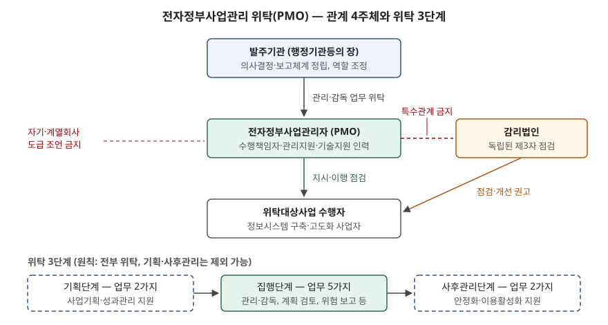

## 들어가며

공공 정보화사업을 다루는 기출에서 PMO는 감리와 짝을 이뤄 거의 매번 나온다. 발주기관은 사업을 계약하고 검수하는 주체지만, 요구사항 변경·일정 지연·연계 쟁점을 매주 판단할 사업관리 인력이 모자란 경우가 많다. 전자정부법은 이 관리 업무 자체를 외부 전문가에게 맡길 수 있게 했고, 그 수탁자가 PMO다. 답안에서는 "누가 무엇을 맡고, 어디까지 맡을 수 없는가"를 조문 개수로 대는 것이 점수가 된다.

> 실행 검증 없음. 정의·대상·자격·선정기준·업무는 전자정부법 제64조의2, 시행령 제78조의2~제78조의4, 「전자정부사업관리 위탁에 관한 규정」(이하 "위탁 규정") 조문을 그대로 근거로 삼았다. 판본은 `environment`에 적었고, 수치는 조문에 적힌 기한·인원만 썼다.

## 정의

> 전자정부사업관리 위탁(PMO)은 행정기관등의 장이 전자정부사업을 관리·감독하는 업무의 전부 또는 일부를 전문지식과 기술능력을 갖춘 자에게 위탁하는 제도이며, 위탁받아 수행하는 자를 전자정부사업관리자라 한다.

근거는 전자정부법 제64조의2제1항·제2항이다. 위탁 규정의 용어 정의(제2조)는 "전자정부사업관리"를 전자정부사업을 관리·감독하는 업무로, "전자정부사업관리자"를 시행령 제78조의3의 자격요건을 갖춰 그 업무를 위탁받아 수행하는 자로 정한다. 조문은 "위탁할 수 있다"로 끝난다. 의무인 감리(법 제57조)와 달리 **선택 제도**다.

## 등장 배경

PMO 조항은 2013년에 들어왔다. 법 제64조의2가 2013년 4월, 시행령 제78조의2~제78조의4와 위탁 규정이 2013년 7월에 신설·제정됐다. 조문이 든 위탁 사유에서 당시 문제가 그대로 읽힌다.

1. **발주기관의 관리 역량 부족** — 시행령 제78조의2제1항제4호 가목은 "기관의 사업관리 경험·전문성·인력 부족"을 위탁 사유로 든다.
2. **기관 경계를 넘는 연계 사업** — 같은 항 제3호는 둘 이상의 정보시스템이 통합·연계돼 고도의 사업관리 역량이 필요한 사업을 따로 든다. 인터페이스·데이터 표준·연계 시험 일정이 여러 기관에 걸치면 한 기관의 인력으로는 조정이 안 된다.
3. **감리만으로는 관리가 되지 않음** — 감리는 독립된 제3자가 점검하고 개선을 권고하는 장치다. 매일의 일정 조정, 쟁점 보고, 의사결정 지시는 여전히 발주기관 몫으로 남는다. PMO는 이 몫을 위탁받는다.

## 구성요소 / 절차

### 대상 사업 — 법 3가지, 시행령 4가지

| 법 제64조의2제1항 | 시행령 제78조의2제1항 | 조문이 든 예 |
|---|---|---|
| ① 대국민 서비스·행정 효율성에 영향이 큰 사업 | 1호 국민생활의 편의·안전에 필요한 시스템 구축·고도화 | 전자민원창구, 재난안전관리 시스템 |
| | 2호 여러 중앙행정기관등이 공통으로 쓰는 시스템 구축·고도화 | 행정기관 내 전자문서유통 시스템 |
| ② 난이도가 높아 특별한 관리가 필요한 사업 | 3호 둘 이상의 시스템이 통합·연계돼 고도의 사업관리 역량이 필요한 사업 | 행정정보 공동이용시스템 |
| ③ 기관장이 위탁이 필요하다고 인정하는 사업 | 4호 가) 경험·전문성·인력 부족, 나) 중요도·난이도가 1~3호에 준함 | — |

### 자격요건 3가지 — 시행령 제78조의3

1. 공공기관(학교 제외)
2. 법 제58조에 따라 등록된 감리법인
3. 소프트웨어기술자를 3명 이상 보유한 소프트웨어사업자

공동수급체로 들어오면 구성원 **모두**가 자격요건을 갖춰야 하고 연대해 이행한다(위탁 규정 제7조).

### 선정기준 5가지 — 시행령 제78조의4

① 수행책임자·관리지원·기술지원 인력의 전문성 ② 관리 업무 수행계획의 구체성·실현 가능성 ③ 전자정부사업(관리) 수행 실적 ④ 품질·성과관리 지원 체계 ⑤ 그 밖에 기관장이 필요하다고 인정하는 기술·전문성. 세부 배점은 고시에 위임돼 위탁 규정 별표 1이 정한다(이 글은 별표 본문을 확인하지 못해 배점을 싣지 않는다). 계약은 **협상에 의한 계약**을 우선 적용하고, 제안요청서에 수행인력 요건과 **상주 여부**를 적는다(위탁 규정 제5조).

### 위탁 3단계와 단계별 업무 9가지

위탁은 기획·집행·사후관리 **3단계 전부**가 원칙이고, 사업 특성과 기관 여건에 따라 기획단계나 사후관리단계를 뺄 수 있다(위탁 규정 제4조제1항). 관련성이 있는 사업 둘 이상을 묶어 통합 위탁할 수도 있다(같은 조 제2항).

| 단계 | 업무 (위탁 규정 제14조제1항) | 개수 |
|---|---|---|
| 기획 | 사업계획 수립 등 사업기획 지원, 성과목표 설정 등 성과관리 지원 | 2 |
| 집행 | 관리·감독, 공정단계별 계획 검토·조정·이행 점검, 쟁점·위험 식별·분석·보고와 대안 제시, 보고·의사결정 지원, 의사결정 사항 지시·관리와 이행 점검 | 5 |
| 사후관리 | 하자보수 등 정보시스템 안정화 지원, 교육·홍보 등 이용활성화 지원 | 2 |

단계별 세부 업무는 별표 5에 있고, 발주기관이 사업 특성에 맞춰 조정할 수 있다.

### 수행조직 3역할 — 위탁 규정 제13조

수행책임자(총괄·지휘, 이해관계자 의사소통)는 반드시 지정하고, 관리지원인력(일정·위험·품질관리)과 기술지원인력(응용시스템·DB·아키텍처·보안 분야의 분석·설계·시험 지원)은 규모에 따라 둔다.

### 지켜야 할 것과 발주기관이 남겨야 할 것

- **금지 3가지**: 자기·계열회사의 도급 조언 금지(법 제64조의2제3항), 업무 중 알게 된 정보의 유용 금지, 수행사업자와의 담합 금지(위탁 규정 제16조)
- **독립성**: PMO·수행사업자·감리법인 상호간에 독립성을 해칠 특수관계가 없어야 한다(위탁 규정 제6조)
- **발주기관 업무 5가지**(위탁 규정 제15조): 관리·감독, 의사결정·보고체계 정립, 수행사업자와 PMO 간 역할 조정, 현업 의견 수렴·이해관계 조정, 행정 지원

### 연결되는 절차 3가지

1. **추진계획 공개** — 매년 12월 31일까지 다음 해 위탁 추진계획을 행정안전부장관에게 내고, 장관은 15일 이내에 정보통신망에 공개한다. 계획에 없던 위탁이나 취소·수행단계 변경은 지체 없이 알린다(시행령 제78조의2제2항·제3항, 위탁 규정 제17조제2항).
2. **결과 제출** — 위탁 후 사업과 위탁용역의 내용·성과를 행정안전부장관에게 낸다(법 제64조의2제4항, 위탁 규정 제17조제1항).
3. **감리 면제와의 연결** — 시행령 제71조제2항에 따라 단계별 감리를 하지 않는 경우, PMO는 **검사 전에 과업내용 이행 여부를 점검**해야 한다(위탁 규정 제14조제3항).

## 도식

> **출처**: [전자정부사업관리 위탁에 관한 규정(행정안전부고시 제2024-54호) 제4조·제6조·제13조·제14조·제15조 — 국가법령정보센터](https://www.law.go.kr/%ED%96%89%EC%A0%95%EA%B7%9C%EC%B9%99/%EC%A0%84%EC%9E%90%EC%A0%95%EB%B6%80%EC%82%AC%EC%97%85%EA%B4%80%EB%A6%AC%EC%9C%84%ED%83%81%EC%97%90%EA%B4%80%ED%95%9C%EA%B7%9C%EC%A0%95) · [전자정부법 제64조의2 — 국가법령정보센터](https://www.law.go.kr/%EB%B2%95%EB%A0%B9/%EC%A0%84%EC%9E%90%EC%A0%95%EB%B6%80%EB%B2%95)

답안지에는 위에서 아래로 발주기관 → PMO → 수행사업자를 세우고, PMO 옆에 감리법인을 두어 점선으로 "특수관계 금지"를 표시한다. 맨 아래에 3단계 상자를 그리고 업무 개수 2·5·2를 적는다.

## 비교

| 구분 | PMO | 단계별 감리 | 상주감리 |
|---|---|---|---|
| 근거 | 법 제64조의2, 위탁 규정 | 법 제57조, 감리기준 | 법 제57조, 감리기준 |
| 성격 | 선택("위탁할 수 있다") | 대상 사업이면 의무 | 단계별 감리에 추가 |
| 지위 | 발주기관 업무의 **수탁자** | 독립된 제3자 | 독립된 제3자 |
| 사업자에 대한 행위 | 의사결정 사항 **지시**·이행 점검 | 점검·개선 권고 | 점검·검토·개선방안 제시 |
| 기간 | 기획·집행·사후관리 | 정해진 시점(요구정의·설계·종료 등) | 사업 수행 기간 |
| 독립성 요건 | 수행사업자·감리법인과 특수관계 금지 | 피감리인으로부터 독립 | 단계별 감리원 참여 금지 |

세 장치는 대체 관계가 아니다. PMO는 발주기관 편에서 **관리**하고, 감리는 어느 편에도 서지 않고 **점검**한다. 감리를 생략할 수 있는 좁은 경우에만 PMO가 이행 점검을 넘겨받는다.

## 적용 시 고려사항

1. **역할 경계를 계약에 항목으로 적는다.** 계획 검토·위험 식별·실적 점검은 PMO 업무와 상주감리 업무에 모두 들어 있다. 한 사업에 둘을 같이 두면 같은 산출물을 두 번 검토하게 되므로, 위탁 규정 제15조의 "역할 조정"을 계약 단계에서 표로 나눈다.
2. **의사결정 기록을 시스템으로 남긴다.** PMO가 지시할 수 있는 근거는 발주기관의 의사결정이다. 쟁점·위험 대장, 의사결정 이력, 공정단계별 계획 대비 실적을 PMO와 발주기관이 함께 보는 저장소에 남겨야 사업 종료 후 운영·감사 단계에서도 추적된다.
3. **기술지원인력의 범위를 사업 성격에 맞춘다.** 시행령 3호(통합·연계) 사업이면 인터페이스 정의·데이터 표준·연계 시험이 핵심 쟁점이다. 제안요청서에 DB·아키텍처·보안 인력 요건과 상주 여부를 구체적으로 적어야 선정기준 ①이 실제로 작동한다.
4. **PMO가 생겨도 발주기관의 책임은 남는다.** 위탁 규정 제15조는 위탁한 뒤에도 발주기관이 관리·감독과 의사결정 체계를 맡도록 한다. 판단까지 PMO에 넘기면 수탁자가 사실상 결정권자가 된다.
5. **독립성을 입찰 단계에서 확인한다.** 감리법인도 PMO 자격이 있다(시행령 제78조의3 2호). 같은 사업에서 PMO와 감리를 특수관계인 곳이 나눠 맡지 않는지 계약 전에 본다.

## 정리

- 정의: 발주기관의 **관리·감독 업무를 위탁**받은 수탁자 — 선택 제도(법 제64조의2)
- 대상: 법 **3가지** → 시행령 **4가지**(편의·안전, 공통 사용, 통합·연계, 기관장 인정)
- 자격 **3가지**: 공공기관·감리법인·SW기술자 3명 이상 SW사업자 → "**공감소**"
- 선정기준 **5가지**: 인력·계획·실적·품질체계·기타
- 위탁 **3단계**: 기획(2)·집행(5)·사후관리(2) = 업무 **9가지**, 원칙은 전부 위탁
- 수행조직 **3역할**: 수행책임자·관리지원·기술지원
- 감리 면제 사업에서는 PMO가 **검사 전 과업 이행 점검**

> 기출 답안: [기출문제 — 정보시스템 감리의 법적 근거와 PMO의 정의·역할·대상 범위, 상주감리와의 비교](../../exam/2026-11-23-information-system-audit-law-and-pmo/index.md)
>
> 기출 답안: [기출문제 — PMC와 PMO 비교](../../exam/2026-09-21-pmc-pmo/index.md)
>
> 관련 개념: [정보시스템 감리 — 제3자 점검이 법으로 자리 잡은 구조](../2026-09-21-information-system-audit/index.md)

## 참고 자료

- [전자정부법(법률 제21394호, 2026.2.27.) 제2조·제57조·제64조의2·제64조의3 — 국가법령정보센터](https://www.law.go.kr/%EB%B2%95%EB%A0%B9/%EC%A0%84%EC%9E%90%EC%A0%95%EB%B6%80%EB%B2%95) · [삼일 법령 조문 페이지 (제3자 전재)](https://www.samili.com/law/Content.asp?bcode=2082-1)
- [전자정부법 시행령(대통령령 제36605호, 2026.8.25.) 제71조·제78조의2·제78조의3·제78조의4 — 국가법령정보센터](https://www.law.go.kr/%EB%B2%95%EB%A0%B9/%EC%A0%84%EC%9E%90%EC%A0%95%EB%B6%80%EB%B2%95%EC%8B%9C%ED%96%89%EB%A0%B9) · [삼일 법령 조문 페이지 (제3자 전재)](https://www.samili.com/law/Content.asp?bcode=2082-2)
- [전자정부사업관리 위탁에 관한 규정(행정안전부고시 제2024-54호, 2024.6.27.) 제2조~제7조·제13조~제17조 — 국가법령정보센터](https://www.law.go.kr/%ED%96%89%EC%A0%95%EA%B7%9C%EC%B9%99/%EC%A0%84%EC%9E%90%EC%A0%95%EB%B6%80%EC%82%AC%EC%97%85%EA%B4%80%EB%A6%AC%EC%9C%84%ED%83%81%EC%97%90%EA%B4%80%ED%95%9C%EA%B7%9C%EC%A0%95)
- [정보시스템 감리기준(행정안전부고시 제2024-53호, 2024.6.27.) — 국가법령정보센터](https://www.law.go.kr/%ED%96%89%EC%A0%95%EA%B7%9C%EC%B9%99/%EC%A0%95%EB%B3%B4%EC%8B%9C%EC%8A%A4%ED%85%9C%EA%B0%90%EB%A6%AC%EA%B8%B0%EC%A4%80) — 비교 표의 감리 시점·상주감리 항목
