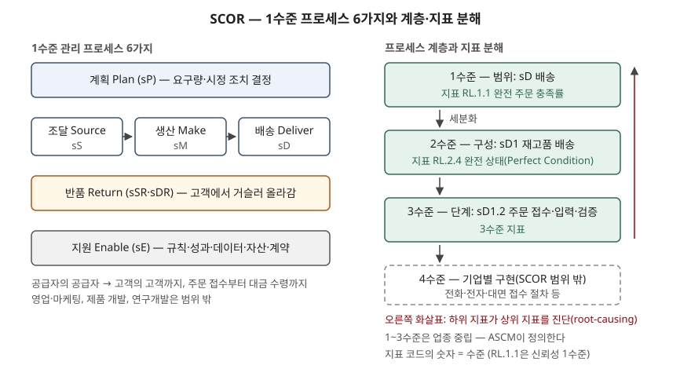

## 들어가며

공급망관리(SCM)를 묻는 기출은 "공급망의 성과를 어떻게 재는가"로 자주 이어진다. 이때 답안에 이름을 대고 쓸 수 있는 거의 유일한 국제 참조 모델이 SCOR다. 실무에서는 여러 회사가 한 공급망에 묶이는데 회사마다 "납기 준수율"의 계산식이 다르면 서로의 숫자를 비교할 수 없다. SCOR는 프로세스 이름과 지표 계산식을 표준으로 정해 이 문제를 푼다.

> 실행 검증 없음. 구조·성과 속성·지표는 ASCM의 SCOR Digital Standard 소개 문서(2020, 이하 "SCOR DS 2020")에서, 1수준 프로세스의 정의 문장은 Supply Chain Council의 SCOR 11.0(2012) 본문에서 옮겼다. 두 판에서 바뀐 부분은 비교 절에 따로 적었다.

## 정의

> SCOR(Supply Chain Operations Reference)는 공급망의 업무 프로세스·성과 지표·실무 관행·인력 역량을 하나의 구조로 묶어, 공급망 파트너가 같은 정의와 측정 방식으로 공급망을 기술·평가·개선하게 하는 **프로세스 참조 모델**이다.

SCOR DS 2020은 SCOR를 업무 프로세스, 지표, 모범 관행, 기술을 "통합된 구조"로 잇는 틀이라고 설명하고(요약 절), 스스로를 프로세스 참조 모델이라고 부른다(구조 절). 프로세스 참조 모델은 핵심 업무 기능·목표에 맞춰 프로세스 아키텍처, 즉 프로세스가 어떻게 상호작용하고 어떻게 구성되며 운영 인력에게 어떤 역량이 필요한지를 정의하는 것이다.

## 등장 배경

SCOR는 1996년에 Supply Chain Council이 만들었고, 2014년 Supply Chain Council과 APICS가 합쳐진 뒤 ASCM(옛 APICS)이 관리한다. 등장 배경은 두 가지로 정리된다.

1. **공통 언어의 부재.** 공급망은 회사 경계를 넘는데, 프로세스 이름과 지표 계산식이 회사마다 달랐다. SCOR DS 2020은 모델이 널리 쓰일수록 공통 정의와 측정으로 의사소통할 수 있고, 같은 지표·용어를 쓰는 소프트웨어가 파트너를 더 잘 지원한다고 적는다.
2. **비교·진단 도구의 필요.** 개선하려면 내 공급망이 어디서 뒤처지는지 알아야 한다. SCOR는 방법론, 진단 도구, 벤치마킹 도구를 함께 제공하는 것을 목표로 둔다(소개 절).

## 구성요소 / 절차

### 모델의 4개 섹션

SCOR DS 2020은 모델이 **4개 주요 섹션**으로 이루어진다고 밝힌다. 검증이 덜 된 확장안을 담는 특수 응용(Special Applications) 절은 따로 둔다.

| 섹션 | 담는 것 |
|---|---|
| 성과(Performance) | 프로세스 성과를 기술하고 전략 목표를 정하는 표준 지표 |
| 프로세스(Processes) | 관리 프로세스와 프로세스 간 관계의 표준 기술 |
| 실무 관행(Practices) | 프로세스 성과를 크게 높이는 관리 관행 |
| 인력(People) | 공급망 프로세스 수행에 필요한 역량(skill)의 표준 정의 |

### 1수준 관리 프로세스 6가지

정의 문장은 SCOR 11.0 본문의 각 프로세스 첫 쪽에서 가져왔다.

| 프로세스 | 코드 | 정의 요지 | 2수준 범주 예 |
|---|---|---|---|
| ① 계획 Plan | sP | 공급망 목표 달성에 필요한 요구량과 시정 조치를 정하는 프로세스 | sP1 공급망 계획 ~ sP5 반품 계획 |
| ② 조달 Source | sS | 원자재·반제품·제품·서비스의 주문, 인도, 수령, 이전 | 재고품·주문생산품·주문설계품 조달 |
| ③ 생산 Make | sM | 혼합·분리·성형·가공·화학 공정으로 제품에 가치를 더함 | 재고생산(MTS)·주문생산(MTO)·주문설계(ETO) |
| ④ 배송 Deliver | sD | 고객 접점의 주문 관리와 주문 이행 | 재고품·MTO·ETO·소매 배송 |
| ⑤ 반품 Return | sSR·sDR | 결함·주문·제조 문제나 유지보수로 자재를 고객에서 공급망 위쪽으로 되돌림 | 결함품·MRO·과잉품 |
| ⑥ 지원 Enable | sE | 공급망 운영에 필요한 정보·관계·자원·자산·업무 규칙·규정 준수·계약을 수립·유지·감시 | 업무 규칙, 성과, 데이터·정보, 위험 관리 등 |

반품은 2수준에서 둘로 갈린다. 내가 돌려보내는 **조달 반품(sSR)**과 고객의 반품을 받는 **배송 반품(sDR)**이다. 범위는 주문 접수부터 대금 수령까지, 공급자의 공급자부터 고객의 고객까지이고, 영업·마케팅·제품 개발·연구개발은 넣지 않는다.

### 프로세스 계층 — 3수준 + 기업별 4수준

| 수준 | 무엇을 정하는가 | 예 | 누가 정의 |
|---|---|---|---|
| 1수준 | 범위 — 6개 프로세스 | sD 배송 | ASCM (업종 중립) |
| 2수준 | 1수준 안의 역량(구성) | sD1 재고품 배송 | ASCM (업종 중립) |
| 3수준 | 정해진 순서로 수행하는 단계 | sD1.2 주문 접수·입력·검증 | ASCM (업종 중립) |
| 4수준 | 업종·제품·장소·기술별 구현 | 전화·전자·대면 주문 접수 절차 | 기업 |

SCOR DS 2020은 ASCM이 위쪽 3개 수준에 집중하며, SCOR로 개선하는 조직은 최소 4수준까지 자기 업종·조직·장소에 맞게 모델을 확장해야 한다고 적는다. 2수준 도식은 창고가 창고에 공급하는 식의 **구조 문제**를, 3수준 도식은 의사결정 지점·트리거·프로세스 단절을 찾는 데 쓴다.

### 성과 — 3요소, 속성 5가지, 1수준 지표 10개

성과 섹션은 **성과 속성, 지표, 프로세스·관행 성숙도 3요소**로 공급망 성과를 이해·평가·진단한다.

| 구분 | 성과 속성 | 정의 | 1수준 지표 |
|---|---|---|---|
| 고객 지향 | ① 신뢰성 Reliability (RL) | 과업을 기대대로 수행하는 능력, 결과의 예측 가능성 | 완전 주문 충족률 RL.1.1 |
| | ② 대응성 Responsiveness (RS) | 과업 수행 속도, 고객에게 제품을 공급하는 속도 | 주문 충족 사이클 타임 RS.1.1 |
| | ③ 민첩성 Agility (AG) | 외부 영향·시장 변화에 대응해 경쟁 우위를 얻거나 유지하는 능력 | 상향 적응력 AG.1.1, 하향 적응력 AG.1.2, 전체 위험 노출 가치 AG.1.3 |
| 내부 지향 | ④ 비용 Cost (CO) | 공급망 프로세스 운영 비용(인건비·재료비·관리비·운송비) | 총 공급망관리 비용 CO.1.1, 매출원가 CO.1.2 |
| | ⑤ 자산관리 Asset Management (AM) | 자산을 효율적으로 활용하는 능력 | 현금 순환 주기 AM.1.1, 고정자산 수익률 AM.1.2, 운전자본 수익률 AM.1.3 |

1수준 지표는 1 + 1 + 3 + 2 + 3 = **10개**다. 모든 SCOR 지표는 다섯 속성 중 하나에 속하고, 속성마다 1수준(전략) 지표가 최소 하나 있다.

### 지표 분해(root-causing)

SCOR 지표는 1·2·3수준의 계층을 이루고, 수준 사이의 관계는 **진단 관계**다. 2수준 지표의 성과를 보면 1수준 지표의 격차나 개선을 설명할 수 있고, 3수준 지표는 2수준 지표를 같은 방식으로 진단한다. SCOR DS 2020은 이런 분석을 **지표 분해 또는 root-causing**이라 부른다. 지표 코드에 수준이 들어 있어 RL.1.1은 신뢰성 1수준, RL.2.4(완전 상태)는 신뢰성 2수준 지표다.

### 실무 관행과 인력

- **실무 관행**: 등급 3가지(신흥 EP, 모범 BP, 표준 SP), 분류 19가지, 영향 기둥 3가지(분석·기술, 프로세스, 조직)
- **인력**: 역량(HS)·경험(HE)·교육(HT)을 코드로 정의하고, 역량 수준을 초보·입문·숙련·능숙·전문가 **5단계**로 본다

## 도식

> **출처**: [SCOR Digital Standard — Introduction and Front Matter (ASCM, 2020) — SCOR process hierarchy, Performance, Processes 절](https://www.ascm.org/globalassets/ascm_website_assets/docs/intro-and-front-matter-scor-digital-standard.pdf)

답안지에는 왼쪽에 Plan을 위에 길게, 그 아래 Source → Make → Deliver를 나란히, 그 아래 Return과 Enable을 길게 그린다. 오른쪽에는 1~4수준 상자를 세로로 쌓고, 아래에서 위로 "진단" 화살표를 붙인다.

## 비교

### ASCM의 다른 참조 모델과의 범위 차이

SCOR DS 2020은 SCOR가 기반으로 삼은 ASCM 프레임워크 묶음을 함께 소개한다. 지금은 보관(archived) 상태이지만, 시험에서 "SCOR가 다루지 않는 것"을 물으면 이 표가 답이 된다.

| 모델 | 다루는 범위 | 1수준 역량 |
|---|---|---|
| SCOR | 고객 수요 충족의 모든 단계 — 기회에서 대금 수령까지 | Plan, Source, Make, Deliver, Return, Enable |
| CCOR | 고객 상호작용 — 잠재 고객에서 계약까지 | Plan, Relate, Sell, Contract, Assist |
| DCOR | 제품·서비스 개발 — 포트폴리오에서 솔루션까지 | Plan, Research, Design, Integrate, Amend |
| PLCOR | 제품 혁신과 포트폴리오 관리 — 아이디어에서 포트폴리오까지 | Plan, Enable, Ideate, Develop, Launch, Revise |

### 판에 따라 바뀐 것

| 항목 | SCOR 11.0 (2012) | SCOR DS 2020 |
|---|---|---|
| 관리 주체 | Supply Chain Council | ASCM |
| 다섯째 속성 이름 | Assets | Asset Management |
| 비용 1수준 지표 | CO.1.001 총 서비스 비용(Total Cost to Serve) | CO.1.1 총 공급망관리 비용, CO.1.2 매출원가 |
| 관행 등급 표기 | Emerging·Best·Standard | EP·BP·SP 코드 부여 |
| 정보 모델 | 없음 | SDSIM 초기 개념(특수 응용, 미완성) |

같은 이름의 지표라도 판마다 코드와 계산 범위가 다를 수 있다. 답안에는 "SCOR DS 2020 기준"처럼 판을 밝힌다. 2020년 이후 판에서 프로세스·속성 구성이 바뀌었는지는 ASCM 공식 사이트가 스크립트로만 열려 이 글에서 확인하지 못했다.

## 적용 시 고려사항

1. **조직도가 아니라 프로세스로 그린다.** SCOR DS 2020은 이 모델이 기능이 아니라 프로세스를 기술한다고 강조한다. "구매팀 = Source"로 옮기면 한 팀이 여러 프로세스에 걸친 사실이 사라지고, 단절 지점을 찾는 3수준 분석이 의미를 잃는다.
2. **4수준과 정보 흐름은 스스로 설계한다.** SCOR는 업무 방식이나 시스템·정보 흐름을 처방하지 않는다. ERP·WMS·TMS의 실제 거래가 어느 3수준 단계에 대응하는지를 매핑해야 지표를 시스템에서 자동으로 뽑을 수 있다.
3. **지표 정의를 데이터 정의로 고정한다.** 완전 주문 충족률 같은 1수준 지표는 여러 시스템의 데이터를 합쳐야 계산된다. 계산식, 원천 테이블, 집계 주기를 파트너와 문서로 맞추지 않으면 "공통 언어"라는 SCOR의 목적이 성립하지 않는다.
4. **성숙도 모델은 따로 고른다.** SCOR는 성숙도 모델을 본문에 넣지 않고 기존 모델을 골라 맞춰 쓰라고 권한다. 지표 값과 프로세스 성숙도를 같은 척도로 섞어 보고하지 않는다.
5. **속성 우선순위는 사업 전략이 정한다.** 성과 속성은 공급망 성과를 사업 전략에 맞춰 우선순위를 정하는 데 쓴다. 다섯 속성을 모두 1등으로 두면 고객 지향 속성과 내부 지향 속성이 부딪치는 지점에서 판단 근거가 없다.

## 정리

- 정의: 프로세스·지표·관행·인력을 하나로 묶은 공급망 **프로세스 참조 모델**(ASCM)
- 섹션 **4개**: 성과·프로세스·관행·인력
- 1수준 프로세스 **6가지**: 계획·조달·생산·배송·반품·지원 → "**계조생배반지**" (P·S·M·D·R·E)
- 계층: ASCM 정의 **3수준**(범위·구성·단계) + 기업별 4수준
- 성과 속성 **5가지**: 신뢰성·대응성·민첩성(고객 지향 3) + 비용·자산관리(내부 지향 2) → "**신대민 비자**", 1수준 지표 **10개**
- 지표 분해: 하위 수준 지표가 상위 지표를 **진단**한다(root-causing)

> 기출 답안: [기출문제 — 공급망관리(SCM)의 정의와 배경, 효과성과 효율성](../../exam/2026-11-22-supply-chain-management-effectiveness-efficiency/index.md)
>
> 관련 개념: [채찍 효과(Bullwhip Effect) — 4가지 원인과 정보 공유 대응](../2026-11-22-bullwhip-effect-four-causes-information-sharing/index.md)

## 참고 자료

- [SCOR Digital Standard — Introduction and Front Matter (ASCM, 2020)](https://www.ascm.org/globalassets/ascm_website_assets/docs/intro-and-front-matter-scor-digital-standard.pdf) — ASCM 프레임워크(Graphic 2), 범위, 프로세스 계층(Graphic 4), 4개 섹션, 성과 속성(Table 1), 1수준 지표(Table 2), 지표 분해, 프로세스·관행·인력 절, v13 개정 사항
- [Supply Chain Operations Reference Model Revision 11.0 (Supply Chain Council, 2012-10) — huihoo 사본 (제3자 전재)](https://docs.huihoo.com/scm/supply-chain-operations-reference-model-r11.0.pdf) — 1수준 프로세스 정의 문장(2.1.1 Plan, 2.2.1 Source, 2.3.1 Make, 2.4 Deliver, 2.5 Return, 2.6.1 Enable)
