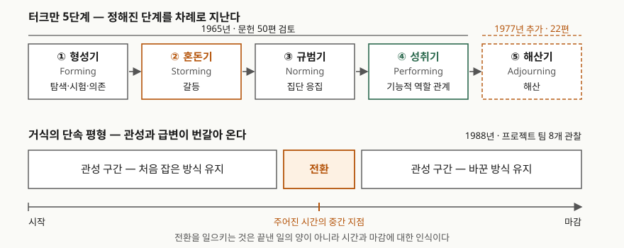

> 실행 검증 없음. 저자가 1984년에 직접 쓴 해설문 전문과, 1977년·1988년·1989년 논문의 초록을
> 근거로 정리했다. 1965년 논문 본문은 구한 사본이 글자 층 없는 스캔본이라 읽지 못했다. 그래서
> 단계별 세부 서술은 저자의 해설문에 적힌 범위까지만 옮겼다.

## 들어가며

프로젝트 관리 문제에서 팀 구성과 갈등을 물으면 터크만 모델이 거의 빠지지 않는다. 착수 직후
설계 회의에서 의견이 부딪칠 때 PM은 "팀이 잘못된 것인가, 원래 거치는 구간인가"를 가려야 하고,
이 모델이 그 판단의 틀로 쓰인다. 다만 답안에서는 단계 이름 다섯 개를 나열하는 데서 그치기 쉽다.
어느 단계가 어느 논문에서 나왔는지, 근거가 무엇이었는지, 다른 모형은 무엇을 다르게 보는지까지
써야 다른 답안과 구별된다.

## 정의

터크만 팀 발달 모델은 **소집단이 형성기(forming)·혼돈기(storming)·규범기(norming)·성취기(performing)를
차례로 거치고 해산기(adjourning)로 끝난다고 보는 5단계 발달 모형**이다. 앞의 4단계는 Tuckman(1965)이,
다섯 번째 단계는 Tuckman·Jensen(1977)이 제시했다.

## 등장 배경

터크만은 1984년 해설문에서 경위를 직접 적었다. 미 해군 의학연구소에서 소집단 행동을 연구하던 때,
상사가 모아 둔 집단 발달 문헌 50편을 넘겨받아 정리한 것이 1965년 논문이다. 해군은 소수 인원이
타는 함정과 기지를 준비하고 있었고, 작은 집단이 시간이 지나며 어떻게 달라지는지에 대한 종합된
설명이 없었다.

50편 가운데 다수는 치료 집단과 T-그룹(감수성 훈련 집단)을 정신분석 관점에서 관찰한 연구였다.
터크만은 집단의 기능을 **두 영역**으로 나눈 뒤, 다수 연구의 결과에 맞는 발달 순서를 찾았다고 적는다.

## 구성요소 — 2개 영역과 5단계

**영역 2가지.** ① 대인 관계 또는 집단 구조 영역, ② 과업 활동 영역이다. 같은 단계라도 사람 사이에서
일어나는 일과 일 자체에서 일어나는 일을 따로 본다.

**단계 5가지.** 가운데 열은 저자가 해설문에서 4단계를 요약한 표현이다.

| 단계 | 저자의 요약 | 출처 | IT 프로젝트에서 보이는 모습 |
|---|---|---|---|
| ① 형성기 | 탐색·시험·의존 | 1965 | 착수 직후. 범위와 역할을 묻고 PM의 지시에 기댄다 |
| ② 혼돈기 | 갈등 | 1965 | 설계 대안, 책임 경계를 두고 의견이 부딪친다 |
| ③ 규범기 | 집단 응집 | 1965 | 개발 표준, 검토 절차에 합의한다 |
| ④ 성취기 | 기능적 역할 관계 | 1965 | 역할이 맞물려 산출물이 나온다 |
| ⑤ 해산기 | 해산 | 1977 | 개발팀이 흩어지고 운영 조직으로 넘긴다 |

마지막 열은 모형을 IT 프로젝트에 대어 본 해석이고 원 논문의 서술이 아니다.

**다섯 번째 단계가 붙은 경위.** 1977년 논문은 학술지의 요청으로 쓴 재검토다. 1965년 이후 나온 연구
22편을 인용 색인으로 찾아 검토했고, 이들이 4단계의 존재를 대체로 뒷받침하면서 다섯 번째 단계를
시사했다고 정리했다. 22편 가운데 이 가설을 직접 검증하려 한 연구는 1편뿐이었고(Runkel 등, 1971),
초록은 실증 연구가 더 필요하다고 권고한다.

## 도식

> **출처**: [Tuckman (1984), This Week's Citation Classic, Current Contents S&BS](https://garfield.library.upenn.edu/classics1984/A1984TD25600001.pdf) — 4단계 요약 표현과 문헌 50편·22편 · [Tuckman & Jensen (1977), Group & Organization Studies 2(4) 초록](https://doi.org/10.1177/105960117700200404) · [Gersick (1988), Academy of Management Journal 31(1) 초록](https://doi.org/10.2307/256496) · [Gersick (1989), Academy of Management Journal 32(2) 초록](https://doi.org/10.2307/256363) — 중간 지점 전환

## 비교 — 단계 모형과 단속 평형 모형

거식(Gersick, 1988)은 실제 프로젝트 팀 8개를 결성부터 종료까지 관찰했다. 초록에 따르면 팀들은
보편적인 단계를 차근차근 밟지 않았다. 일하는 방식이 한동안 그대로 유지되는 관성 구간과 그것이
한꺼번에 바뀌는 구간이 번갈아 나타났고, 저자는 이를 단속 평형(punctuated equilibrium)이라 불렀다.
후속 실험실 연구(1989)는 주어진 시간의 **중간 지점**에서 일어나는 전환을 다시 확인했다.

| 구분 | 터크만 단계 모형 | 거식 단속 평형 모형 |
|---|---|---|
| 근거 | 문헌 50편 검토(1965), 22편 재검토(1977) | 프로젝트 팀 8개 관찰(1988), 실험실 연구(1989) |
| 대상 집단 | 치료 집단·T-그룹 연구가 다수 | 마감이 정해진 과업 집단 |
| 진행 방식 | 정해진 단계를 차례로 지난다 | 관성 구간과 급변이 번갈아 온다 |
| 변화의 계기 | 앞 단계를 거침 | 시간과 마감에 대한 구성원의 인식 |
| 설명하는 것 | 대인 관계와 과업 활동의 상태 | 일하는 방식이 바뀌는 시점 |
| PM이 얻는 것 | 팀 상태 진단, 단계별 리더십 | 일정 중간 점검 시점의 근거 |

두 모형은 서로를 대신하지 않는다. 하나는 팀이 **어떤 상태**에 있는지를, 다른 하나는 **언제** 방식이
바뀌는지를 본다.

## 적용 시 고려사항

1. **근거가 문헌 검토다.** 학술지 편집자는 처음에 검토 대상 연구들의 질이 부족하다며 원고를 반려했다.
   터크만은 그 연구들을 옹호하려는 것이 아니라 추론을 끌어내려는 것이라고 답해 실렸다. 저자 스스로
   가설로 다룬 모형이므로, 프로젝트에서는 법칙이 아니라 진단 틀로 쓴다.
2. **출신 집단이 다르다.** 근거 문헌의 다수가 치료 집단과 T-그룹이다. 일정·예산·산출물이 정해진
   IT 프로젝트 팀에 그대로 대응한다는 보증은 없다. 마감의 영향은 거식 모형이 따로 다룬다.
3. **순서를 고정으로 보지 않는다.** 4단계는 "다수 연구에 맞는" 순서로 뽑은 것이다. 인력이 바뀐 팀을
   어느 단계로 볼지는 모형이 정해 주지 않는다. 이슈 대장의 갈등 건수, 검토 회의록 같은 기록으로 판단한다.
4. **일정 중간에 점검 지점을 둔다.** 단속 평형 모형에 따르면 방식 전환은 중간 지점에 몰린다.
   단계 말 검토와 별도로 중간 점검에서 범위·설계 방향을 다시 확인할 근거가 된다.
5. **해산기를 계획에 넣는다.** 4단계만 쓰면 종료 구간이 빠진다. IT 프로젝트에서는 이 구간에 운영
   이관 문서, 교훈 기록, 계정·권한 회수처럼 정보시스템에 남겨야 할 일이 모인다.

> 기출 답안: [IT 프로젝트 PM의 갈등 관리 — 갈등과 성과의 관계, 갈등 요인과 해결 전략, 터크만 팀 발달 5단계](../../exam/2026-11-26-pm-conflict-management-tuckman/index.md)

## 정리

- 암기 단서는 숫자 넷이다. **50편 → 4단계(1965), 22편 → +1단계(1977), 8팀 → 단속 평형(1988).**
- 단계는 형성·혼돈·규범·성취·해산, 영역은 대인 관계(집단 구조)와 과업 활동 2가지다.
- 한계는 3가지로 쓴다. 문헌 검토 기반, 치료 집단 편중, 직접 검증 연구 부족.
- 비교 대상은 거식의 단속 평형 모형이다. 터크만은 상태를, 거식은 전환 시점을 설명한다.

## 참고 자료

- [Tuckman, B. W. (1965). Developmental sequence in small groups. Psychological Bulletin, 63(6), 384–399.](https://doi.org/10.1037/h0022100)
- [Tuckman, B. W. (1984). This Week's Citation Classic: Developmental sequence in small groups. Current Contents, Social & Behavioral Sciences, p. 14.](https://garfield.library.upenn.edu/classics1984/A1984TD25600001.pdf) — 저자가 쓴 해설문. 문헌 50편, 두 영역, 4단계 요약, 반려 경위, 1977년 재검토
- [Tuckman, B. W., & Jensen, M. A. C. (1977). Stages of small-group development revisited. Group & Organization Studies, 2(4), 419–427.](https://doi.org/10.1177/105960117700200404)
- [Gersick, C. J. G. (1988). Time and transition in work teams: Toward a new model of group development. Academy of Management Journal, 31(1), 9–41.](https://doi.org/10.2307/256496)
- [Gersick, C. J. G. (1989). Marking time: Predictable transitions in task groups. Academy of Management Journal, 32(2), 274–309.](https://doi.org/10.2307/256363)
- Runkel, P. J., Lawrence, M., Oldfield, S., Rider, M., & Clark, C. (1971). Stages of group development: An empirical test of Tuckman's hypothesis. Journal of Applied Behavioral Science, 7, 180–193. — 해설문이 든 직접 검증 연구
