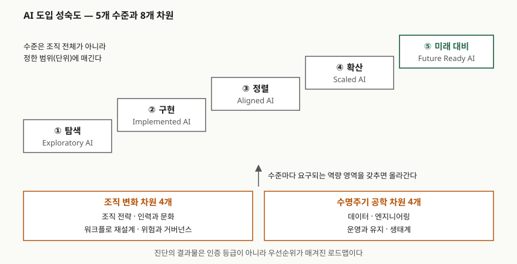

> 실행 검증 없음. 수준과 차원은 카네기멜런대 소프트웨어공학연구소(CMU SEI)의 2025년 12월 예비
> 보고서 본문에서, 기술·데이터 준비 수준은 Microsoft의 AI 도입 지침에서 옮겼다. SEI는 2026년 6월에
> 정식 모형을 공개했는데, 이 글은 예비 보고서에 적힌 범위만 다룬다.

## 들어가며

AI 전환(AX) 추진 절차를 묻는 문제에서 "준비도 진단"은 사용 사례 도출과 우선순위 결정 사이에 한
줄로 지나가기 쉽다. 그런데 실무에서 막히는 곳이 여기다. 개념 검증(PoC)은 성공했는데 다른 부서로
넓히지 못하는 조직은, 데이터가 어디에 어떤 품질로 있는지와 운영할 사람이 있는지를 확인하지 않고
사례부터 골랐다. 답안에서 이 단계를 "현 수준을 평가한다"로만 쓰면 점수가 붙지 않는다. 무엇을
축으로, 몇 단계로 평가하고, 그 결과가 다음 단계의 무엇을 정하는지를 써야 한다.

## 정의

AI 도입 성숙도 진단은 **조직이 AI 관련 실무를 수행하고 유지하는 능력을 차원별로 평가해 단계로
나타내고, 목표 단계와의 차이를 개선 로드맵으로 바꾸는 활동**이다. SEI 보고서는 성숙도 모형을
조직이나 단위가 목표 달성에 필요한 실무를 수행·유지하는 능력을 평가하는 틀이며, 역량이 높아지는
단계를 그려 개선 로드맵을 준다고 설명한다.

준비도(readiness)와 성숙도(maturity)는 문헌에서 엄격히 갈리지 않는다. SEI가 기존 모형을 조사할 때
쓴 검색어에도 두 용어가 함께 들어 있다. 이 글에서는 **지금 이 사용 사례를 시작할 수 있는가**를
묻는 평가를 준비도, **조직의 실무가 어느 단계에 있는가**를 묻는 평가를 성숙도로 나눠 쓴다.

## 등장 배경

성숙도 모형의 원형은 SEI가 소프트웨어 품질 문제를 풀려고 만든 능력 성숙도 모형(CMM)이다.
보고서는 1991년 소프트웨어 CMM에서 2001~2013년의 CMMI로 이어진 계보를 적고, AI 도입 문제도
같은 방식으로 다룰 수 있다고 본다.

AI에 따로 모형이 필요해진 이유로 보고서가 든 실패 원인은 5가지다. 데이터 미비, 사용자 요구에
대한 이해 부족, AI로 풀 문제인지 따지지 않은 것, 인력 부족, 소요 시간 과소평가다. AI 과제를 이끄는
임원 20여 명을 면담한 결과에서는 두 가지가 가장 많이 나왔다. **무엇을 기준선으로 잡아 측정할지
모른다는 것**과 **전사로 넓히지 못한다는 것**이다.

SEI는 기존 문헌 115건을 모아 그중 36건의 모형을 상세히 검토했고, 공통 약점을 3가지로 정리했다.
성숙도를 재는 측정 방법이 분명하지 않고, 새로 생기는 실무 영역을 담지 못하며, 실무 영역을 어디서
뽑았는지 밝히지 않는다는 점이다.

## 구성요소 — 5개 요소, 8개 차원, 5개 수준

**모형의 구성 요소 5가지.** ① 맥락 속성(조직의 규모·규제 수준·AI 개발 방식처럼 평가 범위를
정하는 특성), ② 차원, ③ 역량 영역, ④ 구체 목표, ⑤ 구체 실무다. 차원이 역량 영역을 묶고,
역량 영역마다 목표와 실무가 달린다.

**차원 8가지.** 조직 변화 쪽 4개와 수명주기 공학 쪽 4개로 나뉜다.

| 묶음 | 차원 | 역량 영역의 예 |
|---|---|---|
| 조직 변화 | ① 조직 전략 | AI 전략, 조직 구조 정렬, 협력·조달 |
| | ② 인력과 문화 | 기술·교육, 조직 문화, AI 준비 인력 개발 |
| | ③ 워크플로 재설계 | 실험, 업무 흐름 혁신, 사람 개입 자동화, 측정·분석 |
| | ④ 위험과 거버넌스 | 규정·정책·표준, 위험 관리, 책임 있는 AI |
| 수명주기 공학 | ⑤ 데이터 | 데이터 관리, 획득·품질, 접근·보안·프라이버시 |
| | ⑥ 엔지니어링 | AI 아키텍팅, 기술 통합, 투명성·설명 가능성, 시험·평가 |
| | ⑦ 운영과 유지 | 감시, 운영 데이터 수집, 모델 관리 |
| | ⑧ 생태계 | 공급망 관리, 기술 인프라, 대규모 배포 |

**수준 5가지.**

| 수준 | 상태 | 이 수준에서 갖출 것 |
|---|---|---|
| ① 탐색 | 한정된 사용 사례로 실험하며 배운다 | 실험, 기술·교육 2개 역량 영역 |
| ② 구현 | 일부 AI 시스템·업무 흐름이 운영 환경에 있다 | 데이터 관리 전반, AI 아키텍팅, 측정·분석, 모델 관리 |
| ③ 정렬 | 업무 흐름을 다시 설계하고 AI 과제를 사업 목표에 맞춘다 | 워크플로 재설계, 인력 개발, 위험 관리 절차, AI 전략 |
| ④ 확산 | 예측 가능한 성능으로 새 사용 사례에 되풀이 적용한다 | 대규모 배포, 공급망·협력사 관리 |
| ⑤ 미래 대비 | 분석 기법으로 개선점을 먼저 찾고 새 기술을 빠르게 평가한다 | 조직 역량 관리 |

보고서가 강조하는 것은 낮은 수준의 뜻이다. 실무가 임시방편인지 아닌지가 성숙도를 정하지 않는다.
**범위를 목표에 맞춰 의도적으로 정하고 그 범위의 핵심 실무에 투자하는 것**이 성숙이고, 그래서
① 탐색도 갖춰야 할 역량이 있는 수준이다.

## 도식

> **출처**: [Ozkaya 외 (2025-12), A Preliminary Report on a Model for Maturing AI Adoption, CMU SEI — §3.2 Eight Core Dimensions of Capability, §3.4 AI Adoption Maturity Model Levels, §3.5 Roadmap Development](https://www.sei.cmu.edu/documents/6413/AI-Maturity-Model-Overview.pdf)

## 준비도 평가 항목 — 기술·데이터와 가능한 사용 사례

Microsoft의 AI 도입 지침은 역량 진단 항목에서 조직의 수준을 4단계로 나누고, 수준마다 **필요한
기술, 데이터 준비 상태, 실행 가능한 사용 사례**를 짝지어 둔다.

| 수준 | 필요한 기술 | 데이터 준비 상태 | 실행 가능한 사용 사례 |
|---|---|---|---|
| 1 | AI 기본 개념, 데이터 원천 연결 | 데이터가 거의 없거나 기업 데이터가 있음 | 완제품형 AI 보조 도구 |
| 2 | 모델 선택·배포, 데이터 정제 | 작은 정형 데이터 또는 특정 분야 데이터 | 맞춤 분석, 검색 없는 대화형 앱, 미세 조정 |
| 3 | 프롬프트 설계, 데이터 분할·전처리, 색인 | 대량의 과거 업무 데이터 | 검색 증강 생성(RAG) 앱, 기계학습 모델 학습·배포 |
| 4 | 인프라와 복잡한 학습 흐름을 포함한 고급 기계학습 | 학습용 대량 데이터 | 대규모 모델 학습 |

이 표가 진단과 우선순위를 잇는다. 지침은 사용 사례를 조직의 수준과 자원에 대어 본 뒤 전략적
가치와 실현 가능성으로 순위를 매기고, 수준에 맞는 내부용 고가치 사례를 골라 개념 검증을 하라고
적는다. 모자란 역량을 채우는 길은 3가지다. 내부 육성, 채용, 협력사 활용이다.

## 비교 — 성숙도·준비도 모형 4종

| 구분 | CMMI | SEI AI 도입 성숙도 모형 | Microsoft AI 도입 지침 | Cisco AI 준비도 지수 |
|---|---|---|---|---|
| 평가 대상 | 조직의 프로세스 | AI 도입 실무 | 기술·데이터 수준 | 기업의 AI 대비 정도 |
| 단계 | 성숙도 0~5 (6개) | 5개 수준 | 4개 수준 | 4개 등급 |
| 평가 축 | 실무 영역 | 8개 차원 | 기술, 데이터, 사용 사례 | 6개 축(전략·인프라·데이터·거버넌스·인재·문화) |
| 결과물 | 심사 등급 | 로드맵 | 실행 가능한 사용 사례 범위 | 점수와 등급 |
| 성격 | 범용 프로세스 모형 | 연구 기관 모형 | 벤더 도입 지침 | 벤더 설문 지수 (2차 자료) |

CMMI의 수준 1(초기)은 예측할 수 없고 사후 대응하는 상태를 가리킨다. SEI 모형의 수준 1은 의도를
갖고 실험하는 상태다. 같은 "1단계"라도 뜻이 다르므로 답안에서 두 모형의 단계를 섞어 쓰지 않는다.

## 적용 시 고려사항

1. **진단 범위를 먼저 정한다.** SEI 모형은 수준을 조직 전체가 아니라 단위에 매긴다. 단일 구현,
   사업부, 제품 라인 가운데 어디를 진단하는지 정하지 않으면 부서마다 다른 상태가 평균에 묻힌다.
2. **맥락 속성으로 평가 항목을 좁힌다.** 모델을 직접 만드는 조직과 사서 쓰는 조직은 필요한 역량이
   다르다. 구축·구매·맞춤·혼합 가운데 어느 방식인지에 따라 8개 차원에서 볼 역량 영역을 고른다.
3. **목표 수준을 고른다.** 모형은 어느 수준을 목표로 할지를 조직이 정하게 한다. 완제품형 도구만
   쓸 조직이 수준 4의 학습 인프라를 갖출 이유는 없다.
4. **진단 결과를 사용 사례 선별에 바로 쓴다.** 수준을 넘는 사례는 순위에서 내리거나 역량 확보
   계획과 묶는다. Microsoft 지침은 개념 검증 결과를 반영한 일정에 20~30%의 예비 기간을 두라고 한다.
5. **기준선을 정보시스템에 남긴다.** 임원 면담에서 가장 많이 나온 문제가 기준선 부재였다. 데이터
   자산 목록, 모델 대장, 사용 사례별 성과 지표를 시스템에 기록해 두어야 다음 진단에서 무엇이
   나아졌는지 비교할 수 있다. 이 항목은 보고서의 지적을 정보관리 조직의 일로 옮긴 해석이다.

> 기출 답안: [기출문제 — 기업의 AI 전환(AX): 중요성, 전략적 추진 절차, 장애 요인과 대응](../../exam/2026-11-26-enterprise-ai-transformation-ax-strategy/index.md)

## 정리

- 암기 단서는 **5-8-5**다. 구성 요소 5가지, 차원 8개(조직 변화 4 + 수명주기 공학 4), 수준 5개.
- 수준은 탐색 → 구현 → 정렬 → 확산 → 미래 대비이고, 조직 전체가 아니라 정한 단위에 매긴다.
- 준비도 평가는 기술·데이터·실행 가능한 사용 사례 3열을 4수준으로 맞춘 표로 쓴다.
- 진단의 결과물은 등급이 아니라 로드맵과 사용 사례 우선순위다.
- 기존 AI 성숙도 모형의 공통 약점 3가지는 측정 방법 불명확, 신규 영역 미반영, 근거 불명확이다.

## 참고 자료

- [Ozkaya, I., Carleton, A., Butkovic, M. 외 (2025-12). A Preliminary Report on a Model for Maturing AI Adoption: From Hype to Achieving Repeatable, Predictable Outcomes. CMU Software Engineering Institute. DOI 10.1184/R1/30840476](https://www.sei.cmu.edu/documents/6413/AI-Maturity-Model-Overview.pdf) — 구성 요소, 8개 차원, 5개 수준, 기존 모형 검토
- [Carnegie Mellon University (2026-06), SEI and Accenture release AI Adoption Maturity Model](https://www.cmu.edu/news/stories/archives/2026/june/cmus-software-engineering-institute-and-accenture-release-new-framework-to-help-organizations) — 정식 모형 공개 소식. 정식판의 세부 내용은 이 글에서 확인하지 않았다
- [Microsoft Cloud Adoption Framework, Plan for AI adoption (2026-10-15 갱신)](https://learn.microsoft.com/en-us/azure/cloud-adoption-framework/ai/plan) — 기술·데이터 준비 4수준, 역량 확보 경로, 우선순위와 개념 검증
- [CMMI Institute, CMMI Levels of Capability and Performance](https://cmmiinstitute.com/learning/appraisals/levels) — 성숙도 수준 0~5
- [Cisco AI Readiness Index 2025 — Methodology](https://www.cisco.com/c/m/en_us/solutions/ai/readiness-index/methodology.html) — 6개 축과 4개 등급 (벤더 발간 설문 지수, 2차 자료)
