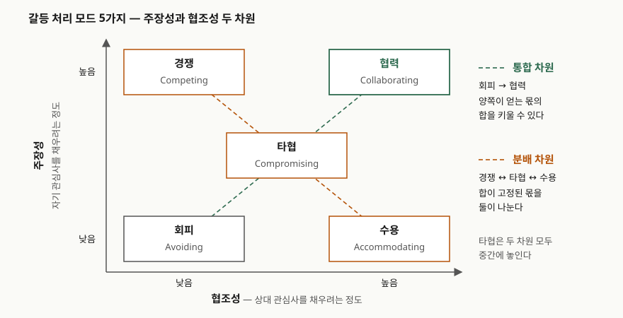

> 실행 검증 없음. 도구의 구성과 수치는 Kilmann·Thomas(1977) 논문 본문에서, 모드를 고르는 조건은
> 공동 개발자 킬만이 쓴 해설 자료에서 옮겼다. 틀을 먼저 제시한 Blake·Mouton(1964)과 Thomas(1976)는
> 원문을 구하지 못해, 1977년 논문이 두 문헌을 설명한 범위까지만 적었다.

## 들어가며

프로젝트 관리 문제에서 갈등 해결 전략을 물으면 "경쟁·협력·타협·회피·수용"이 거의 그대로 나온다.
설계 검토에서 두 아키텍트의 안이 부딪칠 때, PM은 밀어붙일지, 끝까지 논의할지, 절반씩 받을지를
그 자리에서 골라야 하고 이 모형이 그 선택지의 목록이다. 다만 답안이 다섯 이름을 나열하고 "협력이
최선"으로 끝나면 다른 답안과 구별되지 않는다. 다섯이 어떤 두 차원에서 나왔는지, 원래 무엇을
재려고 만든 도구인지, 모드를 고르는 조건이 무엇인지까지 써야 한다.

## 정의

토마스-킬만 모형은 **갈등 상황의 행동을 주장성(assertiveness)과 협조성(cooperativeness) 두 차원에
놓고 경쟁·협력·타협·회피·수용 5가지 모드로 나누는 분류 틀**이다. 이 5모드를 30쌍의 강제 선택
문항으로 재는 자기보고 도구가 토마스-킬만 갈등 모드 도구(TKI)이고, 1977년 논문에서는
MODE(Management-of-Differences Exercise) 도구라고 불렀다.

## 등장 배경

1977년 논문은 첫 문단에서 계보를 밝힌다. 5범주 분류는 Blake·Mouton(1964)이 처음 내놓았고,
Thomas(1976)가 이를 두 차원으로 다시 해석했다. 두 사람이 한 일은 분류를 새로 만든 것이 아니라
**그 분류를 제대로 재는 도구를 만든 것**이다.

당시 5모드를 재는 도구는 3종(Blake-Mouton, Lawrence-Lorsch, Hall)이 있었다. 논문에 따르면 세
도구는 응답자가 "남 보기에 좋은 답"을 고르는 사회적 바람직성 편향에 크게 흔들렸다. 표본의 평균
응답에서 문항 분산의 80% 이상, 모드 점수 분산의 90% 이상이 문항의 바람직성 값으로 설명됐다.
이 상태로는 협력 점수가 높게 나와도 실제 성향인지 좋게 보이려는 응답인지 가를 수 없었다.

## 구성요소 — 2개 차원, 5개 모드, 30쌍 문항

**차원 2가지.** ① 주장성은 자기 관심사를 채우려는 정도, ② 협조성은 상대의 관심사를 채우려는
정도다.

**모드 5가지.** PMBOK 6판 명칭은 프로젝트 팀 관리 절의 갈등 관리 항목(§9.5.2.1)이 든 기법 5가지다.

| 모드 | 주장성 | 협조성 | 문항이 그린 행동 (1977) | PMBOK 6판 명칭 |
|---|---|---|---|---|
| ① 경쟁 competing | 높음 | 낮음 | 자기 입장을 관철하려 한다 | 강요·지시 (force/direct) |
| ② 협력 collaborating | 높음 | 높음 | 상대를 해법 찾기에 참여시키고 양쪽 바람을 모두 채우려 한다 | 협업·문제 해결 (collaborate/problem solve) |
| ③ 타협 compromising | 중간 | 중간 | 중간 지점을 찾거나 양보를 맞바꾼다 | 타협·조정 (compromise/reconcile) |
| ④ 회피 avoiding | 낮음 | 낮음 | 불편한 상황을 만들지 않고 쟁점을 미룬다 | 철수·회피 (withdraw/avoid) |
| ⑤ 수용 accommodating | 낮음 | 높음 | 자기보다 상대의 이익에 마음을 쓴다 | 완화·수용 (smooth/accommodate) |

**도구의 구성.** 논문이 적은 제작 순서는 4단계다. ① 모드마다 10문장씩 50문장을 만든다. ② 대학원생
33명이 각 문장의 바람직성을 9점 척도로 매긴다. ③ 바람직성 평균이 거의 같은 문장끼리 짝짓되,
각 모드가 다른 네 모드와 3번씩 만나도록 **30쌍**을 만든다. ④ 응답이 한쪽으로 쏠린 7쌍을 고쳐
양쪽이 절반씩 선택되게 맞춘다. 응답자는 쌍마다 자기 행동에 가까운 문장 하나를 고르고, 모드
점수는 그 모드의 문장을 고른 횟수이므로 **0~12점**이다. 30번을 고르므로 다섯 점수의 합은 늘 30이다.

**차원을 가로지르는 대각선 2개.** 킬만은 해설 자료에서 모형에 대각선 두 개를 긋는다. 회피에서
협력으로 가는 통합 차원에서는 쟁점을 넓혀 양쪽이 얻는 몫의 합을 키울 수 있다. 경쟁·타협·수용이
놓인 분배 차원에서는 합이 고정돼 있어 한쪽이 더 가지면 다른 쪽이 덜 가진다.

## 도식

> **출처**: [Kilmann & Thomas (1977), Developing a forced-choice measure of conflict-handling behavior: The "MODE" instrument, Educational and Psychological Measurement 37(2), pp. 309–310](https://kilmanndiagnostics.com/wp-content/uploads/2018/07/Kilmann-Thomas-Validating-TKI.pdf) — 두 차원과 5모드의 위치 · [Kilmann, 16 Tips for Using the TKI Tool, pp. 3–6](https://www.themyersbriggs.com/hubfs/MyersBriggsCompany_January2026/pdfs/16%20TKI%20ToolTips.pdf) — 통합 차원과 분배 차원

## 비교 — 같은 5모드를 재는 도구 4종

1977년 논문은 경영대학원생 115명(86명이 네 도구에 응답, 29명이 문항 바람직성 평정)의 자료로
MODE 도구를 기존 도구 3종과 나란히 놓았다.

| 구분 | Blake-Mouton (1964) | Lawrence-Lorsch (1967) | Hall (1969) | MODE (1974) |
|---|---|---|---|---|
| 응답 방식 | 문장 5개에 순위 매기기 | — | — | 30쌍 강제 선택 |
| 소요 시간 | 약 1분 | 약 7분 | 약 50분 | 약 12분 |
| 문항 바람직성과 선택 비율의 상관 | .94 | .88 | .87 | .21 (유의하지 않음) |
| 내적 일관성 평균(알파) | — | .45 | .55 | .60 |

`—`는 논문의 해당 대목에 값이 없는 칸이다. 상관 .21을 분산으로 바꾸면 문항 수준에서 4%이고,
모드 점수 수준에서는 약 17%였다. 기존 도구의 80%·90%대와 비교하면 집단 평균에 끼는 편향은
크게 줄었다.

혼동하기 쉬운 모드 쌍은 **누구의 필요가 얼마나 채워졌는가**로 가른다(킬만 해설 자료).

| 쌍 | 가르는 기준 |
|---|---|
| 회피와 수용 | 수용은 상대의 필요가 채워진다. 회피는 양쪽 모두 채워지지 않는다 |
| 타협과 협력 | 타협은 50/50이든 75/25든 합이 100인 분배다. 협력은 쟁점을 넓혀 양쪽을 모두 채운다 |

## 적용 시 고려사항

1. **점수는 상대 빈도다.** 합이 30으로 고정돼 있어 한 모드가 높으면 다른 모드가 낮아진다. 한 사람
   안에서 어느 모드를 자주 쓰는지를 보여 줄 뿐이므로, 팀원끼리 점수 크기를 견주거나 평가 자료로
   쓰지 않는다.
2. **개인의 편향은 막지 못한다.** 논문은 자신을 좋게 묘사하는 성향이 강한 사람이 네 도구 모두에서
   협력을 더 높게 답했다고 적고, MODE가 이 점에서 더 낫다고 할 수 없다고 인정한다. 내적 일관성도
   중간 수준이다. 진단 결과는 결론이 아니라 대화의 출발 자료로 쓴다.
3. **협력에는 조건 6가지가 붙는다.** 킬만이 든 조건은 감당할 수 있는 수준의 스트레스, 논의할 시간,
   여러 차원으로 넓힐 수 있는 쟁점, 당사자 간 신뢰, 솔직한 발언에 불이익을 주지 않는 문화와 보상
   체계, 방어를 일으키지 않고 말하는 대인 기술이다. 조건이 빠지면 협력은 시간만 쓰고 끝난다.
4. **나머지 모드도 조건으로 고른다.** 경쟁은 사안이 상대보다 나에게 훨씬 중요할 때, 수용은 그
   반대일 때, 타협은 양쪽에 조금씩만 중요하고 시간이 없을 때 맞는다. 회피는 정보를 더 모으거나
   감정이 가라앉기를 기다릴 때는 유효하지만, 양쪽에 중요한 사안을 불편해서 피하는 것은 해롭다.
5. **IT 프로젝트에서는 갈등 유형과 짝지어 읽는다.** 이것은 모형을 프로젝트에 대어 본 해석이다.
   설계안을 둘러싼 과업 갈등은 성능·비용·운영 부담처럼 쟁점을 여러 차원으로 펼칠 수 있어 3의
   조건에 맞는다. 장애 대응처럼 시간이 없는 결정은 4의 경쟁 조건에 가깝다. 어느 모드를 썼든
   결정과 근거를 이슈 대장이나 아키텍처 결정 기록에 남겨야 같은 논쟁이 다시 열리지 않는다.

> 기출 답안: [기출문제 — IT 프로젝트 PM의 갈등 관리: 갈등과 성과의 관계, 갈등 요인과 해결 전략, 터크만 팀 발달 5단계](../../exam/2026-11-26-pm-conflict-management-tuckman/index.md)
>
> 관련 개념: [터크만 팀 발달 5단계 모델](../2026-11-26-tuckman-team-development-five-stages/index.md)

## 정리

- 암기 단서는 **2-5-30-12**다. 차원 2개, 모드 5개, 문항 30쌍, 모드별 최고 12점.
- 모드는 경쟁·협력·타협·회피·수용이고, 타협만 두 차원 모두 중간이다.
- 대각선은 2개다. 통합 차원(회피→협력)은 합을 키우고, 분배 차원(경쟁↔타협↔수용)은 고정된 합을 나눈다.
- 도구가 푼 문제는 사회적 바람직성 편향이다. 문항 분산 기준 80%대에서 4%로 줄였다.
- 답안에서는 "협력이 최선"이 아니라 협력의 조건 6가지와 나머지 모드의 조건을 쓴다.

## 참고 자료

- [Kilmann, R. H., & Thomas, K. W. (1977). Developing a forced-choice measure of conflict-handling behavior: The "MODE" instrument. Educational and Psychological Measurement, 37(2), 309–325.](https://doi.org/10.1177/001316447703700204) · [저자 사이트 게재본](https://kilmanndiagnostics.com/wp-content/uploads/2018/07/Kilmann-Thomas-Validating-TKI.pdf) — 두 차원, 5모드, 30쌍 구성, 기존 도구 3종과의 비교 수치
- [Kilmann, R. H. 16 Tips for Using the TKI Tool for Developing People and Facilitating Conflict Management. The Myers-Briggs Company.](https://www.themyersbriggs.com/hubfs/MyersBriggsCompany_January2026/pdfs/16%20TKI%20ToolTips.pdf) — 통합·분배 차원, 협력의 조건, 모드 쌍 구분. 발행일 표기 없음, 2026-11-27 열람
- [Kilmann, R. H. A Brief Overview of the Thomas-Kilmann Instrument (TKI). Kilmann Diagnostics.](https://kilmanndiagnostics.com/a-brief-overview-tki/) — 두 차원의 정의
- Blake, R. R., & Mouton, J. S. (1964). The Managerial Grid. Houston: Gulf Publishing. — 1977년 논문이 5범주 분류의 첫 제시로 든 문헌
- Thomas, K. W. (1976). Conflict and conflict management. In M. Dunnette (Ed.), Handbook of Industrial and Organizational Psychology (pp. 889–935). Chicago: Rand-McNally. — 두 차원 재해석
- Project Management Institute. (2017). A Guide to the Project Management Body of Knowledge (PMBOK Guide), 6th ed. §9.5.2.1 Conflict Management.
