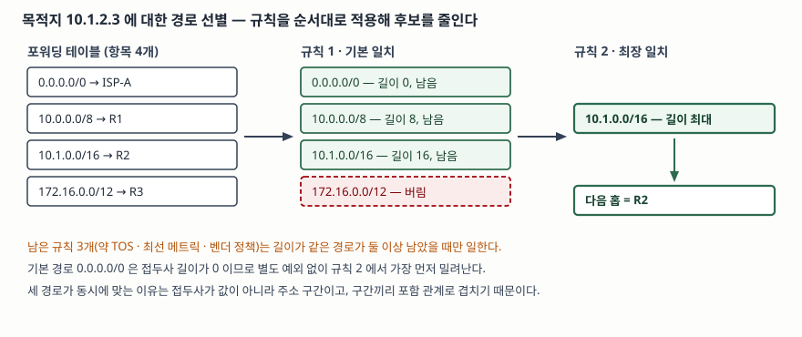

> 실행 검증 없음. 라우터 요구사항 표준(RFC 1812)과 CIDR 표준(RFC 4632), IPv6 포워딩
> 권고(RFC 7608)의 규정만을 근거로 정리했다. 측정값이나 성능 수치는 싣지 않았다.

## 들어가며

라우팅을 묻는 문제는 대개 경로를 **계산하는** 쪽, 곧 거리벡터와 링크상태 프로토콜에
몰려 있다. 그런데 계산이 끝난 뒤에도 일은 남는다. 패킷 하나가 들어올 때마다 그 주소를
들고 테이블에서 다음 홉을 찾아내야 하고, 이 조회는 프로토콜이 수렴한 뒤에도 패킷 수만큼
반복된다. 계산은 몇 초에 한 번이지만 조회는 초당 수백만 번이다.

이 조회가 단순한 표 찾기가 아니라는 데서 문제가 시작된다. 테이블의 항목들이 서로
겹치기 때문이다. 시험에서 이 개념은 단독 용어로도 나오고, 자료구조와 묶여 "왜 이진 탐색
트리를 그대로 못 쓰는가"를 묻는 형태로도 나온다. 어느 쪽이든 답의 출발점은 같다 —
**맞는 항목이 하나가 아니라 여럿이라는 사실**이다.

## 정의

**최장 접두사 일치(Longest Prefix Match)는 목적지 주소와 맞는 포워딩 테이블 항목이
여럿일 때 접두사 길이가 가장 긴 항목을 선택하는 경로 선별 규칙이다.**

표준의 문장으로는 두 군데에서 확인된다. 라우터 요구사항 표준은 전달 규칙을 정하는 절
(RFC 1812 §2.2.5.2)에서 라우터가 목적지와 맞는 경로 중 **가장 구체적인 것, 곧 가장 긴
네트워크 접두사**를 써야 한다고 적는다. CIDR 표준은 경로 광고 규칙 절(RFC 4632 §5.1)의
첫 번째 규칙에서 인터넷의 전달이 최장 일치를 기준으로 이뤄진다고 못 박는다.

답안 첫 줄에 쓸 때는 **"맞는 항목이 여럿"**이라는 전제를 정의 안에 넣는 편이 낫다.
그 전제가 빠지면 뒤에 이어지는 설명이 전부 근거를 잃는다.

## 등장 배경

접두사 길이가 가변이 된 것이 이 규칙이 필요해진 직접적인 계기다.

클래스 기반 주소 체계에서는 접두사 길이가 8·16·24 세 가지로 고정돼 있었고, 길이는
주소의 상위 비트를 보면 바로 알 수 있었다. 길이를 알면 네트워크 부분이 결정되므로
조회는 **그 네트워크 번호와 정확히 같은 항목**을 찾는 일이 된다. 해시 테이블 하나로
끝나는 문제였다.

이 체계는 두 가지를 동시에 낭비했다. 호스트 수백 대를 쓰는 조직이 클래스 B 하나를 받아
주소 6만여 개를 묶어 두거나, 클래스 C 여러 개를 받아 **경로를 그 개수만큼 광고**했다.
클래스 없는 도메인 간 라우팅(CIDR)이 도입되면서 접두사 길이는 0부터 32까지 어느 값이든
될 수 있게 됐다. CIDR 표준이 표기법을 정의한 절(RFC 4632 §3.1)에서 슬래시 뒤의 값을
0에서 32 사이의 십진수로 정한 것이 그 변화다.

길이를 자유롭게 쓸 수 있게 되자 **집약(aggregation)** 이 가능해졌다. 같은 표준이
주소 할당과 경로 집약을 다루는 절(RFC 4632 §4)에서 집약을 라우팅 상태를 줄이는 유일하게
통용되는 방법으로 든다. 사업자가 고객들에게 하나의 큰 블록을 나눠 주면 바깥으로는
그 블록 하나만 광고하면 된다.

그런데 집약은 그 자체로 **겹침을 만든다.** 블록 전체를 광고하면서 그 안의 일부
고객이 다른 경로를 쓰면, 넓은 접두사와 좁은 접두사가 한 테이블에 공존한다. 조직이
둘 이상의 사업자에 연결된 경우가 대표적이다. 같은 절은 그런 조직의 경로 정보를 어느 한
사업자의 주소 공간으로 집약하는 것이 대개 불가능하다고 적는다. 그래서 **집약이 주는
이득과 겹침이 만드는 모호함을 함께 받아들이고, 모호함을 푸는 규칙을 둔 것**이 최장
접두사 일치다.

## 구성요소 / 절차

### 포워딩 테이블 항목의 구성요소 — 3가지

라우터 요구사항 표준은 경로 데이터베이스를 라우팅 테이블 또는 포워딩 테이블이라고
부른다(RFC 1812 §2.2.3). 한 항목이 가지는 것은 셋이다.

① **접두사** — 주소 값과 길이의 쌍. 길이가 주소 범위를 결정한다
② **다음 홉** — 이 항목이 선택됐을 때 패킷을 넘길 상대
③ **부가 속성** — 메트릭, 서비스 유형(TOS), 출발한 라우팅 도메인

①이 키이고 ②가 값이며, ③은 ①로 후보를 좁히고도 둘 이상이 남았을 때 쓰인다.

### 다음 홉 선정 절차 — 5단계

다음 홉 주소를 정하는 절(RFC 1812 §5.2.4.3)은 후보 집합에 규칙을 **순서대로** 적용해
걸러 내라고 정한다. 단계는 다섯이다.

| 순서 | 규칙 | 거르는 기준 |
|---|---|---|
| 1 | 기본 일치 (Basic Match) | 접두사가 목적지 주소와 맞지 않는 경로를 버린다 |
| 2 | 최장 일치 (Longest Match) | 남은 것 중 접두사 길이가 가장 긴 것만 남긴다 |
| 3 | 약 TOS (Weak TOS) | 패킷의 TOS와 맞는 경로를 남기고, 없으면 기본 TOS 경로를 남긴다 (선택 구현) |
| 4 | 최선 메트릭 (Best Metric) | 같은 라우팅 도메인 안에서 메트릭이 확실히 열등한 경로를 버린다 |
| 5 | 벤더 정책 (Vendor Policy) | 구현이 정의하는 마지막 결정 규칙 |

여기서 셋을 읽어야 한다. 첫째, **최장 일치는 독립된 규칙이 아니라 순서 안의 2단계**다.
기본 일치로 맞지 않는 것을 먼저 버리므로, 최장 일치가 보는 후보는 이미 전부 "맞는"
경로다. 둘째, **기본 경로는 예외 장치가 아니다.** 같은 절은 기본 경로를 접두사 길이가
0인 경로라고 정의한다. 모든 주소와 맞으므로 1단계는 통과하지만 길이가 가장 작으므로
2단계에서 가장 먼저 밀려나고, 다른 후보가 하나도 없을 때만 남는다. 규칙 하나로 통상
경로와 기본 경로가 함께 처리되는 설계다. 셋째, **3~5단계는 2단계에서 길이가 같은 경로가
둘 이상 남았을 때만 일한다.** 답안에서 이 조건을 빼면 다섯 단계가 매번 다 도는 것처럼
읽힌다.

> **출처**: [RFC 1812 §5.2.4.3 Next Hop Address](https://www.rfc-editor.org/rfc/rfc1812.txt), [RFC 4632 §5.1 Rules for Route Advertisement](https://www.rfc-editor.org/rfc/rfc4632.txt)

## 비교

### 정확 일치 탐색과 무엇이 다른가

| 구분 | 정확 일치 탐색 | 최장 접두사 일치 탐색 |
|---|---|---|
| 키의 모양 | 값 하나(점) | 주소 구간(접두사 + 길이) |
| 키끼리의 관계 | 배타적, 겹치지 않는다 | 포함 관계로 겹친다 |
| 맞는 항목 수 | 많아야 1개 | 여럿. 최대 W + 1개 (W = 주소 비트 수) |
| 멈추는 시점 | 찾는 즉시 | 더 긴 것이 없음을 확인한 뒤 |
| 비교 결과의 쓸모 | 같다 / 다르다로 끝 | 같은지만으로는 포함 여부를 알 수 없다 |
| 쓸 수 있는 구조 | 해시 테이블, 이진 탐색 트리 | 트라이 계열, 구간 끝점 배열, 길이별 해시 |
| 비용의 지배 변수 | 항목 수 N | 항목 수 N 과 주소 비트 수 W |

네 번째 행이 핵심이다. 정확 일치는 찾는 순간 멈출 수 있지만 최장 접두사 일치는
**"더 긴 것이 없다"는 사실을 확인해야 끝난다.** 이 차이 때문에 해시 테이블을 그대로
쓸 수 없다. 해시는 키 하나를 던져 있는지 없는지만 답하므로, 길이를 모르는 상태에서는
어떤 키를 던져야 하는지부터 정해지지 않는다.

다섯 번째 행도 답안에서 점수가 되는 자리다. 10.1.0.0/16과 10.1.0.0/24는 주소 값이
같고 길이만 다르다. 값만 비교하는 구조는 둘을 구분하지 못한다.

### 비슷한 선별 규칙과의 대비

| 규칙 | 선택 기준 | 쓰이는 곳 |
|---|---|---|
| 최장 접두사 일치 | 접두사 길이가 최대인 것 | IP 포워딩 테이블 |
| 첫 일치 (First Match) | 목록에서 먼저 나온 것 | 패킷 필터, 접근 제어 목록 |
| 최우선 순위 일치 | 규칙에 붙은 우선순위 값이 높은 것 | 정책 기반 라우팅, 분류기 |

셋을 가르는 것은 **순서가 어디서 오는가**다. 첫 일치는 관리자가 적은 줄 순서가 곧
우선순위이므로 줄을 바꾸면 동작이 바뀐다. 최장 접두사 일치는 순서가 **접두사 길이라는
데이터 자체의 성질**에서 나오므로 항목을 어떤 순서로 넣든 결과가 같다. 분산된 라우터들이
같은 테이블을 독립적으로 만들어도 같은 판정을 내릴 수 있는 이유다.

## 적용 시 고려사항

**① 접두사 길이에 상한이나 하한을 설계로 박지 않는다.** IPv6 포워딩 권고의 권고 절
(RFC 7608 §2)은 전달 결정 과정이 설계상 IPv6 접두사 길이를 제한해서는 안 되며, /128까지
1씩 증가하는 모든 길이를 처리하도록 설계해야 한다고 규정한다. 길이를 몇 가지로 가정하고
자료구조를 최적화하면 그 가정이 깨질 때 전달이 틀린다. 운영 정책으로 광고 길이를 거르는
것과, 구현이 길이를 처리하지 못하는 것은 전혀 다른 문제다.

**② 집약 경로에는 버림 경로를 함께 둔다.** 경로 광고 규칙의 두 번째 규칙(RFC 4632 §5.1)은
여러 구체 경로를 묶어 집약 경로를 만드는 라우터가, 집약 경로에는 맞지만 어느 구체
경로에도 맞지 않는 패킷을 **버려야** 한다고 정한다. 그러지 않으면 집약 블록 안의 도달
불가능한 주소로 가는 패킷이 상류와 하류 사이를 오가며 전달 루프를 만든다. 최장 접두사
일치는 "맞는 것 중 가장 긴 것"을 고를 뿐 **"맞는 것이 실제로 도달 가능한가"는 보지
않기** 때문이다.

**③ 조회 비용의 지배 변수가 N인지 W인지 먼저 정한다.** 최장 접두사 일치 구조의 비용은
항목 수 N과 주소 비트 수 W 두 변수로 표기된다. IPv4에서 테이블이 클 때와 IPv6에서 주소가
길 때는 유리한 구조가 서로 다르다. 복잡도 표기만 보고 고르면 지배 변수가 뒤바뀐 선택을
하게 된다.

**④ 테이블 갱신과 조회가 같은 구조를 공유한다는 점을 설계에 넣는다.** 경로는 프로토콜이
수렴할 때마다 바뀌고, 조회는 그 사이에도 계속된다. 조회를 빠르게 하려고 전처리를 많이
해 두는 구조는 갱신이 잦을 때 그 이득을 되돌려준다. 갱신 빈도를 요구사항으로 먼저 적고
구조를 고르는 순서가 맞다.

## 정리

- **정의 한 줄** — 맞는 항목이 여럿일 때 접두사 길이가 가장 긴 것을 고르는 규칙
- **왜 겹치는가** — 접두사 길이가 가변이 되어 집약이 가능해졌고, 집약은 넓은 접두사와
  좁은 접두사를 한 테이블에 공존시킨다
- **절차 5단계** — 기본 일치 → 최장 일치 → 약 TOS → 최선 메트릭 → 벤더 정책.
  최장 일치는 **2단계**이고, 기본 경로는 **길이 0인 경로**로 이 규칙 안에서 처리된다
- **정확 일치와의 차이 2가지** — 맞는 항목이 여럿이라 찾는 즉시 멈출 수 없고, 값 비교만으로는
  포함 관계를 알 수 없다
- **암기 단서** — 규칙 순서는 **기·최·약·최·벤**(기본 일치·최장 일치·약 TOS·최선 메트릭·벤더 정책)

> 기출 답안: [기출문제 — 이진 탐색 트리와 라우팅 테이블 탐색 알고리즘의 상관관계](../../exam/2026-10-20-bst-and-routing-table-lookup/index.md)

> 같이 읽을 글: [트라이와 PATRICIA — 비교 대신 비트로 분기하는 탐색 구조](../../software-engineering/2026-10-25-trie-and-patricia-bit-branching/index.md) — 이 규칙을 실제로 푸는 자료구조
>
> 같이 읽을 글: [라우팅 프로토콜 — 거리벡터와 링크상태](../2026-09-28-routing-distance-vector-vs-link-state/index.md) — 이 글이 다루는 조회는 그쪽 프로토콜이 경로 계산을 끝낸 뒤의 단계다

## 참고 자료

- [RFC 1812, Requirements for IP Version 4 Routers (1995-06)](https://www.rfc-editor.org/rfc/rfc1812.txt) — §2.2.3 경로 데이터베이스를 라우팅 테이블·포워딩 테이블로 부른다는 정의, §2.2.5.2 가장 긴 네트워크 접두사를 쓰라는 요구, §5.2.4.3 Next Hop Address 의 다섯 가지 선별 규칙과 접두사 길이 0인 기본 경로 정의
- [RFC 4632, Classless Inter-domain Routing (CIDR): The Internet Address Assignment and Aggregation Plan (2006-08, BCP 122)](https://www.rfc-editor.org/rfc/rfc4632.txt) — §3.1 접두사 표기와 0~32 길이, §4 집약이 라우팅 상태를 줄이는 방법이라는 서술과 다중 연결 조직의 집약 한계, §5.1 최장 일치 기반 전달과 집약 경로의 버림 규칙
- [RFC 7608, IPv6 Prefix Length Recommendation for Forwarding (2015-07, BCP 198)](https://www.rfc-editor.org/rfc/rfc7608.html) — §2 전달 결정 과정이 접두사 길이를 설계로 제한해서는 안 되며 /128까지 1씩 모든 길이를 처리해야 한다는 규정
- [RFC 1519, Classless Inter-Domain Routing (CIDR): an Address Assignment and Aggregation Strategy (1993-09)](https://www.rfc-editor.org/rfc/rfc1519.txt) — CIDR 의 최초 규격. RFC 4632 가 이를 대체한다
