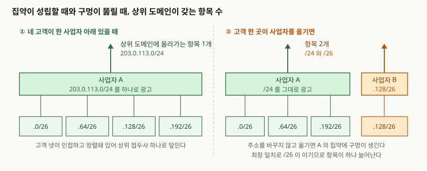

## 들어가며

주소 체계를 묻는 문제는 대개 "클래스 A·B·C가 무엇인가"로 시작하지만, 점수가 붙는
곳은 그다음이다. **그 체계가 왜 버려졌는가**, 그리고 **대체물이 무엇을 대가로 치르는가**
두 가지다. CIDR을 "접두사 길이를 임의로 쓰는 것"까지만 쓰면 절반만 쓴 답안이 된다.

실무에서 이 개념이 드러나는 자리는 주소 설계가 아니라 **광고 설계**다. 고객에게 주소를
떼어 주는 일은 산수지만, 그 주소를 상위로 어떻게 광고할지는 선택이고 그 선택이 전역
라우팅 테이블의 항목 수를 결정한다. 그리고 그 선택은 고객이 사업자를 옮기는 순간 깨진다.
이 글은 집약이 성립하는 조건과 깨지는 지점을 표준 근거와 계산으로 정리한다.

## 정의

**CIDR(Classless Inter-Domain Routing)은 네트워크 접두사의 길이를 주소 클래스에서
떼어 내 임의 길이로 지정하고, 인접하고 정렬된 접두사들을 상위 접두사 하나로 묶어
광고하는 주소 할당·집약 방식이다.**

표기법은 CIDR 표준의 기본 개념 절(RFC 4632 §3.1)이 정한다. 주소 뒤에 `/`를 붙이고
**유효 비트 수를 0에서 32 사이의 십진수로 적는다.** `203.0.113.0/24`가 그 형태다.
클래스 체계에서는 주소의 상위 비트가 길이를 결정했지만, CIDR에서는 길이가 주소와 함께
따로 전달된다. 답안에서는 이 **"길이를 주소에서 읽지 않고 따로 받는다"**를 정의 안에
넣는 편이 낫다. 클래스리스라는 말의 내용이 그것이다.

## 등장 배경

CIDR 표준은 문제 상황을 적은 절(RFC 4632 §2)에서 **세 가지 문제**를 든다.

1. **클래스 B 주소 공간의 고갈**
2. **라우터의 라우팅 테이블이 현재의 소프트웨어·하드웨어·사람이 감당할 수 있는 범위를
   넘어 증가**
3. **32비트 IPv4 주소 공간 자체의 고갈**

문서는 **CIDR이 앞의 둘을 다루고, 세 번째는 풀려 하지 않는다**고 밝힌다. 답안에서
이 구분을 빼면 "CIDR이 주소 고갈을 해결했다"는 틀린 문장이 된다.

첫 번째 문제의 원인도 같은 절이 적는다. **중간 규모 조직에 맞는 크기의 네트워크 클래스가
없었다**는 것이다. 클래스 A·B·C는 주소의 상위 비트로 길이가 정해지는 세 단계뿐이었고
(RFC 791 §3.2), 호스트를 65534대까지 담는 클래스 B는 대부분의 조직에 지나치게 크지만
서브네팅과 함께 쓰기에는 그나마 가장 나은 선택이었다. 그래서 작은 조직에도 B가
나갔고 B가 먼저 말랐다.

두 번째 문제는 첫 번째를 피하려다 커졌다. B 대신 클래스 C를 여러 개 묶어 주면 조직
하나가 라우팅 테이블에 항목을 여러 개 만든다. 이 묶음을 상위 접두사 하나로 광고하자는
발상이 1992년의 슈퍼네팅(RFC 1338)이고, 이듬해 CIDR 규격(RFC 1519)으로 정리된 뒤
2006년에 지금의 표준(RFC 4632, BCP 122)이 그것을 대체했다.

## 구성요소 — 집약 조건 3가지와 광고 규칙 2가지

**집약이 성립하는 조건은 3가지다.** 셋 중 하나라도 어긋나면 묶이지 않는다.

1. **인접** — 묶을 접두사들이 주소 공간에서 빈틈 없이 붙어 있어야 한다
2. **정렬** — 묶은 전체가 상위 접두사 크기의 배수 자리에서 시작해야 한다
3. **완전성** — 상위 접두사가 덮는 범위가 전부 채워져 있어야 한다. 비면 그 구간은
   가지지도 않은 주소를 광고하는 것이 된다

2번은 [VLSM 글](../2026-10-28-vlsm-variable-length-subnet-mask/index.md)의 배치 규칙과
같은 뿌리다. 접두사가 곧 마스크이므로 블록은 자기 크기의 배수 자리에서만 시작한다.

**경로를 광고할 때 지킬 규칙은 2가지다**(RFC 4632 §5.1).

- **규칙 1** — 인터넷의 전달은 최장 일치로 이뤄지므로, **어떤 라우팅 도메인에 대해
  다중 귀속인 목적지는 그 도메인에 반드시 명시적으로 광고해야 한다.** 요약할 수 없다
- **규칙 2** — **집약 경로를 생성하는 라우터는 집약에는 맞지만 더 구체적인 경로에는
  맞지 않는 패킷을 버려야 한다.** 집약이 덮는 주소 중 도달할 수 없는 것이 있을 때
  전달 루프가 생기는 것을 막기 위해서다

## 구조



> **출처**: [RFC 4632, Classless Inter-domain Routing (CIDR): The Internet Address Assignment and Aggregation Plan §4.1 Aggregation Efficiency and Limitations, §4.2 Distributed Assignment of Address Space, §5.1 Rules for Route Advertisement (2006-08, BCP 122)](https://www.rfc-editor.org/rfc/rfc4632.txt) — 위임받은 공간을 상위로 하나로 광고하는 구조, 다중 귀속 목적지를 요약할 수 없다는 규칙, 사업자를 바꾸면 원래 사업자의 집약에 구멍이 생긴다는 서술. 도식의 주소는 문서용으로 예약된 TEST-NET-3(RFC 5737)를 썼다

집약의 효과는 **위임 구조가 토폴로지를 따라갈 때만** 나온다. 사업자가 받은 블록을
고객에게 쪼개 주고 고객이 그 사업자를 통해서만 인터넷에 붙으면, 상위 도메인은 고객
각각을 알 필요가 없다. 반대로 고객이 두 사업자에 붙으면 상위 도메인이 두 경로를 모두
알아야 하므로 그 고객은 집약 밖으로 나온다.

## 실습 예제

`ipaddress` 표준 라이브러리로 집약을 계산했다. 전체 코드는
[`code/aggregate.py`](code/aggregate.py)에 있다.

```text
[사업자가 203.0.113.0/24 를 고객 넷에게 /26 씩 위임]
  203.0.113.0/26
  203.0.113.64/26
  203.0.113.128/26
  203.0.113.192/26
  -> 집약 결과 4개에서 1개로: 203.0.113.0/24

[쪼갠 단위에 따른 항목 수]
  /24 를 /26 단위로 위임 -> 개별 광고     4개 / 집약 광고 1개
  /20 를 /24 단위로 위임 -> 개별 광고    16개 / 집약 광고 1개
  /16 를 /24 단위로 위임 -> 개별 광고   256개 / 집약 광고 1개
  /12 를 /24 단위로 위임 -> 개별 광고  4096개 / 집약 광고 1개
```

줄어드는 비율은 위임 단위와 블록 크기의 차이가 결정한다. **쪼갠 조각이 많을수록 집약의
이득이 크다**는 뜻이고, 이것이 주소를 토폴로지를 따라 위임하자는 분산 할당(§4.2)의
근거다.

인접과 정렬이 깨지면 묶이지 않는다. 서로 떨어진 블록 셋을 억지로 하나로 덮으면 이렇게 된다.

```text
[서로 떨어진 세 블록]
  203.0.113.0/24
  192.0.2.0/24
  198.51.100.0/24
  -> 집약 결과 3개에서 3개로: 192.0.2.0/24, 198.51.100.0/24, 203.0.113.0/24

  억지로 하나로 덮으면 192.0.0.0/4 — 주소 268,435,456개를 덮는다
  그 중 실제로 가진 것은 768개뿐이다
```

가지지 않은 주소 2억 6천만 개를 자기 쪽으로 끌어오는 광고가 되므로 쓸 수 없다. 집약은
**항목 수를 줄이는 대신 광고 범위를 넓히는 거래**이고, 넓어진 범위가 실제 보유 범위를
넘지 않아야 한다는 것이 조건 3개의 뜻이다.

고객 한 곳이 주소를 그대로 들고 사업자를 옮기면 구멍이 생긴다.

```text
[고객 한 곳이 사업자를 옮겼을 때]
  원 사업자가 광고하는 집약  : 203.0.113.0/24
  새 사업자가 광고하는 구체  : 203.0.113.128/26
  -> 전역 테이블 항목 1개에서 2개로 늘어난다
  203.0.113.130 는 2개 경로에 맞고, 최장 일치는 203.0.113.128/26 이다
```

표준은 이 상황을 **원래 사업자의 집약에 구멍을 뚫는 것**으로 적고, 사업자를 바꾸는
조직은 **결국 새 사업자의 주소 공간으로 옮겨 가는 계획을 세우라고 권고한다**(§4.1).

## 비교 — 클래스 체계와의 대비

| 축 | 클래스 체계 (RFC 791 §3.2) | CIDR (RFC 4632) |
|---|---|---|
| 접두사 길이 | 주소의 상위 비트가 결정. 8·16·24 세 단계 | 0~32 임의 길이. 주소와 따로 전달된다(§3.1) |
| 할당 단위 | 클래스 하나가 최소 단위 | 필요한 크기의 2의 거듭제곱 블록 |
| 중간 규모 조직 | 맞는 크기가 없어 B가 나갔다(§2) | 필요한 길이로 맞춘다 |
| 라우팅 항목 | 할당 하나가 항목 하나 | 인접·정렬된 할당을 하나로 묶는다 |
| 전달 규칙 | 클래스로 길이를 알 수 있다 | 최장 일치로 가린다(§5.1 규칙 1) |
| 해결하지 못한 것 | — | **32비트 주소 공간 고갈**(§2, 명시적으로 범위 밖) |

## 적용 시 고려사항

**① 다중 귀속 고객은 집약에서 빼고 센다.** 두 사업자에 붙은 조직의 라우팅 정보는
**어느 한쪽의 주소 공간으로도 집약하기 어렵다**고 표준이 적는다(§4.1). 설계 단계에서
다중 귀속 고객 수를 세어 두면 집약 후 항목 수를 미리 알 수 있다.

**② 사업자 변경은 재부여 계획과 묶는다.** 주소를 들고 옮기면 전역 테이블에 항목이
하나 더 생기고, 그 비용은 옮긴 조직이 아니라 전체가 나눠 진다. 표준의 권고(§4.1)대로
이전 시점에 재부여 일정을 함께 정한다.

**③ 집약을 광고하는 라우터에 널 경로를 둔다.** 규칙 2를 지키지 않으면 아직 배정하지
않은 구간으로 온 패킷이 집약을 따라 들어왔다가 기본 경로로 되돌아 나가면서 루프를
만든다. 예제의 마지막 구간이 그 자리다.

**④ 접두사 필터 형식을 합의한다.** 표준은 필터 표기 형식을 따로 다루는 절(§5.3)을
두고 있다. 같은 의도를 장비마다 다르게 적으면 한쪽에서만 걸러진다. 피어링 설정은
형식을 먼저 맞추고 시작한다.

**⑤ IPv6에서도 같은 원리가 적용되지만 길이를 제한하지 않는다.** IPv6 전달 접두사 길이
권고(RFC 7608, BCP 198 §2)는 전달 결정 과정이 접두사 길이를 설계로 제한해서는 안 되며
/128까지 1씩 모든 길이를 처리해야 한다고 규정한다. 집약은 할당 정책으로 하고, 전달
장비는 어떤 길이든 받아야 한다는 뜻이다.

## 정리

- **정의 한 줄** — 접두사 길이를 클래스에서 떼어 임의 길이로 지정하고, 인접·정렬된
  접두사를 상위 하나로 묶어 광고하는 주소 할당·집약 방식
- **푼 문제 2가지 / 못 푼 문제 1가지** — 클래스 B 고갈과 라우팅 테이블 증가를 다루고,
  **32비트 주소 공간 고갈은 범위 밖**이다(§2)
- **집약 조건 3가지** — 인접 · 정렬 · 완전성
- **광고 규칙 2가지** — 다중 귀속 목적지는 명시적으로 광고한다, 집약에만 맞는 패킷은
  버린다(§5.1)
- **깨지는 지점 2가지** — 다중 귀속, 주소를 들고 하는 사업자 변경
- **암기 단서** — 조건은 **인·정·완**, 규칙은 **"다중 귀속은 드러내고, 빈 구간은 버린다"**

> **실행 검증 범위**: 집약 결과와 항목 수는 파이썬 표준 라이브러리 `ipaddress`로 직접
> 계산해 [`code/output.txt`](code/output.txt)에 기록을 남겼다. 실제 전역 라우팅 테이블의
> 규모나 장비 동작은 측정하지 않았고, 표준 문서 근거만 인용했다.

> 기출 답안: [기출문제 — 서브네팅과 슈퍼네팅, /22를 네 팀에 VLSM으로 나누기](../../exam/2026-10-23-subnetting-supernetting-vlsm/index.md)

> 같이 읽을 글: [VLSM — 가변 길이 서브넷 마스크](../2026-10-28-vlsm-variable-length-subnet-mask/index.md) — 같은 정렬 규칙을 조직 안의 서브넷 배치에 적용한 쪽
>
> 같이 읽을 글: [최장 접두사 일치와 포워딩 테이블 탐색](../2026-10-25-longest-prefix-match-forwarding-lookup/index.md) — 집약 경로와 구체 경로가 겹칠 때 하나를 고르는 규칙

## 참고 자료

- [RFC 4632, Classless Inter-domain Routing (CIDR): The Internet Address Assignment and Aggregation Plan (2006-08, BCP 122)](https://www.rfc-editor.org/rfc/rfc4632.txt) — §2 세 가지 문제와 중간 규모 조직에 맞는 클래스가 없었다는 원인 분석, §3.1 접두사 표기와 0~32 유효 비트 정의, §4.1 집약 효율과 다중 귀속·사업자 변경의 한계, §4.2 주소 공간의 분산 할당, §5.1 경로 광고 규칙 2가지, §5.3 접두사 필터 형식, §9 전역 라우팅 상태에 미친 영향 분석. RFC 1519를 대체한다
- [RFC 791, Internet Protocol (1981-09)](https://www.rfc-editor.org/rfc/rfc791.txt) — §3.2 상위 비트로 클래스 A·B·C를 가르는 원래의 주소 체계
- [RFC 1338, Supernetting: an Address Assignment and Aggregation Strategy (1992-06)](https://www.rfc-editor.org/rfc/rfc1338.txt) — 클래스 C 묶음을 상위 접두사 하나로 광고하자는 최초 제안
- [RFC 1519, Classless Inter-Domain Routing (CIDR): an Address Assignment and Aggregation Strategy (1993-09)](https://www.rfc-editor.org/rfc/rfc1519.txt) — CIDR 최초 규격. RFC 4632가 대체한다
- [RFC 7608, IPv6 Prefix Length Recommendation for Forwarding (2015-07, BCP 198)](https://www.rfc-editor.org/rfc/rfc7608.html) — §2 전달 결정이 접두사 길이를 설계로 제한해서는 안 된다는 규정
- [RFC 5737, IPv4 Address Blocks Reserved for Documentation (2010-01)](https://www.rfc-editor.org/rfc/rfc5737.txt) — 예제에 쓴 세 블록의 예약 근거
- [Python 표준 라이브러리 — ipaddress](https://docs.python.org/3/library/ipaddress.html) — `collapse_addresses`, `subnets`
