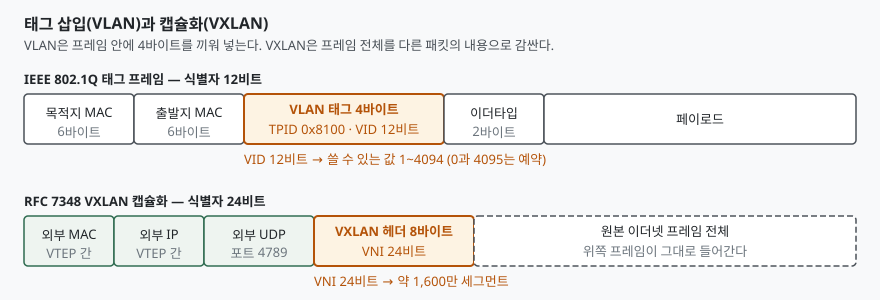
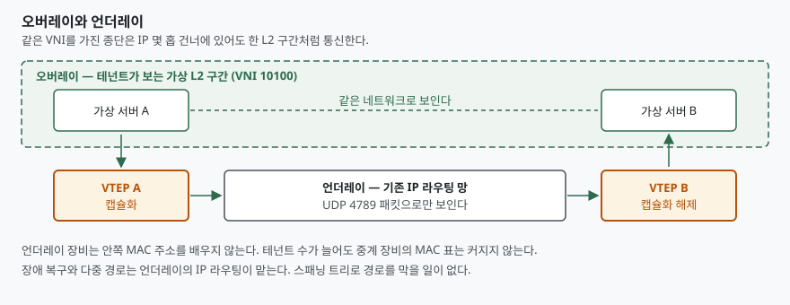

> 실행 검증 없음. 표준 문서(RFC·IEEE)에 적힌 필드 정의와 동작만 정리했다.
> 성능 수치나 벤치마크는 싣지 않는다.

## 들어가며

데이터센터가 가상화되면서 한 물리 서버 위에 수십 대의 가상 서버가 올라갔다. 서버 수가
늘어난 만큼 분리해야 할 네트워크 구간도 늘었는데, 기존 수단인 VLAN은 식별자가 12비트라
한 관리 도메인에서 4,094개까지만 만들 수 있다. 공용 클라우드처럼 테넌트가 수만인
환경에서는 이 수가 모자란다.

시험에서는 "VLAN의 한계를 쓰고 VXLAN이 그것을 어떻게 해결했는지 설명하라" 또는
"오버레이 네트워크의 구성요소를 기술하라" 형태로 나온다. 수를 늘린 것만 답하면
절반이고, **왜 태그 방식에서 캡슐화 방식으로 바뀌어야 했는지**까지 써야 점수가 붙는다.

## 정의

**네트워크 가상화**는 하나의 물리 네트워크 인프라 위에 서로 격리된 복수의 논리 네트워크를
구성하는 기술이다.

구현 방식은 두 갈래다.

- **태그 방식(VLAN)**: 이더넷 프레임 안에 식별자 필드를 끼워 넣어 구간을 나눈다.
  IEEE 802.1Q가 정의한다.
- **캡슐화 방식(오버레이)**: 원본 프레임 전체를 다른 프로토콜의 패킷 내용으로 감싸
  기존 IP 망 위로 실어 나른다. VXLAN(RFC 7348), NVGRE(RFC 7637),
  Geneve(RFC 8926)가 여기 속한다.

## 등장 배경 — VLAN의 한계 3가지

RFC 7348은 기존 방식의 문제를 세 절에 걸쳐 든다(§3.1~§3.3).

**① 식별자 고갈.** VLAN ID는 12비트다. 값 0과 4095가 예약되어 실제로 쓸 수 있는 것은
1~4094다. RFC 7348은 서론에서 "현재의 VLAN 한계 4094는 이런 상황에서 불충분하다"고
적는다.

**② 다중 경로를 못 쓴다.** L2 구간을 넓히면 루프를 막기 위해 스패닝 트리(STP)가 필요하다.
STP는 링크를 선택적으로 차단하는 방식이라, RFC 7348의 **스패닝 트리와 VLAN 범위 절**(§3.1)이
적은 대로 다중 경로에 의한 복원력을 얻을 수 없다. 장비를 늘려도 쓰이지 않는 링크가 생긴다.

**③ 중계 장비의 MAC 표 고갈.** 가상 서버 하나하나가 각자의 MAC 주소를 갖는다. ToR
스위치는 자기 구간의 모든 MAC을 배워야 하는데, 표가 넘치면 같은 문서의
**ToR 스위치 표 크기 절**(§3.3)이 적은 대로 유휴 항목이 만료될 때까지
**새 주소 학습을 멈출 수 있다.**

①만 답하면 "숫자를 늘리면 되는 문제"로 읽힌다. ②·③을 함께 써야 **IP 라우팅 위로
올리는 설계**가 왜 나왔는지가 설명된다.

## 구성요소 — 태그와 캡슐화의 차이

> **출처**: [RFC 7348 §5 VXLAN Frame Format](https://www.rfc-editor.org/rfc/rfc7348.html#section-5), [IEEE 802.1Q — Bridges and Bridged Networks](https://standards.ieee.org/ieee/802.1Q/10323/)

VLAN 태그는 4바이트이고, 그중 VLAN ID에 쓰이는 것은 12비트다. 나머지는 프로토콜
식별자(TPID), 우선순위(PCP), 폐기 적격 표시(DEI)가 나눠 쓴다.

VXLAN 헤더는 8바이트이고, 그중 24비트가 **VNI(VXLAN Network Identifier)** 다.
RFC 7348의 **VXLAN 문제 해결 구조 절**(§4)은 이 24비트로 **약 1,600만 개의 VXLAN
세그먼트**가 한 관리 도메인에 공존할 수 있다고 적는다. 나머지 비트는 플래그 8비트와 예약 필드 32비트다. 플래그의
I 비트가 1이어야 VNI가 유효한 값으로 취급된다.

결정적인 차이는 VXLAN 헤더 **뒤에 오는 것**이다. 원본 이더넷 프레임이 통째로 들어간다.
바깥에는 VTEP 간 통신에 쓰이는 외부 MAC·IP·UDP 헤더가 새로 붙고, 목적지 UDP 포트는
IANA가 할당한 **4789**다(§5).

## 구성요소 — 오버레이 4요소

오버레이 구성은 네 가지로 끊어 답안에 쓴다.

> **출처**: [RFC 7348 §1.1 Acronyms and Definitions, §4 VXLAN Problem Statement 해결 구조](https://www.rfc-editor.org/rfc/rfc7348.html#section-4)

| 번호 | 요소 | 역할 |
|---|---|---|
| ① | **언더레이** | VTEP 사이를 잇는 기존 IP 라우팅 망. 캡슐화된 UDP 패킷만 본다 |
| ② | **오버레이** | 같은 VNI를 가진 종단들이 이루는 가상 L2 구간 |
| ③ | **VTEP** | 터널의 시작점·끝점. 캡슐화와 해제를 수행한다 |
| ④ | **VNI** | 오버레이 구간을 구별하는 24비트 식별자 |

VTEP은 하이퍼바이저 안의 가상 스위치일 수도 있고, 물리 스위치나 물리 서버일 수도
있다(§4). 가상 서버는 자기가 캡슐화되고 있다는 것을 모른다 — 평범한 이더넷 프레임을
보내고 받을 뿐이다.

이 구조가 앞의 세 한계를 각각 어떻게 다루는지가 답안의 핵심이다. ①은 VNI 24비트가
받는다. ②는 언더레이가 IP 라우팅이므로 STP가 아니라 라우팅 프로토콜이 경로를 정한다.
③은 중계 장비가 외부 헤더만 보므로 테넌트의 MAC을 배우지 않는다.

## 비교 — 오버레이 프로토콜 3종

| 구분 | VLAN (IEEE 802.1Q) | VXLAN (RFC 7348) | Geneve (RFC 8926) |
|---|---|---|---|
| 방식 | 태그 삽입 | 캡슐화 | 캡슐화 |
| 식별자 | VID 12비트 | VNI 24비트 | VNI 24비트 |
| 식별자 개수 | 1~4094 | 약 1,600만 | 약 1,600만 |
| 전송 계층 | 이더넷 자체 | UDP (포트 4789) | UDP (포트 6081) |
| 헤더 크기 | 4바이트 | 8바이트 고정 | 8바이트 + 옵션 (최대 260바이트) |
| 확장성 | 없음 | 예약 필드만 | TLV 가변 옵션 |

NVGRE(RFC 7637)는 UDP 대신 GRE를 쓰고 식별자를 **VSID 24비트**로 둔다. 셋 다 식별자
24비트라는 점은 같고, 갈리는 것은 **바깥을 무엇으로 감싸는가**와 **확장 여지를 두었는가**다.

RFC 8926 서론은 Geneve가 나온 이유를 밝힌다. 고정 헤더 방식은 제어 평면과 요구가 바뀌면
**금방 낡아 버리고**, 테넌트 식별 외의 메타데이터 요구가 24비트 식별자 공간을 금세
비좁게 만든다는 것이다. 그래서 Geneve는 4바이트 헤더를 가진 TLV 옵션을 가변 개수로
붙일 수 있게 했다(§3.5).

## 적용 시 고려사항

**① MTU를 반드시 키운다.** VXLAN은 외부 MAC·IP·UDP와 VXLAN 헤더를 덧붙이므로 패킷이
커진다. RFC 7348의 **단편화와 MTU 절**(§4.3)은 VTEP이 VXLAN 패킷을 단편화해서는
안 된다(MUST NOT)고 규정하고, 늘어난 프레임 크기를 수용하도록 망의 MTU를 설정할 것을
권고한다. 언더레이
MTU를 손대지 않고 오버레이를 올리면 큰 패킷이 조용히 버려진다. 실무에서 가장 자주
밟는 지점이다.

**② 캡슐화·해제 부담이 어디에 걸리는지 본다.** VTEP이 하이퍼바이저 안에 있으면 그 일을
호스트 CPU가 한다. 물리 스위치가 VTEP이면 하드웨어가 처리한다. 어느 쪽을 택하느냐에
따라 비용이 서버로 갈지 장비로 갈지가 갈린다.

**③ 주소 학습 방식을 정해야 한다.** RFC 7348의 기본 방식은 멀티캐스트를 이용한 플러딩과
학습이다. 언더레이에 멀티캐스트를 깔 수 없는 환경이면 별도의 제어 평면(컨트롤러나
BGP EVPN 같은 경로 광고)으로 VTEP·MAC 대응을 분배해야 한다. 데이터 평면 표준만 보고
설계하면 이 부분이 빈다.

**④ 가시성이 떨어진다.** 중계 구간에서 보이는 것은 UDP 4789 패킷뿐이다. 기존 방화벽·
IDS 규칙이 안쪽 프레임을 못 본다. 보안 정책을 오버레이 종단(VTEP·가상 스위치)으로
옮기는 설계가 함께 가야 한다.

## 정리 — 답안 암기 단서

- **한계 3가지**: 식별자 4094 · 스패닝 트리로 다중 경로 불가 · 중계 장비 MAC 표 고갈
- **구성 4요소**: 언더레이 · 오버레이 · VTEP · VNI
- **숫자 3개**: VID **12**비트 / VNI **24**비트 / VXLAN 포트 **4789**, Geneve 포트 **6081**
- **고려사항 4가지**: MTU · 캡슐화 부담 위치 · 주소 학습 방식 · 가시성 저하
- 한 줄 요약: **태그를 끼우는 방식에서 프레임을 감싸는 방식으로 바뀌었고, 그 덕에
  식별자 공간과 경로 선택을 L2의 제약에서 떼어냈다.**

## 참고 자료

- [RFC 7348 — Virtual eXtensible Local Area Network (VXLAN)](https://www.rfc-editor.org/rfc/rfc7348.html) — §3 문제 정의, §4 VNI와 VTEP, §4.3 MTU, §5 프레임 포맷과 UDP 4789
- [RFC 8926 — Geneve: Generic Network Virtualization Encapsulation](https://www.rfc-editor.org/rfc/rfc8926.html) — §3.3 UDP 6081, §3.4 VNI, §3.5 TLV 옵션
- [RFC 7637 — NVGRE: Network Virtualization Using Generic Routing Encapsulation](https://www.rfc-editor.org/rfc/rfc7637.html)
- [IEEE 802.1Q — Bridges and Bridged Networks](https://standards.ieee.org/ieee/802.1Q/10323/)
- [IANA — Service Name and Transport Protocol Port Number Registry](https://www.iana.org/assignments/service-names-port-numbers/service-names-port-numbers.xhtml)
