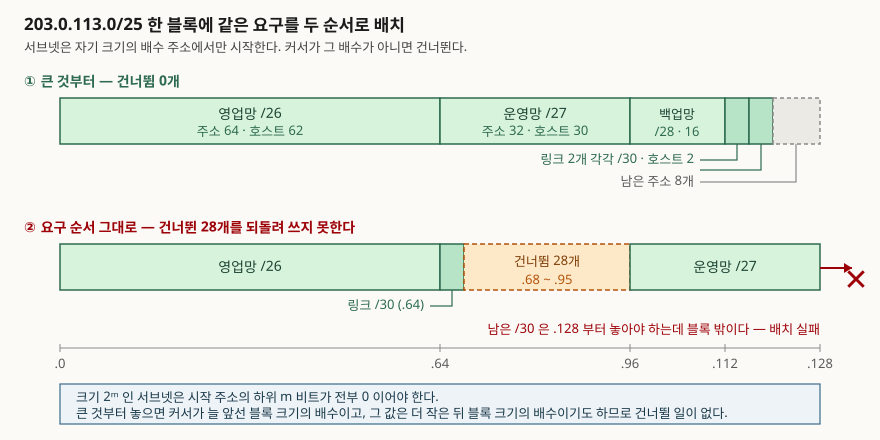

## 들어가며

서브넷 설계는 시험에서 계산 문제로 나온다. 블록 하나를 주고 세그먼트별 호스트 수를
적어 준 뒤 주소를 나눠 보라고 한다. 이때 답이 갈리는 지점은 마스크 길이를 고르는
산수가 아니라 **배치 순서**다. 같은 요구조건에 같은 블록인데 순서를 잘못 잡으면
마지막 세그먼트가 들어가지 않는다.

실무에서도 같은 자리에서 틀린다. 설계서에 적힌 순서대로 위에서부터 주소를 떼어 주다가
중간에 자리가 모자라 블록을 더 받아 오는 일이 그것이다. 산수는 맞는데 배치가 틀린
경우이고, 원인은 하나다 — **서브넷이 아무 주소에서나 시작할 수 없다는 제약**을 계산에
넣지 않은 것이다. 이 글은 그 제약을 비트 수준에서 보이고, 고정 길이 서브넷과 주소
소모량을 같은 요구조건으로 계산해 대비한다.

## 정의

**VLSM(Variable Length Subnet Mask, 가변 길이 서브넷 마스크)은 하나의 네트워크 접두사를
쪼갤 때 서브넷마다 서로 다른 길이의 마스크를 쓰는 주소 할당 방식이다.**

답안 첫 줄에 쓸 때는 **"서브넷마다 다른 길이"**가 정의의 중심이라는 점을 분명히 한다.
"서브넷을 나누는 것"은 VLSM이 아니라 서브네팅이고, 그 둘을 가르는 것이 마스크 길이의
가변성이다.

표준 문서가 VLSM이라는 약어를 쓰지는 않는다. 근거는 라우터 요구사항 표준의 서브네팅
항목(RFC 1812 §4.2.3.4)에 있다. 이 절은 라우터가 **인터페이스 설정과 라우팅
데이터베이스 양쪽에서 가변 길이 네트워크 접두사를 지원해야 한다(MUST)**고 요구하고,
그 기술이 CIDR이라고 적는다. 같은 문서의 주소 지정 항목(§4.2.2.11)은 CIDR 체계에서
서브넷 번호가 네트워크 접두사의 연장이며 접두사의 나머지 없이는 해석할 수 없다고
덧붙인다. 접두사 길이 1~32의 마스크 값과 블록 크기를 표로 묶어 둔 것은 가변 길이 서브넷
표(RFC 1878)다. 정보용 문서이지 표준이 아니라는 점은 밝혀 둔다.

## 등장 배경

서브네팅을 처음 규정한 것은 1985년의 인터넷 표준 서브네팅 절차(RFC 950)다. 이 문서는
지역 주소 필드의 어느 비트가 서브넷 번호인지를 **주소 마스크**로 가리키자고 제안했다.
여기까지는 지금과 같다. 문제는 그다음 문장이다. 주소 해석을 규정한 절(§2.1)은
**서브넷 번호 필드의 폭이 주어진 네트워크에 대해 일정하다**고 적는다. 네트워크 하나에
마스크 하나라는 뜻이다.

이 제약이 만드는 낭비는 간단한 산수로 드러난다. 한 네트워크 안에 호스트 50대짜리
세그먼트와 라우터 둘을 잇는 점대점 링크가 같이 있으면, 마스크는 50대를 담을 수 있어야
하므로 링크에도 같은 크기가 간다. 호스트 2대를 위해 주소 64개를 떼어 주는 것이다.
클래스 B 주소 하나로 조직을 덮던 시절에는 이 낭비가 눈에 띄지 않았지만, 주소가
모자라기 시작하자 곧바로 문제가 됐다.

가변 길이를 쓰려면 **마스크가 주소와 함께 전달되어야 한다.** 초기 라우팅 프로토콜은
마스크를 실어 나르지 않았고, 그래서 받는 쪽이 주소만 보고 접두사 길이를 추측해야 했다.
RIP 버전 2 표준(RFC 2453, STD 56)이 이 사정을 설명한다. 마스크가 없는 것이 라우터에게
특히 심각한 문제이며, 네트워크 비트가 아닌 자리에 비트가 서 있으면 라우터가 서브넷
마스크를 결정할 수 없다고 적는다(§2). 그래서 RIP-2는 라우팅 항목마다 서브넷 마스크
필드를 넣었고(§4.3), 이 필드가 생긴 뒤에야 가변 길이가 프로토콜 위에서 성립한다.

## 구성요소 — 설계 절차 4단계

VLSM 설계는 4단계로 끊어진다. 답안에서는 단계 수를 먼저 밝히고 들어간다.

1. **요구 수집** — 세그먼트별 호스트 수를 센다. 링크와 루프백도 세그먼트다
2. **접두사 길이 산정** — 호스트 n대를 담으려면 주소가 n+2개 필요하다. 네트워크 주소와
   브로드캐스트 주소가 호스트로 쓰이지 않기 때문이다. n+2 이상인 가장 작은 2의 거듭제곱을
   찾아 길이를 정한다
3. **크기 내림차순 배치** — 큰 블록부터 앞에서 차례로 떼어 낸다. 이 순서가 핵심이고,
   왜 그런지는 아래에서 본다
4. **검증** — 블록이 서로 겹치지 않는지, 상위 블록 밖으로 나가지 않는지 확인한다

## 구조

배치를 지배하는 규칙은 하나다. **크기가 2ᵐ인 서브넷은 시작 주소의 하위 m비트가 전부
0이어야 한다.** 접두사가 곧 마스크이므로 네트워크 주소는 호스트 비트가 전부 0인 주소이고,
그 말은 블록이 자기 크기의 배수 자리에서만 시작한다는 뜻이다. /26은 64의 배수에서,
/30은 4의 배수에서 시작한다.



> **출처**: [RFC 1812, Requirements for IP Version 4 Routers §4.2.3.4 Subnetting, §4.2.2.11 Addressing (1995-06)](https://www.rfc-editor.org/rfc/rfc1812.txt) — 가변 길이 네트워크 접두사 지원 요구와 서브넷 번호가 접두사의 연장이라는 규정 · [RFC 4632, Classless Inter-domain Routing (CIDR) §3.1 Basic Concept and Prefix Notation (2006-08, BCP 122)](https://www.rfc-editor.org/rfc/rfc4632.txt) — 접두사 표기와 유효 비트 수 정의. 도식의 주소는 문서용으로 예약된 TEST-NET-3(RFC 5737)를 썼다

여기서 **큰 것부터 배치해야 하는 이유**가 나온다. 크기를 내림차순으로 놓으면, k개를
놓은 뒤 커서는 s₁+…+sₖ에 있다. 모든 sᵢ는 2의 거듭제곱이고 다음 블록 크기 sₖ₊₁보다
크거나 같으므로, 각 sᵢ는 sₖ₊₁의 배수다. 배수들의 합은 다시 배수이므로 커서 역시
sₖ₊₁의 배수다. **다음 블록을 놓을 자리가 이미 정렬돼 있다는 뜻이고, 그래서 건너뛸 일이
생기지 않는다.**

반대로 큰 블록이 작은 블록 뒤에 오면 커서가 그 블록 크기의 배수가 아닐 수 있다.
그러면 커서를 배수 자리까지 밀어야 하고, 밀린 구간은 되돌려 쓰지 못한다. 앞으로만
떼어 주는 손 배치에서는 그 구간이 그대로 사라진다.

## 실습 예제

`203.0.113.0/25` 한 블록에 다섯 세그먼트를 담는다. 요구는 영업망 50대, 운영망 25대,
백업망 10대, 점대점 링크 두 개다. 필요한 주소를 모두 더하면 120개로 블록의 128개
안에 들어간다. **합계가 들어간다고 배치가 되는 것은 아니다**는 것이 이 예제가 보이려는
것이다. 전체 코드는 [`code/vlsm_plan.py`](code/vlsm_plan.py)에 있다.

```python
def align_up(value, size):
    """value 이상인 size 의 배수. 서브넷은 자기 크기의 배수에서만 시작한다."""
    return -(-value // size) * size
```

설계서에 적힌 순서 그대로 떼어 주면 네 번째에서 멈춘다.

```text
[요구 순서 그대로 배치]
  영업망            203.0.113.0/26     호스트  62대 (203.0.113.0 ~ 203.0.113.63)
  본사-지사 링크       203.0.113.64/30    호스트   2대 (203.0.113.64 ~ 203.0.113.67)
  (건너뜀 203.0.113.68 ~ 203.0.113.95 : 28개)
  운영망            203.0.113.96/27    호스트  30대 (203.0.113.96 ~ 203.0.113.127)
  본사-DR 링크       /30 (  4개) 필요 -> 203.0.113.128 부터 놓아야 하는데 블록 밖이다. 배치 실패
  -> 건너뛴 주소 28개가 남아 있지만 커서가 지나쳐 쓸 수 없다
```

링크 하나를 `.64`에 놓은 탓에 커서가 `.68`에 섰고, 다음 /27은 32의 배수에서 시작해야
하므로 `.96`까지 밀렸다. 그 사이 28개가 버려졌다. 크기를 내림차순으로 바꾸면 같은
요구가 그대로 들어간다.

```text
[큰 것부터 배치]
  영업망            203.0.113.0/26     호스트  62대 (203.0.113.0 ~ 203.0.113.63)
  운영망            203.0.113.64/27    호스트  30대 (203.0.113.64 ~ 203.0.113.95)
  백업망            203.0.113.96/28    호스트  14대 (203.0.113.96 ~ 203.0.113.111)
  본사-지사 링크       203.0.113.112/30   호스트   2대 (203.0.113.112 ~ 203.0.113.115)
  본사-DR 링크       203.0.113.116/30   호스트   2대 (203.0.113.116 ~ 203.0.113.119)
  -> 사용 120개 / 건너뜀 0개 / 남음 8개
```

같은 요구를 고정 길이로 덮으면 차이가 바로 보인다.

```text
[고정 길이 — 전부 가장 큰 세그먼트에 맞춘다]
  가장 큰 요구는 50대 -> 모든 서브넷이 /26 (64개)
  5개 세그먼트 x 64 = 320개 -> 최소 /23 (512개) 블록이 필요하다

[대비] VLSM 128개(/25) vs 고정 길이 512개 -> 4배
```

호스트 2대짜리 링크 두 개가 각각 주소 64개를 받기 때문에 생기는 차이다. 세그먼트 수가
같아도 **크기 편차가 클수록 고정 길이의 낭비가 커진다.**

## 비교 — 고정 길이 서브넷과의 대비

| 축 | 고정 길이 서브넷 (RFC 950) | VLSM |
|---|---|---|
| 마스크 | 네트워크당 하나. 서브넷 번호 필드 폭이 일정하다(§2.1) | 서브넷마다 다르다 |
| 크기 결정 기준 | 가장 큰 세그먼트 | 세그먼트마다 따로 |
| 위 예제의 소모 | 512개(/23) | 128개(/25) |
| 배치 순서 | 영향 없음 — 전부 같은 크기다 | **결과를 바꾼다** — 크기 내림차순이어야 한다 |
| 라우팅 프로토콜 요건 | 마스크를 실어 나르지 않아도 된다 | 라우팅 항목마다 마스크가 필요하다(RFC 2453 §4.3) |
| 집약 | 서브넷 경계가 하나라 묶을 여지가 적다 | 인접·정렬된 서브넷을 상위 접두사로 묶을 수 있다 |

## 적용 시 고려사항

**① 점대점 링크는 /31을 검토한다.** /30은 주소 4개 중 2개만 호스트로 쓴다. 점대점
링크에서 31비트 접두사를 쓰는 방법(RFC 3021)은 링크 양끝에 주소 2개를 모두 배정하고
네트워크·브로드캐스트 주소를 따로 두지 않는다. 다만 양끝 장비가 모두 지원해야 하므로
장비 요건을 먼저 확인한다.

**② 전부 0·전부 1인 서브넷 번호의 취급을 확인한다.** 서브네팅 표준은 특수 주소의
의미를 지키기 위해 서브넷 필드 값이 전부 0이거나 전부 1인 서브넷을 실제 서브넷에
배정하지 말라고 적는다(RFC 950 §2.1). 가변 길이 서브넷 표(RFC 1878)는 이 제약을 더
이상 유효하지 않은 것으로 보고 계산에서 빼지만, 오래된 장비가 섞인 망에서는 설계
단계에서 장비별 동작을 확인하는 편이 안전하다.

**③ 집약을 염두에 두고 자리를 잡는다.** 같은 상위 접두사 아래에 들어갈 서브넷들을
주소 공간에서 붙여 놓으면 상위로 광고할 때 하나로 묶인다. 요구대로 자리를 떼어 주고
나서 집약을 시도하면 이미 흩어져 있어 묶이지 않는다. **집약은 사후 작업이 아니라
배치 기준이다.**

**④ 확장 여지를 블록 뒤가 아니라 블록별로 남긴다.** 세그먼트마다 꼭 맞는 크기를 주면
호스트 한 대가 늘 때 블록을 옮겨야 한다. 성장이 예상되는 세그먼트는 한 단계 큰 접두사를
주고, 그 결정을 설계 문서에 근거와 함께 남긴다.

## 정리

- **정의 한 줄** — 하나의 네트워크 접두사를 쪼갤 때 서브넷마다 다른 길이의 마스크를
  쓰는 주소 할당 방식
- **표준 근거** — 라우터는 인터페이스 설정과 라우팅 데이터베이스 양쪽에서 가변 길이
  네트워크 접두사를 지원해야 한다(RFC 1812 §4.2.3.4, MUST)
- **무엇을 풀었나** — 네트워크당 마스크 하나라는 제약(RFC 950 §2.1) 때문에 생기던
  낭비. 위 예제에서 **512개 대 128개로 4배** 차이가 났다
- **설계 절차 4단계** — 요구 수집 → 접두사 길이 산정 → 크기 내림차순 배치 → 검증
- **왜 내림차순인가** — 크기 2ᵐ인 블록은 하위 m비트가 0인 주소에서만 시작한다.
  내림차순이면 커서가 늘 다음 블록 크기의 배수이므로 **건너뛰는 구간이 생기지 않는다**
- **암기 단서** — 절차는 **요·산·배·검**(요구 수집·길이 산정·내림차순 배치·검증),
  규칙은 **"큰 것부터, 배수 자리에"** 한 줄

> **실행 검증 범위**: 배치와 소모량 계산은 파이썬 표준 라이브러리 `ipaddress`로 직접
> 계산해 [`code/output.txt`](code/output.txt)에 기록을 남겼다. 라우터 동작이나 성능
> 수치는 측정하지 않았고, 표준 문서 근거만 인용했다.

> 기출 답안: [기출문제 — 서브네팅과 슈퍼네팅, /22를 네 팀에 VLSM으로 나누기](../../exam/2026-10-23-subnetting-supernetting-vlsm/index.md)

> 같이 읽을 글: [최장 접두사 일치와 포워딩 테이블 탐색](../2026-10-25-longest-prefix-match-forwarding-lookup/index.md) — 길이가 가변이 된 접두사들이 포워딩 테이블에서 겹칠 때 하나를 고르는 규칙
>
> 같이 읽을 글: [CIDR와 라우팅 집약](../2026-10-28-cidr-and-route-aggregation/index.md) — 같은 가변 길이 원리를 조직 안이 아니라 인터넷 전체의 할당·집약에 적용한 것

## 참고 자료

- [RFC 950, Internet Standard Subnetting Procedure (1985-08)](https://www.rfc-editor.org/rfc/rfc950.txt) — §2.1 주소 마스크로 서브넷 번호 필드를 가리키는 방식, 서브넷 번호 필드 폭이 네트워크마다 일정하다는 서술, 전부 0·전부 1인 서브넷 값을 배정하지 말라는 권고. §2.2 호스트가 마스크를 32비트 값으로 보관한다는 규정
- [RFC 1812, Requirements for IP Version 4 Routers (1995-06)](https://www.rfc-editor.org/rfc/rfc1812.txt) — §4.2.3.4 가변 길이 네트워크 접두사를 인터페이스 설정과 라우팅 데이터베이스에서 지원해야 한다는 요구, §4.2.2.11 서브넷 번호가 네트워크 접두사의 연장이라는 서술, §2.2.5.1 서브넷 비트가 연속이어야 한다는 권고
- [RFC 1878, Variable Length Subnet Table For IPv4 (1995-12)](https://www.rfc-editor.org/rfc/rfc1878.txt) — 접두사 길이 1~32의 마스크 값·주소 개수 표. 정보용 문서이며 RFC 1860을 대체한다
- [RFC 2453, RIP Version 2 (1998-11, STD 56)](https://www.rfc-editor.org/rfc/rfc2453.txt) — §2 마스크가 없을 때 라우터가 서브넷 마스크를 결정할 수 없다는 문제 제기, §3.7 주소만으로는 서브넷 번호인지 노드 주소인지 가릴 수 없다는 서술, §4.3 RIP-2 메시지의 Subnet Mask 필드
- [RFC 3021, Using 31-Bit Prefixes on IPv4 Point-to-Point Links (2000-12)](https://www.rfc-editor.org/rfc/rfc3021.txt) — 점대점 링크에서 31비트 접두사를 써 주소 2개를 모두 호스트에 배정하는 방법
- [RFC 4632, Classless Inter-domain Routing (CIDR) (2006-08, BCP 122)](https://www.rfc-editor.org/rfc/rfc4632.txt) — §3.1 접두사 표기와 0~32 길이 정의
- [RFC 5737, IPv4 Address Blocks Reserved for Documentation (2010-01)](https://www.rfc-editor.org/rfc/rfc5737.txt) — 예제에 쓴 203.0.113.0/24(TEST-NET-3)의 예약 근거
