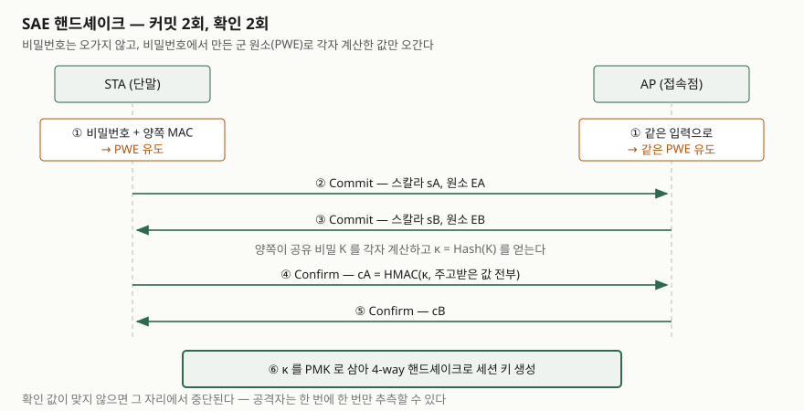

> **실행 검증 없음.** 무선 장비와 인증 환경이 없어 직접 실행하지 못했다.
> Wi-Fi Alliance의 WPA3 Specification v3.5, IETF RFC, 그리고 공개 논문의 기술에만 근거한다.
> 측정값이나 패킷 캡처 결과는 싣지 않는다.

## 들어가며

무선 보안은 단답형과 논술형 모두에 자주 나오고, 묻는 각도가 일정하다. "WPA2의
무엇이 문제였는가", "WPA3가 그것을 어떻게 해결했는가", "전이 구간에서 무엇을
조심해야 하는가" 셋이다.

이 문제를 "WPA3는 SAE를 쓴다"로 끝내면 점수가 안 붙는다. SAE가 무엇을 바꿨는지,
바꾼 뒤에도 무엇이 남았는지까지 써야 한다. 실무에서도 같다. 공유기 설정 화면에서
`WPA2/WPA3` 혼합 모드를 고르는 순간 WPA3가 막으려던 공격이 그대로 돌아온다.

## 정의

**WPA3**는 Wi-Fi Alliance가 정의한 무선 랜 보안 인증 프로그램으로, 비밀번호 기반
접속에 SAE(Simultaneous Authentication of Equals) 핸드셰이크와 보호된 관리 프레임
(PMF)을 의무화해 오프라인 사전 공격과 관리 프레임 위조를 차단한다.

답안에서 짚어야 할 전제가 하나 있다. **WPA3는 새 프로토콜이 아니다.** Dragonblood
논문은 "WPA3는 새 프로토콜을 정의하지 않는다. 기기가 어떤 기존 프로토콜을 지원해야
하는지를 정하는 인증 프로그램"이라고 못 박는다. SAE 자체는 2011년에 IEEE 802.11에
들어간 것이고, 그 바탕인 Dragonfly 키 교환은 RFC 7664에 정의돼 있다.

**SAE**는 비밀번호를 고엔트로피 키로 바꿔 주는 PAKE(Password Authenticated Key
Exchange)로, 비밀번호를 그대로 주고받지 않고 비밀번호에서 유도한 군 원소(PWE)로
커밋·확인 2단계를 교환해 상호 인증과 순방향 비밀성을 함께 얻는다.

## 등장 배경

WPA2는 PSK(Pre-Shared Key)를 **4-way 핸드셰이크**로 확인한다. 문제는 그 교환이
공개 채널에서 오간다는 데 있다. 공격자가 한 번만 캡처해 두면, 그다음은 접속 없이
자기 컴퓨터에서 후보 비밀번호를 하나씩 대입해 볼 수 있다. 이것이 **오프라인 사전
공격**이다. 네트워크에 붙지 않으므로 시도 횟수 제한도, 탐지도 걸리지 않는다.

여기에 2017년 KRACK(Key Reinstallation Attack)이 더해졌다. 4-way 핸드셰이크의
메시지를 재전송시켜 이미 설치된 키를 다시 설치하게 만들면 논스가 재사용된다.
Wi-Fi Alliance가 WPA3를 내놓은 직접적인 계기가 이것이다.

WPA3가 바꾼 핵심은 하나다. **캡처한 핸드셰이크만으로는 비밀번호를 대입해 볼 수
없게 만든다.** RFC 7664는 Dragonfly가 "능동 공격, 수동 공격, 오프라인 사전 공격에
저항한다"고 적고, 오프라인 사전 공격에 대한 저항성은 증명 가능하다고 밝힌다.
추측은 **온라인에서 한 번에 하나씩만** 가능해지고, 그 지점에는 횟수 제한을 걸 수 있다.

## 구성요소 — WPA3가 정의하는 5가지

| # | 구성요소 | 내용 |
|---|---|---|
| 1 | **WPA3-Personal** | SAE(AKM 00-0F-AC:8) 또는 군 의존 해시 SAE(00-0F-AC:24). PMF 필수 |
| 2 | **WPA3-Enterprise** | 802.1X/EAP 기반. WPA·WEP·TKIP 금지, PMF 요구 |
| 3 | **WPA3-Enterprise 192-bit 모드** | Suite B 192b(00-0F-AC:12) 단독. GCMP-256 + BIP-GMAC-256 |
| 4 | **SAE-PK** | 공개키를 섞어 전이 구간의 악성 AP 사칭을 막는 변형 |
| 5 | **Transition Disable** | 전이 모드를 쓰던 단말을 전용 모드로 되돌리게 하는 지시 |

여기에 **Wi-Fi Enhanced Open**(OWE, RFC 8110)이 짝으로 붙는다. 비밀번호가 없는
공개 망에서 인증 없이 암호화만 제공한다. WPA3 자체는 아니지만 같은 세대의
인증 프로그램이고, 시험에서 함께 묻는다.

## 절차 — SAE 핸드셰이크 6단계

> **출처**: [RFC 7664 §3.3 Commit Exchange, §3.4 Confirm Exchange](https://www.rfc-editor.org/rfc/rfc7664.html#section-3.3) 및 Vanhoef & Ronen, Dragonblood (IEEE S&P 2020) Figure 1

1. **PWE 유도** — 양쪽이 비밀번호와 서로의 MAC 주소로 같은 군 원소(Password
   Element)를 만든다. 비밀번호를 모르는 쪽에서 보면 무작위 원소와 구분되지 않는다.
2. **Commit 송신** — 난수 두 개(private, mask)로 스칼라와 원소를 만들어 보낸다.
3. **Commit 수신** — 상대 값을 검증한다. 자기가 보낸 값과 같으면 반사 공격으로 보고 중단한다.
4. **공유 비밀 계산** — 양쪽이 각자 같은 비밀 K를 얻고 κ = Hash(K)를 유도한다.
5. **Confirm 교환** — κ로 주고받은 값 전체에 HMAC을 걸어 교환하고 서로 검증한다.
6. **키 확정** — κ를 PMK로 삼아 기존 4-way 핸드셰이크로 세션 키를 만든다.

6번이 중요하다. **WPA3도 4-way 핸드셰이크를 그대로 쓴다.** 다만 그 입력이 비밀번호가
아니라 SAE가 만든 고엔트로피 키라서, 그 핸드셰이크를 캡처해도 대입해 볼 대상이 없다.

## 비교 — WPA2와 WPA3

| 항목 | WPA2-Personal | WPA3-Personal |
|---|---|---|
| 인증 교환 | 4-way 핸드셰이크(PSK 직접) | SAE 커밋·확인 후 4-way |
| 오프라인 사전 공격 | 캡처 한 번으로 가능 | 캡처로는 불가, 온라인 1회씩만 |
| 순방향 비밀성 | 없음 (PSK 노출 시 과거 트래픽 복호화) | 있음 (세션별 난수) |
| 관리 프레임 보호(PMF) | 선택 | **필수** (전용 모드 기준) |
| 암호 스위트 | CCMP-128 | CCMP-128 이상, 192-bit 모드는 GCMP-256 |
| TKIP·WEP | 호환 목적 허용 사례 있음 | 금지 |

## 전이 모드가 되돌리는 것

시험에서 가장 자주 틀리는 자리다. **WPA3-Personal Transition Mode**는 같은 SSID에서
PSK(00-0F-AC:2)와 SAE(00-0F-AC:8)를 함께 켜 둔다. 구형 단말을 버리지 않으려는
설정이고, 이때 PMF는 "필수"가 아니라 "가능"(MFPC=1, MFPR=0)으로 내려간다.

문제는 공격자가 PSK 쪽으로 끌어내릴 수 있다는 것이다. SAE를 지원하는 단말이라도
PSK로 붙게 만들면 WPA2와 같은 상태가 되고, 캡처 한 번이면 오프라인 대입이 다시
가능해진다. WPA3 사양이 **Transition Disable**(§8)을 둔 이유다. 망의 모든 AP가
WPA3를 켠 시점에 AP가 이 지시를 내리면, 단말은 자기 프로파일을 전용 모드로
바꾸고 이후 다운그레이드를 거절한다.

6 GHz 대역은 아예 전이를 금지한다. 사양의 **6 GHz 대역 제약 절(§11.2)** 은 그 대역의
AP가 WPA3-Personal Transition Mode로 구성되어서는 안 되며, PSK AKM과 TKIP, 그리고
SAE의 **Hunting and Pecking** 방식을 허용해서는 안 된다고 적는다.

## 남은 공격면 — Dragonblood

SAE가 오프라인 사전 공격을 막았다고 끝난 것이 아니다. Vanhoef와 Ronen은 2020년
IEEE S&P에서 SAE 구현을 분석해 **서비스 거부, 다운그레이드, 부채널** 세 갈래의
공격을 제시했다.

핵심은 1단계 PWE 유도에 있었다. 초기 SAE는 **hunting-and-pecking**이라는
시행착오 방식을 썼다. 해시 결과를 곡선 위의 점으로 쓸 수 있는지 보고, 안 되면
카운터를 올려 다시 해시한다. 반복 횟수가 비밀번호와 MAC 주소에 따라 달라지므로,
공격자가 MAC 주소를 바꿔 가며 응답 시간이나 캐시 접근 패턴을 재면 후보 비밀번호를
걸러낼 수 있다. 논문은 이렇게 걸러낸 정보로 1010 규모 사전을 Amazon EC2에서
1달러 미만으로 전수 대입할 수 있다고 적는다.

대응이 **Hash-to-Element(H2E)**다. 반복 없이 한 번에 원소를 유도해 실행 시간이
비밀번호에 의존하지 않게 만든다. 앞서 본 6 GHz 제약이 hunting-and-pecking을
금지하는 것이 이 결론의 반영이다.

답안에서 쓸 문장은 이것이다. **프로토콜이 안전해도 유도 과정의 실행 시간이 비밀을
누설하면 같은 공격이 되돌아온다.**

## 적용 시 고려사항 — 5가지

1. **전이 모드는 임시 상태로만 둔다.** 기한을 정하고, 구형 단말 목록을 관리하고,
   정리가 끝나면 전용 모드로 전환한다. 켜 둔 채 잊으면 WPA3를 도입한 효과가 없다.
2. **Transition Disable은 망 전체를 보고 켠다.** 사양의 **배포 지침 절(§8.2)** 은 AP가
   기본값으로 이를 켜서는 안 되며, 망 수준의 영향을 알고 결정해야 한다고 적는다.
   일부 AP만 WPA3인 상태에서 켜면 단말이 나머지 AP에 붙지 못한다.
3. **H2E 지원 여부를 펌웨어 단위로 확인한다.** 전용 모드를 켜도 PWE 유도가 구형
   방식이면 부채널이 남는다. 6 GHz를 쓰는 망은 사양상 자동으로 걸러지지만,
   2.4/5 GHz는 그렇지 않다.
4. **192-bit 모드는 호환성을 포기하는 선택이다.** 사양의 **192-bit 모드 절(§3.5)** 은
   이 모드가 다른 보안 모드와 상호 운용되지 않는다고 명시한다. GCMP-256과 P-384 계열 EAP 스위트를
   단말·RADIUS·인증서까지 전부 맞춰야 하므로, 적용 범위를 먼저 정하고 들어간다.
5. **공개 망에는 OWE를 쓰되 한계를 같이 공지한다.** RFC 8110 §7은 OWE가 인증을
   제공하지 않으며 AP를 사칭하는 능동 공격에 취약하다고 적는다. 도청은 막지만
   악성 AP는 막지 못하므로, 사내 접근에는 VPN이나 TLS를 별도로 요구한다.

## 정리 — 암기 단서

- **WPA3는 프로토콜이 아니라 인증 프로그램이다.** SAE·PMF를 "의무화"한 것이 본질이다.
- **SAE는 커밋 2회 + 확인 2회**, 그 앞에 PWE 유도, 그 뒤에 4-way 핸드셰이크.
  숫자로 **1-2-2-1**(유도 1, 커밋 2, 확인 2, 4-way 1)로 묶으면 절차를 놓치지 않는다.
- **구성요소 5가지**: Personal / Enterprise / 192-bit / SAE-PK / Transition Disable.
- **WPA2 대비 바뀐 것 3가지**: 오프라인 사전 공격 차단, 순방향 비밀성, PMF 필수.
- **남은 함정 2가지**: 전이 모드 다운그레이드, PWE 유도의 부채널(→ H2E).

## 참고 자료

- [Wi-Fi Alliance, WPA3™ Specification v3.5 (2025)](https://www.wi-fi.org/system/files/WPA3%20Specification%20v3.5.pdf) — §2 WPA3-Personal, §3.5 192-bit mode, §8 Transition Disable, §11.2 6 GHz 제약
- [RFC 7664 — Dragonfly Key Exchange](https://www.rfc-editor.org/rfc/rfc7664.html) — §3.2 Password Element, §3.3 Commit, §3.4 Confirm
- [RFC 8110 — Opportunistic Wireless Encryption](https://www.rfc-editor.org/rfc/rfc8110.html) — §4.3 Diffie-Hellman 교환, §7 Security Considerations
- [Vanhoef & Ronen, "Dragonblood: Analyzing the Dragonfly Handshake of WPA3 and EAP-pwd", IEEE Symposium on Security and Privacy 2020, pp. 517–533](https://papers.mathyvanhoef.com/dragonblood.pdf)
- [Wi-Fi Alliance, Security](https://www.wi-fi.org/discover-wi-fi/security) — WPA3·Enhanced Open·PMF 요구 사항
