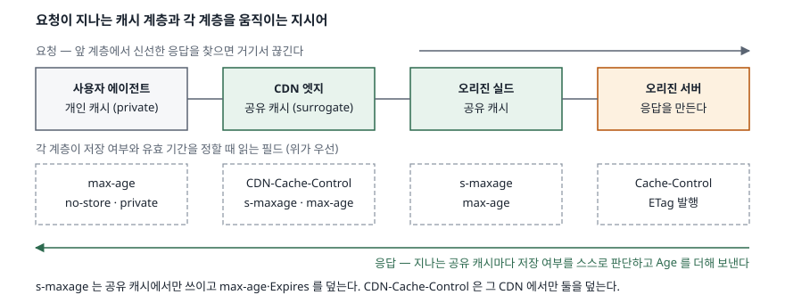
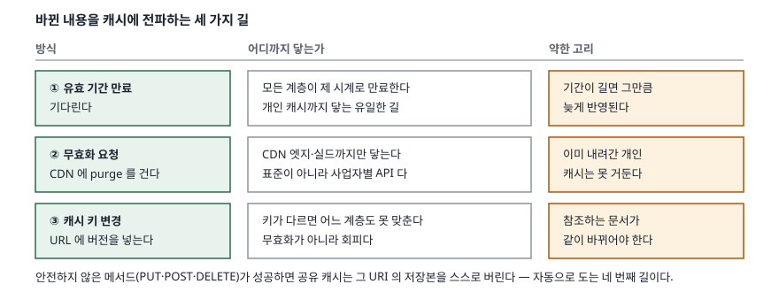

> **실행 검증 없음.** 이 글은 RFC 원문의 규정만으로 정리했다. 측정값이나 특정
> CDN 사업자의 동작은 싣지 않는다.

## 들어가며

CDN 문항을 "콘텐츠를 사용자 가까운 곳에 복제해 지연을 줄이는 기술"로 시작하면
그 문장에서 점수가 끊긴다. 거리는 CDN이 푸는 문제의 일부일 뿐이고, 채점자가
보는 곳은 **무엇을 어느 계층에 얼마나 두고, 바뀌었을 때 그것을 어떻게 거두는가**다.

실무에서 CDN이 사고를 내는 자리도 거기다. 가격을 고쳤는데 한 시간째 옛날 값이
보이고, 로그인한 사용자에게 남의 장바구니가 보이고, 오리진을 고쳤는데 일부
지역만 반영된다. 셋 다 "서버가 가깝다"로는 설명도 예방도 되지 않는다.
캐시가 **계층으로 쌓여 있고 계층마다 판단 근거가 다르다**는 것을 알아야 풀린다.

## 정의

**CDN(Content Delivery Network)은 네트워크 요소들이 4~7계층에서 협력해 콘텐츠를
더 효과적으로 전달하도록 구성한 네트워크 기반구조다.** CDNI 문제 정의 문서의
용어 절(RFC 6707 §1.1)이 이렇게 규정하고, 같은 절에서 CDN이 **요청 라우팅
시스템, 서로게이트를 둔 분배 시스템, 로깅 시스템, 제어 시스템 4가지**로 구성된다고
적는다.

여기서 **서로게이트(Surrogate)** 는 같은 절이 "흔히 캐시라 불리는 장치·기능"으로
규정하는 요소다. 즉 CDN의 실체는 "가까운 서버"가 아니라 **오리진을 대신해 응답을
보관하고 내주는 공유 캐시들의 망**이다. 답안의 정의 문장에 서로게이트와 요청
라우팅 둘을 넣으면 "복제 서버"로 쓴 답안과 갈린다.

캐시 자체의 구분은 HTTP 캐싱 표준(RFC 9111 §1)이 정한다. 한 사용자만 쓰는
**개인 캐시(private cache)** 와 여러 사용자의 응답을 함께 보관하는
**공유 캐시(shared cache)** 둘이고, CDN의 서로게이트는 후자다.

## 등장 배경

오리진 한 대가 모든 요청을 받던 구조에는 세 가지가 겹쳐 있었다. 거리에 비례하는
왕복 지연, 같은 콘텐츠를 반복해 보내는 대역폭 낭비, 그리고 특정 시점에 몰리는
부하다. 앞의 둘은 캐시로 줄고 셋째는 분산으로 줄지만, 브라우저 안의 개인 캐시만으로는
**처음 받는 사용자**에게 아무 도움이 되지 않는다.

여러 사용자의 요청을 한 곳에서 받아 두는 공유 캐시가 필요했고, 그것을 오리진이
아니라 사용자 쪽 네트워크에 둔 것이 CDN이다. 다만 공유 캐시가 생기는 순간
**"이 응답을 남에게도 줘도 되는가"** 라는 질문이 새로 생긴다. HTTP 캐싱 표준이
`private`·`s-maxage` 같은 지시어를 따로 둔 이유가 그것이다.

## 구성요소 — 요청이 지나는 캐시 4계층

요청이 오리진까지 가는 길에는 **캐시가 최대 4계층** 놓인다.

1. **개인 캐시** — 사용자 에이전트 안. `max-age`를 읽고 `private` 응답도 저장한다
2. **CDN 엣지(서로게이트)** — 사용자와 가장 가까운 공유 캐시
3. **오리진 실드** — 엣지들이 공유하는 상위 공유 캐시. 오리진으로 가는 요청을 한 번 더 모은다
4. **오리진 서버** — 응답을 만들고 `Cache-Control`·`ETag`를 발행한다

계층마다 **읽는 필드가 다르다.** 유효 기간을 정할 때 캐시는 다음 순서로 **처음
맞는 규칙 하나**를 쓴다(RFC 9111 §4.2.1).

1. `s-maxage` — 공유 캐시에서만 쓴다
2. `max-age`
3. `Expires` 에서 `Date` 를 뺀 값
4. 셋 다 없으면 휴리스틱 추정(§4.2.2). `Last-Modified` 이후 경과 시간의 10% 정도가 통상적인 값이다

여기에 **표적 지시어**가 한 겹 더 붙는다. `CDN-Cache-Control`(RFC 9213 §3)은
그 헤더를 대상 목록에 둔 CDN에서만 유효하며, 유효한 값이 있으면 그 CDN은
`Cache-Control`과 `Expires`를 **무시한다**(§2.2). 같은 응답을 두고 CDN은 신선하다고
보고 브라우저는 낡았다고 보는 상태가 정상적으로 성립한다(§2.3).

## 도식

> **출처**: [RFC 9111 §4.2.1 Calculating Freshness Lifetime](https://www.rfc-editor.org/rfc/rfc9111.html#name-calculating-freshness-lifet), [RFC 9213 §2.2 Applying Targeted Fields](https://www.rfc-editor.org/rfc/rfc9213.html), [RFC 6707 §1.1 Terminology](https://www.rfc-editor.org/rfc/rfc6707.html)

## 절차 — 바뀐 내용을 전파하는 길 3가지

캐시는 **넣기보다 거두기가 어렵다.** 쓸 수 있는 길은 셋이고, 셋 다 닿는 범위가 다르다.

> **출처**: [RFC 9111 §4.4 Invalidating Stored Responses](https://www.rfc-editor.org/rfc/rfc9111.html#name-invalidating-stored-respons), [RFC 9111 §4.3 Validation](https://www.rfc-editor.org/rfc/rfc9111.html#name-validation)

1. **유효 기간 만료** — 각 계층이 제 시계로 만료시킨다. 개인 캐시까지 닿는 유일한
   길이지만 그만큼 늦다
2. **무효화 요청(purge)** — CDN 엣지와 실드의 저장본을 지운다. **HTTP 표준에 없고
   사업자별 API다.** 이미 사용자에게 내려간 개인 캐시는 거두지 못한다
3. **캐시 키 변경** — URL에 버전을 넣어 새 키로 만든다. 무효화가 아니라 **회피**이고,
   그 URL을 참조하는 문서가 같이 바뀌어야 성립한다

여기에 자동으로 도는 길이 하나 더 있다. **안전하지 않은 메서드(PUT·POST·DELETE 등)가
오류가 아닌 응답을 받으면 캐시는 그 요청 URI의 저장본을 반드시 무효화한다**(RFC 9111 §4.4).
`Location`·`Content-Location`이 가리키는 URI도 **같은 오리진일 때만** 함께 무효화할 수 있다.

만료된 뒤에도 바로 버리지 않는 길이 있다. `stale-while-revalidate`(RFC 5861 §3)는
지정한 초만큼 낡은 응답을 내주면서 뒤에서 재검증하고, `stale-if-error`(§4)는
5xx가 날 때 낡은 응답으로 대신 답한다. 둘 다 **가용성을 신선도와 바꾸는 선택**이다.

## 비교 — 세 가지 축

| 축 | 개인 캐시 | CDN 엣지(공유 캐시) |
|---|---|---|
| 적용 범위 | 사용자 1명 | 다수 사용자 |
| 읽는 기간 지시어 | `max-age` | `s-maxage` → `max-age` (`CDN-Cache-Control`이 있으면 그것이 우선) |
| `private` 응답 | 저장 가능 | 저장 금지 |
| 운영자 무효화 | 불가 | 사업자 API로 가능 |
| 첫 사용자 효과 | 없음 | 있음 (다른 사용자가 이미 채워 둠) |

| 지시어 | 규정 | 자주 틀리는 지점 |
|---|---|---|
| `no-store` | 어떤 부분도 저장 금지 (§5.2.2.5) | **기밀 보장 수단이 아니라고 표준이 명시한다** |
| `no-cache` | 저장은 하되 재사용 전 재검증 (§5.2.2.4) | "캐시 금지"로 읽는 오독이 가장 흔하다 |
| `private` | 단일 사용자 캐시만 저장 (§5.2.2.7) | CDN에 두면 안 되는 응답의 표시 |
| `must-revalidate` | 낡으면 반드시 재검증 (§5.2.2.2) | 연결이 끊기면 낡은 응답 대신 오류를 내야 한다 |
| `proxy-revalidate` | 공유 캐시에만 적용 (§5.2.2.8) | 개인 캐시는 영향받지 않는다 |
| `s-maxage` | 공유 캐시에서 `max-age`·`Expires`를 덮음 (§5.2.2.10) | `proxy-revalidate` 의미를 함께 갖는다 |

## 적용 시 고려사항

- **개인 정보가 섞인 응답에 `private`를 반드시 건다.** 공유 캐시가 사용자별 응답을
  저장하면 다음 사용자에게 그대로 나간다. 다만 `no-store`는 표준이
  "신뢰할 만한 기밀 보장 수단이 아니다"라고 못 박으므로, 기밀성은 전송 계층과
  접근 제어로 따로 세운다.
- **캐시 키에 무엇이 들어가는지를 먼저 정한다.** 질의 문자열, `Vary` 대상 헤더,
  쿠키 가운데 무엇을 키에 넣느냐가 적중률을 결정한다. 추적용 질의 문자열이
  키에 들어가면 같은 콘텐츠가 사용자 수만큼 따로 저장된다.
- **무효화는 설계 시점에 고른다.** 즉시성이 필요한 자원(가격·재고)은 짧은
  `s-maxage` 와 재검증으로, 바뀌지 않는 자원(정적 번들)은 긴 기간과 버전 URL로
  간다. purge API에만 의존하면 사업자 종속이 생기고 개인 캐시에는 닿지 않는다.
- **계층별로 기간을 다르게 줄 수 있음을 활용한다.** 브라우저에는 짧게
  (`max-age`), CDN에는 길게(`s-maxage` 또는 `CDN-Cache-Control`) 주면
  오리진 부하는 줄이면서 반영 지연은 purge로 끊을 수 있다.
- **적중 여부를 관측할 수단을 함께 넣는다.** `Cache-Status`(RFC 9211 §2)는
  캐시마다 `hit`, 전달 사유인 `fwd`, 남은 유효 기간 `ttl`, 저장 여부 `stored`,
  요청 병합 여부 `collapsed`를 보고한다. 적중률을 추측으로 말하지 않으려면 이게 필요하다.

## 정리

- **정의**: CDN = 4~7계층에서 협력하는 전달 기반구조. 구성은 **요청 라우팅·분배·로깅·제어 4가지**
- **계층**: 개인 캐시 → CDN 엣지 → 오리진 실드 → 오리진 **4계층**
- **기간 판단 순서**: `s-maxage` → `max-age` → `Expires` − `Date` → 휴리스틱, **4단계**
- **전파 경로**: 만료·purge·키 변경 **3가지** + 안전하지 않은 메서드에 의한 자동 무효화
- 암기 단서 — **계층 4, 판단 4, 전파 3**. `private`는 범위를, `no-cache`는 시점을,
  `no-store`는 저장 자체를 막는다로 셋을 갈라 둔다

## 참고 자료

- [RFC 6707 — Content Distribution Network Interconnection (CDNI) Problem Statement, §1.1 Terminology](https://www.rfc-editor.org/rfc/rfc6707.html)
- [RFC 9111 — HTTP Caching](https://www.rfc-editor.org/rfc/rfc9111.html)
- [RFC 9111 §4.2.1 Calculating Freshness Lifetime](https://www.rfc-editor.org/rfc/rfc9111.html#name-calculating-freshness-lifet)
- [RFC 9111 §4.4 Invalidating Stored Responses](https://www.rfc-editor.org/rfc/rfc9111.html#name-invalidating-stored-respons)
- [RFC 9213 — Targeted HTTP Cache Control](https://www.rfc-editor.org/rfc/rfc9213.html)
- [RFC 9211 — The Cache-Status HTTP Response Header Field](https://www.rfc-editor.org/rfc/rfc9211.html)
- [RFC 5861 — HTTP Cache-Control Extensions for Stale Content](https://www.rfc-editor.org/rfc/rfc5861.html)
