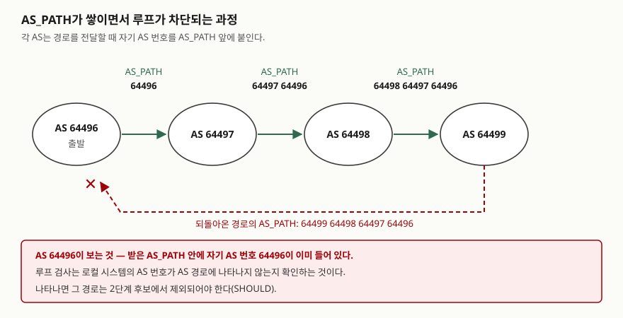
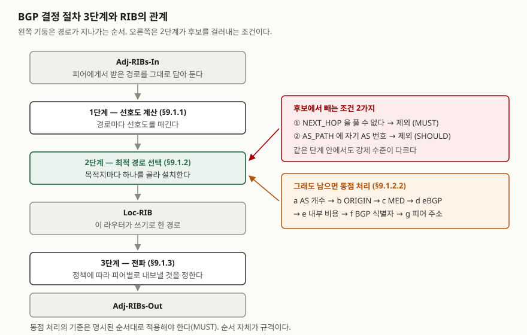

## 들어가며

라우팅 프로토콜 분류를 물으면 대개 거리벡터와 링크상태 둘로 답이 나온다. 그런데 오늘날
인터넷의 도메인 사이를 실제로 잇는 BGP는 둘 중 어느 쪽도 아니다. 시험에서 점수가 갈리는
자리는 "BGP는 경로벡터다"라고 이름을 붙이는 데 있지 않고, **왜 AS 사이에서는 메트릭
최소화가 성립하지 않는지**와 **그렇다면 무엇을 기준으로 고르는지**를 적는 데 있다.
실무에서도 "더 짧은 경로가 있는데 왜 저쪽으로 나가느냐"는 질문은 거의 전부 이 두 자리에서
나온다.

> **실행 검증 없음.** RFC 조문 근거로만 정리했다.

---

## 정의

**경로벡터 라우팅은 목적지까지의 거리 대신 거쳐 온 라우팅 도메인의 순서를 경로 속성에
실어 이웃에게 알리고, 그 속성으로 루프를 막으면서 도메인마다 자기 정책으로 경로를 고르게
하는 방식이다.**

용어 자체는 도메인 간 라우팅을 다룬 RFC 1322가 세웠다. 경로벡터 개요 절(§3.2.1)은 경로를
"목적지와 그 목적지까지의 경로가 갖는 속성의 짝"으로 규정하고, 이웃 경계 라우터로부터
**목적지 집합까지의 경로가 담긴 벡터**를 받는 프로토콜이라고 적는다. 같은 절은 이 이름이
거리벡터(distance vector)라는 용어와 **의도적으로 닮게** 지어졌다고 밝힌다. 거리벡터가
"목적지 집합까지의 거리가 담긴 벡터"를 주고받는다면, 경로벡터는 그 자리에 거리 대신
경로를 넣는다.

한 가지 짚어 둘 것이 있다. **BGP-4 표준 자체에는 "경로벡터"라는 말이 나오지 않는다.**
표준이 규정하는 것은 AS_PATH라는 속성이고, 경로벡터는 그 메커니즘을 가리키는 분류
용어다. 답안에서 "RFC 4271이 경로벡터라고 정의한다"고 쓰면 틀린다. 정의는 RFC 1322에서
가져오고, BGP 쪽은 속성의 규정으로 받는 것이 맞다.

AS_PATH는 BGP가 반드시 싣고 다녀야 하는 속성이다. 속성 목록 절(§4.3)은 AS_PATH를 **잘
알려진 필수 속성(well-known mandatory)**, 타입 코드 **2**로 정하고, 두 가지 세그먼트
타입을 둔다.

| 세그먼트 | 타입 값 | 표준의 규정 |
|---|---|---|
| AS_SET | 1 | 경로가 거쳐 온 AS들의 **순서 없는** 집합 |
| AS_SEQUENCE | 2 | 경로가 거쳐 온 AS들의 **순서 있는** 집합 |

## 등장 배경

거리벡터와 링크상태가 왜 AS 경계를 넘지 못하는지가 이 개념의 출발점이다. RFC 1322의
경로벡터 개요 절(§3.2.1)은 두 방식이 **전역으로 정의된, 단조 증가하는 하나의 메트릭**에
기대어 경로를 고른다고 적는다. 모든 라우터가 같은 자로 재고 그 값이 작은 쪽을 고르기
때문에 결과가 하나로 모인다.

AS 사이에서는 이 전제가 두 군데서 깨진다.

첫째, **자가 같지 않다.** 홉 수든 링크 비용이든 그 값은 한 관리 주체가 자기 망에 매긴
것이다. 다른 사업자가 매긴 값과 더하거나 비교할 근거가 없다.

둘째, **고르는 기준이 같지 않다.** 같은 절은 경로벡터가 모든 라우팅 도메인에 **동질적인
경로 선택 기준을 요구하지 않는다**고 적는다. 각 도메인이 자기 정책을 적용할 수 있다는
뜻이다. 계약상 쓰지 않기로 한 이웃이 더 짧아도 그쪽으로 보내지 않는 일이 AS 사이에서는
정상 동작이다. 같은 문서가 정책을 지원하려면 **경로 정보를 추가로 갖는 것이 필수**라고
못 박은 이유가 여기에 있다.

루프 차단 방식도 따라서 달라진다. 거리벡터는 거리가 한 단계씩 올라가다 무한값에서 멈추는
방식으로 루프를 다스린다. 경로벡터는 셀 필요가 없다. RFC 1322는 **루프 억제가 이 특별한
경로 속성으로 구현된다**고 적고, 다른 절(§3.4)에서는 **완전한 경로 정보를 써서 루프를
피한다**고 쓴다. 자기 도메인 번호가 받은 경로 안에 들어 있으면 그 경로는 이미 자신을
거쳐 간 것이므로, 더 볼 것 없이 버리면 된다.

> 거리벡터와 링크상태 자체의 동작은 다음 글에 정리해 두었다.
> [라우팅 프로토콜 — 거리벡터와 링크상태](../2026-09-28-routing-distance-vector-vs-link-state/index.md)

## 구성요소 — 경로 속성 7가지와 결정 절차 3단계

### 가. 경로 속성 7가지

BGP-4 표준은 속성을 **네 범주**로 나눈다. 잘 알려진 필수, 잘 알려진 임의, 선택적 전이,
선택적 비전이다. "잘 알려진"은 모든 구현이 알아봐야 한다는 뜻이고, "전이"는 알아보지
못하는 구현이 그대로 다음 피어에 넘겨야 한다는 뜻이다.

| 속성 | 타입 코드 | 범주 | 역할 |
|---|---|---|---|
| ORIGIN | 1 | 잘 알려진 필수 | 경로 정보의 출처 |
| AS_PATH | 2 | 잘 알려진 필수 | 거쳐 온 AS의 순서 |
| NEXT_HOP | 3 | 잘 알려진 필수 | 목적지로 가는 다음 홉 주소 |
| MULTI_EXIT_DISC | 4 | 선택적 비전이 | 이웃 AS에게 알리는 출구 선호 |
| LOCAL_PREF | 5 | 잘 알려진 속성 | AS 안에서 공유하는 선호도 |
| ATOMIC_AGGREGATE | 6 | 잘 알려진 임의 | 경로가 집약되었음을 표시 |
| AGGREGATOR | 7 | 선택적 전이 | 집약을 수행한 AS와 라우터 |

표에서 **LOCAL_PREF 한 줄만 범주 이름이 비어 있다.** 속성 목록 절(§4.3)이 LOCAL_PREF를
"잘 알려진 속성"이라고만 쓰고 네 범주 중 하나를 지정하지 않기 때문이다. 같은 표준의 경로
속성 절(§5)은 이 속성을 iBGP에서 **필수**, eBGP에서는 별도 절을 보라고 갈라 적는다.
답안에 "잘 알려진 임의"라고 단정해 쓰지 않는 편이 안전하다.

ORIGIN이 갖는 값은 **3가지**다. 0은 IGP, 1은 EGP, 2는 INCOMPLETE다.

방향이 갈리는 속성 두 개를 따로 본다. LOCAL_PREF 절(§5.1.5)은 이 속성을 **내부 피어에게
보내는 모든 UPDATE에 포함해야 하고(SHALL)**, 외부 피어에게 보내는 UPDATE에는 **포함하면
안 된다(MUST NOT)**고 정한다. 값은 **높은 쪽이 선호된다.** MULTI_EXIT_DISC 절(§5.1.4)은
반대로 **외부 링크에서 쓰도록 의도된** 선택적 비전이 속성이며, **낮은 메트릭을 가진 출구가
선호되어야 한다**고 적는다. 외부에서 받은 값은 같은 AS 안의 다른 스피커에게 전파할 수
있지만(MAY), **다른 이웃 AS로 전파해서는 안 된다(MUST NOT).**

### 나. 결정 절차 3단계

BGP-4 표준의 결정 절차 절(§9.1)은 경로 선택을 세 단계로 나눈다.

1. **1단계(§9.1.1)** — 피어에게서 받은 각 경로에 대해 **선호도(degree of preference)**를
   계산한다
2. **2단계(§9.1.2)** — 목적지마다 가용한 경로 중 최적 경로를 고르고 **Loc-RIB에 설치**한다
3. **3단계(§9.1.3)** — Loc-RIB의 경로를 정책에 따라 **각 피어에게 전파**한다

2단계에는 고르기 전에 **후보에서 빼는 두 가지 조건**이 있다. 하나는 NEXT_HOP이다. 같은
절은 NEXT_HOP을 풀 수 없으면 그 경로를 2단계 결정 함수에서 **반드시 제외해야 한다(MUST)**고
정하고, 해석 가능성 절(§9.1.2.1)은 **라우팅 표에 NEXT_HOP과 일치하는 경로가 없을 때**
풀 수 없는 것으로 규정한다. 다른 하나가 루프다. 같은 절은 AS_PATH에 AS 루프가 있으면 그
경로가 **제외되어야 한다(SHOULD)**고 적고, 루프 검사란 **로컬 시스템의 AS 번호가 AS 경로에
나타나지 않는지 확인하는 것**이라고 쓴다.

**두 조건의 강제 수준이 다르다는 점을 흘리지 않는다.** NEXT_HOP은 MUST이고 루프는
SHOULD다. 답안에서 "BGP는 자기 AS 번호가 들어 있으면 반드시 버린다"고 쓰면 조문보다 한
칸 세게 쓰는 것이 된다.

## 도식

> **출처**: [RFC 4271 §4.3 UPDATE Message Format (AS_PATH 타입 코드·세그먼트 타입), §5.1.2 AS_PATH, §9.1.2 Phase 2: Route Selection (AS 루프 제외와 루프 검사의 정의) (2006-01)](https://www.rfc-editor.org/rfc/rfc4271.txt) · [RFC 1322 §3.2.1 Path Vector Protocol Overview (경로 속성을 통한 루프 억제) (1992-05)](https://www.rfc-editor.org/rfc/rfc1322.txt). 도식의 AS 번호는 문서 예시용으로 예약된 대역([RFC 5398](https://www.rfc-editor.org/info/rfc5398))을 썼다

답안지에는 AS 타원 네 개를 가로로 늘어놓고 화살표마다 AS_PATH 값을 한 줄로 적는다.
마지막 화살표가 처음 AS로 되돌아가고 거기에 ✕를 치면 그림이 끝난다.

> **출처**: [RFC 4271 §3.2 Routing Information Base (Adj-RIBs-In·Loc-RIB·Adj-RIBs-Out), §9.1 Decision Process, §9.1.1 Phase 1, §9.1.2 Phase 2, §9.1.3 Phase 3 (2006-01)](https://www.rfc-editor.org/rfc/rfc4271.txt)

## 비교

### 가. 세 가지 라우팅 방식

| 축 | 거리벡터 | 링크상태 | **경로벡터** |
|---|---|---|---|
| 알리는 것 | 목적지별 **거리** | 자기 **링크 상태** 원본 | 목적지별 **거쳐 온 경로** |
| 받는 범위 | 이웃 | 영역 전체(flooding) | 피어 |
| 고르는 기준 | 전역 메트릭 최소 | 전역 메트릭 최소 | **도메인별 정책** |
| 선택 기준의 동질성 | 필요 | 필요 | **불필요** |
| 루프 차단 | 무한값까지 세기 | 전체 토폴로지 보유 | **경로 속성에 자기 번호가 있는지** |
| 대표 | RIP | OSPF, IS-IS | BGP-4 |

거리벡터·링크상태 칸의 "전역 메트릭 최소"와 "선택 기준의 동질성 필요"는 RFC 1322의 경로벡터
개요 절(§3.2.1)이 두 방식의 전제로 적은 내용이다.

### 나. 동점 처리 7단계

선호도가 같은 경로가 여럿 남으면 동점 처리 절(§9.1.2.2)이 순서대로 걸러낸다. 이 절은
**기준을 명시된 순서대로 적용해야 한다(MUST)**고 못 박는다. 순서가 곧 규격이므로 답안에도
순서대로 쓴다.

| 순서 | 기준 |
|---|---|
| a | AS_PATH의 **AS 개수가 가장 적은** 경로만 남긴다 (AS_SET은 **1개**로 센다) |
| b | **ORIGIN 값이 가장 낮은** 경로만 남긴다 |
| c | MULTI_EXIT_DISC가 덜 선호되는 경로를 뺀다 |
| d | eBGP로 받은 후보가 하나라도 있으면 **iBGP로 받은 경로를 전부 뺀다** |
| e | NEXT_HOP까지의 **내부 비용**이 덜 선호되는 경로를 뺀다 |
| f | **BGP 식별자가 가장 낮은** 스피커가 알린 경로만 남긴다 |
| g | **피어 주소가 가장 낮은** 쪽에서 받은 경로를 선호한다 |

c 항목에는 단서가 붙는다. 같은 절은 MULTI_EXIT_DISC가 **같은 이웃 AS에서 배운 경로들
사이에서만 비교 가능하다**고 적는다. 서로 다른 AS에서 온 두 경로의 MED 값을 나란히
비교하는 것은 규격 바깥의 동작이다.

## 적용 시 고려사항 — 4가지

### 가. iBGP는 풀메시를 전제로 설계됐다

UPDATE 메시지 처리 절(§9.2)은 내부 피어에게서 받은 UPDATE의 라우팅 정보를 **다른 내부
피어에게 재배포해서는 안 된다(SHALL NOT)**고 정한다. 경로 반사기로 동작하는 경우만
예외다. 내부에서 한 홉만 전파되므로, 모든 내부 스피커가 외부 경로를 같은 모양으로 보려면
서로가 직접 세션을 맺어야 한다. 표준의 동작 요약 절(§3)도 AS 안의 모든 BGP 스피커가
서로 iBGP를 유지하는 것으로 **AS 외부 경로에 대한 일관된 뷰**가 만들어진다고 전제한다.

이 전제의 비용을 RFC 4456이 수치로 적는다. 서론(§1)은 AS 안의 BGP 스피커가 n개면
**n×(n−1)/2개의 유일한 iBGP 세션**을 유지해야 하고, 이 풀메시 요구는 **분명히 확장되지
않는다**고 쓴다.

### 나. 경로 반사기는 절차 자체를 건드린다

RFC 4456은 피어를 **클라이언트와 비클라이언트 둘로** 나누고, 반사기와 그 클라이언트들이
하나의 **클러스터**를 이룬다고 규정한다(§5). 반사 규칙 절(§6)은 비클라이언트에게서 받은
경로는 **모든 클라이언트에게**, 클라이언트에게서 받은 경로는 **모든 비클라이언트와 다른
클라이언트에게** 반사한다고 적는다. 이때 반사기가 **자기 경로 선택 규칙으로 최적 경로를
먼저 고른다**는 점이 중요하다.

반사가 만드는 새 루프는 새 속성 두 개로 막는다(§8).

| 속성 | 타입 코드 | 범주 | 루프를 막는 방식 |
|---|---|---|---|
| ORIGINATOR_ID | 9 | 선택적 비전이 | 자기 BGP 식별자가 이 값이면 경로를 무시(SHOULD) |
| CLUSTER_LIST | 10 | 선택적 비전이 | 반사할 때 자기 CLUSTER_ID를 앞에 붙이고(MUST), 목록에 자기 값이 있으면 무시(SHOULD) |

그리고 **동점 처리 순서가 바뀐다.** RFC 4456의 경로 선택 절(§9)은 동점 처리 규칙이 다음과
같이 수정된다고 적는다. f 단계에서는 ORIGINATOR_ID를 경로를 알린 스피커의 BGP 식별자로
취급하고, **f와 g 사이에 CLUSTER_LIST가 짧은 경로를 선호하는 단계가 새로 들어간다.**
반면 속성 절(§10)은 반사기가 NEXT_HOP·AS_PATH·LOCAL_PREF·MED를 **수정하지 않아야 한다
(SHOULD NOT)**고 정한다. 바뀌는 것은 고르는 순서이지 경로의 내용이 아니다.

여기에 문서가 스스로 적어 둔 한계가 붙는다. 반사기는 **라우팅 정보를 요약해 자기 최적
경로만 반사하므로**, MED나 IGP 메트릭이 갈리는 구성에서는 **풀메시와 같은 경로 선택 결과가
나오지 않을 수 있다**(§11). 풀메시를 줄이면서 치르는 대가가 이것이다.

### 다. AS_PATH는 내부로 넘어갈 때 길어지지 않는다

AS_PATH 절(§5.1.2)은 내부 피어에게 알릴 때 알리는 스피커가 **AS_PATH를 수정하지 않아야
한다(SHALL NOT)**고 정한다. 따라서 AS_PATH의 길이는 거쳐 온 AS의 개수이지 라우터의
개수가 아니다. 동점 처리 a 단계가 "AS 개수가 가장 적은"을 보는 것도 이 전제 위에 선다.
AS_SET을 **1개로 센다**는 단서가 같은 자리에 붙어 있는 것도 같은 이유다. 집약된 경로는
실제로 여러 AS를 담고 있어도 길이 비교에서는 한 칸이다.

### 라. 감시는 속성별로 건다

경로가 갑자기 바뀌었다는 신고를 받으면 볼 자리가 정해져 있다. 선호도를 바꾸는 쪽
(LOCAL_PREF), 길이를 바꾸는 쪽(AS_PATH), 후보에서 빼는 쪽(NEXT_HOP 해석 실패)이 서로
다른 단계에서 작동하기 때문이다. 특히 NEXT_HOP 해석 실패는 **BGP 세션이 멀쩡한 채로**
경로만 사라지므로, 세션 상태만 보는 감시로는 잡히지 않는다.

## 정리

- **정의는 RFC 1322에서, 메커니즘은 RFC 4271에서 가져온다.** BGP-4 표준에는 "경로벡터"라는
  말이 없다
- **거리벡터와 갈리는 지점은 셋이다.** 벡터에 거리 대신 경로가 들어가고, 전역 메트릭을
  요구하지 않으며, 루프를 세지 않고 경로 속성으로 막는다
- **속성 7가지, 범주 4가지, ORIGIN 값 3가지.** LOCAL_PREF는 네 범주 중 하나로 단정하지
  않는다
- **결정 절차 3단계 — 선호도 계산 → 최적 경로 선택과 Loc-RIB 설치 → 전파.** 2단계 앞에
  제외 조건 2가지(NEXT_HOP은 MUST, AS 루프는 SHOULD)가 선다
- **동점 처리 7단계 a~g는 순서가 곧 규격이다.** 경로 반사기를 쓰면 f가 바뀌고 f와 g 사이에
  한 단계가 끼어든다
- **풀메시는 n×(n−1)/2.** 이 숫자를 줄이는 대가는 "풀메시와 같은 결과가 나오지 않을 수
  있다"는 것이다

> 기출 답안: [기출문제 — 동적 라우팅 프로토콜 IGP와 EGP](../../exam/2026-10-27-igp-and-egp/index.md)

## 참고 자료

- [RFC 1322, *A Unified Approach to Inter-Domain Routing* (1992-05, Informational)](https://www.rfc-editor.org/rfc/rfc1322.txt) — §3.2 경로벡터라는 이름, §3.2.1 Path Vector Protocol Overview(정의·거리벡터와의 대비·전역 메트릭 불필요·루프 억제), §3.4 완전한 경로 정보로 루프를 피한다 (1차)
- [RFC 4271, *A Border Gateway Protocol 4 (BGP-4)* (2006-01, Standards Track)](https://www.rfc-editor.org/rfc/rfc4271.txt) — §3 동작 요약과 iBGP 전제, §3.2 Routing Information Base, §4.3 경로 속성 타입 코드와 범주, §5 경로 속성의 네 범주, §5.1.2 AS_PATH, §5.1.4 MULTI_EXIT_DISC, §5.1.5 LOCAL_PREF, §9.1 Decision Process, §9.1.2 Phase 2, §9.1.2.1 Route Resolvability Condition, §9.1.2.2 Breaking Ties, §9.2 내부 피어 재배포 금지 (1차)
- [RFC 4456, *BGP Route Reflection: An Alternative to Full Mesh Internal BGP (IBGP)* (2006-04, Standards Track)](https://www.rfc-editor.org/rfc/rfc4456.txt) — §1 풀메시 세션 수 n×(n−1)/2, §5 클라이언트·비클라이언트와 클러스터, §6 반사 규칙, §7 CLUSTER_ID, §8 ORIGINATOR_ID와 CLUSTER_LIST, §9 동점 처리 수정, §10 수정하지 않아야 할 속성, §11 풀메시와 결과가 다를 수 있음 (1차)
- [RFC 4098, *Terminology for Benchmarking BGP Device Convergence in the Control Plane* (2005-06, Informational)](https://www.rfc-editor.org/rfc/rfc4098.txt) — §1에서 BGP를 경로벡터 프로토콜로 지칭하나, 용어 정의 항목에는 두지 않는다 (1차)
- [RFC 5398, *Autonomous System (AS) Number Reservation for Documentation Use* (2008-12, Informational)](https://www.rfc-editor.org/info/rfc5398) — 도식에 쓴 문서 예시용 AS 번호 대역 (1차)
