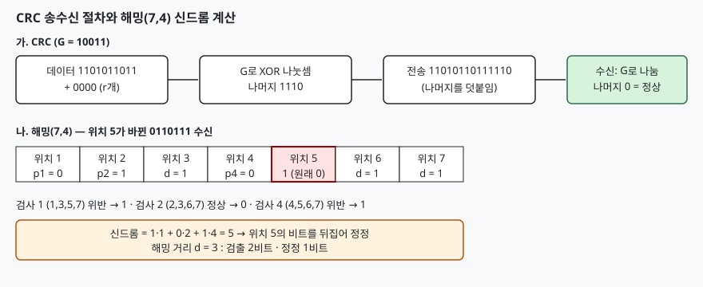

## 들어가며

이더넷 프레임 끝에는 32비트 FCS가 붙고, 서버 메모리에는 1비트 오류를 스스로 고치는 ECC가 쓰인다.
둘 다 데이터에 **중복 비트를 덧붙여** 오류를 다루지만 목적이 다르다. 앞의 것은 오류가 있다는 사실만
알아내고 재전송에 맡기며, 뒤의 것은 재전송이 불가능해서 수신 쪽이 직접 고친다.
시험에서는 CRC의 계산 절차와 해밍 코드에서 오류 위치를 찾는 절차를 손으로 계산하게 하는 일이 많다.

> **실행 검증 없음.** 두 예제는 손으로 계산해 검산했고 프로그램으로 돌린 기록은 없다. 부호 이론의 정리는 원 논문과 규격의 서술을 따랐다.

## 정의

**CRC(Cyclic Redundancy Check)는 데이터를 생성 다항식으로 나눈 나머지를 데이터 뒤에 덧붙여 보내고, 수신 측이 같은 다항식으로 나눠 나머지가 0인지로 오류를 검출하는 부호다.**

**해밍 코드(Hamming Code)는 패리티 비트 여러 개가 데이터 비트의 서로 다른 부분집합을 검사하게 하여, 검사 결과의 조합(신드롬)으로 1비트 오류의 위치를 알아내 정정하는 부호다.**

## 등장 배경

단순 패리티 비트는 비트 하나가 바뀐 것은 알아내지만 두 비트가 바뀌면 놓치고, 어느 비트인지도 알 수 없다.
통신에서는 잡음이 비트를 연달아 바꾸는 **집단 오류(burst error)** 가 흔해서 이를 잘 잡는 방식이 필요했다.
Peterson과 Brown(1961)은 순환 부호의 다항식 나눗셈을 시프트 레지스터 회로로 구현할 수 있음을 보였고,
Hamming(1950)은 패리티 검사 여러 개를 겹쳐서 오류 위치까지 가리키는 부호를 제시했다.

## 구성요소와 절차

**CRC 송신 절차(4단계)** 는 다음과 같다.

1. 생성 다항식 G(x)의 차수가 r이면 데이터 뒤에 0을 r개 붙인다
2. 이 수를 G로 나눈다. 뺄셈은 자리올림 없는 XOR이다
3. 나머지 r비트를 0 대신 붙여 전송한다
4. 수신 측은 받은 전체를 G로 나눠 나머지가 0이면 정상으로 판단한다

예를 들어 데이터 `1101011011`, G(x) = x⁴ + x + 1 (`10011`)이면 `11010110110000`을 나눈 나머지가 `1110`이고,
전송 비트열은 `11010110111110`이다. 수신 측이 이를 `10011`로 나누면 나머지가 0이 된다.

**해밍(7,4) 코드의 구성(3가지)** 은 다음과 같다. 위치 1~7 중 2의 거듭제곱 위치(1, 2, 4)가 패리티 비트이고 나머지 3, 5, 6, 7이 데이터이다.
패리티 비트 p_k는 **위치 번호를 이진수로 썼을 때 k자리가 1인 모든 위치**를 검사한다.

| 패리티 | 검사하는 위치 |
|---|---|
| p₁ | 1, 3, 5, 7 |
| p₂ | 2, 3, 6, 7 |
| p₄ | 4, 5, 6, 7 |

데이터 `1011`이면 위치 3, 5, 6, 7에 1, 0, 1, 1이 들어간다. 짝수 패리티로 p₁ = 0, p₂ = 1, p₄ = 0이 되어 코드어는 `0110011`이다.
위치 5가 바뀌어 `0110111`이 도착하면 세 검사의 결과는 p₁ 위반(1), p₂ 정상(0), p₄ 위반(1)이다.
이를 4·2·1 자리로 읽으면 신드롬 = 101₂ = 5이고, 위치 5의 비트를 뒤집으면 정정된다.

> **출처**: [Hamming, "Error Detecting and Error Correcting Codes", Bell System Technical Journal 29(2), 1950](https://ieeexplore.ieee.org/document/6772729) · [Peterson & Brown, "Cyclic Codes for Error Detection", Proc. IRE 49(1), 1961](https://ieeexplore.ieee.org/document/4066263)

## 동작 원리

두 부호의 능력은 **해밍 거리**(두 코드어에서 서로 다른 비트 수)의 최솟값 d로 정해진다.
d 이상 떨어진 코드어 집합에서는 **d − 1비트까지 오류를 검출**하고 **⌊(d − 1)/2⌋비트까지 정정**한다.
해밍(7,4)는 d = 3이라 2비트 검출 또는 1비트 정정이 되고, 전체 패리티 비트 1개를 더한 확장 해밍 코드는 d = 4가 되어
**1비트 정정과 2비트 검출(SECDED)** 을 함께 한다. 서버 ECC 메모리가 이 구조를 쓴다.

해밍 코드의 비트 수 조건은 데이터 m비트, 패리티 r비트일 때 2ʳ ≥ m + r + 1이다.
r개의 검사 결과가 만드는 2ʳ가지 신드롬이 "오류 없음"과 "m + r개 위치 중 하나"를 모두 구별해야 하기 때문이다.
(7,4)는 8 ≥ 4 + 3 + 1로 딱 들어맞는다.

CRC가 오류를 잡는 이유는 수신 다항식이 G로 나누어떨어지는 것이 코드어의 조건이라는 데 있다.
오류 패턴 E(x)가 G로 나누어떨어지는 경우에만 검출에 실패한다. 이에 따라 **차수 r인 G는 길이 r 이하의 집단 오류를 항상 검출**한다.
E(x)의 차수가 r 미만이라 G의 배수가 될 수 없기 때문이다. G가 (x + 1)을 인수로 가지면 홀수 개 비트 오류도 모두 검출한다.

## 비교

| 구분 | 단순 패리티 | CRC | 해밍 코드 |
|---|---|---|---|
| 목적 | 검출 | 검출 | 검출·정정 |
| 덧붙이는 양 | 1비트 | 다항식 차수 r비트 | 2ʳ ≥ m+r+1을 만족하는 r비트 |
| 집단 오류 | 약함 | 길이 r 이하 항상 검출 | 약함 |
| 오류 처리 | 재전송 | 재전송 | 수신 측 정정 |
| 쓰이는 곳 | 시리얼 통신 | 이더넷 FCS, 저장장치 | ECC 메모리 |

## 적용 시 고려사항

1. **재전송 가능 여부로 고른다.** 재전송이 가능하면 CRC와 ARQ를 묶는 편이 비용이 낮다. 지연이 크거나 재전송이 불가능한 환경(위성, 메모리)은 정정 부호가 필요하다
2. **오류 유형을 본다.** 비트가 독립적으로 바뀌면 해밍 코드가 맞고, 연속으로 바뀌면 CRC가 맞다. 집단 오류를 정정해야 하면 인터리빙과 함께 쓴다
3. **CRC는 악의적 변조를 막지 못한다.** 선형 부호라 공격자가 CRC가 일치하도록 데이터를 고칠 수 있다. 무결성이 보안 요건이면 해시나 MAC을 쓴다
4. **생성 다항식 선택은 규격을 따른다.** 같은 r이라도 다항식마다 검출 성능이 다르므로 프로토콜이 정한 것을 그대로 쓴다. 이더넷 FCS는 32비트 CRC이다(IEEE 802.3 프레임 검사 순서 필드)

## 정리

- CRC는 **나눗셈 나머지 덧붙이기(4단계)**, 길이 r 이하 집단 오류 항상 검출
- 해밍은 **패리티 3개가 위치 번호의 이진 자릿수에 대응**, 신드롬이 곧 오류 위치
- 능력은 해밍 거리 d로 결정: **검출 d−1, 정정 ⌊(d−1)/2⌋**
- 해밍 조건 **2ʳ ≥ m+r+1**, 확장 해밍은 **SECDED**

> 기출 답안: [기출문제 — 데이터 통신의 오류 제어와 ARQ(정지-대기·Go-Back-N)](../../exam/2026-11-06-error-control-arq-stop-and-wait-go-back-n/index.md)

## 참고 자료

- R. W. Hamming, [Error Detecting and Error Correcting Codes](https://ieeexplore.ieee.org/document/6772729), Bell System Technical Journal, 1950
- W. W. Peterson, D. T. Brown, [Cyclic Codes for Error Detection](https://ieeexplore.ieee.org/document/4066263), Proceedings of the IRE, 1961
- IEEE 802.3 Ethernet 표준, 프레임 검사 순서(FCS) 필드
