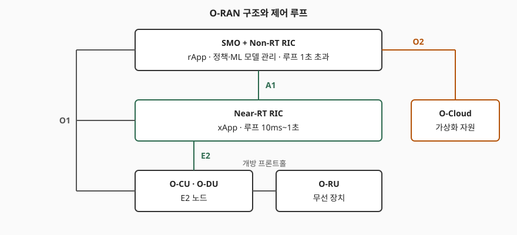

## 들어가며

기지국 장비가 한 제조사의 폐쇄된 묶음이던 시절에는 무선 자원 관리 로직도 그 안에 박혀 있어서, 다른 회사의 최적화 알고리즘을 얹으려면 장비 공급사의 허락이 필요했다. O-RAN 은 기지국을 쪼개고 사이를 개방 인터페이스로 이어, **외부 소프트웨어가 RAN 을 제어하게 하는 자리**를 규격으로 만든 것이다. 시험에서는 구성요소 이름보다 **어느 제어 루프가 어느 시간 척도에서 어느 인터페이스를 타는가**를 묻는다. 앞서 정리한 [SON](../2026-11-06-son-self-organizing-network/index.md) 이 자동화의 개념이라면, O-RAN 은 그 자동화 로직을 올릴 구조다.

> **실행 검증 없음.** 규격 본문(O-RAN.WG1 등)은 읽지 못했다. 같은 구조를 설명하는 논문(arXiv 2202.01032v2, 2022-08)의 본문 앞부분과 O-RAN Alliance 기술그룹 소개 페이지를 읽고 정리했다. 규격이 이후 개정됐을 수 있고, 아래 수치는 논문 기준이다.

---

## 정의

**O-RAN 은 기지국을 분리·가상화하고 개방 인터페이스로 연결하며, RIC(RAN Intelligent Controller)로 폐루프 제어를 수행하는 개방형 무선접속망 구조다.**

논문은 O-RAN 의 기반 원칙을 **분리, RIC 제어, 가상화, 개방 인터페이스의 4가지**로 든다. RIC 는 RAN 전체를 보는 논리적 제어기이며 AI/ML 을 돌려 제어 정책을 적용한다.

## 등장 배경

3GPP 의 gNB 는 CU·DU·RU 로 나뉘지만, 그 사이 인터페이스와 제어 로직의 위치는 제조사에 맡겨져 있었다. O-RAN 은 이를 O-CU·O-DU·O-RU 로 부르고 3GPP NR 의 7.2 분할을 확장해 장비 간 상호 운용을 노린다. 제어 로직은 장비 밖의 RIC 로 빼내 앱 형태로 배포하게 했다.

## 구성요소 — 5가지 구성과 4가지 인터페이스

### 가. 구성요소 5가지

| 구성요소 | 역할 |
|---|---|
| SMO | RAN 구성요소의 오케스트레이션·관리·자동화 |
| Non-RT RIC | SMO 안에서 정책·보강 정보·ML 모델 관리를 Near-RT RIC 에 제공 |
| Near-RT RIC | 엣지에서 xApp 을 호스팅하고 E2 로 RAN 을 제어 |
| O-CU · O-DU · O-RU | 분리된 기지국. O-CU/O-DU 가 E2 노드 |
| O-Cloud | 가상화 자원을 하나 이상의 데이터센터에 모은 인프라 |

### 나. 인터페이스 4가지 (+ R1, 개방 프론트홀)

| 인터페이스 | 연결 | 실리는 것 |
|---|---|---|
| A1 | Non-RT RIC ↔ Near-RT RIC | 정책, 가이던스, ML 모델 |
| E2 | Near-RT RIC ↔ E2 노드(DU·CU 등) | 측정 보고와 제어 (E2AP 위에 서비스 모델) |
| O1 | SMO ↔ RIC·RAN 노드 | FCAPS 관리 (장애·구성·계정·성능·보안) |
| O2 | SMO·Non-RT RIC ↔ O-Cloud | 클라우드 자원 관리 |

R1 은 Non-RT RIC 이 rApp 에 데이터와 기능을 노출하는 종단이고, 개방 프론트홀은 DU 와 RU 를 잇는다. 논문은 E2 의 절차 서비스를 **Report·Insert·Control·Policy 4가지**, 표준화된 서비스 모델을 **KPM·NI·RC 3가지**로 적는다.

> **출처**: Polese 외, [Understanding O-RAN (arXiv 2202.01032v2)](https://arxiv.org/html/2202.01032v2) 그림 3·4(제어 루프와 구조). 작업그룹 범위는 [O-RAN Alliance 기술그룹](https://www.o-ran.org/technical-groups). 도식은 단순화했다.

## 제어 루프 — 시간 척도별 3단

| 루프 | 시간 척도 | 제어기 | 경로 | 상태 |
|---|---|---|---|---|
| Non-RT | 1초 초과 | Non-RT RIC (rApp) | SMO, A1 | 규격화 |
| Near-RT | 10ms ~ 1초 | Near-RT RIC (xApp) | E2, A1 | 규격화 |
| 실시간 | 10ms 미만 (장치 관리는 1ms 미만) | RAN 노드 | — | 현 구조 밖, 추후 검토 |

논문은 실시간 루프를 현재 아키텍처에 포함되지 않는 향후 확장으로 쓰고, 스케줄링·빔 관리를 예로 든다. **느린 루프가 정책과 모델을 정하고, 빠른 루프가 그 안에서 개별 제어를 수행한다.** 정책은 A1 으로 내려가고 측정은 E2 로 올라온다. 예를 들어 rApp 이 여러 셀에 걸친 간섭 관리 정책을 정하면 Non-RT RIC 이 A1 로 Near-RT RIC 에 전하고, xApp 은 E2 로 올라오는 측정 보고를 보며 그 정책 안에서 개별 셀을 조정한다. 이 예는 논문이 설명한 역할 분담을 풀어 쓴 것이며, 특정 규격 절차를 그대로 옮긴 것은 아니다.

## 비교 — rApp 과 xApp

| 항목 | rApp | xApp |
|---|---|---|
| 위치 | Non-RT RIC | Near-RT RIC |
| 시간 척도 | 1초 초과 | 10ms ~ 1초 |
| 접근 방식 | R1 로 데이터·A1/O1/O2 접근 | E2 로 RAN 데이터 수신·제어 반환 |
| 성격 | 상위 정책, 다수 사용자·노드에 영향 | 셀·사용자 단위 제어 |
| 예 | 주파수·간섭 관리, 슬라이싱, SLA 보증 | 트래픽 스티어링, 스케줄링 제어, 핸드오버 |

논문은 두 앱이 같은 기능을 다른 시간 척도로 다룰 수 있다고 설명한다. 차이는 기능이 아니라 **시간 척도와 영향 범위**다.

## 적용 시 고려사항

1. **xApp 간 충돌 완화.** 독립적으로 만든 xApp 이 같은 설정을 서로 다르게 바꿀 수 있다. 논문은 직접 충돌은 실행 전에, 간접·암묵 충돌은 실행 후 성능 감시로 다룬다고 적고, 당시 오픈소스 RIC 에는 이 기능이 없었다고 쓴다.
2. **보안.** 악성 xApp 이 RAN 데이터를 유출하거나 성능을 해치지 못하게 하는 보안 하위 시스템이 RIC 에 있으나, 세부는 추후 과제로 남아 있다.
3. **xApp 이식성.** 규격이 의무화한 API 는 제한적이다. 앱이 제조사 RIC 사이에서 그대로 옮겨지는지는 별도로 확인해야 한다.
4. **확장성.** Non-RT RIC 은 SMO 를 거쳐 수천 단말에 간접적으로 영향을 주므로 규모가 커지면 부담이 된다.
5. **상호 운용 시험.** 논문은 초기 표준 시험이 프론트홀과 E2 에 집중돼 있다고 쓴다.

## 정리

- O-RAN = **분리·RIC 제어·가상화·개방 인터페이스 4원칙**.
- 구성요소 5가지(SMO·Non-RT RIC·Near-RT RIC·O-CU/DU/RU·O-Cloud), 인터페이스 **A1·E2·O1·O2**.
- 루프 3단: **>1초 Non-RT, 10ms~1초 Near-RT, <10ms 실시간(미규격)**.
- 암기 단서: "**A는 위로(정책), E는 아래로(제어)**". rApp 은 느리고 넓게, xApp 은 빠르고 좁게.
- 고려사항: 충돌 완화, 보안, 이식성, 확장성, 상호 운용 시험.

## 참고 자료

- M. Polese 외, [Understanding O-RAN: Architecture, Interfaces, Algorithms, Security, and Research Challenges](https://arxiv.org/html/2202.01032v2), arXiv:2202.01032v2, 2022-08
- O-RAN Alliance, [Technical Groups](https://www.o-ran.org/technical-groups)
- 3GPP SON 개념 정리: [자가조직 네트워크(SON)](../2026-11-06-son-self-organizing-network/index.md)
