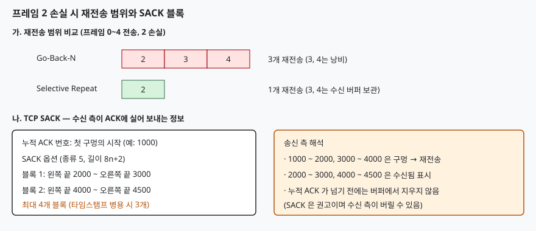

## 들어가며

Go-Back-N ARQ는 프레임 하나가 손실되면 그 뒤에 이미 잘 도착한 프레임까지 모두 다시 보낸다.
윈도우가 크고 왕복 지연이 긴 링크에서는 손실 한 번에 수십 개 프레임이 낭비된다.
Selective Repeat는 손실된 프레임만 다시 보내서 이 낭비를 없앤다.
시험에서는 Go-Back-N과의 비교, 그리고 윈도우를 왜 시퀀스 번호 공간의 절반으로 제한하는지를 자주 묻는다.

> **실행 검증 없음.** 문장의 근거는 RFC 2018과 RFC 9293의 본문이다. 윈도우 제약은 시퀀스 번호 공간을 세어 직접 유도했다.

## 정의

**Selective Repeat ARQ는 수신 측이 순서가 어긋나 도착한 프레임을 버리지 않고 버퍼에 보관하고, 송신 측은 손실·오류가 확인된 프레임만 골라 재전송하는 오류 제어 방식이다.**

**TCP SACK(Selective Acknowledgment)은 수신 측이 누적 확인 응답 번호 외에 순서가 어긋나 받은 바이트 범위를 옵션으로 알려, 송신 측이 빠진 구간만 재전송하게 하는 TCP 확장이다(RFC 2018).**

## 등장 배경

TCP의 누적 ACK는 "이 번호 직전까지 모두 받았다"만 알린다. 한 윈도우에서 여러 세그먼트가 손실되면 송신 측은
왕복 한 번에 손실 하나밖에 알 수 없고, 어느 세그먼트가 뒤에 도착했는지도 모르므로 이미 받은 것을 다시 보내기 쉽다.
RFC 2018(1996)은 이 문제를 수신 측이 가진 블록을 알려 주는 옵션으로 해결했다.

## 구성요소와 절차

**Selective Repeat의 구성(4가지)** 은 다음과 같다.

1. 송신 윈도우: 확인 전 프레임을 보관하고 **프레임마다 타이머**를 둔다
2. 수신 윈도우: 순서가 어긋난 프레임도 윈도우 안이면 버퍼에 저장한다
3. 개별 확인 응답(ACK) 또는 NAK: 받은 프레임을 번호별로 알린다
4. 윈도우 이동: 가장 앞 프레임이 채워지면 연속된 프레임을 한꺼번에 상위로 올리고 윈도우를 민다

**수행 절차(4단계)** 는 다음과 같다. 프레임 0~4를 보내고 2가 손실된 경우다.

1. 수신 측이 0, 1을 상위로 올리고 3, 4는 버퍼에 보관하며 각각 ACK를 보낸다
2. 송신 측은 2의 타이머가 만료되면 **2만** 재전송한다 (Go-Back-N이면 2, 3, 4)
3. 수신 측이 2를 받으면 2, 3, 4를 순서대로 상위로 올린다
4. 윈도우가 5 앞으로 이동한다

**TCP SACK의 구성(3가지)** 은 다음과 같다.

| 요소 | 내용 |
|---|---|
| SACK-permitted 옵션 | SYN 세그먼트에서 양쪽이 SACK 지원을 합의한다 (옵션 종류 4, 길이 2) |
| SACK 옵션 | 수신 측이 ACK에 실어 보낸다 (옵션 종류 5, 길이 8n+2) |
| 블록 | 각 블록은 **왼쪽 끝**(블록 첫 바이트 번호)과 **오른쪽 끝**(블록 마지막 바이트 다음 번호), 8바이트 |

TCP 옵션 공간이 40바이트라 블록은 **최대 4개**이고, 타임스탬프 옵션과 함께 쓰면 3개이다. 첫 번째 블록은 가장 최근에 받은 세그먼트를 포함해야 하며,
이는 앞선 ACK가 유실되어도 뒤따르는 ACK에서 정보가 중복되도록 하기 위한 것이다(RFC 2018 §4).

> **출처**: [RFC 2018 TCP Selective Acknowledgment Options §2 SACK-Permitted, §3 SACK Option Format, §4 Generating Acknowledgments](https://www.rfc-editor.org/rfc/rfc2018)

## 동작 원리

**윈도우 크기 제약.** 시퀀스 번호가 N가지(0 ~ N−1)일 때 Selective Repeat의 송수신 윈도우는 각각 **N/2 이하**여야 한다.
윈도우를 N − 1로 잡으면 N = 8, 윈도우 7인 경우에 문제가 생긴다. 프레임 0~6이 모두 도착해 수신 측이 ACK를 보냈는데
ACK가 모두 유실되면, 송신 측은 타이머 만료 후 0을 재전송한다. 수신 측의 새 윈도우는 7, 0, 1, …이므로
**재전송된 0을 새 윈도우의 새 프레임 0으로 받아들인다.** 같은 번호가 이전 라운드 것인지 다음 라운드 것인지 구분되지 않아 데이터가 중복 전달된다.
윈도우가 N/2 이하이면 수신 윈도우와 직전 윈도우의 번호 범위가 겹치지 않아 구분이 된다. Go-Back-N은 수신 윈도우가 1이라 N − 1까지 가능하다.

**SACK 송신 측의 동작.** 송신 측은 SACK에 포함된 블록을 "수신됨"으로 표시하고 그 사이 구멍만 재전송 대상으로 삼는다.
SACK 정보는 **권고(advisory)** 이다. 수신 측은 SACK로 알린 데이터를 나중에 버릴 수 있으므로(RFC 2018 §8), 송신 측은 누적 ACK가 그 번호를 넘기 전까지 재전송 버퍼에서 지우지 않는다.
SACK을 쓰는 재전송의 구체적 손실 복구 알고리즘은 별도 문서(RFC 6675)가 정한다.

## 비교

| 구분 | Stop-and-Wait | Go-Back-N | Selective Repeat |
|---|---|---|---|
| 송신 윈도우 | 1 | N − 1 이하 | N/2 이하 |
| 수신 윈도우 | 1 | 1 | N/2 이하 |
| 재전송 범위 | 해당 프레임 | 손실 프레임 이후 전부 | 손실 프레임만 |
| 수신 버퍼 | 불필요 | 불필요 | 필요 |
| 확인 응답 | 개별 | 누적 | 개별(TCP는 누적 + SACK) |
| 구현 복잡도 | 낮음 | 중간 | 높음 |

## 적용 시 고려사항

1. **손실률과 지연의 곱을 본다.** 왕복 지연이 길고 손실이 잦으면 재전송 낭비가 크므로 Selective Repeat가 유리하다. 손실이 드문 링크는 수신 버퍼와 타이머 관리 비용 때문에 Go-Back-N이 단순해서 낫다
2. **수신 버퍼 크기를 윈도우에 맞춘다.** 순서가 어긋난 프레임을 보관해야 하므로 메모리가 윈도우 크기만큼 든다
3. **TCP SACK은 양쪽 합의가 전제다.** SYN에서 SACK-permitted를 교환하지 않으면 옵션을 쓸 수 없다. 방화벽이 TCP 옵션을 지우면 SACK이 꺼진다
4. **SACK 블록 수에 한계가 있다.** 손실 구멍이 4개를 넘으면 한 ACK에 다 담을 수 없다. 앞선 ACK가 남은 정보를 전달하도록 첫 블록이 최신이어야 한다
5. **D-SACK(RFC 2883)로 중복 수신도 알린다.** 첫 SACK 블록에 이미 받은 구간을 실어 보내면 송신 측이 불필요한 재전송이었음을 알아낼 수 있다

## 정리

- Selective Repeat는 **손실 프레임만 재전송**, 대가로 **수신 버퍼**가 필요하다
- 윈도우는 번호 공간 N의 **N/2 이하**(Go-Back-N은 N−1)
- SACK은 **SYN에서 합의(종류 4) → ACK에 블록(종류 5, 최대 4개)**
- 블록은 **왼쪽 끝~오른쪽 끝**, 첫 블록은 **가장 최근 수신분**, 정보는 **권고**

> 기출 답안: [기출문제 — 데이터 통신의 오류 제어와 ARQ(정지-대기·Go-Back-N)](../../exam/2026-11-06-error-control-arq-stop-and-wait-go-back-n/index.md)

## 참고 자료

- [RFC 2018 TCP Selective Acknowledgment Options](https://www.rfc-editor.org/rfc/rfc2018) (1996-10)
- [RFC 2883 An Extension to the SACK Option for TCP](https://www.rfc-editor.org/rfc/rfc2883) (2000-07)
- [RFC 6675 A Conservative Loss Recovery Algorithm Based on SACK for TCP](https://www.rfc-editor.org/rfc/rfc6675) (2012-08)
- [RFC 9293 Transmission Control Protocol (TCP)](https://www.rfc-editor.org/rfc/rfc9293) (2022-08)
