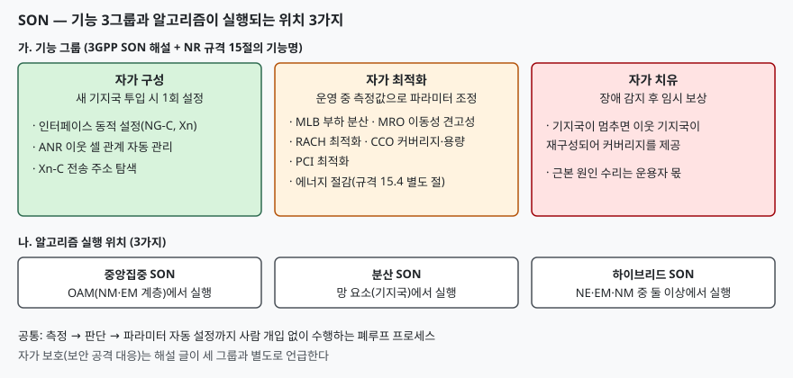

## 들어가며

기지국이 수만 대로 늘면 새 기지국 하나를 붙일 때마다 이웃 목록을 손으로 고치고, 밤마다
트래픽이 줄어도 전력은 그대로 쓰며, 장애가 나면 현장에서 원인을 찾는 방식은 운영 인력으로
감당되지 않는다. SON 은 이 반복 작업을 망이 스스로 수행하게 하려는 개념이다. 시험에서는
기능 3그룹의 이름을 쓰는 데서 끝나지 않고, **각 그룹의 대표 기능이 어떤 문제를 푸는지**와
**알고리즘이 어디서 실행되는지**를 묻는다.

> **실행 검증 없음.** 3GPP 공개 해설 글과 TS 38.300 본문을 읽고 정리했다. 1차 자료이지만 TS 32.500 등 SON 개념 규격 본문은 읽지 못했다.

---

## 정의

**SON(Self-Organizing Network)은 망이 새 기지국의 설정, 운영 중 파라미터 조정, 장애 보상을
측정값에 따라 스스로 수행하도록 하는 이동통신망 관리 자동화 개념이다.**

3GPP 해설 글(2025-04 갱신)은 SON 을 망 관리를 돕는 자동화 기술의 상위 개념으로 소개하고,
기능이 **자가 구성·자가 최적화·자가 치유 3그룹**으로 나뉜다고 적는다. 같은 글은 SON 이
**개념 수준에서만 규격화**되어 있고 알고리즘의 내용은 구현에 맡겨진다고 쓴다. 3GPP 규격에는
Release 8 에 처음 들어왔다.

## 등장 배경

기존에는 이웃 셀 관계, 핸드오버 파라미터, 셀 켜고 끄기를 운용자가 직접 설정했다. 3GPP 해설
글은 SON 기능이 **폐루프 프로세스**라고 규정한다. 측정 입력을 처리하는 데서 그치는 개루프와
달리, 입력을 처리한 뒤 파라미터까지 자동으로 설정한다는 점이 다르다.

## 구성요소 — 기능 3그룹, 실행 위치 3가지

### 가. 기능 3그룹

| 그룹 | 시점 | 하는 일 |
|---|---|---|
| 자가 구성 | 새 기지국 투입 | 전원을 켜면 설정을 받아 망의 일부가 된다. 이웃 기지국도 재구성된다 |
| 자가 최적화 | 운영 중 | 망과 단말의 측정 결과로 파라미터를 계속 갱신한다 |
| 자가 치유 | 장애 시 | 장애를 빨리 감지하고 이웃 기지국 재구성 등으로 영향을 임시 보완한다 |

해설 글은 자가 치유가 **근본 원인을 고치지는 못하고** 운용자가 분석·복구할 시간을 번다고
설명한다. 3그룹과 별도로 보안 공격을 막는 자가 보호도 언급한다.

### 나. 실행 위치 3가지

| 방식 | 알고리즘이 실행되는 곳 |
|---|---|
| 중앙집중 SON | OAM 시스템(NM 계층 또는 EM 계층) |
| 분산 SON | 기지국 같은 망 요소(NE) |
| 하이브리드 SON | NE·EM·NM 중 둘 이상 |

해설 글은 중앙집중 SON 이 여러 벤더 셀과 연동해야 해서 보통 제3자가 공급한다고 덧붙인다.

### 다. NR 규격 15절이 다루는 기능

TS 38.300 의 자가 구성·자가 최적화 절(15절)은 기능을 아래처럼 나눈다.

| 절 | 기능 | 핵심 동작 |
|---|---|---|
| 15.3 | 동적 인터페이스 설정, ANR, Xn-C 주소 탐색 | 인터페이스를 자동으로 올리고 이웃 셀 관계를 관리한다 |
| 15.4 | 에너지 절감 | 용량 보강 셀이 부하에 따라 스스로 꺼지고 필요하면 다시 켜진다 |
| 15.5.1 | MLB(이동성 부하 분산) | 부하를 보고하고 핸드오버 파라미터 변경을 이웃에 요청한다 |
| 15.5.2 | MRO(이동성 견고성 최적화) | 이동성 문제를 구분하고 수정할 수 있게 한다 |
| 15.5.3 | RACH 최적화 | 단말이 보고한 RACH 정보로 PRACH 파라미터를 맞춘다 |
| 15.5.5 | CCO(커버리지·용량 최적화) | 커버리지와 셀 경계 간섭 문제를 탐지하고 해결·완화한다 |
| 15.5.6 | PCI 최적화 | 중앙집중·분산 PCI 할당 |

15.5(자가 최적화)의 하위 절은 MLB·MRO·RACH·단말 이력 정보·CCO·PCI 의 **6가지**다.

## 동작 원리 — ANR 과 MRO

**ANR** 의 목적은 이웃 셀 관계(NCR)를 수작업으로 관리하는 부담을 덜어 주는 것이다. ANR 은
기지국 안에 있고 이웃 셀 관계 표(NCRT)를 관리한다. 새 이웃을 찾는 **탐지 기능**과 낡은
관계를 지우는 **제거 기능**이 들어 있으며 둘 다 구현에 맡겨진다. OAM 도 관계를 추가·삭제하고
속성을 바꿀 수 있고, 표가 바뀌면 OAM 에 통지된다. 이웃 셀 관계는 **단방향**, Xn 링크는
양방향이라는 점이 시험에서 헷갈리기 쉽다.

**MRO** 는 TS 38.300 이 적은 문제를 구분해 수정할 수 있게 한다. 규격이 든 문제는 **4가지**다.

1. 시스템 내·시스템 간 이동성에 의한 연결 실패
2. 시스템 간 불필요한 핸드오버(무선 링크 실패 없이 NR 에서 E-UTRAN 으로 너무 일찍 넘김)
3. 시스템 간 핑퐁 핸드오버
4. PSCell 변경 실패

연결 실패를 분석하려고 단말이 **RLF 보고**를 망에 제공하며, 단말은 최신 보고를 망이 가져갈
때까지 또는 실패 감지 후 **48시간** 동안 보관한다.

## 도식

> **출처**: [3GPP, Self-Organizing Networks (2025-04 갱신)](https://www.3gpp.org/technologies/son), [ETSI TS 138 300 V17.3.0 §15 Self-Configuration and Self-Optimisation (2023-01)](https://www.etsi.org/deliver/etsi_ts/138300_138399/138300/17.03.00_60/ts_138300v170300p.pdf)

답안지에는 위쪽에 큰 박스 3개(구성·최적화·치유)를 놓고 기능 이름을 한 줄씩 적은 뒤, 아래에
실행 위치 3개를 한 줄로 늘어놓는다.

## 비교 — 개루프와 폐루프

| 축 | 개루프 | 폐루프(SON) |
|---|---|---|
| 측정 입력 처리 | 한다 | 한다 |
| 파라미터 자동 설정 | 하지 않는다. 사람 입력 필요 | 한다 |

## 적용 시 고려사항 — 4가지

1. **알고리즘은 규격 밖이다.** 해설 글은 SON 기능이 구현 의존이라고 적는다. 벤더마다 동작이
   다르므로 도입 때 알고리즘 동작을 확인해야 한다.
2. **자동 변경에는 범위가 있다.** TS 38.300 은 MLB 에서 핸드오버·재선택 파라미터의 자동
   변경이 **OAM 이 허용한 범위 안에** 있어야 한다고 적는다. 운용자는 허용 범위를 설정해야 한다.
3. **멀티벤더면 중앙집중이 필요해진다.** 분산 SON 은 보통 셀을 공급한 벤더가 제공하므로 벤더를
   넘는 조정은 중앙집중이 맡는다는 것이 해설 글의 설명이다.
4. **AI 확장은 아직 전망이다.** 해설 글의 미래 절은 SON 프로세스가 AI 모델을 쓸 가능성이
   있고, 모델은 대량의 실제 데이터로 학습되어야 한다고 쓴다. 이 글은 AI 확장의 규격 내용은
   확인하지 못했으므로 시험에서는 "방향"으로만 쓴다.

## 정리

- SON = 자가 **구성·최적화·치유** 3그룹, 실행 위치는 **중앙집중·분산·하이브리드** 3가지
- 구성은 투입 시 1회, 최적화는 운영 중 지속, 치유는 장애 시 임시 보상
- NR 자가 최적화 6가지: MLB·MRO·RACH·단말 이력·CCO·PCI
- MRO 가 구분하는 문제 4가지, ANR 은 이웃 관계(단방향)를 자동 관리
- 규격은 개념 수준이고 알고리즘은 구현 의존

## 참고 자료

- [3GPP, Self-Organizing Networks (2025-04 갱신)](https://www.3gpp.org/technologies/son)
- [ETSI TS 138 300 V17.3.0 (2023-01) — NR Overall description](https://www.etsi.org/deliver/etsi_ts/138300_138399/138300/17.03.00_60/ts_138300v170300p.pdf)
