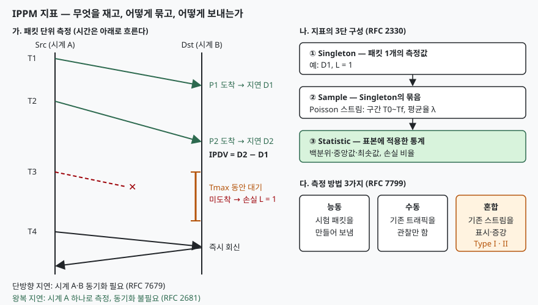

## 들어가며

네트워크 SLA에 "지연 50 ms 이하, 손실률 0.1% 이하"라고 적어 두어도, 지연을 어디서 어디까지 쟀는지와
몇 초 안 온 패킷을 손실로 볼지가 정해져 있지 않으면 두 당사자는 다른 숫자를 들고 온다.
IETF IPPM(IP Performance Metrics) 작업반은 이 문제를 지표 정의 자체를 표준화하는 방식으로 풀었다.
시험에서는 SLA·QoS 문제의 네트워크 영역 지표로 나오며, 각 지표의 정의와 측정 조건(시계 동기화, Tmax)을 함께 묻는다.

> **실행 검증 없음.** 정의와 매개변수는 각 RFC 본문을 근거로 정리했다. 예시 수치는 설명용 가정값이다.

## 정의

**IPPM 지표는 IP 경로의 성능을 패킷 유형(Type-P), 송·수신 호스트, 측정 시각 같은 매개변수와 함께 정의해, 누가 재도 같은 값이 나오도록 한 IETF 표준 성능 지표 체계다(RFC 2330).**

핵심 지표 4가지의 정의는 다음과 같다.

| 지표 | 정의 (요지) | 근거 |
|---|---|---|
| 단방향 지연 | Src가 패킷의 **첫 비트**를 시각 T에 보내고 Dst가 **마지막 비트**를 T+dT에 받았을 때의 dT. Tmax 안에 못 받으면 정의되지 않음(무한대) | RFC 7679 §3.4 |
| 왕복 지연 | Src가 보낸 패킷을 Dst가 받자마자 회신하고, Src가 그 회신의 마지막 비트를 T+dT에 받았을 때의 dT | RFC 2681 §2.4 |
| 단방향 손실 | Dst가 Tmax 안에 받았으면 0, 받지 못했으면 1인 값 | RFC 7680 §2.4 |
| 지연 변이(IPDV) | 선택 함수로 고른 두 패킷의 단방향 지연 **차이** | RFC 3393 §1.2·§2.4 |

## 등장 배경

ping 결과나 장비 벤더의 자체 통계는 측정 방식이 제각각이었다. 같은 "지연"이라도 호스트가 시각을 찍은 지점이
커널인지 애플리케이션인지에 따라 값이 달라지고, 손실도 몇 초를 기다렸는지에 따라 달라진다.
RFC 2330(1998)은 이를 막으려고 패킷이 선로에 나타난 시각(wire time)을 기준으로 삼고, 시계의 정확도·해상도·편차(skew)를
따로 정의해 측정 불확도를 보고하도록 틀을 세웠다. 이후 개별 지표 RFC가 이 틀 위에서 나왔고, 단방향 지연과 손실은
2016년 개정판(RFC 7679·7680)에서 각각 인터넷 표준 STD 81·82가 됐다.

## 구성요소 / 절차

**지표의 3단 구성(3가지)** — RFC 2330의 singleton·sample·statistic 절(§11)이 정한 틀이다.

1. **Singleton**: 패킷 1개에 대한 원자적 측정값 (예: 지연 한 번, 손실 0/1 한 번)
2. **Sample**: singleton의 묶음. 단방향 지연은 시작 T0, 종료 Tf, 평균율 λ의 **Poisson 스트림**으로 시각을 뽑는다(RFC 7679 §4)
3. **Statistic**: sample에 적용한 통계. 지연은 백분위·중앙값·최솟값(RFC 7679 §5), 손실은 손실 비율(RFC 7680 §4.1)

Poisson 간격을 쓰는 이유는 다음 측정 시각을 예측할 수 없어 네트워크의 주기적 동작과 맞물려 생기는 편향을 피할 수 있기 때문이다(RFC 2330 §11.1.1).

**측정 절차(4단계)** — 단방향 지연 방법론(RFC 7679 §3.6)을 단계로 묶은 것이다.

1. Src와 Dst의 시계를 **동기화**한다
2. Src가 송신 시각을 패킷에 싣거나 기록하고 Type-P 패킷을 보낸다
3. Dst가 수신 시각을 기록하고, Tmax까지 오지 않으면 정의되지 않은 값(손실)으로 둔다
4. 수신 시각 − 송신 시각을 계산하고, 시계 오차를 보정해 불확도와 함께 보고한다

> **출처**: [RFC 7679 §3.4 Definition, §3.6 Methodology](https://www.rfc-editor.org/rfc/rfc7679.html#section-3.4), [RFC 2681 §2.4 Definition, §2.7.1](https://www.rfc-editor.org/rfc/rfc2681.html#section-2.4), [RFC 7680 §2.4 Definition](https://www.rfc-editor.org/rfc/rfc7680.html#section-2.4), [RFC 3393 §2.4 Definition](https://www.rfc-editor.org/rfc/rfc3393.html#section-2.4), [RFC 2330 §11 Singletons, Samples, and Statistics](https://www.rfc-editor.org/rfc/rfc2330.html#section-11), [RFC 7799 §3.4·§3.6·§3.8](https://www.rfc-editor.org/rfc/rfc7799.html#section-3.4)

## 비교

**지연 지표 비교** — 시험에서 가장 자주 묻는 것은 단방향과 왕복의 차이다.

| 구분 | 단방향 지연 (RFC 7679) | 왕복 지연 (RFC 2681) |
|---|---|---|
| 쓰는 시계 | Src·Dst 두 개 | Src 하나 |
| 시계 동기화 | 필수 (오차가 측정값에 그대로 더해짐, §3.7.1) | 불필요 (같은 시계로 차를 구함, §2.7.1) |
| 경로 비대칭 | 방향별로 드러남 | 왕복 합만 보임 |
| Dst의 역할 | 수신 시각 기록 | 즉시 회신. 처리 시간이 오차가 됨(§2.7.3) |
| 주 용도 | 방향별 품질, 음성·영상 | SLA 지연 지표, 일상 감시 |

**지연 변이 두 정의 비교** — RFC 5481이 두 정의의 쓰임을 나눴다.

| 구분 | IPDV | PDV |
|---|---|---|
| 기준 | 바로 앞 패킷의 지연 D(i−1) | 표본 안 최소 지연 D(min) |
| 식 | D(i) − D(i−1) | D(i) − D(min) |
| 값의 범위 | 음수 가능 | 0 이상 |
| 근거 | RFC 3393, RFC 5481 §4.1 | RFC 5481 §4.2 |

IPDV는 두 패킷의 지연 차라서 두 측정에 공통으로 들어간 시계 오프셋이 빠지고, 두 시각 사이의 오차 변화만 남는다(RFC 3393 §2.7.1).
RFC 5481은 수신 버퍼 크기 산정처럼 대부분의 용도에 PDV를 권하고, 경로가 자주 바뀌거나 시계 편차가 큰 경우에 IPDV를 권한다(§7).
"지터(jitter)"라는 말은 쓰는 사람마다 뜻이 달라 RFC 3393이 피하는 용어다(§1.1).

**측정 방법 3가지(RFC 7799)**

| 구분 | 능동(Active, §3.4) | 수동(Passive, §3.6) | 혼합(Hybrid, §3.8) |
|---|---|---|---|
| 방식 | 측정용 패킷 스트림을 만들어 보낸다 | 기존 스트림을 바꾸지 않고 관찰만 한다 | 기존 스트림을 표시·증강하거나(Type I) 조율된 여러 스트림을 함께 쓴다(Type II) |
| 장점 | 측정 조건(패킷 유형·간격)을 정할 수 있다 | 실제 사용자 트래픽을 그대로 반영한다 | 실제 트래픽에 측정 정보를 얹는다 |
| 한계 | 측정 트래픽이 결과에 영향을 줄 수 있다 | 스트림 특성을 미리 알 수 없다 | 두 방식의 오차를 모두 가질 수 있다 |
| 예 | 시험 패킷 지연·손실 측정 | 접근 로그, 인터페이스 카운터 | 패킷 표시(coloring) |

## 적용 시 고려사항

1. **Tmax를 SLA 문서에 적는다.** RFC 7680은 Tmax 값을 정하지 않고 매개변수로 두며, 보고할 때 밝히도록 한다. 한도를 너무 낮게 잡으면 늦게 도착한 패킷이 손실로 세어진다(§2.7). Tmax가 없는 손실률 조항은 값이 정의되지 않은 조항이다
2. **단방향 지연은 시계 동기화 수준부터 확인한다.** RFC 7679는 측정 대상 지연이 작을수록 동기화가 정밀해야 하며, NTP 오차가 측정값에 섞일 수 있다고 적는다(§3.5). 동기화 수단을 확보하지 못했으면 왕복 지연을 계약 지표로 쓰는 편이 분쟁이 적다
3. **ping을 그대로 SLA 근거로 쓰지 않는다.** ICMP 회신도 왕복 지연 정의에 들어가지만, 라우터가 ICMP를 처리하는 경로와 부하가 회신 시간에 섞이므로 반사 지점을 분석해야 한다(RFC 2681 §2.6). 패킷 유형(Type-P)에 따라 값이 달라지므로 실제 서비스와 같은 유형으로 잰다
4. **통계는 평균 대신 백분위·중앙값을 쓴다.** 정의되지 않은 값(무한대)이 섞이면 평균을 낼 수 없다. RFC 7679가 통계로 백분위·중앙값·최솟값을 정의한 이유다(§5)
5. **능동 측정은 측정 트래픽의 양을 제한한다.** 시험 패킷이 경로를 붐비게 하면 재려던 값이 바뀐다(RFC 7799 §3.4). 사용자 체감 지표는 수동 측정으로, 경로 지표는 능동 측정으로 나누는 것이 일반적인 구성이다

## 정리

- 지표 4가지: **단방향 지연·왕복 지연·단방향 손실·지연 변이** (RFC 7679·2681·7680·3393)
- 3단 구성: **Singleton → Sample(Poisson, T0·Tf·λ) → Statistic(백분위·중앙값·최솟값, 손실 비율)**
- 시계: 단방향은 **동기화 필수**, 왕복은 **Src 시계 하나**, IPDV는 **오프셋이 상쇄**
- 손실은 **Tmax**가 정한다 — 값이 매개변수라 SLA에 적어야 한다
- 측정 방법 3가지: **능동(주입)·수동(관찰)·혼합(표시, Type I·II)** (RFC 7799)

> 관련 개념: [SLA 지표 설계와 측정 — 99.9%가 실제로 허용하는 장애 시간](../../it-management/2026-10-20-sla-metrics-design-and-measurement/index.md)

> 기출 답안: [기출문제 — 전자상거래 시스템을 운영으로 넘길 때의 SLA: 구성요소·절차와 영역별 평가지표](../../exam/2026-11-11-sla-components-procedure-and-metrics/index.md)

## 참고 자료

- [RFC 2330, Framework for IP Performance Metrics](https://www.rfc-editor.org/rfc/rfc2330.html) (1998-05) — §10 시계·wire time, §11 Singletons, Samples, and Statistics, §11.1.1 Poisson Sampling, §13 Type-P
- [RFC 7679, A One-Way Delay Metric for IP Performance Metrics (IPPM)](https://www.rfc-editor.org/rfc/rfc7679.html) (2016-01, STD 81, RFC 2679 대체) — §3.4 Definition, §3.5 Discussion, §3.6 Methodology, §3.7.1 Errors related to Clocks, §4 Poisson Stream, §5 Statistics
- [RFC 7680, A One-Way Loss Metric for IP Performance Metrics (IPPM)](https://www.rfc-editor.org/rfc/rfc7680.html) (2016-01, STD 82, RFC 2680 대체) — §2.2 Parameters, §2.4 Definition, §2.5 Discussion, §2.7 Errors, §4.1 Loss Ratio
- [RFC 2681, A Round-trip Delay Metric for IPPM](https://www.rfc-editor.org/rfc/rfc2681.html) (1999-09) — §2.4 Definition, §2.6 Methodology, §2.7.1 Errors related to Clocks, §2.7.3
- [RFC 3393, IP Packet Delay Variation Metric for IP Performance Metrics (IPPM)](https://www.rfc-editor.org/rfc/rfc3393.html) (2002-11) — §1.1 Terminology, §1.2 Definition, §2.4 Definition, §2.7.1
- [RFC 5481, Packet Delay Variation Applicability Statement](https://www.rfc-editor.org/rfc/rfc5481.html) (2009-03) — §4.1 IPDV, §4.2 PDV, §7 Applicability
- [RFC 7799, Active and Passive Metrics and Methods (with Hybrid Types In-Between)](https://www.rfc-editor.org/rfc/rfc7799.html) (2016-05) — §3.4 Active Methods, §3.6 Passive Methods, §3.8 Hybrid Methods
