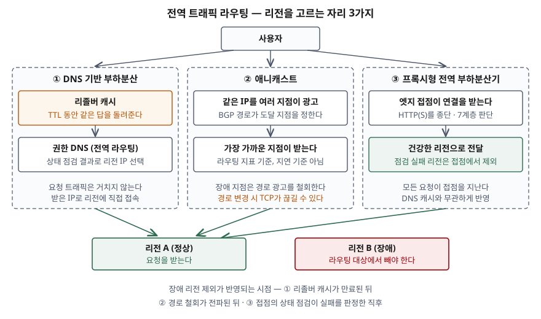

> **실행 검증 없음.** IETF RFC와 Microsoft·AWS 공식 문서만 근거로 정리했다. 측정한 전환
> 시간은 싣지 않으며, 본문의 시간 값은 모두 표준·문서에 적힌 권고값이다.

## 들어가며

다중 리전 재해복구 문항에서 전역 트래픽 라우팅은 보통 "GSLB로 장애 리전을 뺀다" 한 줄로
끝난다. 그런데 장애 리전을 **어디서** 빼느냐에 따라 사용자가 장애를 겪는 시간이 달라진다.
DNS에서 빼면 리졸버 캐시가 비워질 때까지 일부 사용자는 죽은 리전으로 계속 가고, 경로에서
빼면 이미 열린 연결이 끊긴다.

실무에서는 "TTL을 60초로 줄였는데 왜 몇 분째 장애 리전으로 접속이 가느냐"는 질문으로 나타난다.
답은 TTL 하나가 아니라 상태 점검, 리졸버, 클라이언트 캐시가 겹친 결과에 있다.

## 정의

**전역 트래픽 라우팅은 지리적으로 떨어진 여러 리전의 백엔드 가운데 요청을 받을 리전을 리전
바깥의 계층(DNS 응답, 네트워크 경로, 전역 접점)에서 정하는 기법이다.** 업계에서는 전역 서버
부하분산(GSLB)이라고도 부른다. 표준화된 정의는 없고, Azure 아키텍처 센터의 부하분산 선택
지침은 부하분산 서비스를 **전역·지역**과 **HTTP(S)·비HTTP(S)** 두 축으로 나눠, 리전 사이에
트래픽을 나누는 것을 전역 서비스로 분류한다.

그 가운데 **애니캐스트(anycast)** 는 표준 정의가 있다. 애니캐스트 운영 지침(RFC 4786, BCP 126)의
용어 절은 이를 **하나의 서비스 주소를 서로 독립된 여러 위치에서 제공해, 그 주소로 가는 패킷이
그중 한 곳으로 전달되게 하는 것**으로 정의한다. 한 노드로 패킷이 모이는 네트워크 영역을
그 노드의 **캐치먼트(catchment)** 라 부른다.

## 등장 배경

리전 하나 안의 부하분산기는 그 리전이 통째로 죽으면 함께 죽는다. 그래서 리전을 고르는 결정은
**모든 리전 바깥**에 있어야 한다. 바깥에서 결정을 내릴 수 있는 자리는 인터넷 구조상 3곳뿐이다.
이름을 주소로 바꾸는 DNS, 주소로 가는 길을 정하는 라우팅(BGP), 그리고 사용자 가까이에 둔
중계 서버다. 세 방식은 이 자리에 대응한다.

## 구성요소 — 방식 3가지와 공통 요소 2가지

### 방식 3가지

**① DNS 기반 부하분산** — 권한 DNS 서버가 질의마다 응답할 리전 IP를 고른다. Azure Traffic
Manager 문서는 자신을 DNS 기반 트래픽 부하분산기라 부르고, 클라이언트가 응답받은 주소로 직접
접속하므로 **트래픽은 Traffic Manager를 거치지 않는다**고 적는다. 라우팅 방법은 6가지(우선순위·
가중치·성능·지리·다중값·서브넷)이고, Amazon Route 53은 8가지(단순·장애 조치·지리 위치·지리 근접·
지연·IP 기반·다중값·가중치) 정책을 둔다.

**② 애니캐스트** — 여러 지점이 같은 주소를 BGP로 광고하고, 라우터가 고른 경로가 도달 지점을
정한다. IAB의 애니캐스트 구조 문서(RFC 7094)는 이때 "가장 가까운" 지점이 **유니캐스트 라우팅
지표로 정해지며 지연으로 정해지는 것이 아니다**라고 적는다. AWS Global Accelerator는 엣지
네트워크에서 애니캐스트로 광고하는 고정 IPv4 주소 2개를 준다.

**③ 프록시형 전역 부하분산기** — 사용자 가까운 접점이 연결을 받아 건강한 리전으로 요청을
넘긴다. Azure Front Door는 HTTP(S) 전용 전역 서비스로 분류되고, 경로 기반 라우팅·SSL 종료
같은 7계층 기능과 분할 TCP 연결을 쓴다. 모든 요청이 접점을 지나므로 리전 제외가 접점에서
바로 반영된다.

### 공통 요소 2가지

- **상태 점검** — 리전이 건강한지 판정한다. RFC 4786(§4.4.1)은 애니캐스트에서도 **서비스가
  가능할 때만 경로를 광고하고 불가능하면 철회**하도록 둘을 묶으라고 권한다
- **라우팅 정책** — 건강한 리전 중 하나를 고른다(지연·가중치·지리·우선순위 등)

## 도식

> **출처**: [Azure Traffic Manager overview](https://learn.microsoft.com/en-us/azure/traffic-manager/traffic-manager-overview) · [RFC 4786 §2 Terminology, §4.4.1](https://www.rfc-editor.org/rfc/rfc4786.html) · [RFC 7094 §1 Overview](https://www.rfc-editor.org/rfc/rfc7094.html) · [Azure Architecture Center — Load-balancing options](https://learn.microsoft.com/en-us/azure/architecture/guide/technology-choices/load-balancing-overview)

## DNS 방식이 장애 리전 제외를 늦추는 4가지 요인

1. **상태 점검 주기와 임계치** — 실패를 몇 번 확인해야 리전을 뺄지가 첫 지연이다
2. **레코드 TTL** — 리졸버는 TTL 동안 이전 응답을 다시 쓴다
3. **리졸버·클라이언트 캐시** — Azure 부하분산 지침은 DNS 캐시와 **TTL을 지키지 않는 리졸버**
   때문에 Traffic Manager의 장애 조치가 Front Door보다 느리다고 적는다
4. **낡은 응답 제공(serve-stale)** — RFC 8767은 권한 서버에서 갱신에 실패한 리졸버가 만료된
   레코드를 계속 쓰도록 허용한다. 이때 응답 TTL은 30초를 권하고, 낡은 데이터를 쓸 수 있는 최대
   기간은 1~3일 사이를 예로 든다. 전역 라우팅의 **권한 DNS까지 장애**면 죽은 리전 주소가 그만큼
   더 남는다

여기에 위치 판단 문제가 더해진다. Traffic Manager 문서는 성능·지리 라우팅이 **클라이언트가
아니라 리졸버의 IP**로 위치를 판단한다고 적는다. 클라이언트 서브넷 확장(ECS, RFC 7871)이 이를
보완하지만, 저자들은 지금이라면 이렇게 설계하지 않았을 것이라며 **기본값을 꺼 두기를** 권한다.
클라이언트 주소 일부가 권한 서버로 넘어가기 때문이다.

## 비교

| 구분 | ① DNS 기반 | ② 애니캐스트 | ③ 프록시형 |
|---|---|---|---|
| 결정 지점 | 권한 DNS 응답 | BGP 경로 선택 | 전역 접점(엣지) |
| 트래픽 경유 | 안 한다 | 주소 자체가 경로 | 모든 요청이 경유 |
| 장애 리전 제외 반영 | 리졸버·클라이언트 캐시 만료 후 | 경로 철회가 전파된 후 | 접점의 상태 점검 판정 직후 |
| "가까움"의 기준 | 리졸버 위치·지연표 | 라우팅 지표 | 접점은 사업자 망이, 리전은 정책이 정한다 |
| 프로토콜 | 무관 | 무관 (상태 있는 연결은 주의) | 주로 HTTP(S) |
| 장애 시 기존 연결 | 영향 없음 (새 조회부터 바뀐다) | 경로가 바뀌면 끊길 수 있다 | 사용자–접점 연결과 접점–리전 연결이 나뉘어 있어 리전 쪽만 바뀐다 |
| 예 | Traffic Manager, Route 53 | Global Accelerator, 권한 DNS 서버 분산(RFC 3258) | Front Door |

## 적용 시 고려사항

- **애니캐스트와 상태 있는 연결.** RFC 7094(§4.2)는 TCP 연결 수립 중 경로가 바뀌면 연결이
  리셋될 수 있다고 적고, RFC 4786(§4.4.3)은 패킷 단위로 경로를 나누는 망에서는 한 TCP 거래가
  여러 노드로 갈라져 서비스가 안 된다고 경고한다. 지점 선택이 거래 시간보다 훨씬 오래 유지돼야
  한다는 것이 지침의 전제다. 경로 광고와 철회가 반복되는 흔들림도 재광고 전 최소 지연으로 막는다.
- **이미 열린 연결은 바로 옮겨지지 않는다.** AWS Global Accelerator는 엔드포인트가 비정상이 돼도
  기존 연결을 유휴 제한 시간(TCP 340초, UDP 30초)까지 같은 엔드포인트로 보내고, 새 연결만
  건강한 엔드포인트로 보낸다. 전환 시간을 말할 때 신규 연결과 기존 연결을 나눠 본다.
- **DoS 때 경로를 함부로 철회하지 않는다.** RFC 7094(§4.4)는 지속되는 공격에 애니캐스트 경로를
  단순히 빼면 공격이 다음 지점으로 옮겨 가 연쇄 장애가 날 수 있다고 적는다. 상태 점검 실패를
  곧바로 철회로 잇는 자동화에 이 예외를 둔다.
- **DNS 계층은 단순하게 둔다.** Azure의 미션 크리티컬 전역 라우팅 지침은 CNAME이 5단계 이상
  이어질 수 있는 구성을 경고하고, Traffic Manager를 쓸 때 가중치 방식을 권하며, 여러 지역에
  걸친 상태 검증이 필요하면 엔드포인트 모니터링을 끄고 수동·사용자 정의 장애 조치를 쓰라고 한다.
- **조합해서 쓴다.** 프록시형은 그 접점 서비스 자체가 단일 장애점이 된다. DNS 계층을 앞에 두고
  프록시형 서비스와 대체 경로를 가중치로 나누는 구성이 같은 지침에 나온다. 반대로 비HTTP
  트래픽은 프록시형이 받지 못하므로 ①이나 ②가 남는다.

## 정리

- **정의**: 리전을 고르는 결정을 리전 **바깥**(DNS·경로·접점)에서 내리는 기법
- **방식 3가지**: DNS 응답 · BGP 경로 · 전역 접점 프록시 — "**이름·길·문지기**"
- **DNS 제외 지연 4요인**: 점검 주기 · TTL · 캐시(TTL 무시 리졸버) · serve-stale — "**점티캐스**"
- **애니캐스트 주의 2가지**: 가까움은 지연이 아니라 라우팅 지표, 경로가 바뀌면 상태 있는 연결이 끊긴다
- 상태 점검과 경로 광고를 **하나로 묶되**, DoS 때의 연쇄 철회는 막는다

> 기출 답안: [기출문제 — 다중 리전 동시 가동 재해복구시스템의 개념과 기술 요소](../../exam/2026-11-14-multi-region-active-active-dr/index.md)
>
> 관련 개념: [CDN과 캐시 계층 — 응답을 앞당기는 구조](../2026-10-29-cdn-cache-layers/index.md)
>
> 관련 개념: [경로벡터 라우팅과 BGP 경로 선택 — 메트릭이 아니라 정책으로 고른다](../2026-11-03-path-vector-routing-and-bgp-decision-process/index.md)

## 참고 자료

- [RFC 4786 — Operation of Anycast Services (BCP 126, 2006-12)](https://www.rfc-editor.org/rfc/rfc4786.html) — §2 용어(애니캐스트·캐치먼트), §4.4.1 서비스 가용성과 경로 광고 연동, §4.4.3 패킷 단위 부하분산, §4.4.6 전파 범위(NO_EXPORT)
- [RFC 7094 — Architectural Considerations of IP Anycast (IAB, 2014-01)](https://www.rfc-editor.org/rfc/rfc7094.html) — §1 라우팅 지표 기준의 "가장 가까움", §4.2 전송 계층 영향, §4.4 보안
- [RFC 8767 — Serving Stale Data to Improve DNS Resiliency (2020-03)](https://www.rfc-editor.org/rfc/rfc8767.html) — §4 낡은 응답의 TTL 30초, §5 최대 기간 1~3일
- [RFC 7871 — Client Subnet in DNS Queries (2016-05)](https://www.rfc-editor.org/rfc/rfc7871.html) — §1 리졸버 위치 문제, §2 개인정보 관련 권고
- [Microsoft, Azure Traffic Manager overview (2026-10-19 갱신)](https://learn.microsoft.com/en-us/azure/traffic-manager/traffic-manager-overview) · [Traffic Manager routing methods](https://learn.microsoft.com/en-us/azure/traffic-manager/traffic-manager-routing-methods) — DNS 기반 동작, 라우팅 방법 6가지, 리졸버 IP 기준 판단
- [Microsoft, Azure Architecture Center — Load-balancing options (2026-10-21 갱신)](https://learn.microsoft.com/en-us/azure/architecture/guide/technology-choices/load-balancing-overview) — 전역·지역, HTTP(S)·비HTTP(S) 분류, DNS 캐시로 인한 장애 조치 지연
- [Microsoft, Azure Architecture Center — Global routing redundancy for mission-critical web applications (2026-10-16 갱신)](https://learn.microsoft.com/en-us/azure/architecture/guide/networking/global-web-applications/overview) — CNAME 연쇄, 가중치 방식, 엔드포인트 모니터링 권고
- [Microsoft, Azure Front Door overview (2026-09-01 갱신)](https://learn.microsoft.com/en-us/azure/frontdoor/front-door-overview) — 전역 접점, 분할 TCP
- [AWS, Global Accelerator — How it works](https://docs.aws.amazon.com/global-accelerator/latest/dg/introduction-how-it-works.html) — 애니캐스트 고정 IP 2개, 상태 점검과 신규 연결, 유휴 제한 시간
- [AWS, Amazon Route 53 — Choosing a routing policy](https://docs.aws.amazon.com/Route53/latest/DeveloperGuide/routing-policy.html) — 라우팅 정책 8가지
