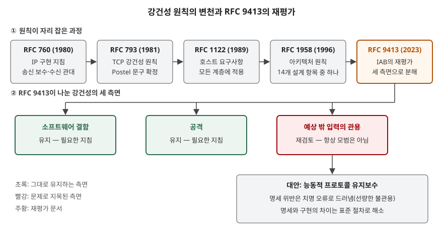

## 들어가며

프로토콜 설계 문제는 "새 통신 규약을 만든다면 무엇을 고려하는가"라는 형태로 기출에 나온다. 이때 항목을 경험으로 나열하면 채점자가 근거를 확인할 수 없다. 인터넷 쪽에는 IAB(Internet Architecture Board, 인터넷 구조를 감독하는 IETF 위원회)가 직접 정리한 설계 원칙 문서가 있고, 그중 가장 널리 인용되는 강건성 원칙은 2023년에 같은 IAB가 다시 따져 보았다. 원칙과 그 재평가를 함께 알아 두면 "원칙도 운영 경험으로 바뀐다"는 결론까지 근거를 갖고 쓸 수 있다.

> **실행 검증 없음.** 문장의 근거는 RFC 1958, RFC 1122, RFC 6709, RFC 8701, RFC 9413의 본문이다. 다섯 문서 모두 표준(Standards Track)이 아니라 정보(Informational) 문서이거나 호스트 요구사항 문서다.

## 정의

**인터넷 아키텍처 원칙(RFC 1958)은 IAB가 1996년에 정리한 인터넷 프로토콜 설계 지침으로, 연결성을 목표로 하고 IP를 도구로 쓰며 지능은 망이 아니라 종단에 둔다는 관점 아래 일반 설계 항목 14가지를 제시한다.**

**강건성 원칙(Robustness Principle)은 "보낼 때는 명세를 엄격히 지키고, 받을 때는 잘못된 입력도 관대하게 처리하라"는 구현 지침이다(RFC 1958 §3.9, 원형은 RFC 793 §2.10).**

**RFC 9413은 이 원칙을 결함·공격·예상 밖 입력의 세 측면으로 나누어, 앞의 둘은 유지하되 예상 밖 입력을 관용하는 것은 모든 상황의 모범 관행이 아니라고 보고 명세의 능동적 유지보수를 대안으로 권고한 IAB 문서다.**

## 등장 배경

1980년 IP 구현 지침(RFC 760 §3.2)을 쓸 당시 명세는 불완전했고 구현은 소수였다. 상대 구현이 명세를 조금씩 다르게 읽어도 통신이 끊기지 않게 하려면 받는 쪽이 너그러워야 했다. 이 문장은 TCP 명세(RFC 793)를 거쳐 호스트 요구사항(RFC 1122 §1.2.2)에서 **모든 계층에 적용하는 원칙**으로 넓어졌고, RFC 1958이 설계 원칙 중 하나로 정리했다.

문제는 수십 년 운영한 뒤에 드러났다. 받는 쪽이 잘못된 입력을 조용히 받아 주면 보내는 쪽의 결함이 고쳐지지 않고 쌓인다. RFC 9413은 TLS 서버 일부가 빈 확장으로 끝나는 ClientHello에서 실패한 사례, BGP 명세(RFC 4271)가 잘못된 UPDATE에 세션을 끊으라고 했지만 그대로 구현되지 않아 결국 RFC 7606으로 실제 관행을 다시 명세한 사례를 든다. 관대함이 **나중 구현자에게 비용을 넘기는 장치**가 된 것이다.

## 구성요소

### RFC 1958의 구성 — 6개 절

| 절 | 내용 | 핵심 |
|---|---|---|
| §1 | 끊임없는 변화 | 원칙은 교리가 아니라 현재의 스냅숏이다 |
| §2 | 인터넷 아키텍처의 존재 여부 (4항목) | 연결성이 목표, IP가 도구, 지능은 종단 / 인터넷 계층 프로토콜은 하나 / 종단 간 원칙과 운명 공유 / 중앙 통제 없음, 대략적 합의와 동작하는 코드 |
| §3 | 일반 설계 항목 (14항목) | 아래 표 |
| §4 | 이름과 주소 (5항목) | 주소 하드코딩 금지, 단일 이름 체계, 대소문자 무관 ASCII |
| §5 | 외부 요인 (4항목) | 특허 없는 기술 선호, 국제화 지원 |
| §6 | 기밀성과 인증 (5항목) | 종단이 스스로 보호, 암호 알고리즘 교체 가능 |

### §3 일반 설계 항목 14가지 — 4갈래로 묶기

| 갈래 | 항목 |
|---|---|
| 환경 | ① 이질성을 전제로 설계(3.1) ② 규모 확장(3.3) ③ 성능·비용도 기능만큼 중요(3.4) |
| 단순성 | ④ 하는 방법은 하나(3.2) ⑤ 의심되면 가장 단순한 해법(3.5) ⑥ 모듈화(3.6) ⑦ 완벽보다 지금의 거의 완전한 해법(3.7) ⑧ 선택 항목·파라미터 회피, 필요하면 협상(3.8) |
| 동작 | ⑨ 강건성 — 송신 엄격·수신 관대(3.9) ⑩ 요청받지 않은 패킷 절제(3.10) ⑪ 순환 의존 회피(3.11) |
| 표기·검증 | ⑫ 자기 기술적 객체, 유형과 크기를 담음(3.12) ⑬ 용어·표기·바이트 순서 통일(3.13) ⑭ 동작하는 구현이 여럿 있기 전에는 표준화하지 않음(3.14) |

### RFC 9413의 구성 — 강건성 3측면, 해악 2가지, 대안 2가지

- **세 측면(§2)**: 소프트웨어 결함에 대한 강건성, 공격에 대한 강건성, 예상 밖 입력에 대한 관용. 앞의 둘은 "필요한 지침"으로 유지한다.
- **해악 2가지(§4)**: 프로토콜 부식(protocol decay, §4.1)은 관용이 비용을 미루는 사이 구현이 갈라져 오류가 사실상의 표준이 되는 현상이다. 생태계 효과(§4.2)는 관대한 생태계에서 새 구현이 명세가 아니라 기존 구현의 비준수까지 따라 해야 하는 현상이다.
- **대안 2가지(§5)**: 선량한 불관용(virtuous intolerance, §5.1)은 명세되지 않은 상황을 오류 복구 대신 치명 오류로 끊어 결함이 드러나게 하는 선택이다. 배제(exclusion, §5.2)는 문제 있는 구현이나 MD5·SSL3 같은 약한 방식을 의도적으로 걸러내는 것이다. 둘 다 명세를 계속 고치는 **능동적 프로토콜 유지보수**를 전제로 한다.

> **출처**: [RFC 793 §2.10 Robustness Principle](https://www.rfc-editor.org/rfc/rfc793#section-2.10), [RFC 1122 §1.2.2 Robustness Principle](https://www.rfc-editor.org/rfc/rfc1122.html#page-12), [RFC 1958 §3 General Design Issues](https://www.rfc-editor.org/rfc/rfc1958#section-3), [RFC 9413 §2 Protocol Robustness, §5 Active Protocol Maintenance](https://www.rfc-editor.org/rfc/rfc9413#section-2)

## 확장을 고려한 설계 — RFC 6709의 7가지

강건성 원칙이 흔히 확장성의 근거로 오해된다는 점을 RFC 9413의 확장성 항목(§2.2)이 지적한다. 모르는 입력을 관대하게 받는 것과 확장을 설계하는 것은 다르다. 확장 설계는 IAB의 별도 지침인 RFC 6709가 다룬다. 이 문서는 아키텍처 원칙 7가지(§3)를 든다.

1. 처음부터 필요 이상으로 확장 가능하게 만들지 않는다(§3.1)
2. 확장이 없는 구현과도 상호운용되게 한다(§3.2)
3. 기본 프로토콜의 구조 가정과 확장 모델에 맞춘다(§3.3)
4. 호환되지 않는 변종을 만들지 않는다(§3.4)
5. 시험할 수 있게 한다(§3.5)
6. 파라미터 값은 IANA 등록으로 조정한다(§3.6)
7. 핵심 프로토콜의 확장은 특히 신중히 한다(§3.7)

기본 프로토콜 쪽에서는 버전 번호, 예약 필드, 인코딩 형식, 파라미터 공간, 암호 민첩성, 전송, 모르는 확장의 처리를 미리 정해 두라고 한다(§4.1~§4.7). TLS의 GREASE(RFC 8701)는 이 생각을 실제로 운영에 옮긴 예다. 클라이언트가 예약된 무의미한 값을 무작위로 섞어 보내면, 모르는 값을 무시해야 하는 상대 구현이 그 규칙을 어길 때 바로 실패가 드러난다. 확장 지점이 쓰이지 않아 굳어 버리는 일을 막는다.

## 비교

| 구분 | 관대한 수신 (RFC 1958 §3.9) | 선량한 불관용 (RFC 9413 §5.1) |
|---|---|---|
| 잘못된 입력을 받으면 | 해석할 수 있으면 받고, 애매하면 조용히 버린다 | 명세 위반을 치명 오류로 알리고 끊는다 |
| 전제 | 명세는 불완전하고 구현은 고치기 어렵다 | 명세와 구현을 계속 갱신할 수 있다 |
| 단기 효과 | 통신이 끊기지 않는다 | 연결 실패가 늘 수 있다 |
| 장기 효과 | 결함이 쌓여 사실상의 표준이 된다 | 결함이 드러나 일찍 고쳐진다 |
| 새 구현자의 부담 | 기존 구현의 버그까지 따라야 한다 | 명세만 따르면 된다 |
| 예 | 잘못된 BGP UPDATE를 무시 | HTTP/2 INADEQUATE_SECURITY, QUIC 오류 프레임, DNS 확장 오류(EDE) |

## 적용 시 고려사항

1. **갱신할 수 있는 환경인지 먼저 본다.** RFC 9413의 적용 범위 절(§3)은 구현을 제때 갱신할 수 있는 프로토콜에만 이 권고가 맞는다고 밝힌다. 펌웨어를 바꾸기 어려운 장비가 섞인 환경에서는 관대한 수신이 여전히 현실적인 선택이고, 그때는 임시 우회책을 문서로 남기고 제거 계획을 함께 세운다(§5).
2. **불관용에도 예외가 있다.** 인증되지 않은 송신자의 메시지에 오류를 돌려주면 서비스 거부 증폭에 쓰일 수 있으므로, 상태를 두지 않는 종단은 조용히 버려야 할 수 있다(§5.1). 오류로 끊을지 버릴지는 신뢰 경계로 판단한다.
3. **초기 구현이 기준이 된다.** 먼저 배포된 구현의 동작을 나중 구현이 따라 하게 되므로, 초기 구현일수록 명세를 엄격히 지킬 책임이 크다(§5). 시범 구현을 둘 이상 독립적으로 만들어 상호운용을 확인하라는 RFC 1958 표준화 조건 항목(§3.14)과 같은 방향이다.
4. **확장 지점은 쓰이게 만든다.** 예약 필드와 모르는 확장의 처리 규칙을 정해 두는 것만으로는 부족하고, GREASE처럼 실제 트래픽에서 그 규칙이 지켜지는지 계속 시험해야 굳지 않는다.
5. **원칙끼리 충돌한다.** 확장을 위해 선택 항목을 늘리면 단순성(§3.5·§3.8)이 깨진다. RFC 6709도 필요 이상의 확장성을 경계한다(§3.1). 우선순위는 지연, 오류율, 노드 규모, 신뢰 경계 같은 사용 환경으로 정한다.

## 정리

- RFC 1958은 **6개 절**, 그중 일반 설계 항목은 **14가지**(환경·단순성·동작·표기검증의 4갈래)
- 강건성 원칙: **송신 엄격·수신 관대** — RFC 760에서 시작해 RFC 793·1122·1958로 이어졌다
- RFC 9413: **3측면**(결함·공격은 유지, 예상 밖 입력 관용은 재검토), **해악 2가지**(부식·생태계), **대안 2가지**(선량한 불관용·배제)
- 확장 설계는 RFC 6709의 **7원칙**, 운영 사례는 TLS **GREASE**
- 암기 단서: "**엄송관수 → 부생 → 불배**" (엄격 송신·관대 수신 → 부식·생태계 → 불관용·배제)

> 기출 답안: [기출문제 — 통신 프로토콜의 오류·혼잡 제어, 슬라이딩 윈도우, 설계 고려사항](../../exam/2026-11-15-protocol-error-congestion-control-sliding-window/index.md)

## 참고 자료

- [RFC 1958 Architectural Principles of the Internet](https://www.rfc-editor.org/rfc/rfc1958) (IAB, 1996-06)
- [RFC 760 DoD Standard Internet Protocol](https://www.rfc-editor.org/rfc/rfc760) (1980-01)
- [RFC 793 Transmission Control Protocol](https://www.rfc-editor.org/rfc/rfc793) (1981-09)
- [RFC 1122 Requirements for Internet Hosts — Communication Layers](https://www.rfc-editor.org/rfc/rfc1122) (1989-10)
- [RFC 6709 Design Considerations for Protocol Extensions](https://www.rfc-editor.org/rfc/rfc6709) (IAB, 2012-09)
- [RFC 8701 Applying Generate Random Extensions And Sustain Extensibility (GREASE) to TLS Extensibility](https://www.rfc-editor.org/rfc/rfc8701) (2020-01)
- [RFC 9413 Maintaining Robust Protocols](https://www.rfc-editor.org/rfc/rfc9413) (IAB, 2023-06)
