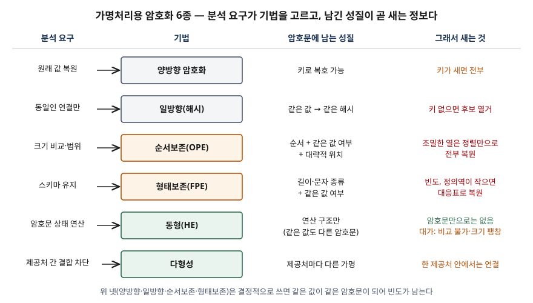

## 들어가며

가명처리 문제에서 암호화는 "복호화가 안 되니 안전하다" 한 줄로 끝나기 쉽다. 점수가 갈리는 곳은 **왜 암호화가 여섯 가지로
나뉘는가**다. 분석하는 쪽은 암호문으로도 크기를 비교하거나, 기존 컬럼에 그대로 넣거나, 합계를 내고 싶어 한다. 그 요구를
들어주려고 암호문에 평문의 성질을 일부러 남기고, **남긴 성질은 그대로 공격자에게도 보인다.** 실무에서는 "순서보존 암호를
썼으니 가명처리됐다"는 설계를 받았을 때 그 컬럼이 무엇을 내주는지 따지는 데 쓴다.

> 정의는 개인정보보호위원회 가이드라인과 NIST·ISO 표준, 원 논문에서 가져왔다. 각 기법의 성질은 학습용 구현과 가상 데이터로
> 직접 계산했고 기록은 [code/output.txt](code/output.txt)에 있다. 형태보존 암호는 표준 FF1이 아니라 그 뼈대만 흉내 낸 구현이다.

## 정의

가명정보 처리 가이드라인은 암호화를 **정보 가공 시 일정한 규칙의 알고리즘을 적용하여 대체하는 기법**으로 두고 6종으로 나눈다.

- **순서보존 암호화(OPE)**: 원본정보의 순서와 암호값의 순서가 동일하게 유지되는 암호화. Boldyreva 등은 이를 **암호화된
  데이터에 범위 질의를 효율적으로 수행하려고 DB 분야에서 제안된 대칭 암호**로 소개한다. Naveed 등은 OPE가 결정적 암호처럼
  같은 값의 빈도를 드러내고 **거기에 순서까지** 드러낸다고 정리한다.
- **형태보존 암호화(FPE)**: 원본 정보의 형태와 암호값의 형태가 동일하게 유지되는 암호화. NIST SP 800-38G는 이를 블록 암호의
  운영 모드로 정하고, 현행 개정 초안은 FF1 한 가지만 규정한다.
- **동형 암호화(HE)**: 암호화된 상태에서 연산이 가능하고, 연산 결과를 복호하면 평문을 연산한 것과 같은 결과가 나오는 암호화.
  ISO/IEC 18033-6은 덧셈 동형 방식 **2가지**(지수형 ElGamal, Paillier)를 규정한다.

## 등장 배경

일반 암호화(AES 등)를 컬럼에 걸면 분석 시스템은 암호문으로 아무것도 못 한다. 범위 조건은 전부 복호해야 하고, 16자리 카드번호
컬럼은 암호문 길이에 맞춰 스키마를 바꿔야 하며, 합계를 내려면 원값을 다시 꺼내야 한다. Naveed 등은 이런 이유로 CryptDB 같은
암호화 DB가 **같음을 드러내는 결정적 암호(DTE)와 순서를 드러내는 OPE**를 쓰게 됐다고 정리하고, 이런 기법을 묶어 **성질
보존 암호(PPE)**라 부른다. 기존 데이터베이스 알고리즘을 그대로 쓸 수 있다는 것이 장점이고, 성질을 드러낸다는 것이 대가다.

## 구성요소 — 암호화 6종

| 기법 | 분석 요구 | 근거 |
|---|---|---|
| ① 양방향 | 키 소유자가 원래 값 복원 | 대칭키(AES·ARIA)·비대칭키(RSA) 2방식 |
| ② 일방향(해시) | 동일인 연결만 | 키 없는 해시(MDC)·키 있는 해시(MAC)·솔트 해시 3방식 |
| ③ 순서보존 | 크기 비교·범위 조건 | Boldyreva 2009 |
| ④ 형태보존 | 기존 스키마 유지 | NIST SP 800-38G (FF1) |
| ⑤ 동형 | 암호문 상태 연산 | ISO/IEC 18033-6 (2방식) |
| ⑥ 다형성 | 제공처 간 부정 결합 차단 | Verheul 등 2016 (ElGamal 기반) |

가이드라인은 ③을 "크기에 대한 비교 분석이 필요한 경우", ④를 "저장 공간의 스키마 변경 이슈가 없는" 경우, ⑥을 "도메인별로
서로 다른 가명처리"로 설명한다. 분석 요구가 기법을 고른다는 뜻이다.

## 도식



> **출처**: [가명정보 처리 가이드라인(2022.4, 개인정보보호위원회) 부록1 암호화](https://data.gangwon.kr/images/%EA%B0%80%EB%AA%85%EC%A0%95%EB%B3%B4%EC%B2%98%EB%A6%AC%EA%B0%80%EC%9D%B4%EB%93%9C%EB%9D%BC%EC%9D%B8_2022_04_29.pdf)(제3자 전재, 77쪽), 새는 것 열은 [Naveed·Kamara·Wright, CCS 2015 §6.1 Sorting Attack](https://www.microsoft.com/en-us/research/wp-content/uploads/2017/02/edb.pdf)과 [Boldyreva·Chenette·O'Neill, CRYPTO 2011](https://eprint.iacr.org/2012/625), 동형·다형성은 [ISO/IEC 18033-6:2019](https://www.iso.org/standard/67740.html)와 [Verheul 외, ePrint 2016/411](https://eprint.iacr.org/2016/411)

## 계산으로 확인한 것

전체 소스: [`code/crypto_leakage.py`](code/crypto_leakage.py).

**순서보존 암호는 조밀한 열에서 정렬만으로 풀린다.** Boldyreva 등의 이상적 OPE(무작위 순서보존 함수)를 나이 0~99에 걸었다.
서버는 키 없이 "나이 60 이상"을 390건으로 정확히 셌다. 그런데 0~99가 모두 나오는 1,000행 열은 암호문을 정렬해 순위대로
0~99를 붙이는 것만으로 **1,000행 전부** 복원됐다. 보조 정보도 필요 없다. Naveed 등은 이것을 조밀한 열에 대한 정렬 공격으로
정리한다.

```text
    조밀한 열(1,000행, 서로 다른 값 100개) 정렬 공격: 1000/1000행 복원
    희소한 열(30행, 서로 다른 값 25개) 정렬 공격: 0/30행 복원
    같은 30행을 '암호문/65536*100'으로 어림: 평균 오차 1.8세, 최대 3세, 오차 10세 이내 30/30행
```

30행짜리 희소한 열에서는 정렬 공격이 하나도 맞히지 못했다. 하지만 암호문 값의 위치를 비율로 바꾸기만 해도 평균 1.8세 차로
나이가 어림됐다. Boldyreva 등(2011)이 보인 것이 이것이다. 무작위 순서보존 함수는 평문 값과 두 값의 거리를 **정의역 크기의
제곱근 정도 범위 안에서** 드러낸다.

**형태보존 암호는 같은 값을 같은 암호문으로 만든다.** 16자리 카드번호가 16자리 숫자로 나오고 복호도 맞았다. 같은 번호 두
건은 같은 암호문이 되어 빈도가 그대로 보인다. 두 자리 값(00~99)은 서로 다른 암호문이 100개뿐이라, 대응 쌍을 모으면 그 표로
전부 풀린다. NIST가 처음 판에서 정의역 크기를 100 이상으로 요구하고 100만 이상을 권고했다가, 개정 초안에서 최소 100만으로
올린 이유가 이 크기 문제다.

**동형 암호는 연산은 되지만 비교는 안 된다.** Paillier로 급여 5건을 암호화해 암호문끼리 곱하자 복호값이 합계 1905였고,
한 건을 3제곱하면 3배가 나왔다. 같은 320을 두 번 암호화한 암호문은 서로 달랐고, 암호문 크기 비교는 평문 대소와 무관했다.
9비트 값이 184비트 암호문이 됐다. **새는 것이 없는 대신 순서보존이 해 주던 비교·범위 질의를 못 하고 저장량이 늘어난다.**

## 비교

| 구분 | 순서보존 | 형태보존 | 동형 |
|---|---|---|---|
| 남기는 성질 | 순서, 같음 | 길이·문자 종류, 같음 | 연산 구조 |
| 같은 값의 암호문 | 같다 (결정적) | 같다 (결정적) | 다르다 (확률적) |
| 키 없이 서버가 하는 일 | 범위 조건·정렬 | 같은 값 조인·그룹 | 합계·상수배 |
| 대표 공격 | 정렬·누적분포 공격 | 빈도 분석, 작은 정의역 | 암호문만으로는 해당 없음 |
| 대가 | 순서·대략 위치 노출 | 같음 노출 | 비교 불가, 암호문 팽창 |

일방향 해시와의 차이도 같은 축으로 갈린다. 해시는 같음만 남기고 복원 경로가 없지만, 키 없는 해시는 후보 열거로 되돌아간다.
→ [가명처리 기법 분류와 해시·키·토큰 검산](../../exam/2026-10-11-pseudonymization-techniques/index.md)

## 적용 시 고려사항

- **열의 조밀도를 먼저 본다.** 나이·등급·월처럼 값 종류가 적고 고루 나오는 열에 순서보존 암호를 걸면 정렬만으로 풀린다.
  Naveed 등은 모든 값이 나온다는 이 조건이 강해 보여도 실제 데이터에서는 자주 성립한다고 보고했다. 그런 열은 범주화를 먼저 검토한다.
- **결정적 암호는 빈도를 남긴다는 전제로 적정성을 검토한다.** 순서보존·형태보존 모두 같은 값이 같은 암호문이 된다.
  성별처럼 값이 둘뿐인 열은 빈도만으로 어느 쪽인지 정해진다. 결정적 암호화 열도 준식별자로 넣어 k-익명성 등을 계산한다.
- **형태보존 암호는 정의역 크기와 표준 개정을 확인한다.** NIST는 FF3를 개정 초안에서 뺐고 최소 정의역을 100만으로 올렸다.
  짧은 코드 값에 걸 때는 이 하한을 넘는지 본다.
- **동형 암호는 필요한 연산이 무엇인지부터 정한다.** ISO/IEC 18033-6의 두 방식은 덧셈 동형이다. 곱셈·비교까지 필요하면 다른
  방식이 필요하고 비용이 크다. 합계·평균이면 충분한지 분석 목적에서 먼저 확인한다.
- **키는 추가정보다.** 여섯 기법 모두 키가 있으면 가명정보가 다시 개인정보로 돌아간다. 키는 가명정보 처리자와 분리해 보관한다.

## 정리

- 가이드라인 암호화 **6종**: 양방향·일방향·순서보존·형태보존·동형·다형성. 일방향은 다시 **3방식**(MDC·MAC·솔트).
- 분석 요구가 기법을 고른다: **비교 → 순서보존, 스키마 → 형태보존, 연산 → 동형, 결합 차단 → 다형성.**
- **남긴 성질 = 새는 정보.** 순서보존은 순서와 대략 위치, 형태보존은 같음, 동형은 암호문만으로는 없음.
- 순서보존은 조밀한 열에서 정렬로 전부 풀리고, 형태보존은 정의역이 작으면 풀린다. 동형은 안전한 대신 비교를 못 한다.

> 기출 답안: [기출문제 — 개인정보보호를 위한 가명처리 기법](../../exam/2026-10-11-pseudonymization-techniques/index.md)

## 참고 자료

- [개인정보보호위원회 — 안내서: 가명정보 처리 가이드라인(2026.3. 개정)](https://www.pipc.go.kr/np/cop/bbs/selectBoardArticle.do?bbsId=BS217&mCode=D010030000&nttId=11931) — 현행판 게시글.
  본문은 [2022.4판 PDF](https://data.gangwon.kr/images/%EA%B0%80%EB%AA%85%EC%A0%95%EB%B3%B4%EC%B2%98%EB%A6%AC%EA%B0%80%EC%9D%B4%EB%93%9C%EB%9D%BC%EC%9D%B8_2022_04_29.pdf)(제3자 전재)로 읽었다 — 77쪽 암호화 6종. 2026.3판 본문은 확인하지 못했다
- [A. Boldyreva, N. Chenette, Y. Lee, A. O'Neill — Order-Preserving Symmetric Encryption (Eurocrypt 2009, ePrint 2012/624)](https://eprint.iacr.org/2012/624) — OPE 정의, 무작위 순서보존 함수
- [A. Boldyreva, N. Chenette, A. O'Neill — Order-Preserving Encryption Revisited: Improved Security Analysis and Alternative Solutions (CRYPTO 2011, ePrint 2012/625)](https://eprint.iacr.org/2012/625) — 평문 값·거리가 정의역 제곱근 범위로 새는 것
- [M. Naveed, S. Kamara, C. V. Wright — Inference Attacks on Property-Preserving Encrypted Databases (CCS 2015)](https://www.microsoft.com/en-us/research/wp-content/uploads/2017/02/edb.pdf) — §1 PPE 정의, §6.1 조밀한 열 정렬 공격, §6.2 누적 공격
- [NIST SP 800-38G Rev. 1 (2nd Public Draft, 2025.2) — Methods for Format-Preserving Encryption](https://csrc.nist.gov/pubs/sp/800/38/g/r1/2pd) — FF1만 규정, FF3 제외, 정의역 하한 변경 이력
- [ISO/IEC 18033-6:2019 — Encryption algorithms — Part 6: Homomorphic encryption](https://www.iso.org/standard/67740.html) — 지수형 ElGamal·Paillier 2방식. 본문은 확인하지 못했고 표준 소개 페이지의 범위 설명을 따랐다
- [E. Verheul, B. Jacobs, C. Meijer, M. Hildebrandt, J. de Ruiter — Polymorphic Encryption and Pseudonymisation for Personalised Healthcare (ePrint 2016/411)](https://eprint.iacr.org/2016/411) — 다형성 암호화·가명처리, ElGamal 기반
