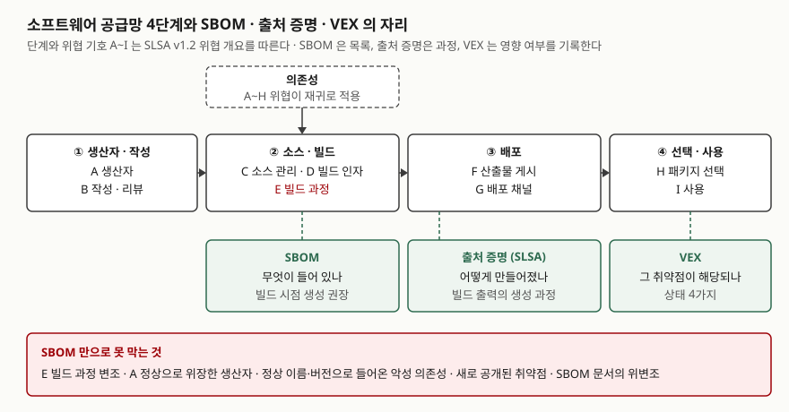

> **실행 검증 없음.** NTIA·CISA 발간 문서와 SLSA 명세를 근거로 정리한 개념 글이다. 실행 예제와 측정값은 없다.
> CISA의 2025년 최소 요소 개정판은 이 글을 쓰는 시점에 CISA 페이지에 **초안**으로 올라 있다. 확정판 여부는 원문에서 확인한다.

## 들어가며

공급망 공격은 공격자가 표적을 직접 뚫지 않고 **표적이 믿고 들여오는 소프트웨어**를 거쳐 들어오는 공격이다.
Log4j처럼 널리 쓰이는 라이브러리의 취약점이 공개되면 패치보다 먼저 "우리 시스템 어디에 그것이 들어 있는가"에
답해야 한다. SBOM은 이 질문에 답하려는 기록이다. 시험에서는 SBOM의 구성요소와 함께
**SBOM만으로 충분한가**를 묻는 형태가 자주 나오므로, 목록이 다루는 위협과 다루지 못하는 위협을 나눠 둔다.

## 정의

- **SBOM**(Software Bill of Materials): 소프트웨어를 만드는 데 쓰인 여러 구성요소의 세부 정보와
  **공급망 관계**를 담은 공식 기록이다(NTIA 2021, CISA 2025 초안이 같은 정의를 쓴다).
- **소프트웨어 공급망 위협**: SLSA는 생산자부터 사용까지 공급망을 **4단계**로 나누고 각 단계의 위협을
  **A~I 9가지**로 든다. 의존성에는 같은 위협이 재귀로 적용된다.

NTIA 보고서는 SBOM이 **모든 보안 문제를 풀지는 않으며**, 다른 보안 도구와 절차가 올라설 기초 데이터 층이 된다고
적는다. 이 문장이 이 글의 출발점이다.

## 등장 배경

1. **구성요소를 셀 수 없었다** — 상용·오픈소스 부품이 몇 단계로 겹쳐 들어가면서, 새 취약점이 나오면 영향 범위를
   사람이 제품마다 뒤져야 했다
2. **제도가 요구했다** — 미국 행정명령 14028(2021-05)이 상무부와 NTIA에 SBOM 최소 요소를 정하라고 지시했고,
   NTIA가 2021-07-12에 발표했다. 국내에서는 과기정통부·국정원·디지털플랫폼정부위원회가 2024-05에
   「SW 공급망 보안 가이드라인 1.0」을 냈다
3. **형식이 나뉘어 있었다** — 같은 정보를 SPDX·CycloneDX·SWID가 다르게 적어, 자동으로 주고받을 공통 기준이 필요했다

## 구성요소 / 절차

### NTIA 최소 요소 — 3영역

| 영역 | 내용 | 개수 |
|---|---|---|
| ① 데이터 필드 | 공급자, 구성요소 이름, 버전, 기타 고유 식별자, 의존 관계, SBOM 작성자, 작성 시각 | **7가지** |
| ② 자동화 지원 | 기계가 생성·판독할 수 있는 형식. SPDX, CycloneDX, SWID 태그 | 3형식 |
| ③ 실무와 절차 | 주기, 깊이, 알려진 미지(Known Unknowns), 배포와 전달, 접근 통제, 오류 수용 | **6가지** |

③에서 시험에 자주 쓰이는 것은 둘이다. **깊이**는 최소한 최상위 구성요소를 모두 적고 그 아래 전이 의존성을
재귀로 찾아갈 수 있을 만큼 적으라는 요구다. **알려진 미지**는 의존성이 "없음"인 구성요소와 "모름"인 구성요소를
구분해 적으라는 요구이고, 표시가 없으면 **불완전하다고 해석**하는 것이 기본이다.

### CISA 2025 초안이 바꾼 것

| 구분 | NTIA 2021 | CISA 2025 초안 |
|---|---|---|
| 데이터 필드 | 7가지 | **11가지** — 구성요소 해시, 라이선스, 도구 이름, 생성 맥락 추가 |
| 형식 | SPDX · CycloneDX · SWID | SWID 제외 |
| 실무와 절차 | 6가지 | 5가지 — 접근 통제를 배포와 전달로 흡수, 깊이 대신 범위(Coverage): 전이 의존성까지 전부 |

**생성 맥락**은 SBOM을 빌드 전·빌드 중·빌드 후 중 언제 만들었는지를 적는 필드다. 같은 제품이라도 언제 만들었는지에
따라 목록이 달라지기 때문이다.

### 생성 시점에 따른 SBOM — 6유형 (CISA 2023)

설계(Design) → 소스(Source) → 빌드(Build) → 분석(Analyzed) → 배포(Deployed) → 실행(Runtime).
소스 SBOM은 컴파일 과정에서 빠지는 구성요소까지 올리고, 빌드 SBOM은 실제로 컴파일·패키징된 것을 적으며,
분석 SBOM은 완성된 바이너리를 도구로 분해해 추정한다. NTIA는 컴파일러가 바꾼 것까지 반영되므로
**빌드 시점의 SBOM**을 받으라고 권한다.

## 도식

> **출처**: [SLSA v1.2 — Threats overview](https://slsa.dev/spec/v1.2/threats-overview)(4단계와 위협 A~I, 의존성 재귀) ·
> [SLSA v1.0 — Terminology](https://slsa.dev/spec/v1.0/terminology)(provenance 정의) ·
> [NTIA, The Minimum Elements For a Software Bill of Materials (2021) — Legacy Software and Binary Analysis, Vulnerability and Exploitability in Dependencies](https://www.ntia.gov/sites/default/files/publications/sbom_minimum_elements_report_0.pdf)(빌드 시점 권장, VEX) ·
> [CISA, VEX Status Justifications (2022-06) §2.0](https://www.cisa.gov/sites/default/files/2023-01/VEX_Status_Justification_Jun22.pdf)(상태 4가지)

답안지에는 가로 4칸(단계)과 그 아래 3칸(SBOM·출처 증명·VEX)만 그리고, 아래에 "목록·과정·영향"이라고 붙이면 된다.

## 비교

### 공급망 보안 산출물 4가지

| 구분 | SBOM | 출처 증명(SLSA) | VEX | 코드 서명 |
|---|---|---|---|---|
| 답하는 질문 | 무엇이 들어 있나 | 어떻게 만들어졌나 | 그 취약점이 이 제품에 해당되나 | 누가 냈고 바뀌지 않았나 |
| 기록 대상 | 구성요소와 관계 | 빌드 출력의 생성 과정 | 제품 × 취약점의 상태 | 산출물의 해시와 서명 |
| 변하는가 | 판마다 고정 | 빌드마다 고정 | 취약점 분석에 따라 갱신 | 고정 |
| 근거 | NTIA 2021, CISA 2025 초안 | SLSA | CISA VEX 문서 | 각 서명 체계 |

NTIA는 SBOM 데이터는 **대체로 정적**이고 취약점 데이터는 **시간에 따라 변한다**고 적고, 취약점 정보를
SBOM과 **별도 구조로** 관리하라고 권한다. VEX가 SBOM과 따로 존재하는 이유다. VEX 상태는
**영향 없음 · 영향 있음 · 수정됨 · 조사 중** 4가지이고, 영향 없음에는 구성요소 없음, 취약 코드 없음,
공격자가 제어 불가, 실행 경로 밖, 내장 완화 존재의 **근거 5가지**를 붙일 수 있다.

### SBOM이 있어도 못 막는 것 — 5가지

| 위협 | SLSA 단계 | 왜 목록으로 안 되는가 | 보완 |
|---|---|---|---|
| ① 빌드 과정 변조 (예: SolarWinds) | E | 끼어든 코드는 구성요소로 등록되지 않는다 | 출처 증명, 격리된 빌드 |
| ② 정상으로 위장한 생산자 | A | 목록은 생산자가 적은 대로 나온다 | 공급자 평가 |
| ③ 정상 이름·버전의 악성 의존성 (예: event-stream) | 의존성 재귀 | 이름과 버전은 맞게 기록된다 | 의존성 검토, 해시 고정 |
| ④ 새로 공개된 취약점 | — | SBOM은 생성 시점의 기록이다 | 취약점 DB와 상시 대조, VEX |
| ⑤ SBOM 문서 자체의 위변조 | — | 최소 요소에 서명이 없다 | SBOM 서명·변조 탐지 |

①·②·③은 **목록이 거짓 없이 적혀도** 일어난다. SBOM의 역할은 공격을 막는 것이 아니라, 문제가 공개된 뒤
**영향받는 곳을 빠르게 찾는 것**이다. ⑤에 대해 NTIA는 무결성·진위 확인을 최소 요소 밖의 권장 사항으로 두고,
SBOM 서명과 변조 탐지를 검토하라고 적는다.

## 적용 시 고려사항

- **생성 시점을 계약에 적는다.** 소스 SBOM과 분석 SBOM은 같은 제품이라도 목록이 다르다. 빌드 SBOM을 요구하고,
  받은 SBOM의 생성 맥락을 확인한다.
- **"모름"과 "없음"을 구분하게 한다.** 알려진 미지 표시가 없는 SBOM은 불완전하다고 보는 것이 NTIA의 기본 해석이다.
  "이 구성요소는 우리 망에 없다"를 증명하려면 전체 그래프가 필요하다.
- **SBOM과 취약점 정보를 따로 관리하고 잇는다.** SBOM 안에 취약점을 적어 두면 금방 낡는다. 구성요소 식별자(PURL·CPE)로
  취약점 DB와 상시 대조하고, 공급자의 VEX를 받아 경보를 거른다.
- **판이 바뀔 때마다 새로 만든다.** NTIA의 주기 요건은 새 빌드·릴리스마다 새 SBOM을 요구한다. 수동 작성은
  이 요건을 지키지 못하므로 빌드 파이프라인에서 생성한다.
- **SBOM 하나로 공급망 보안을 끝내지 않는다.** 위 5가지 한계는 출처 증명, 서명, 공급자 평가로 메운다.

> 개념 정리: [AI-BOM — SPDX 3.0 AI 프로필과 CycloneDX ML-BOM](../../software-engineering/2026-09-30-ai-bom-spdx-cyclonedx/index.md)
>
> 기출 답안: [기출문제 — AI 생성 코드와 오픈웨이트 모델의 오픈소스 라이선스 컴플라이언스](../../exam/2026-09-29-ai-code-open-weight-license-compliance/index.md)

## 정리

- NTIA 최소 요소 **3영역**: 데이터 필드 **7** · 자동화 지원(SPDX·CycloneDX·SWID) · 실무와 절차 **6**.
  CISA 2025 초안은 필드 **11**(해시·라이선스·도구·생성 맥락 추가), SWID 제외.
- 생성 시점 **6유형**: 설계·소스·빌드·분석·배포·실행 → 받을 것은 **빌드 SBOM**.
- 산출물 4가지: SBOM(**목록**) · 출처 증명(**과정**) · VEX(**영향**, 상태 4가지) · 서명(**진위**).
- SBOM으로 못 막는 것 **5가지**: 빌드 변조 · 위장 생산자 · 악성 의존성 · 새 취약점 · 문서 위변조.
  SBOM은 막는 도구가 아니라 **찾는 도구**다.

## 참고 자료

- [NTIA, The Minimum Elements For a Software Bill of Materials (2021-07-12)](https://www.ntia.gov/report/2021/minimum-elements-software-bill-materials-sbom) — [보고서 PDF](https://www.ntia.gov/sites/default/files/publications/sbom_minimum_elements_report_0.pdf): Minimum Elements, Practices and Processes, SBOM Integrity and Authenticity, Vulnerabilities and SBOM
- [CISA, 2025 Minimum Elements for a Software Bill of Materials (공개 의견 수렴 초안, 2025-08-22)](https://www.cisa.gov/resources-tools/resources/2025-minimum-elements-software-bill-materials-sbom) — [PDF](https://www.cisa.gov/sites/default/files/2025-08/2025_CISA_SBOM_Minimum_Elements.pdf) Appendix A·B
- [CISA, Types of Software Bill of Material (SBOM) Documents (2023-04-21)](https://www.cisa.gov/resources-tools/resources/types-software-bill-materials-sbom) — [PDF](https://www.cisa.gov/sites/default/files/2023-04/sbom-types-document-508c.pdf)
- [CISA, Vulnerability Exploitability eXchange (VEX) — Status Justifications (2022-06)](https://www.cisa.gov/sites/default/files/2023-01/VEX_Status_Justification_Jun22.pdf)
- [SLSA v1.2 — Threats overview](https://slsa.dev/spec/v1.2/threats-overview) · [SLSA v1.0 — Terminology](https://slsa.dev/spec/v1.0/terminology)
- [바이라인네트워크, 정부, SW공급망 보안 가이드라인 발표 (2024-05-12)](https://byline.network/2024/05/12-292/) — 국내 「SW 공급망 보안 가이드라인 1.0」 발표 보도(2차)
