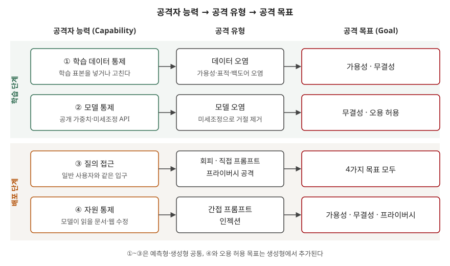

> **실행 검증 없음.** NIST의 적대적 머신러닝 분류 보고서(NIST AI 100-2 E2025) 원문을 근거로 정리한 개념 글이다.
> 실행 예제와 측정값은 없다.

## 들어가며

AI 보안 문항은 "AI를 공격하는 방법을 쓰라"는 형태로 나오고, 사례를 늘어놓으면 회피·오염·탈옥이 기준 없이 섞인다.
NIST는 이 분야의 용어와 분류를 정리한 보고서(NIST AI 100-2)를 판을 거듭해 내고 있고, 2025년판은 생성형 AI 공격을 별도 장으로 다룬다.
이 보고서의 축은 **공격자가 무엇을 노리는가(목표)** 와 **공격자가 무엇을 손에 쥐었는가(능력)** 두 가지다.
이 두 축을 쓰면 새 공격 기법이 나와도 표의 어느 칸에 들어가는지로 설명할 수 있다.

## 정의

- **적대적 머신러닝(AML)**: 머신러닝 시스템의 통계적·데이터 기반 특성을 악용하는 공격과, 그 공격을 완화하는 방법을 다루는 분야다.
  NIST AI 100-2는 이 분야의 공격을 **학습 방법·공격 단계·공격자의 목표·능력·지식**의 계층으로 분류한다.
- **공격 목표**는 보안 침해의 주요 유형에 맞춰 **가용성 붕괴·무결성 침해·프라이버시 침해** 3가지로 나누고,
  생성형 AI에는 **오용 허용**을 더해 **4가지**가 된다.

NIST는 공급망 공격 절(§3.2)에서 AI가 소프트웨어인 이상 전통 공급망 취약점도 물려받는다고 적고,
그중 **머신러닝의 통계적·데이터 기반 특성을 노리는 공격**만 AML의 영역으로 본다. 서버 침투나 계정 탈취는 여기에 들지 않는다.

## 등장 배경

1. **입력이 곧 공격 면이 됐다** — 스팸 필터의 선형 분류기에 대한 적대적 예제가 2004년에 보고됐고,
   2013년에는 심층 신경망 이미지 분류기도 사람 눈에 안 보이는 작은 변화로 오분류된다는 것이 밝혀졌다.
   코드에 결함이 없어도 모델은 속는다
2. **학습 데이터가 코드 역할을 한다** — 학습 데이터 일부를 바꾸면 모델의 동작이 바뀐다. 기존 보안 통제는 데이터를
   "보호할 자산"으로만 봤지 "동작을 정하는 입력"으로 보지 않았다
3. **생성형 AI가 데이터와 지시를 한 통로에 넣었다** — NIST는 LLM 애플리케이션 취약점의 밑바탕에 **데이터와 지시가 분리된
   통로로 들어가지 않는다**는 사실이 있다고 적고, 이것을 SQL 인젝션과 비슷한 결함으로 비교한다
4. **용어가 제각각이었다** — 같은 공격을 논문마다 다른 이름으로 불러 위험 평가와 표준이 기댈 공통 용어가 필요했다

## 구성요소

### 공격 목표 — 4가지

| 목표 | 정의 (NIST AI 100-2) | 대표 공격 |
|---|---|---|
| ① 가용성 붕괴 | 다른 사용자·프로세스가 제때 안정적으로 서비스를 받지 못하게 하는 고의적 방해 | 가용성 오염, 에너지-지연 공격 |
| ② 무결성 침해 | 시스템이 의도한 목적과 다르게, **공격자의 목적에 맞는** 예측·출력을 내게 함 | 회피, 표적 오염, 백도어 |
| ③ 프라이버시 침해 | 학습 데이터, 가중치·구조, RAG 지식베이스 같은 제한된 정보의 유출 | 멤버십 추론, 데이터 재구성, 모델 추출 |
| ④ 오용 허용 | 소유자가 건 **기술적 제한**(시스템 프롬프트, 안전 정렬용 RLHF)을 의도적으로 우회 | 탈옥, 미세조정 우회 |

③에서 NIST는 전통 보안이 "기밀성"이라 부르는 것을 AML 분야는 "프라이버시"라는 말로 함께 부른다고 밝힌다.
모델의 가중치를 빼내는 것도, 학습 데이터를 드러내는 것도 이 칸에 든다.

### 공격자 능력 — 예측형 6가지, 생성형 4가지

| 능력 | 예측형 | 생성형 | 쓰이는 공격 |
|---|---|---|---|
| 학습 데이터 통제 | O | O | 데이터 오염 |
| 모델 통제 | O | O | 모델 오염(연합학습의 악성 업데이트, 트로이 목마), 미세조정 우회 |
| 시험 데이터 통제 | O | — | 회피, 백도어 발동 |
| 레이블 제한 | O | — | 레이블을 못 건드리는 클린 레이블 오염 |
| 소스 코드 통제 | O | — | 난수 생성기·외부 라이브러리 변조 |
| 질의 접근 | O | O | 블랙박스 회피, 프라이버시 공격, 프롬프트 인젝션·추출 |
| **자원 통제** | — | **O** | **간접 프롬프트 인젝션** |

능력과 별도로 **공격자 지식**은 화이트박스·블랙박스·그레이박스 3가지로 나눈다. NIST는 화이트박스를 최악의 공격자를 가정해
완화책을 시험하는 용도로, 블랙박스를 정상 사용 인터페이스만 쓰므로 **가장 현실적인** 경우로 설명한다.

### 공격 단계 — 2가지

학습 단계 공격은 **오염**(데이터 오염·모델 오염)이고, 배포 단계 공격은 **회피·프라이버시 공격·프롬프트 공격**이다.
백도어는 학습 단계에 심고 배포 단계에 발동하므로 학습 데이터와 시험 데이터를 **둘 다** 통제해야 하는 유일한 공격으로 분류된다.

## 도식

> **출처**: [NIST AI 100-2 E2025 Adversarial Machine Learning — §2.1.2 Attacker Goals and Objectives, §2.1.3 Attacker Capabilities, §3.1.2 Attacker Goals and Objectives, §3.1.3 Attacker Capabilities](https://csrc.nist.gov/pubs/ai/100/2/e2025/final)

답안지에는 왼쪽 4칸(능력)과 오른쪽 목표만 그리고, 두 단계를 띠로 나누면 3분 안에 옮길 수 있다.

## 비교

### 직접 프롬프트 공격과 간접 프롬프트 인젝션

| 구분 | 직접 프롬프트 공격 | 간접 프롬프트 인젝션 |
|---|---|---|
| 공격자 | 시스템의 **사용자 본인** | 사용자가 아닌 **제3자** |
| 필요한 능력 | 질의 접근 | 자원 통제 |
| 공격이 들어오는 곳 | 사용자 입력 | 모델이 실행 중에 읽는 문서·웹 페이지·이메일·RAG 자료 |
| 주된 목표 | 오용 허용, 시스템 프롬프트 추출 | 가용성·무결성·프라이버시 |
| 피해자 | 주로 모델 소유자 | 주로 **그 시스템의 정상 사용자** |

NIST는 간접 프롬프트 인젝션에서 **피해를 입는 쪽이 대개 모델의 주 사용자**라고 적는다. 공격자는 시스템에 계정도 없고
사용자와 대화하지도 않는다. 모델이 읽을 자료에 글을 남기는 것만으로 공격이 성립하므로, 에이전트와 RAG를 붙일수록
공격 면이 넓어진다. 같은 절은 이메일을 읽는 모델에게 연락처 전원에게 같은 메일을 보내라고 지시해 **자기 전파**시키는 경우와,
모델이 사용자 데이터를 담은 URL을 호출하게 해 **유출**하는 경우를 든다.

### 전통 보안 목표와의 대응

| 전통 보안 (CIA) | AML 목표 | 달라진 점 |
|---|---|---|
| 가용성 | 가용성 붕괴 | 학습 데이터 오염으로도 일어난다 |
| 무결성 | 무결성 침해 | 데이터를 고치지 않고 **입력만 바꿔도** 출력이 바뀐다(회피) |
| 기밀성 | 프라이버시 침해 | 저장소를 뚫지 않고 **질의만으로** 학습 데이터·모델이 샌다 |
| — | 오용 허용 | 대응하는 칸이 없다. "모델이 하지 않기로 한 일"을 하게 만드는 것 |

## 적용 시 고려사항

- **자원 통제를 위협 모델에 넣는다.** RAG 문서함, 에이전트가 여는 웹, 수신 메일은 신뢰 경계 밖이다.
  NIST는 현재 완화책이 모든 기법을 막지 못하므로 **신뢰할 수 없는 입력에 노출된 모델은 인젝션이 가능하다고 가정하고** 설계하라고 적고,
  권한이 다른 여러 LLM을 쓰거나 신뢰할 수 없는 자료와는 정해진 인터페이스로만 상호작용하게 하는 방식을 예로 든다.
- **모델 출력을 그대로 실행하지 않는다.** NIST는 출력이 사람 감독 없이 웹 페이지 요소나 명령으로 쓰이면 하위 애플리케이션에서
  가용성·무결성·프라이버시 침해가 생길 수 있다고 적는다. 출력은 입력과 같은 수준으로 검증한다.
- **방어를 적응형 공격으로 평가한다.** 회피 방어는 약한 공격으로 평가됐다가 더 강한 공격에 깨진 역사가 반복됐다.
  NIST는 적대적 학습과 인증 기법을 유망한 방향으로 들면서도, 평가는 방어를 아는 공격자를 상정해야 한다고 적는다.
- **공개 모델과 미세조정 API는 모델 통제를 넘겨주는 결정이다.** 가중치를 공개하거나 미세조정을 열면 공격자가
  거절 동작을 학습으로 지우는 미세조정 우회가 가능해진다. 배포 방식이 곧 공격자 능력을 정한다.
- **데이터·모델 공급망을 관리한다.** 인터넷에서 긁어 온 대규모 학습 데이터는 오염에, 제3자가 학습한 모델은 모델 오염에 노출된다.
  NIST는 기존 공급망 관리에 산출물 출처 정보를 더하는 방식을 권한다.

> 기출 답안: [기출문제 — AI 리스크: 개념, 보안·프라이버시·사회적 리스크](../../exam/2026-10-12-ai-risk-security-privacy-social/index.md)

## 정리

- 분류 축 **2가지**: 목표(무엇을 노리나) × 능력(무엇을 쥐었나). 여기에 단계 2가지(학습·배포), 지식 3가지(화이트·블랙·그레이)가 붙는다.
- 목표 **4가지 — 가·무·프·오**: 가용성 붕괴, 무결성 침해, 프라이버시 침해, 오용 허용(생성형 추가).
- 능력: 예측형 **6가지**(학습 데이터·모델·시험 데이터·레이블·소스 코드·질의), 생성형 **4가지**(학습 데이터·모델·질의·**자원**).
- 생성형의 새 항목 둘: **오용 허용**(목표)과 **자원 통제**(능력). 자원 통제가 **간접 프롬프트 인젝션**을 만들고,
  원인은 데이터와 지시가 한 통로로 들어가는 구조다.

## 참고 자료

- [NIST AI 100-2 E2025, Adversarial Machine Learning: A Taxonomy and Terminology of Attacks and Mitigations (2025-03)](https://csrc.nist.gov/pubs/ai/100/2/e2025/final) — §2.1 Attack Classification, §2.2 Evasion Attacks, §3.1 Attack Classification, §3.2 Supply Chain Attacks, §3.4 Indirect Prompt Injection Attacks and Mitigations
