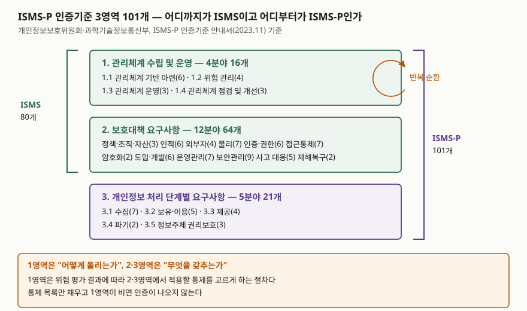

> **실행 검증 없음.** 개인정보보호위원회·과학기술정보통신부의 ISMS-P 인증기준 안내서(2023.11)와
> ISMS-P 누리집 고시 안내를 근거로 정리한 개념 글이다. 실행 예제와 측정값은 없다.
> 인증기준 개수는 고시 개정에 따라 바뀌므로 답안에 쓸 때는 기준 시점을 함께 적는다.

## 들어가며

보안 인증을 준비하는 조직에서 가장 먼저 나오는 산출물은 통제 항목 체크리스트다. 101개 항목에 ○·×를 채우고
증빙 문서를 붙이면 인증이 나올 것 같지만 그렇지 않다. 체크리스트를 다 채우고도 "위험 평가를 어떻게 했는지"에서
막히는 경우가 흔하다. **ISMS-P 인증기준의 1영역이 통제 목록이 아니라 통제를 고르는 절차**이기 때문이다.
시험에서도 "인증기준 3영역을 설명하라"가 단답형으로, "관리체계와 보호대책의 관계"가 논술형으로 나온다.
영역을 왜 나눴는지를 알아야 둘 다 쓸 수 있다.

## 정의

- **ISMS-P**(정보보호 및 개인정보보호 관리체계 인증): 조직이 정보보호와 개인정보보호를 위해 수립·운영하는
  관리체계가 인증기준에 적합한지를 인증기관이 심사해 인증하는 제도다.
  근거 법령은 **정보통신망법 제47조**(ISMS)와 **개인정보 보호법 제32조의2**(개인정보 보호 인증)이고,
  두 인증은 2018년 「정보보호 및 개인정보보호 관리체계 인증 등에 관한 고시」로 통합됐다.
- **인증기준**: 3개 영역 **총 101개**로 구성된다(2023.11 안내서 기준). 안내서는
  "1. 관리체계 수립 및 운영", "2. 보호대책 요구사항", "3. 개인정보 처리 단계별 요구사항"으로 나눈다.
- **ISMS와 ISMS-P의 범위 차이**: ISMS는 1·2영역 **80개**, ISMS-P는 세 영역 전부 **101개**를 받는다.

정책기관은 과학기술정보통신부와 개인정보보호위원회이고, 법정 인증기관은 한국인터넷진흥원(KISA)이다.
정책기관이 인증기관과 심사기관을 따로 지정한다.

## 등장 배경

통합 이전에는 정보보호 관리체계 인증(ISMS)과 개인정보보호 관리체계 인증(PIMS)이 따로 있었다.
두 인증은 근거 법이 다르고 소관 부처가 달랐지만 **요구하는 통제가 상당 부분 겹쳤다.**
정책·조직·자산 관리, 접근통제, 암호화, 사고 대응 같은 항목은 두 인증이 거의 같은 것을 물었고,
둘 다 받으려는 조직은 같은 증빙을 두 번 만들어 두 번 심사받아야 했다.

2018년 통합은 이 중복을 걷어낸 조치다. 겹치는 통제를 **1·2영역으로 합치고**, 개인정보에만 해당하는 통제를
**3영역으로 떼어** 선택 영역으로 뒀다. 그래서 ISMS 신청자는 1·2영역만, ISMS-P 신청자는 3영역까지 받는
구조가 됐다. 영역을 나눈 축이 "관리냐 기술이냐"가 아니라 **"정보 전반이냐 개인정보냐"** 라는 점이 핵심이다.

## 구성요소 — 3영역 21분야 101개

### 1영역: 관리체계 수립 및 운영 — **4분야 16개**

| 분야 | 인증기준 수 | 무엇을 묻는가 |
|---|---|---|
| 1.1 관리체계 기반 마련 | 6 | 경영진 참여, 범위 설정, 조직 구성, 자원 할당 |
| 1.2 위험 관리 | 4 | 자산 식별, 위험 식별·평가, 보호대책 선정 |
| 1.3 관리체계 운영 | 3 | 보호대책 구현, 공유, 운영현황 관리 |
| 1.4 관리체계 점검 및 개선 | 3 | 법적 요구사항 준수 검토, 내부 감사, 개선 |

이 네 분야가 **계획–실행–점검–개선의 한 바퀴**다. 1.2에서 평가한 위험 수준에 따라 2·3영역에서 적용할 통제를
고르고, 1.3에서 구현하며, 1.4에서 점검해 다음 바퀴로 넘긴다. **인증기준이 통제 목록이 아니라 절차인 곳이 여기다.**

### 2영역: 보호대책 요구사항 — **12분야 64개**

| 분야 | 수 | 분야 | 수 |
|---|---|---|---|
| 2.1 정책, 조직, 자산 관리 | 3 | 2.7 암호화 적용 | 2 |
| 2.2 인적 보안 | 6 | 2.8 정보시스템 도입 및 개발 보안 | 6 |
| 2.3 외부자 보안 | 4 | 2.9 시스템 및 서비스 운영관리 | 7 |
| 2.4 물리 보안 | 7 | 2.10 시스템 및 서비스 보안관리 | 9 |
| 2.5 인증 및 권한 관리 | 6 | 2.11 사고 예방 및 대응 | 5 |
| 2.6 접근통제 | 7 | 2.12 재해복구 | 2 |

관리적·물리적·기술적 보호대책이 한 영역에 섞여 있고, 분야는 **보호 대상의 수명주기**를 따라 늘어선다.
사람(2.2)과 외부자(2.3)에서 시작해 공간(2.4), 계정(2.5~2.6), 데이터(2.7), 시스템의 도입·운영·보안(2.8~2.10),
그리고 사고와 재해(2.11~2.12)로 간다.

### 3영역: 개인정보 처리 단계별 요구사항 — **5분야 21개**

| 분야 | 인증기준 수 |
|---|---|
| 3.1 개인정보 수집 시 보호조치 | 7 |
| 3.2 개인정보 보유 및 이용 시 보호조치 | 5 |
| 3.3 개인정보 제공 시 보호조치 | 4 |
| 3.4 개인정보 파기 시 보호조치 | 2 |
| 3.5 정보주체 권리보호 | 3 |

3.1~3.4가 **수집 → 보유·이용 → 제공 → 파기**의 개인정보 생명주기이고, 3.5가 그 전 구간에 걸치는
정보주체의 권리 보장이다. 2영역이 자산 종류로 나뉘는 것과 달리 3영역은 **처리 단계**로 나뉜다.
같은 암호화라도 2.7은 "정책에 따라 암호화했는가"를 묻고 3영역은 "그 단계에서 법이 요구하는 조치를 했는가"를 묻는다.

## 도식

> **출처**: [개인정보보호위원회 — ISMS-P 인증기준 안내서(공공데이터포털 자료 설명)](https://www.data.go.kr/data/15105394/fileData.do)(3영역 101개, ISMS 80개·ISMS-P 101개),
> [ISMS-P 누리집 — 제도소개](https://isms-p.or.kr/sysm/intro/selectSysmCertDetail.do)(분야별 인증기준 수, 법적 근거, 인증기관).

## 비교

### ISMS와 ISMS-P

| 구분 | ISMS | ISMS-P |
|---|---|---|
| 적용 영역 | 1·2영역 | 1·2·3영역 |
| 인증기준 수 | 80개 | 101개 |
| 보호 대상 | 정보자산 전반 | 정보자산 + 개인정보 |
| 근거 법 | 정보통신망법 제47조 | 위 조항 + 개인정보 보호법 제32조의2 |
| 의무 여부 | 제47조 제2항 요건에 해당하면 의무 | 의무대상자는 둘 중 하나를 고를 수 있다 |

ISMS 의무대상은 전기통신사업자이거나 전기통신역무를 이용해 정보를 제공·매개하는 자 중 다음 어느 하나에
해당하는 경우다 — **ISP**(서울 및 모든 광역시에서 정보통신망서비스를 제공하는 사업자 등), **IDC**(집적정보통신시설
사업자), **전년도 매출 1,500억 원 이상이면서 상급종합병원이거나 재학생 1만 명 이상인 학교**,
**전년도 정보통신서비스 매출 100억 원 이상**, **전년도 일평균 이용자 100만 명 이상**. 다섯 가지다.
의무대상이 아니어도 임의신청자로 신청할 수 있다.

### ISO/IEC 27001:2022와의 차이

| 구분 | ISMS-P | ISO/IEC 27001:2022 |
|---|---|---|
| 통제 목록의 위치 | 인증기준 2·3영역(85개) | 부속서 A(93개 통제) |
| 통제 분류 축 | 보호 대상·처리 단계 | 조직·인원·물리·기술 4개 주제 |
| 관리체계 절차 | 1영역 16개 인증기준 | 본문 4~10절(PDCA) |
| 개인정보 | 3영역으로 포함 | 확장 표준 ISO/IEC 27701로 분리 |
| 성격 | 국내 법정 인증(일부 의무) | 국제 표준의 임의 인증 |

구조가 닮은 것은 우연이 아니다. 둘 다 **"관리 절차 + 선택할 통제 목록"** 이라는 같은 틀을 쓴다.
다른 것은 개인정보를 어디에 뒀는가다. ISO는 별도 표준으로 뺐고 ISMS-P는 한 인증 안에 영역으로 넣었다.
국내에 개인정보 보호법이라는 별도 근거 법이 있어 하나의 인증으로 두 법을 함께 다루는 편이 신청자의 부담이 적다.

## 적용 시 고려사항

1. **범위 설정이 결과를 가른다.** 1.1에서 정한 인증 범위 밖의 시스템은 심사 대상이 아니다. 범위를 좁히면
   준비가 가벼워지지만, 범위 밖 시스템에서 사고가 나면 인증이 아무것도 보장하지 못한다. 서비스 경계와
   개인정보 흐름을 함께 보고 정해야 한다.
2. **통제 선택의 근거가 위험 평가다.** 101개를 전부 "적용"으로 표시하는 것이 안전해 보이지만, 1.2의 위험
   평가 결과와 이어지지 않으면 1영역에서 결함이 난다. 적용하지 않는 통제는 **왜 적용하지 않는지**를 남긴다.
3. **3영역은 법 개정을 따라간다.** 개인정보 보호법이 바뀌면 3영역 인증기준과 안내서가 개정된다. 인증을
   받아 둔 조직도 개정 내용이 자사 처리 절차에 미치는 영향을 따로 봐야 한다.
4. **인증과 보안 수준은 다른 말이다.** 인증은 심사 시점에 관리체계가 기준에 맞았다는 확인이다.
   1.4의 점검·개선이 실제로 돌지 않으면 인증서만 남는다. 1영역을 절차로 설계해야 하는 이유다.

## 정리

- **3-2-1로 묶는다**: **3**개 영역, 영역 **2**개까지가 ISMS, 영역 **1**개(3영역)를 더하면 ISMS-P다.
- 분야 수는 **4 · 12 · 5 = 21분야**, 인증기준 수는 **16 · 64 · 21 = 101개**. 1·2영역만 더하면 80개다.
- 1영역은 통제를 **고르는 절차**(기반 마련 → 위험 관리 → 운영 → 점검·개선), 2·3영역은 **고른 통제의 목록**이다.
- 2영역은 보호 대상으로, 3영역은 개인정보 **처리 단계**(수집·보유이용·제공·파기 + 권리보호)로 나뉜다.
- 의무대상 요건은 **5가지**(ISP, IDC, 매출 1,500억+병원·대학, 정보통신서비스 매출 100억, 일평균 이용자 100만).

## 참고 자료

- [개인정보보호위원회 — 정보보호 및 개인정보보호 관리체계(ISMS-P) 인증기준 안내서](https://www.data.go.kr/data/15105394/fileData.do) — 3개 영역 101개 인증기준, ISMS 80개·ISMS-P 101개 구분
- [ISMS-P 누리집 — 제도소개](https://isms-p.or.kr/sysm/intro/selectSysmCertDetail.do) — 법적 근거, 인증기관·심사기관, 분야별 인증기준 수
- [ISMS-P 누리집 — 인증대상](https://isms-p.or.kr/cert/aply/selectCertTrgtDetail.do) — 정보통신망법 제47조 제2항 의무대상 요건, 임의신청자
- [한국인터넷진흥원 — 정보보호 및 개인정보보호 관리체계 인증](https://www.kisa.or.kr/1050602) — 제도 운영 안내
- [ISO/IEC 27001:2022 — Information security management systems](https://www.iso.org/standard/27001) — 부속서 A 통제 구조 (국제 표준)
