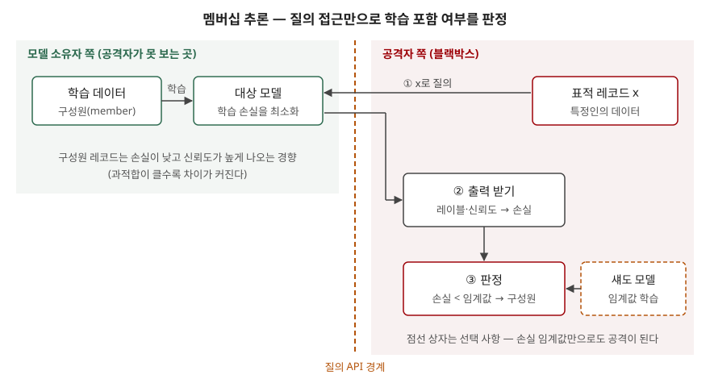

> **실행 검증 없음.** NIST의 적대적 머신러닝 분류 보고서와 원 논문, 개인정보보호위원회 발표 자료를 근거로 정리한 개념 글이다.
> 실행 예제와 측정값은 없다. 개인정보위 모델의 리스크 유형·안전조치 목록은 원문 PDF를 직접 열지 못해
> 법무법인 뉴스레터(2024-12-27)에 옮겨 적힌 표로 확인했다.

## 들어가며

데이터베이스 접근 통제와 암호화를 다 갖춰도, 그 데이터로 학습한 모델의 API가 열려 있으면 개인정보가 샐 수 있다.
모델은 학습한 데이터에 대해 학습하지 않은 데이터와 **다르게 반응**하고, 그 차이를 질의로 관찰할 수 있기 때문이다.
시험에서는 "AI 프라이버시 리스크"를 물을 때 유출만 쓰면 평이한 답안이 된다.
**저장하지 않은 정보가 모델의 추론으로 생긴다**는 점과 그 대표 공격인 멤버십 추론을 쓸 수 있어야 차이가 난다.

## 정의

- **멤버십 추론 공격**(Membership Inference Attack): 특정 레코드나 데이터 표본이 통계·머신러닝 알고리즘의
  **학습 데이터셋에 포함됐는지**를 판정하는 공격이다(NIST AI 100-2 E2025, 멤버십 추론 절).
- **학습 데이터 추출**(Training Data Extraction): 생성형 모델에서 학습 데이터를 그대로 뽑아내는 공격이다.
  모델이 학습 데이터를 **암기**하는 성질 때문에 성립한다.

멤버십 추론은 "누구의 데이터인가"를 묻지 않는다. 공격자는 이미 표적 레코드를 손에 쥐고 있고, 그것이 **학습에 쓰였다는 사실**을 알아낸다.
NIST는 희귀 질환 환자 연구처럼 **포함됐다는 사실 자체가 민감정보**가 되는 경우를 예로 든다.

## 등장 배경

1. **통계 공개에서 먼저 나왔다** — Homer 등이 유전체 통계에서 특정인의 포함 여부를 알아내는 공격을 "추적 공격"이라는 이름으로 처음 보였다.
   집계값만 공개해도 개인이 드러날 수 있다는 것이 출발점이다
2. **MLaaS가 질의 접근을 열었다** — Shokri 등(2017)은 클라우드 머신러닝 서비스에 블랙박스로 질의해 학습 포함 여부를 판정했다.
   모델만 공개해도 같은 문제가 생긴다는 것이 확인됐다
3. **생성형 모델이 학습 문장을 그대로 내놓았다** — Carlini 등은 GPT-2에서 이름·전화번호·이메일 주소를 포함한 학습 문장 수백 개를
   그대로 뽑았고, 그중 일부는 학습 데이터에 **단 한 문서에만** 있던 것이었다. 흔한 문장만 외운다는 가정이 깨졌다

## 구성요소

### 모델 대상 프라이버시 공격 — 4가지

NIST는 공격자가 알아내려는 것이 **학습 데이터**면 데이터 프라이버시 공격, **모델**이면 모델 프라이버시 공격으로 나눈다.

| 공격 | 공격자가 알아내는 것 | 구분 |
|---|---|---|
| ① 데이터 재구성 | 개인 레코드의 **내용·특징**. 모델 역전, 생성형 모델의 학습 데이터 추출이 여기 든다 | 데이터 |
| ② 멤버십 추론 | 특정 레코드가 학습에 **쓰였는지** 여부 | 데이터 |
| ③ 속성 추론 | 학습 데이터 **분포의 전역 정보**. 예를 들어 민감 속성을 가진 표본의 비율 | 데이터 |
| ④ 모델 추출 | 모델의 **구조·파라미터**. 정확히 같은 모델은 못 뽑고 기능이 같은 모델을 만든다 | 모델 |

NIST는 개별 레코드의 민감 속성을 알아내는 **속성값 추론**(attribute inference)도 함께 언급한다. ③은 집단의 비율을, 속성값 추론은
한 레코드의 값을 노린다는 점이 다르다. ④는 그 자체가 목적이라기보다 **다음 공격의 발판**이다. 가중치를 알면
화이트박스 공격이 가능해진다.

### 멤버십 추론 기법 — 3가지

| 기법 | 방법 | 비용 |
|---|---|---|
| ① 손실 임계값 (Yeom 등) | 표적 레코드의 손실이 고정 임계값(학습 표본의 평균 손실)보다 낮으면 구성원으로 판정 | 가장 싸다 |
| ② 섀도 모델 (Shokri 등) | 같은 과제로 학습한 모델을 여러 개 만들어, 구성원·비구성원 출력을 가르는 분류기를 학습 | 비싸다. 같은 분포의 데이터가 많이 필요 |
| ③ LiRA (Carlini 등) | 적은 수의 섀도 모델로 구성원·비구성원의 로짓 분포를 가우시안으로 추정하고 가능도비로 검정 | 중간 |

NIST는 ①과 ②가 복잡도는 양 끝이지만 **낮은 오탐률에서의 정밀도**는 비슷하다고 적는다. 공격자가 레이블만 받는 경우에도
멤버십 추론이 설계돼 있어, 신뢰도 점수를 숨기는 것만으로는 막히지 않는다.

## 도식

> **출처**: [NIST AI 100-2 E2025 Adversarial Machine Learning — §2.1.3 Attacker Capabilities(Query access), §2.4.2 Membership Inference](https://csrc.nist.gov/pubs/ai/100/2/e2025/final) ·
> [Yeom et al., Privacy Risk in Machine Learning: Analyzing the Connection to Overfitting](https://arxiv.org/abs/1709.01604) ·
> [Shokri et al., Membership Inference Attacks against Machine Learning Models (IEEE S&P 2017)](https://arxiv.org/abs/1610.05820)

답안지에는 점선(질의 API) 하나를 긋고 왼쪽에 "학습 데이터 → 모델", 오른쪽에 "x 질의 → 손실 → 임계값 판정"만 그리면 된다.

## 비교

### 멤버십 추론과 전통적 재식별

| 구분 | 전통적 재식별 | 멤버십 추론 |
|---|---|---|
| 공격 대상 | 공개·제공된 **데이터셋** | 데이터로 학습한 **모델** |
| 필요한 접근 | 데이터셋 사본 | 모델 질의 접근 |
| 알아내는 것 | 레코드가 **누구인지** | 이미 아는 레코드가 **학습에 있었는지** |
| 원인 | 준식별자 결합 | 학습 표본과 비학습 표본에 대한 모델 반응 차이(과적합·암기) |
| 대표 대책 | 가명·익명 처리, k-익명성 | 차분 프라이버시 학습, 과적합 억제, 중복 제거 |

데이터셋을 가명 처리해 학습해도 멤버십 추론은 남는다. 가명 처리는 레코드에서 식별자를 지우지만, 모델이 그 레코드에 보이는
반응 차이는 지우지 않는다.

### 대책별 효과

| 대책 | 데이터 재구성 | 멤버십 추론 | 속성 추론 | 모델 추출 |
|---|---|---|---|---|
| 차분 프라이버시 학습 | 완화 | 완화(성공 상한이 정의에서 바로 나온다) | 효과가 없었다는 보고가 있다 | 대상 아님 |
| 질의 제한·이상 질의 탐지 | — | — | — | 완화. 동기 있는 공격자는 우회 |
| 머신 언러닝 | 해당 레코드 영향 제거 | 해당 레코드 영향 제거 | — | — |

NIST는 차분 프라이버시가 학습 데이터를 보호하도록 설계된 것이라 **모델 추출은 막지 못한다**고 적는다. 또 실무에서는 정확도를 지키려
프라이버시 매개변수 ε을 크게 잡는 일이 많아 실제 보호 수준을 추정하기 어렵다며, 카나리를 심어 측정하는 **경험적 프라이버시 감사**를 함께 하라고 권한다.

## 적용 시 고려사항

- **평균 정확도가 아니라 낮은 오탐률에서 평가한다.** Carlini 등은 평균 정확도로 멤버십 추론 위험을 재면 공격이 실제로
  특정인을 확신 있게 가려내는지 알 수 없다며, **오탐률 0.1% 미만에서의 탐지율**로 재라고 제안한다. 자체 레드팀 결과를 볼 때도 이 기준을 쓴다.
- **과적합을 프라이버시 지표로 본다.** Yeom 등은 과적합만으로도 멤버십 추론이 충분히 가능하다고 보였다. 다만 과적합이 없어도
  공격이 될 수 있다고 함께 적었으므로, 일반화 성능이 좋다는 것으로 안전을 주장하지 않는다.
- **학습 데이터에서 중복을 지운다.** 개인정보위 모델은 기술적 안전조치로 학습데이터 전처리(데이터 최소화, 가명·익명화, **중복 제거**)를 첫 항목에 둔다.
  다만 GPT-2 추출 사례처럼 한 번만 나온 문장도 암기될 수 있으므로, 중복 제거만으로 끝내지 않고 차분 프라이버시와 출력 필터링을 겹친다.
- **생애주기 단계에 맞춰 리스크를 배치한다.** 개인정보위 모델은 생애주기를 기획·개발과 서비스 제공으로 나누고, 생성 AI와 판별 AI
  모두의 서비스 제공 단계에 **학습데이터 암기 및 개인정보 유·노출**을 프라이버시 리스크로 둔다. 관리 절차는
  **AI 유형·용례 파악 → 리스크 식별 → 리스크 측정 → 경감방안 검토·도입**의 4단계다.
- **RAG 문서함과 시스템 프롬프트도 같은 위험에 놓인다.** NIST는 생성형 모델에서 학습 데이터뿐 아니라 RAG로 넣은 데이터베이스 행이나
  PDF 본문도 직접 요청으로 그대로 뽑아낼 수 있다고 적는다. 학습하지 않은 데이터라도 문맥에 넣으면 유출 대상이다.

> 개념 정리: [차분 프라이버시(Differential Privacy) — 프라이버시 손실 매개변수 ε과 누적 손실](../2026-10-03-differential-privacy-epsilon-composition/index.md)
>
> 개념 정리: [적대적 머신러닝 공격 분류 — 회피·오염·프라이버시·오용 허용](../2026-10-13-adversarial-ml-attack-taxonomy/index.md)
>
> 기출 답안: [기출문제 — AI 리스크: 개념, 보안·프라이버시·사회적 리스크](../../exam/2026-10-12-ai-risk-security-privacy-social/index.md)

## 정리

- 모델 대상 프라이버시 공격 **4가지 — 재·멤·속·추**: 데이터 재구성(내용), 멤버십 추론(포함 여부), 속성 추론(분포), 모델 추출(구조·파라미터).
  앞의 셋은 데이터, 마지막은 모델을 노린다.
- 멤버십 추론 기법 **3가지**: 손실 임계값 · 섀도 모델 · LiRA. 레이블만 받아도 공격이 된다.
- 원인은 **과적합과 암기**. 한 번만 나온 문장도 생성형 모델에서 그대로 추출됐다.
- 대책의 중심은 **차분 프라이버시**(재구성·멤버십 추론에 효과, 모델 추출은 대상 아님)와 **경험적 감사**.
  국내 기준은 개인정보위 관리 모델의 **4단계 절차**와 **암기·유노출** 리스크 유형.

## 참고 자료

- [NIST AI 100-2 E2025, Adversarial Machine Learning: A Taxonomy and Terminology of Attacks and Mitigations (2025-03)](https://csrc.nist.gov/pubs/ai/100/2/e2025/final) — §2.1.2 Attacker Goals and Objectives, §2.4 Privacy Attacks and Mitigations, §3.3.2 Information Extraction
- [Shokri, Stronati, Song, Shmatikov, Membership Inference Attacks against Machine Learning Models, IEEE S&P 2017](https://arxiv.org/abs/1610.05820)
- [Yeom, Giacomelli, Fredrikson, Jha, Privacy Risk in Machine Learning: Analyzing the Connection to Overfitting (arXiv 1709.01604)](https://arxiv.org/abs/1709.01604)
- [Carlini et al., Membership Inference Attacks From First Principles (arXiv 2112.03570)](https://arxiv.org/abs/2112.03570)
- [Carlini et al., Extracting Training Data from Large Language Models (arXiv 2012.07805)](https://arxiv.org/abs/2012.07805)
- [개인정보보호위원회, 안전한 인공지능(AI)·데이터 활용을 위한 AI 프라이버시 리스크 관리 모델 (2024-12-19 공개)](https://www.pipc.go.kr/np/cop/bbs/selectBoardArticle.do?bbsId=BS217&mCode=G010030000&nttId=11014)
- [법무법인 세종, 개인정보보호위원회 「AI 프라이버시 리스크 관리모델」 공개 (뉴스레터, 2024-12-27)](https://www.shinkim.com/kor/media/newsletter/2663) — 리스크 유형·안전조치 표 확인용(2차)
