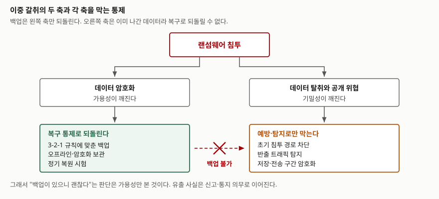

> **실행 검증 없음.** NIST·CISA·US-CERT 발간 문서를 근거로 정리한 개념 글이다. 실행 예제와 측정값은 없다.
> 피해 규모·복구 기간 같은 수치는 1차 자료에서 확인한 것만 쓰고, 확인되지 않은 수치는 싣지 않았다.

## 들어가며

랜섬웨어는 시험에서 "악성코드의 한 종류"로 묻지 않는다. **조직의 어떤 통제가 어디까지 막아 주는가**를 묻는다.
답안에서 가장 흔한 실수가 백업 이야기로 지면을 다 쓰는 것이다. 백업은 복구 통제 하나일 뿐이고,
2019년 이후의 랜섬웨어는 데이터를 암호화하기 전에 **먼저 빼내 간다.** 빼낸 데이터를 공개하겠다는 협박에는
복원 절차가 아무 영향을 주지 못한다.

그래서 이 주제는 예방·탐지·복구를 한 축에 세워 놓고, 어느 통제가 어느 피해를 담당하는지를
나누어 쓰는 문제다. 백업은 그 격자의 한 칸이다.

## 정의

NIST의 랜섬웨어 위험관리 프로파일(IR 8374r1)은 랜섬웨어를 **공격자가 조직의 데이터를 암호화하고 접근을
되돌려 주는 대가로 금전을 요구하는 악성 공격**으로 정의한다. 같은 문서는 공격자가 정보를 탈취한 뒤
당국·경쟁사·대중에게 공개하지 않는 조건으로 **추가 금전을 요구하기도 한다**고 덧붙인다.

정의가 두 문장인 이유가 이 주제의 전부다. 앞 문장은 **가용성** 침해이고 뒤 문장은 **기밀성** 침해다.
뒤 문장에 해당하는 수법을 CISA의 `#StopRansomware` 가이드는 **이중 갈취**(double extortion)로 부른다.

## 등장 배경

초기 랜섬웨어는 단말 하나의 파일을 암호화하고 소액을 요구하는 수법이었다. 조직이 백업과 복원 절차를
갖추면서 몸값을 내지 않고 복구하는 사례가 늘자, 공격자는 **지불을 거부해도 손해가 남도록** 수법을 바꿨다.
암호화 전에 데이터를 반출해 두고, 복구에 성공한 조직에도 공개를 협박하는 방식이다.

이 변화가 대응 체계에 두 가지를 요구했다.

1. **복구 통제만으로 위험이 닫히지 않는다.** 반출을 막거나 찾아내는 통제가 따로 있어야 한다.
2. **사고 판단 기준이 바뀐다.** "복구했으니 사고가 끝났다"가 아니라, 무엇이 밖으로 나갔는지를
   확정해야 신고·통지 의무를 이행할 수 있다.

NIST IR 8374의 개정판이 2022년 초판(CSF 1.1 기반 5개 기능)에서 **GOVERN을 더한 6개 기능**으로 옮겨 간 것도
같은 맥락이다. 랜섬웨어를 기술 통제 문제가 아니라 조직의 위험관리 문제로 세운 것이다.

## 구성요소 — NIST CSF 2.0의 6개 기능

NIST IR 8374r1은 CSF 2.0의 **6개 기능** 전부를 랜섬웨어 대응의 뼈대로 쓴다. 각 기능의 정의는 CSF 2.0 본문의 것이다.

| 기능 | CSF 2.0의 정의 | 랜섬웨어에서 담당하는 것 |
|---|---|---|
| **GOVERN**(GV) | 조직의 사이버보안 위험관리 전략·기대·정책을 수립·전달·감독한다 | 몸값 지불 여부의 사전 방침, 역할과 보고 체계 |
| **IDENTIFY**(ID) | 조직의 현재 사이버보안 위험을 이해한다 | 자산·데이터 식별, 우선 복구 대상 선정 |
| **PROTECT**(PR) | 위험을 관리하기 위한 보호조치를 사용한다 | 접근통제, 분할, 백업 체계 구축 |
| **DETECT**(DE) | 발생 가능한 공격과 침해를 찾아내고 분석한다 | 선행 악성코드·비정상 반출 탐지 |
| **RESPOND**(RS) | 탐지된 사고에 대한 조치를 수행한다 | 격리, 제거, 신고와 통지 |
| **RECOVER**(RC) | 사고의 영향을 받은 자산과 운영을 복원한다 | 백업 복원, 재감염 없는 복귀 |

여기서 답안에 쓸 만한 구분이 하나 나온다. **백업은 PROTECT에서 만들어지고 RECOVER에서 쓰인다.**
한 통제가 두 기능에 걸쳐 있으므로, 만들기만 하고 복원을 시험해 본 적이 없으면 PROTECT만 한 것이다.

## 절차 — CISA 대응 체크리스트 4단계

사고가 난 뒤의 순서는 CISA `#StopRansomware` 가이드 2부의 **4단계**를 따른다.

| 단계 | 핵심 활동 |
|---|---|
| ① 탐지와 분석 | 영향받은 시스템 식별·격리(전원 차단은 최후 수단), 복구 우선순위 분류, 로그 검토, 위협 헌팅 착수 |
| ② 보고와 통지 | 내외부 이해관계자 참여, 수사·대응 기관 신고, 대외 커뮤니케이션 조율, 유출 통지 의무 이행 |
| ③ 격리와 제거 | 시스템 이미지·메모리 확보, 복호화 도구 확인, 바이너리 제거, 최초 침투 지점과 지속성 수단 제거, 암호 재설정, 사고 종료 선언 |
| ④ 복구와 사후 활동 | 오프라인·암호화 백업에서 중요 업무 순으로 복원, 교훈 정리, 침해지표(IoC) 공유 |

①에서 **전원 차단을 최후 수단으로 두는 것**이 자주 틀리는 자리다. 메모리에만 있는 암호화 키와
휘발성 증거가 전원과 함께 사라지기 때문이다. 격리는 전원이 아니라 네트워크 분리로 한다.

②가 ③보다 앞에 오는 것도 의도된 순서다. 제거부터 하면 증거가 사라져 무엇이 나갔는지 확정할 수 없다.

## 도식

> **출처**: [NIST IR 8374r1 — Ransomware Risk Management: A CSF 2.0 Community Profile](https://csrc.nist.gov/pubs/ir/8374/r1/final)(암호화 후 금전 요구와 탈취 후 공개 협박을 함께 적는 정의),
> [CISA #StopRansomware Guide](https://www.cisa.gov/stopransomware/ransomware-guide)(서론의 이중 갈취 정의, 1부 준비 항목의 오프라인·암호화 백업과 정기 시험, 4부 복구 항목),
> [US-CERT — Data Backup Options](https://www.cisa.gov/sites/default/files/publications/data_backup_options.pdf)(3-2-1 규칙 3항목).

## 비교 — 세 통제가 담당하는 피해가 다르다

| 구분 | 예방(PROTECT) | 탐지(DETECT) | 복구(RECOVER) |
|---|---|---|---|
| 막는 피해 | 침투 자체 | 피해 확산과 반출 | 암호화된 데이터의 가용성 |
| 이중 갈취의 유출 축 | 막는다 | 찾아낸다 | **되돌릴 수 없다** |
| 대표 수단 | 패치, MFA, 최소권한, 분할 | EDR, 로그 상관분석, 반출 트래픽 감시 | 3-2-1 백업, 골든 이미지, 복원 시험 |
| 실패가 드러나는 시점 | 침투 시점 | 공격자 체류 기간 중 | 복원을 시도할 때 |
| 흔한 착각 | "경계만 막으면 된다" | "알림이 오면 보면 된다" | "백업이 있으니 괜찮다" |

**복구 통제의 실패가 복원을 시도할 때야 드러난다**는 점이 답안에서 짚을 만한 대목이다.
백업을 매일 받고 있어도 복원해 본 적이 없으면, 사고가 나서야 복원이 안 된다는 사실을 알게 된다.
CISA 가이드가 백업의 "가용성과 무결성을 정기적으로 시험하라"고 따로 적는 이유다.

### 3-2-1 규칙의 3항목

백업 체계의 기준으로 인용되는 3-2-1 규칙은 US-CERT가 펴낸 *Data Backup Options*에 **3항목**으로 적혀 있다.
이 문서는 규칙의 출처를 Peter Krogh의 *The DAM Book* 2판으로 밝힌다.

| 숫자 | 내용 |
|---|---|
| **3** | 중요한 파일은 사본 3벌 — 원본 1벌과 백업 2벌 |
| **2** | 서로 다른 매체 2종에 둔다 — 위험의 종류가 다르기 때문이다 |
| **1** | 1벌은 외부에 보관한다 — 건물 밖 |

이 규칙은 2012년 문서이고, 화재·고장·분실 같은 **물리적 손실**을 전제로 만들어졌다.
랜섬웨어는 전제가 다르다. 공격자가 관리자 권한을 쥐면 네트워크에 붙어 있는 사본은 매체가 달라도 같이 지워진다.
그래서 CISA 가이드는 3-2-1에 두 가지를 덧붙인다 — **오프라인 보관**과 **백업 자체의 암호화**다.
클라우드 불변 저장소(object lock)도 선택지로 들지만, 규정 요건에 맞지 않을 수 있고 설정을 잘못하면
비용이 크다는 단서를 함께 적는다.

## 적용 시 고려사항 — 5가지

1. **복원을 정기적으로 시험한다.** 백업 존재 여부가 아니라 **복원 성공 여부**가 지표다.
   목표 시간은 재해복구의 RTO·RPO와 같은 기준으로 잡는다
   ([재해복구 전략 글](../../system/2026-10-02-disaster-recovery-mtd-rto-rpo-strategies/index.md)).
2. **백업 저장소의 권한을 운영 계정과 분리한다.** 운영 관리자 계정으로 백업을 지울 수 있으면
   그 계정 하나가 뚫릴 때 3벌이 동시에 사라진다. 오프라인 사본이 여기서 값을 한다.
3. **초기 침투 경로별로 통제를 배치한다.** CISA 가이드는 예방을 침투 경로 **6가지**로 나눈다 —
   인터넷에 노출된 취약점, 탈취된 자격증명, 피싱, 선행 악성코드, 고급 사회공학, 제3자·MSP.
   경로마다 막는 수단이 달라 한 가지 통제로 덮이지 않는다.
4. **유출 판단과 신고 절차를 복구 절차와 분리해 둔다.** 국내에서는 개인정보 보호법 제34조가
   유출 시 정보주체 통지와 전문기관 신고를 의무로 두므로, 복구가 끝나도 절차가 남는다.
   무엇이 나갔는지를 확정하려면 ③ 제거 단계 전에 증거를 확보해야 한다.
5. **몸값 지불 방침을 사고 전에 정한다.** GOVERN 기능의 몫이다. 사고 한가운데서 결정하면
   의사결정 시간이 그대로 복구 지연이 된다. 지불해도 복호화 도구가 동작한다는 보장이 없고
   유출된 데이터가 폐기된다는 보장도 없다는 점을 방침에 명시한다.

## 정리

- 암기 단서는 **"6-4-3"**이다. CSF 2.0 **6개 기능**, CISA 대응 체크리스트 **4단계**, 백업 **3-2-1 규칙**.
- 랜섬웨어의 정의가 두 문장인 이유는 피해가 두 축이기 때문이다. 암호화는 **가용성**, 탈취·공개는 **기밀성**이다.
- 백업은 PROTECT에서 만들어 RECOVER에서 쓴다. 가용성 축만 되돌리고 기밀성 축은 건드리지 못한다.
- 3-2-1은 물리적 손실을 전제로 한 2012년 기준이다. 랜섬웨어에는 **오프라인·암호화·복원 시험**이 더 붙는다.
- 대응 순서에서 두 가지를 틀리지 않는다 — 격리는 전원 차단이 아니라 네트워크 분리, 제거보다 증거 확보가 먼저다.

## 참고 자료

- [NIST IR 8374r1 — Ransomware Risk Management: A Cybersecurity Framework 2.0 Community Profile](https://csrc.nist.gov/pubs/ir/8374/r1/final) — 랜섬웨어 정의, CSF 2.0 6개 기능 기반 프로파일
- [NIST CSWP 29 — The NIST Cybersecurity Framework (CSF) 2.0](https://nvlpubs.nist.gov/nistpubs/CSWP/NIST.CSWP.29.pdf) — GOVERN·IDENTIFY·PROTECT·DETECT·RESPOND·RECOVER 6개 기능의 정의
- [CISA — #StopRansomware Guide](https://www.cisa.gov/stopransomware/ransomware-guide) — 이중 갈취 정의, 예방 모범사례(침투 경로 6가지), 대응 체크리스트 4단계
- [US-CERT — Data Backup Options](https://www.cisa.gov/sites/default/files/publications/data_backup_options.pdf) — 3-2-1 규칙의 3항목과 그 원 출처
- [국가법령정보센터 — 개인정보 보호법](https://www.law.go.kr/%EB%B2%95%EB%A0%B9/%EA%B0%9C%EC%9D%B8%EC%A0%95%EB%B3%B4%EB%B3%B4%ED%98%B8%EB%B2%95) — 제34조 개인정보 유출 등의 통지·신고
- [사고 대응 6단계 글](../2026-09-29-incident-response-six-phases/index.md) — 준비·탐지·억제·근절·복구·교훈과 CISA 체크리스트의 대응 관계
