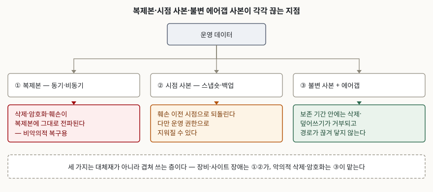

> **실행 검증 없음.** 이 글의 정의·통제 번호·권고 항목은 전부 NIST 발간물(SP 800-209,
> SP 800-53 Rev. 5, IR 8374)과 CNSSI 4009-2022 용어집에서 확인한 것이고, 제품 기능이나
> 성능 수치는 싣지 않았다.

## 들어가며

재해복구 설계를 하다 보면 복제 지연을 몇 초까지 줄일 것인가에 시간이 다 간다. 그렇게
만든 구성은 장비가 망가지거나 건물이 못 쓰게 되는 사고에는 잘 듣지만, **운영 데이터가
암호화되거나 지워지는 사고에는 거의 듣지 않는다.** 복제는 변경을 따라가라고 만든 장치이고,
삭제와 암호화도 변경이기 때문이다. 시험에서는 재해복구·랜섬웨어·정보보호 통제 문항이
모두 이 지점을 묻고, 실무에서는 "백업은 다 있었는데 백업까지 같이 당했다"는 형태로
나타난다.

## 정의

**불변 백업은 정해 둔 보존 기간이 끝나기 전에는 덮어쓰기와 삭제가 저장 계층에서
거부되는 사본이고, 에어갭은 두 시스템이 물리적으로 연결되어 있지 않고 논리적 연결도
자동화되어 있지 않은 인터페이스다.**

뒤쪽은 그대로 쓸 수 있는 1차 정의다. CNSSI 4009-2022는 에어갭을 두 시스템 사이의
인터페이스로서 **(a) 물리적으로 연결되어 있지 않고 (b) 논리적 연결이 자동화되어 있지
않아 자료가 사람의 통제 아래 수동으로만 옮겨지는 것**으로 정의한다.

앞쪽은 사정이 다르다. **표준이 "불변 백업"을 한 문장으로 정의해 두지 않았다.** 대신
NIST IR 8374가 자료를 불변 형식으로 저장하라고 권하면서 그것을 **새 자료가 들어올 때
오래된 자료를 자동으로 덮어쓰지 않는 상태**라고 풀어 쓰고, SP 800-209는 그 수단으로
보존 잠금(retention locking)·볼트 잠금(vault locking)·불변성 정책을 든다. 위 정의는 이
두 자료의 서술을 묶은 것이므로, 답안에 쓸 때는 **출처를 둘 다 밝히는 편**이 안전하다.

참고로 백업 자체의 1차 정의는 따로 있다. NIST SP 800-34 Rev. 1은 백업을 **필요할 때
복구를 돕기 위해 만든 파일과 프로그램의 사본**으로 정의한다.

## 등장 배경

SP 800-209의 격리 절(§4.7)이 문제를 한 문단에 정리한다. 운영 자료가 손상되거나 유실되면
조직은 복제본이나 백업으로 복구하는데, **그 손상이 악의적 공격의 결과이고 공격자가
백업 사본까지 장악했다면 복구 능력 자체가 사라지므로 피해가 치명적이 된다.** 그래서
같은 절은 자료 보호 시나리오를 **2가지로 나눠 생각하라**고 요구한다.

| 구분 | 비악의적 복구 | 사이버 공격 복구 |
|---|---|---|
| 대비 대상 | 자연재해, 하드웨어 고장, 사람의 실수 | 악의적 삭제·암호화·변조 |
| 사본의 성격 | 운영 환경에 가까운 로컬 사본, DR 사본, 백업, 장기 보관본 | 강화되고 잠기고 격리된 사본 |
| 설계 목표 | 빠르게 되돌린다 | **운영이 장악되어도 영향받지 않는다** |

둘을 따로 둘지는 선택이지만, **기존 사본으로 공격 복구까지 감당할 작정이라면 그 설정을
다시 검토해 격리를 갖추게 하라**는 것이 같은 절의 요구다. 적어도 일부 복구 사본과
시스템이 운영 환경에서 **접근 불가능하고 독립적**이며, 운영이 장악되어도 그 사본에
손댈 수 없다는 점을 검증해야 한다.

NIST IR 8374도 같은 지점을 짚는다. 랜섬웨어 대비 항목에서 백업에 대해 **랜섬웨어에
오염되거나 공격자에게 삭제되지 않도록 보호되어야 하며 오프라인으로 보관되어야
한다**고 적는다.

## 구성요소 — 끊는 축 4가지와 격리 권고 10가지

### 사본을 끊는 축 — 4가지

복제본이 훼손을 따라가는 경로는 네 갈래이고, 각 축이 그중 하나를 끊는다.

| # | 축 | 무엇을 끊는가 | 대표 수단 | 근거 |
|---|---|---|---|---|
| 1 | 시점 격리 | 현재 상태만 남는 것 | 스냅숏, 시점 복구, 독립 전체 기준 사본 | SP 800-209 IS-SS-R5 |
| 2 | 쓰기 금지 | 사본의 덮어쓰기·삭제 | 불변 저장, WORM, 보존 잠금, 객체 잠금 | SP 800-209 IS-SS-R10·AL-SS-R5 |
| 3 | 경로 격리 | 운영망에서 사본으로 닿는 길 | 에어갭, 저장·관리 시스템 분리, 오프사이트 | SP 800-209 IS-SS-R1·R4·R8 |
| 4 | 권한 격리 | 운영 자격증명으로 사본을 다루는 것 | 전용 관리 시스템, 별도 계정, 삭제 이중 승인 | SP 800-209 IS-SS-R2·R3, SP 800-53 CP-9(7) |

**네 축은 대체재가 아니다.** 쓰기 금지만 걸고 권한 격리를 빼면 보존 정책을 바꿀 수 있는
계정 하나가 전부를 무력화하고, 경로만 끊고 시점 격리를 빼면 끊긴 저쪽에도 이미 훼손된
상태만 남는다.

### SP 800-209의 격리 권고 — 10가지

| 번호 | 내용 |
|---|---|
| IS-SS-R1 | 저장 시스템 분리 — 사설 클라우드는 물리적으로 분리된 저장 시스템, 공용 클라우드는 별도 계정 |
| IS-SS-R2 | 관리 시스템 분리 — 운영과 분리된 전용 관리 시스템, 일반 자격증명으로 접근 불가 |
| IS-SS-R3 | 접근 제한 — 일상 업무와 **다른 자격증명**을 쓰는 극소수에게만 공격 복구 사본 접근 허용 |
| IS-SS-R4 | 오프사이트 보관 — 운영 자료가 있는 장소와 다른 곳에 둔다 |
| IS-SS-R5 | 독립된 전체 기준 사본 — 공격 복구 사본은 운영 기준 자료에 의존하지 않아야 한다 |
| IS-SS-R6 | 불필요한 서비스·프로토콜 차단 — API나 CLI로 충분하면 대화형 웹 인터페이스도 끈다 |
| IS-SS-R7 | 호스트·애플리케이션으로부터의 독립 — 복구 사본을 운영 호스트에 직접 마운트하지 않고 **격리된 스테이징 환경으로 밀어 넣는다** |
| IS-SS-R8 | 에어갭 검토 — 엄격한 구현은 물리·네트워크 수준의 완전 분리 |
| IS-SS-R9 | 주기적 격리 점검 — **최소 연 1회**, 민감 시스템은 분기 1회와 주요 변경 직후 중 빠른 쪽 |
| IS-SS-R10 | 불변 저장 검토 — 보존 잠금, 볼트 잠금, 불변성 정책 |

### SP 800-53 Rev. 5의 백업 통제 — CP-9과 강화 8가지

CP-9은 본문 **4개 항목**으로 사용자 수준 정보·시스템 수준 정보·시스템 문서의 백업을
각각 요구하고, 마지막 항목에서 **백업 정보의 기밀성·무결성·가용성을 보호하라**고 적는다.
토의 절은 백업 무결성을 지키는 수단으로 **전자서명과 암호학적 해시**를 든다.

강화 항목은 번호상 8개이고 그중 하나는 폐지되었다.

| 번호 | 이름 | 이 글과의 관계 |
|---|---|---|
| CP-9(1) | 신뢰성·무결성 시험 | 복원 가능성 확인 |
| CP-9(2) | 표본을 이용한 복원 시험 | 복원 가능성 확인 |
| CP-9(3) | 중요 정보의 분리 보관 | 경로 격리 |
| CP-9(4) | 무단 변경으로부터의 보호 | **폐지** — CP-9 본문에 흡수 |
| CP-9(5) | 대체 저장 사이트로 전송 | 경로 격리 |
| CP-9(6) | 이중화된 보조 시스템 | 비악의적 복구 쪽 |
| CP-9(7) | 삭제·파기에 대한 이중 승인 | 권한 격리 |
| CP-9(8) | 암호학적 보호 | 쓰기 금지와 기밀성 |

CP-9(7)의 토의 절이 특히 답안에서 쓸모 있다. **자격을 갖춘 두 사람이 함께 수행하지
않으면 백업 정보의 삭제·파기가 일어날 수 없게 하는 것**이고, 이를 2인 통제라고도 부르며,
**공모 위험을 낮추려면 이 역할을 다른 사람에게 돌려 가며 맡기는 것을 고려**하라고 적는다.

## 도식

> **출처**: 비악의적 복구와 사이버 공격 복구의 구분, 엄격·느슨한 에어갭과 불변 저장 권고는 [NIST SP 800-209, *Security Guidelines for Storage Infrastructure*, §4.7 Isolation (IS-SS-R5·R8·R10) (October 2020)](https://nvlpubs.nist.gov/nistpubs/SpecialPublications/NIST.SP.800-209.pdf), 백업이 랜섬웨어에 오염되거나 공격자에게 삭제되지 않아야 한다는 요구는 [NIST IR 8374, *Ransomware Risk Management: A Cybersecurity Framework Profile*, PR.IP-4 (February 2022)](https://nvlpubs.nist.gov/nistpubs/ir/2022/NIST.IR.8374.pdf) 근거다.

## 비교

### 사본 세 종류

| 구분 | 복제본 | 시점 사본 | 불변·에어갭 사본 |
|---|---|---|---|
| 따라가는 것 | 운영의 모든 변경 | 찍은 시점의 상태 | 찍은 시점의 상태 |
| 삭제·암호화 전파 | **그대로 전파된다** | 전파되지 않는다 | 전파되지 않는다 |
| 운영 권한으로 지울 수 있는가 | 지울 수 있다 | 대개 지울 수 있다 | **거부된다** |
| 복구 소요 | 가장 짧다 | 중간 | 가장 길다 |
| 주된 쓰임 | 장비 고장, 사이트 장애 | 사람의 실수, 논리적 손상 | 악의적 삭제·암호화 |
| 대응 시나리오 | 비악의적 복구 | 비악의적 복구 | **사이버 공격 복구** |

### 에어갭 두 가지

SP 800-209는 "에어갭"이라는 말이 **같은 강도를 뜻하지 않는다**는 점을 분명히 적는다.

| 구분 | 엄격한 에어갭 | 느슨한 격리 |
|---|---|---|
| 연결 | 물리·네트워크 수준의 완전 분리 | 평소 자료 포트를 닫아 두고 주기적 동기화 때만 연다 |
| CNSSI 정의 충족 | 충족한다 | **충족하지 않는다** — 논리적 연결이 자동화되어 있다 |
| 남는 위험 | 시각·청각·열 신호 전송, 무선 송신 능력, 노출된 자료 포트, 전원 경로 | 동기화 창이 열려 있는 동안의 전파 |
| 운영 비용 | 높다 | 낮다 |

같은 권고는 두 방식 중 무엇을 고를지를 **자료의 가치와 공격자의 역량에 비추어 각
기법의 효과를 따져 정하라**고 적는다. 어느 쪽이 옳다고 적지 않는다는 점이 중요하다.

## 적용 시 고려사항 — 5가지

1. **보존 기간을 되돌릴 수 있으면 불변이 아니다.** 쓰기 금지만 걸고 관리 평면을 운영과
   같은 자격증명으로 열어 두면, 정책을 바꾸는 호출 하나로 불변이 사라진다. 저장 시스템
   분리(IS-SS-R1)와 관리 시스템 분리(IS-SS-R2), 접근 제한(IS-SS-R3)이 **쓰기 금지와
   같은 묶음으로 설계되어야** 한다. 답안에서는 "불변 저장을 도입한다"로 끝내지 말고
   **보존 정책을 바꿀 수 있는 주체가 누구인가**까지 적는다.
2. **느슨한 격리는 동기화 창이 곧 노출 구간이다.** 포트를 닫아 두다가 주기적으로 여는
   방식도 업계에서 에어갭이라 불리지만, 자료가 자동으로 오가는 이상 CNSSI 정의의
   "논리적 연결이 자동화되어 있지 않아야 한다"를 만족하지 못한다. **용어를 그대로 믿지
   말고 연결이 언제 열리는지를 확인한다.**
3. **사본 사이의 의존 관계를 끊는다.** 증분 사본은 기준 사본 없이는 복구에 쓸 수 없고,
   스냅숏 방식에서는 운영 자료 자체가 기준 사본이 된다. SP 800-209는 **공격 복구 사본이
   운영 기준 자료에 의존해서는 안 되며**, 장기 보관 자료는 운영과 재해복구 기준 자료
   양쪽에 의존해서는 안 된다고 적는다. 격리했다고 믿었는데 복원 시점에 운영 볼륨이
   필요해지는 구성이 여기서 걸러진다.
4. **복원되는지 확인하지 않은 사본은 사본이 아니다.** CP-9(1)과 CP-9(2)가 신뢰성·무결성
   시험과 표본 복원 시험을 각각 요구하고, SP 800-209의 복원 보증 절은 **딸린 구성요소까지
   보호하라**고 적는다. 액티브 디렉터리·DNS·외부 키 관리 시스템, 드라이버와 펌웨어,
   인증서와 **암호화 키**가 여기에 든다. 자료만 살아남고 키가 없으면 암호화 공격을 당한
   것과 결과가 같다.
5. **삭제를 한 사람이 끝낼 수 없게 만든다.** CP-9(7)의 이중 승인이 이 자리를 맡고,
   SP 800-209의 감사 로그 보호 권고도 보관 로그에 대해 **WORM이나 불변 저장, 객체 잠금,
   삭제 시 다중 인증 승인**을 든다. 권한을 탈취당하는 경우와 내부자가 지우는 경우를 같은
   통제로 막는다는 점에서 효율이 좋은 항목이다.

## 정리

**"시점·쓰기·경로·권한"** — 복제가 훼손을 따라가는 네 갈래를 각각 끊는 축이고,
네 축을 모두 세워야 사이버 공격 복구 사본이 된다.

- 자료 보호 시나리오는 **2가지**: 비악의적 복구와 사이버 공격 복구. 둘을 섞으면
  설계 목표가 흐려진다
- 사본을 끊는 축은 **4가지**: 시점 격리, 쓰기 금지, 경로 격리, 권한 격리
- SP 800-209의 격리 권고는 **10가지**(IS-SS-R1~R10). 에어갭은 R8, 불변 저장은 R10,
  격리 점검 주기는 R9에서 **최소 연 1회**
- SP 800-53 Rev. 5의 CP-9 본문은 **4개 항목**, 강화는 **8개**이며 그중 **CP-9(4)는
  폐지**되어 본문에 흡수되었다
- 에어갭은 **2가지 강도**로 쓰인다. CNSSI 정의를 만족하는 것은 물리·논리 양쪽이 끊긴
  엄격한 쪽뿐이다
- 삭제·파기에는 **2인 통제**(CP-9(7))를 건다. 공모 위험을 낮추려면 담당을 돌린다

> 기출 답안: [기출문제 — IDC 입지 선정과 재해 대응](../../exam/2026-10-22-idc-site-selection-and-disaster-response/index.md)

## 참고 자료

- [NIST SP 800-209, *Security Guidelines for Storage Infrastructure* (October 2020)](https://nvlpubs.nist.gov/nistpubs/SpecialPublications/NIST.SP.800-209.pdf) — 격리 절(§4.7)의 두 복구 시나리오 구분과 격리 권고 IS-SS-R1~R10, 복원 보증 절(§4.8)의 RA-SS-R1~R4, 감사 로그 보호 권고(AL-SS-R5)의 1차 자료
- [NIST SP 800-53 Rev. 5, *Security and Privacy Controls for Information Systems and Organizations* (September 2020, updates as of December 10, 2020)](https://nvlpubs.nist.gov/nistpubs/SpecialPublications/NIST.SP.800-53r5.pdf) — CP-9 시스템 백업 본문 4개 항목과 강화 8개, CP-9(7) 이중 승인의 토의, CP-6 대체 저장 사이트의 1차 자료
- [NIST IR 8374, *Ransomware Risk Management: A Cybersecurity Framework Profile* (February 2022)](https://nvlpubs.nist.gov/nistpubs/ir/2022/NIST.IR.8374.pdf) — 불변 형식 저장 권고, 백업 보호·격리·복원 시험 권고, PR.IP-4의 오프라인 보관 요구
- [NIST Computer Security Resource Center Glossary, *air gap* (CNSSI 4009-2022, IETF RFC 4949 Ver 2 인용)](https://csrc.nist.gov/glossary/term/air_gap) — 에어갭의 1차 정의
- [NIST Computer Security Resource Center Glossary, *backup* (NIST SP 800-34 Rev. 1)](https://csrc.nist.gov/glossary/term/backup) — 백업의 1차 정의
