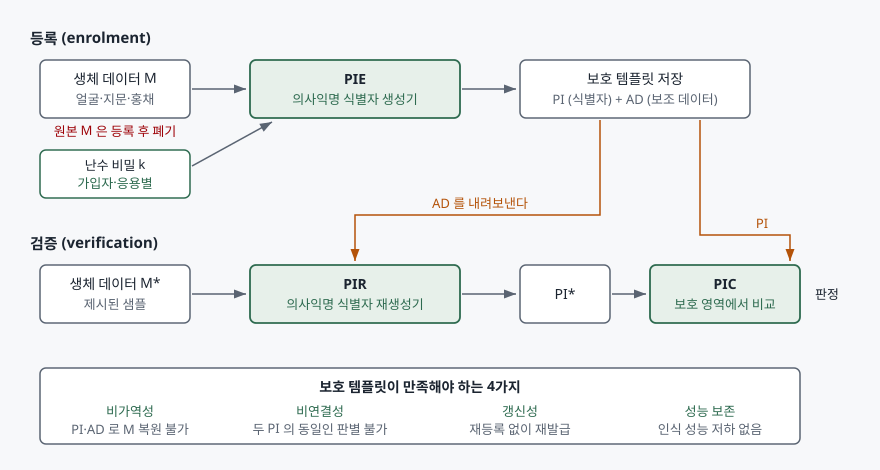

> 실행 검증 없음. 표준 기반 개념 글이므로 공개 자료 근거만으로 정리했다.
>
> 절·부속서의 번호와 제목, 서문의 개정 내역, 서론 본문은 발행처 공인 미리보기(VDE Verlag가
> 공개한 ISO/IEC 24745:2022 앞부분)에서 직접 확인했다. PIE·PIR·PIC 구조와 요구 4가지의
> 서술은 다름슈타트 공대 생체인식 연구그룹이 발표한 보호 템플릿 개관 논문을 근거로 썼고,
> 한국어 문장은 옮긴 것이 아니라 뜻을 다시 쓴 것이다. 표준 본문의 유료 구간은 열지 않았다.

## 들어가며

생체인식은 정보보호 과목에서 인증 수단으로 먼저 나오지만, 점수가 갈리는 자리는
"유출되면 어떻게 하는가"다. 비밀번호가 새면 바꾸면 되고 토큰이 털리면 재발급하면
된다. 얼굴과 지문은 그 두 가지가 다 안 된다. 그래서 생체인식 답안은 인식률 이야기로
끝나면 절반이고, **바꿀 수 없는 인증정보를 어떻게 갱신 가능하게 만드는가**까지
내려가야 한다. 실무에서도 같다. 출입 시스템과 간편결제가 같은 얼굴을 각자 저장해 두면
한쪽이 뚫렸을 때 나머지가 전부 따라 무너지고, 두 DB를 맞춰 보면 같은 사람인지까지
알 수 있다. ISO/IEC 24745가 다루는 문제가 이것이다.

## 정의

**ISO/IEC 24745:2022는 생체인식 정보를 저장·전송하는 전 구간에서 기밀성·무결성·갱신성
요구에 따라 보호하는 방법과, 생체인식 참조(BR)와 신원 참조(IR)를 안전하게 결합하기
위한 보안 요구사항을 규정한 국제표준이다.** 작성 주체는 ISO/IEC JTC 1의 정보보안
분과위원회(SC 27)이고, 2011년 초판을 기술적으로 개정한 제2판이다.

여기서 **보호 템플릿(protected template)** 은 원본 생체 데이터를 되돌릴 수 없는 형태로
바꾸고도 비교는 할 수 있게 만든 참조 데이터를 가리킨다. 답안 첫 줄에는 "암호화가 아니다"를
붙여 두는 편이 낫다. 암호화는 비교하려면 복호화해야 하므로 비교 시점에 원본이 평문으로
드러난다. 보호 템플릿은 **보호된 상태 그대로 비교한다.**

## 등장 배경

표준의 서론이 문제를 직접 적는다. 생체인식은 개인에게 고유하게 묶이는 성질 덕분에 강한
인증 보증을 주는데, 바로 그 강한 결합이 프라이버시 문제의 뿌리가 된다는 것이다. 그리고
인증정보가 노출됐을 때 **쓰던 해법 — 비밀번호 변경이나 토큰 재발급 — 을 생체인식에는
일반적으로 쓸 수 없다**고 못 박는다. 생체 특성은 생리적·행동적 속성이라 바꾸기 어렵거나
불가능하고, 다른 손가락이나 다른 눈을 추가로 등록하는 정도가 전부인데 그 선택지는 많아야
열 손가락이다.

여기에 결합 문제가 겹친다. 생체인식 시스템은 보통 생체인식 참조를 다른 개인식별정보와
묶어 저장하는데, 그 결합이 늘어나고 관할을 넘어 공유되면서 조직이 보호를 보증하기가
어려워진다. 초판(2011) 이후 11년 만의 개정이 고친 지점도 여기다. 서문이 적은 **주요 변경
7가지** 가운데 답안에 쓸 것은 **"비가역성과 비연결성의 요구를 더 명시적으로 강제하도록
생체인식 정보 보호 요구사항을 개선"** 한 항목과, **보호 템플릿 성능시험 표준(ISO/IEC
30136:2018) 참조를 추가**한 항목, 그리고 **최신 기술에 맞춘 새 응용 모델 도입**이다.
초판이 요구를 선언 수준으로 적어 두는 바람에 구현이 제각각이었다는 뜻이다.

## 구성요소 — 보안 4가지, 프라이버시 3가지, 응용 모델 11가지

표준은 요구를 **보안 측면(6절)** 과 **프라이버시 측면(7절)** 으로 나눠 적는다. 이 둘을
섞어 쓰면 답안에서 항목이 겹치므로 갈라서 외운다.

### 보안 요구 — 4가지 (6.1)

| # | 요구 | 무엇을 막는가 |
|---|---|---|
| ① | 기밀성 | 권한 없는 주체가 생체인식 정보를 읽는 것 |
| ② | 무결성 | 저장·전송 중 변조와 위조 참조의 주입 |
| ③ | 갱신성·폐기성 | 침해된 참조를 무효화하고 새로 발급하지 못하는 상태 |
| ④ | 가용성 | 정당한 가입자가 인증받지 못하게 되는 상태 |

③이 생체인식에만 붙는 요구다. 일반 정보보안의 3요소에 **갱신성과 폐기성**이 하나 더
붙는다고 외우면 답안에서 빠뜨리지 않는다.

### 프라이버시 요구 — 3가지 (7.2)

| # | 요구 | 뜻 |
|---|---|---|
| ① | 비가역성 | 보호 템플릿에서 원본 생체 데이터를 복원할 수 없을 것 |
| ② | 비연결성 | 두 보호 템플릿이 같은 사람의 같은 특성에서 나왔는지 판별할 수 없을 것 |
| ③ | 기밀성 | 생체인식 정보가 권한 없이 노출되지 않을 것 |

②가 교차 대조(cross-matching)를 막는 요구다. 출입 시스템과 결제 시스템이 같은 얼굴로
만든 보호 템플릿을 각각 가지고 있어도, 둘을 맞춰 동일인임을 알아낼 수 없어야 한다.
이것이 깨지면 서비스마다 분리해 저장한 의미가 사라진다.

구현 관점에서는 여기에 **성능 보존**을 더해 4가지로 세는 경우가 많다. 보호를 적용했다고
인식 성능이 크게 떨어지면 쓸 수 없기 때문인데, 표준의 7.2가 세는 요구는 위 3가지이고
성능 보존은 성능시험 표준(ISO/IEC 30136:2018)이 측정·보고 대상으로 다룬다.

### 보호 템플릿의 구조 — 3개 함수

표준이 정의하는 일반 틀은 함수 세 개로 요약된다. 등록 때 생체 데이터 M과 난수 비밀 k를
**의사익명 식별자 생성기(PIE)** 에 넣어 **의사익명 식별자 PI**와 **보조 데이터 AD**를
만들고, 원본 M은 버린다. 검증 때는 새로 받은 M*와 저장해 둔 AD를 **의사익명 식별자
재생성기(PIR)** 에 넣어 PI*를 만들고, **비교기(PIC)** 가 PI와 PI*를 보호된 상태로 비교한다.

난수 비밀 k가 비연결성과 갱신성을 떠받치는 장치다. **k를 서비스마다 다르게 주면** 같은
얼굴에서 서로 연결되지 않는 PI가 나오고, **k를 바꾸면** 재등록 없이 새 보호 템플릿을
발급할 수 있다.

### 응용 모델 — 11가지 (8.2)

저장 위치(서버·토큰·클라이언트·분산)와 비교 위치의 조합으로 **모델 A부터 K까지 11가지**를
제시하고 각각의 보안 특성을 적는다. 초판 대비 새로 들어온 모델들이 여기 있다. 답안에서
전부 외울 필요는 없고, **"저장과 비교를 어디서 하느냐가 위협 모델을 바꾼다"**는 축과
대표 조합(서버 저장·서버 비교 / 토큰 저장·토큰 비교)만 들면 된다.

## 도식

> **출처**: [ISO/IEC 24745:2022 Information security, cybersecurity and privacy protection — Biometric information protection, Contents / Foreword / Introduction (VDE Verlag 공개 미리보기)](https://assets.vde-verlag.de/iec-normen/preview-pdf/info_isoiec24745%7Bed2.0%7Den.pdf) · [C. Rathgeb, J. Kolberg, A. Uhl, C. Busch, "Deep Learning in the Field of Biometric Template Protection: An Overview", arXiv:2303.02715 (2023-03-05), §II](https://arxiv.org/abs/2303.02715) — 절 구성과 요구 항목, PIE·PIR·PIC 틀의 정의

## 비교 — 두 갈래 구현 방식

보호 템플릿을 만드는 방법은 크게 **취소 가능 생체인식**과 **생체 암호** 둘로 갈린다.
여기에 **암호화 영역 생체인식**을 셋째로 세기도 한다.

| 구분 | 취소 가능 생체인식 | 생체 암호 | 암호화 영역 생체인식 |
|---|---|---|---|
| 원리 | 신호·특징 영역에 변환을 걸고 변환된 영역에서 비교 | 키를 특징 벡터에 결합하고 키 복원 여부로 판정 | 동형암호로 암호문 상태에서 거리 계산 |
| 대표 기법 | 비가역 변환, 바이오해싱 같은 솔팅 | 퍼지 커밋먼트, 퍼지 볼트 | 동형암호 기반 비교 |
| 비교 결과 | 유사도 점수 | 키 복원 성공/실패 | 유사도 점수 |
| 갱신 방법 | 변환 파라미터 교체 | 결합 키 교체 | 암호 키 교체 |
| 부가 이득 | 구현이 가볍다 | **디지털 키를 함께 얻는다** | 연산을 외부에 맡길 수 있다 |
| 약점 | 변환 설계에 따라 성능 하락 | 특징 표현 제약이 크다 | 연산 비용 |

전통 암호화와의 차이를 한 줄로 못 박아 두면 좋다. **대칭암호나 일반 해시는 생체인식에
맞지 않는다.** 생체 특성은 같은 사람이라도 잴 때마다 값이 조금씩 다른데(클래스 내 분산),
해시는 입력이 조금만 달라도 출력이 완전히 달라지므로 비교가 성립하지 않는다. 그래서
암호화를 쓰면 비교 직전에 복호화해야 하고, 보호가 영구적이지 않게 된다.

평가 축도 함께 묶어 둔다. 보호 기법의 정확도·비밀성·프라이버시를 재고 보고하는 방법은
**ISO/IEC 30136:2018**이 다룬다. 이 표준은 보호 기법을 설계하지 않고, 일반 암호화 기법의
시험도 다루지 않는다. 공격 모델을 표준화해 둔 것도 이쪽이다.

## 적용 시 고려사항

- **암호화와 보호 템플릿을 같은 칸에 쓰지 않는다.** DB를 암호화했으니 24745를 지켰다는
  설명은 틀렸다. 비교 시점에 평문이 되살아나면 영구 보호가 아니고, 암호화만으로는
  비연결성도 얻지 못한다 — 같은 키로 암호화한 같은 얼굴은 같은 암호문이 된다.
- **난수 비밀 k의 관리가 설계의 핵심이다.** k가 서비스마다 같으면 비연결성이 무너지고,
  k가 유출되면 기법에 따라 비가역성까지 함께 흔들린다. 갱신 절차는 k 교체로 설계하고,
  k의 저장 위치를 보호 템플릿과 분리한다.
- **갱신성은 사후 대응이 아니라 사전 설계다.** 침해가 난 뒤에 "새로 등록받겠다"로는
  요구를 만족하지 못한다. 요구는 **재등록 없이 재발급**이다. 설계 단계에서 재발급
  경로를 넣지 않으면 나중에 추가할 수 없다.
- **보호 전후의 인식 성능을 함께 보고한다.** 비가역성을 높이면 보통 오류율이 올라간다.
  ISO/IEC 30136:2018이 정확도·공격 성공 확률·누설 정보량을 함께 재도록 한 이유다.
  한쪽 수치만 제시하는 제안서는 비교가 불가능하다.
- **원본 폐기를 절차로 못 박는다.** PIE가 PI와 AD를 만든 뒤 원본 M을 버리는 것이 전제다.
  "나중에 알고리즘을 바꿀 수도 있으니 원본을 보관한다"는 운영 편의가 들어오면 이 구조의
  전제가 무너진다. 국내법에서 얼굴 특징정보가 민감정보로 분류된다는 점과 함께 검토한다.
- **응용 모델을 먼저 고른다.** 저장과 비교의 위치가 정해져야 위협 모델이 정해지고,
  그래야 어떤 요구를 어디서 만족시킬지가 정해진다. 표준의 모델 A~K가 이 선택지를 정리해 둔다.

## 정리

- **4·3·3·11**로 외운다 — 보안 요구 **4가지**(기밀성·무결성·갱신성과 폐기성·가용성),
  프라이버시 요구 **3가지**(비가역성·비연결성·기밀성), 보호 템플릿 함수 **3개**(PIE·PIR·PIC),
  응용 모델 **11가지**(A~K).
- 생체인식이 특별한 이유는 **바꿀 수 없는 인증정보**라는 한 가지다. 여기서 갱신성과
  비연결성이 파생된다.
- 구조의 핵심은 **난수 비밀 k**다. 서비스마다 다르게 주면 비연결성, 바꾸면 갱신성이다.
- 구현은 **취소 가능 생체인식 / 생체 암호 / 암호화 영역** 세 갈래이고, 평가는
  **ISO/IEC 30136**이 맡는다.
- 2011년 초판 대비 2022년 제2판의 요지는 **비가역성·비연결성의 명시적 강제**다.

> 기출 답안: [기출문제 — 안면인식 결제 서비스](../../exam/2026-10-25-facial-recognition-payment-biometric-standards/index.md)

## 참고 자료

- [ISO/IEC 24745:2022, Information security, cybersecurity and privacy protection — Biometric information protection (ISO 카탈로그)](https://www.iso.org/standard/75302.html) — 발행 정보와 적용 범위
- [ISO/IEC 24745:2022 공개 미리보기 — 목차·서문·서론 (VDE Verlag)](https://assets.vde-verlag.de/iec-normen/preview-pdf/info_isoiec24745%7Bed2.0%7Den.pdf) — 절·부속서 구성, 제2판 주요 변경 7가지, 서론의 문제 제기
- [ISO/IEC 30136:2018, Information technology — Performance testing of biometric template protection schemes (ISO 카탈로그)](https://www.iso.org/standard/53256.html) — 정확도·공격 성공 확률·누설 정보량의 측정과 보고
- [C. Rathgeb, J. Kolberg, A. Uhl, C. Busch, "Deep Learning in the Field of Biometric Template Protection: An Overview", arXiv:2303.02715 (2023-03-05)](https://arxiv.org/abs/2303.02715) — PIE·PIR·PIC 틀, 요구 4가지의 정의, 구현 세 갈래의 분류
- [ISO/IEC 2382-37:2022, Information technology — Vocabulary — Part 37: Biometrics (ISO 카탈로그)](https://www.iso.org/standard/73514.html) — 생체인식 용어의 기준
