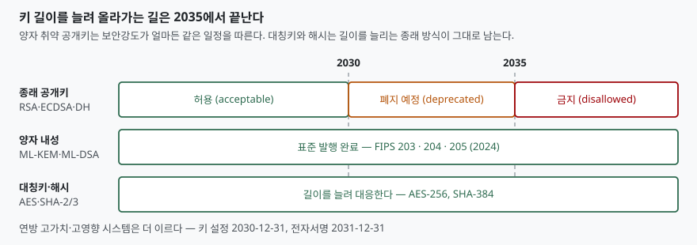

> 실행 검증 없음. 표준 문서 근거만으로 정리한 개념 글이다.
>
> 등가 강도표와 암호주기 항목은 NIST SP 800-57 Part 1 Rev. 5의 본문(§5.3, §5.6)에서
> 직접 확인했고, 2030·2035 전환 일정은 2026년 10월 27일 최종 발행된 NIST IR 8547의
> 본문(§4, §4.1.1, §4.1.2)에서 확인했다. 한국어 문장은 옮긴 것이 아니라 뜻을 다시 쓴 것이다.
> 수치는 전부 원문에 있는 값이며, 성능·시장 수치는 쓰지 않았다.

## 들어가며

"RSA는 2048비트면 되나요"라는 질문은 실무에서 자주 나오고, 답하기도 쉬워 보인다.
그런데 같은 자리에서 "AES는 128비트면 충분한데 RSA는 왜 2048이냐"는 질문이
따라붙으면 설명이 막힌다. 두 숫자는 단위가 같아 보이지만 같은 것을 재는 숫자가
아니기 때문이다.

시험에서 이 주제가 꾸준히 나오는 이유도 여기에 있다. 묻는 것은 키 길이의 암기가
아니라 **"무엇을 기준으로 알고리즘과 키 길이를 고르고, 그 키를 언제까지 쓰는가"**다.
그리고 2026년 10월 최종 발행된 NIST IR 8547이 이 판단의 전제를 바꿔 놓았다 —
키 길이를 늘려 수명을 버는 전략에 **종료 시점이 생겼다.**

## 정의

**보안강도(security strength)**는 NIST SP 800-57 Part 1 Rev. 5가 "암호 알고리즘이나
시스템을 깨는 데 필요한 작업량, 즉 연산 횟수와 결부된 수"로 정의한다. 같은 문서는
곧바로 단서를 단다 — **"보안강도는 키 길이와 반드시 같지는 않다."** 계산상의 이점을
주는 공격이 알고리즘마다 다르기 때문이다. 표기는 비트로 하며, 강도가 s비트라는
말은 깨는 데 2ˢ 번 수준의 연산이 든다는 뜻이다.

**암호주기(cryptoperiod)**는 같은 문서가 "특정 키가 정당한 주체에 의해 사용하도록
승인된 기간, 또는 주어진 시스템의 키가 효력을 유지하는 기간"으로 정의한다.
알고리즘을 고르는 것이 **공간 축**이라면 암호주기는 **시간 축**이고, 둘 다 정해야
"이 암호는 안전한가"에 답할 수 있다.

## 등장 배경

키 길이만으로 안전성을 말할 수 없게 된 데는 두 단계가 있었다.

**첫째, 알고리즘마다 공격의 효율이 다르다.** 대칭키는 원리상 전수 탐색이 최선에
가까워 128비트 키가 대체로 128비트 강도를 준다. 반면 RSA는 소인수분해, 타원곡선은
이산대수라는 전용 공격이 있어 키 길이보다 강도가 낮게 매겨진다. 그래서 같은
112비트 강도를 얻는 데 3TDEA는 키 168비트, RSA는 모듈러스 2048비트, 타원곡선은
224비트가 든다. **길이를 가로로 비교하면 반드시 틀린다.**

**둘째, 양자 컴퓨터가 이 비교표 자체를 무너뜨린다.** SP 800-57은 등가 강도표
아래에 "이 추정치는 양자 컴퓨팅이 현실적 고려 대상이 되면 크게 영향을 받는다"고
못 박아 두었다. 쇼어 알고리즘은 소인수분해와 이산대수를 함께 무너뜨리므로,
RSA·ECC·DH는 **키를 아무리 늘려도 같은 운명**이다. 이것이 2026년 IR 8547이
보안강도와 무관하게 일괄 일정을 적용한 근거다.

## 구성요소

### 등가 보안강도 — 5등급 (SP 800-57 Part 1 Rev. 5, 표 2)

| 보안강도 | 대칭키 | FFC (DSA·DH) | IFC (RSA) | ECC |
|---|---|---|---|---|
| ≤ 80 | 2TDEA | L=1024, N=160 | k=1024 | f=160–223 |
| 112 | 3TDEA | L=2048, N=224 | k=2048 | f=224–255 |
| 128 | AES-128 | L=3072, N=256 | k=3072 | f=256–383 |
| 192 | AES-192 | L=7680, N=384 | k=7680 | f=384–511 |
| 256 | AES-256 | L=15360, N=512 | k=15360 | f=512 이상 |

표의 `L`은 공개키 크기, `N`은 개인키 크기, `k`는 RSA 모듈러스 `n`의 크기,
`f`는 타원곡선 기저점 위수 `n`의 크기다. 80비트 강도는 같은 문서가 "더 이상
적절하다고 보지 않는다"고 적었고, 3TDEA는 112비트로 올라와 있으나 각주에서
2023년 이후 적용 금지로 밝혀 두었다.

**외우는 요령은 세 줄이다.** 대칭키 128 ↔ RSA 3072 ↔ ECC 256이 한 줄,
여기서 강도가 64비트 오를 때마다 RSA는 3072 → 7680 → 15360으로 뛰고 ECC는
256 → 384 → 512로 는다. **RSA만 가파르게 커진다**는 것이 이 표의 요점이다.

### 암호주기가 제한하는 것 — 6가지 (§5.3)

적절히 정한 암호주기는 다음 여섯을 제한한다.

1. 키를 알아내기 위한 암호해독에 쓸 수 있는 정보의 양
2. 키 하나가 노출됐을 때의 피해 범위
3. 특정 알고리즘의 사용 기간(그 알고리즘의 추정 유효수명까지)
4. 키를 지키는 물리적·절차적·논리적 접근 통제를 뚫는 데 쓸 수 있는 시간
5. 키가 부주의하게 노출돼 정보가 위태로워질 수 있는 기간
6. 계산량이 많은 암호해독에 쓸 수 있는 시간

### 암호주기를 정하는 요소 — 14가지 (§5.3.1)

원문은 열넷을 나열한다. 답안에서는 **네 갈래로 묶어** 쓰면 빠뜨리지 않는다.

| 갈래 | 요소 |
|---|---|
| 암호 자체 (3) | 암호 메커니즘의 강도(알고리즘·키 길이·블록 크기·운용 모드), 구현 형태(FIPS 140 등급), 알고리즘 사용 제약(논스 재사용 회피를 위한 최대 호출 횟수) |
| 환경과 사람 (3) | 운영 환경, 인원 교체, 보안 기능(암호화·서명·키 유도·키 보호) |
| 사용량과 확산 (5) | 데이터 흐름량·거래 건수, 데이터의 보안 수명, 재키잉 방법, 재키잉·키 유도 절차, 공통 키를 공유하는 노드 수와 키 사본 수 |
| 위협 (2) | 공격자의 기술력·재원에서 오는 위협, 양자 컴퓨터 같은 신기술에서 오는 위협 |

같은 절은 결론을 하나 덧붙인다. **"강한 암호를 쓰는 환경에서는 알고리즘과 키
길이보다 물리적·절차적·논리적 접근 통제가 암호주기 선택에 더 큰 영향을 준다."**
공격자가 암호를 깨는 것보다 시스템을 뚫는 쪽이 싸기 때문이다. 답안에서 이 문장을
한 줄 넣으면 암기형 답안과 갈린다.

## 도식

> **출처**: [NIST IR 8547, Transition to Post-Quantum Cryptography Standards §4 PQC Standards Transition Timeline, Table 2·Table 4 (2026-10)](https://csrc.nist.gov/pubs/ir/8547/final)

## 비교

### 종래 일정과 바뀐 일정

SP 800-57의 표 4는 보안강도별로 시한을 끊어 두었다. 112비트는 2030년까지만
적용이 허용되고 2031년부터는 금지, 128비트 이상은 두 구간 모두 허용이다.
그런데 IR 8547은 **공개키에 한해 이 일정을 갈아 끼웠다.** 원문이 그 사실을 직접
밝힌다 — SP 800-57은 112비트 공개키 방식을 2031년 1월 1일에 금지할 것으로
전망했으나, 양자 내성 알고리즘으로 옮겨 가야 하는 사정 때문에 **양자 취약 공개키
전체를 2030년 이후 폐지 예정, 2035년 이후 금지**로 바꾼다는 것이다.

| 구분 | SP 800-57 Rev. 5 (2020) | IR 8547 (2026) |
|---|---|---|
| 적용 기준 | 보안강도별 (112 / 128 이상) | 양자 취약 여부 (강도 무관) |
| 112비트 공개키 | 2031년부터 금지 | 2030년 이후 폐지 예정, 2035년 이후 금지 |
| 128비트 이상 공개키 | 계속 허용 | 2030년 이후 폐지 예정, 2035년 이후 금지 |
| 대칭키·해시 | 128비트 이상 허용 | 변동 없음 (길이로 대응) |
| 대체 수단 | 키 길이 증가 | ML-KEM, ML-DSA, SLH-DSA |

**RSA 15360(256비트 강도)도 2035년 이후에는 금지다.** 키를 늘려 수명을 버는
전략이 공개키에서는 더 통하지 않는다는 뜻이고, 이 한 줄이 이번 변경의 핵심이다.
반면 대칭키와 해시는 양자 공격이 제곱근 수준의 이득에 그치므로 길이를 늘려 대응하는
종래 방식이 그대로 남는다.

### 적용 기간 둘 — 발신자 사용기간과 수신자 사용기간

비대칭 키쌍은 키 하나마다 암호주기가 따로 있다. 보호를 **적용**하는 키(서명 생성,
암호화)의 기간을 **발신자 사용기간(OUP)**, 보호된 정보를 **처리**하는 키(서명 검증,
복호)의 기간을 **수신자 사용기간(RUP)**이라 한다. 둘은 보통 같이 시작하지만
RUP가 더 길 수 있다. 서명 개인키는 쓰는 기간이 짧고, 그 서명을 검증할 공개키는
오래 살아 있어야 하기 때문이다. SP 800-57은 개인 서명키의 권장 암호주기를
1~3년, 권한 키(authorization key)는 2년 이하로 제시한다.

## 적용 시 고려사항

**첫째, 시스템 수명과 데이터 수명을 각각 본다.** SP 800-57은 조달 기관이 시스템의
잠재 운영 수명을 고려해야 하며, **전 수명 동안 안전할 알고리즘·키 길이를 고르거나
아니면 쉽게 교체 가능하게 만들어야 한다**고 적는다. 둘 중 하나는 반드시 해야 한다는
것이 요지다. 10년 쓸 시스템에 2030년에 폐지 예정이 되는 알고리즘을 넣으려면
교체 경로가 설계에 들어 있어야 한다.

**둘째, 지금 수집해 나중에 복호하는 공격을 전제한다.** IR 8547은 키 설정 전환을
먼저 서두를 이유로 이 공격을 들고, TLS와 IKE 같은 대화형 프로토콜을 우선 대상으로
짚는다. 오늘 오가는 트래픽이 10년 뒤 복호된다고 보면, **기밀 수명이 긴 데이터는
2035년이 아니라 지금 기준으로 판단해야 한다.**

**셋째, 전환은 알고리즘 교체가 아니라 체계 교체다.** IR 8547은 신원 확인 체계를
예로 든다 — 발급 시스템, 스마트카드, 리더, 미들웨어, 그 뒤의 공개키 기반구조가
전부 바뀌어야 하고, 발급된 자격증명과 하드웨어는 몇 년짜리 교체 주기를 따른다.
그래서 표준·모듈·제품·인프라 갱신을 전환기 **앞쪽에서** 시작해야 기한을 맞춘다.

**넷째, 혼합(하이브리드) 방식을 과도기 수단으로 본다.** NIST는 승인된 방식 하나가
섞여 있으면 혼합 키 설정을 FIPS 140 검증에서 수용하겠다고 밝혔고, 구성요소 중
**하나만 안전해도 유도된 키가 안전하게 남는 것**을 이 방식의 목표 성질로 든다.
다만 합성 방식의 보안 성질은 경우마다 따져야 한다고 단서를 단다.

## 정리

- **보안강도는 키 길이가 아니다.** 깨는 데 드는 연산량을 비트로 표기한 값이고,
  알고리즘마다 같은 강도를 얻는 키 길이가 다르다
- **등가표 기준선은 「128 ↔ 3072 ↔ 256」** 한 줄이다. 강도가 오를수록 RSA만
  가파르게 커진다 (3072 → 7680 → 15360)
- **암호주기는 6가지를 제한하고, 그것을 정하는 요소는 14가지**다. 암호 자체·환경과
  사람·사용량과 확산·위협의 네 갈래로 묶어 외운다
- **키쌍은 기간이 둘이다.** 적용하는 쪽이 발신자 사용기간, 처리하는 쪽이 수신자
  사용기간이며 후자가 더 길 수 있다
- **2030은 폐지 예정, 2035는 금지.** 양자 취약 공개키는 보안강도와 무관하게 같은
  일정을 따르고, 대칭키·해시는 종래처럼 길이로 대응한다

## 참고 자료

- [NIST SP 800-57 Part 1 Rev. 5 — Recommendation for Key Management: Part 1 – General (2020-05)](https://csrc.nist.gov/pubs/sp/800/57/pt1/r5/final)
- [NIST IR 8547 — Transition to Post-Quantum Cryptography Standards (2026-10, 최종본)](https://csrc.nist.gov/pubs/ir/8547/final)
- [FIPS 203 — Module-Lattice-Based Key-Encapsulation Mechanism Standard (2024)](https://csrc.nist.gov/pubs/fips/203/final)
- [FIPS 204 — Module-Lattice-Based Digital Signature Standard (2024)](https://csrc.nist.gov/pubs/fips/204/final)
- [FIPS 205 — Stateless Hash-Based Digital Signature Standard (2024)](https://csrc.nist.gov/pubs/fips/205/final)
- [NIST SP 800-131A Rev. 2 — Transitioning the Use of Cryptographic Algorithms and Key Lengths](https://csrc.nist.gov/pubs/sp/800/131/a/r2/final)
