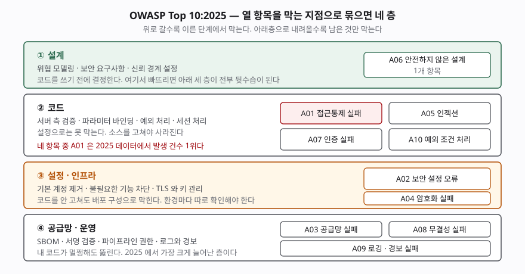

> 실행 검증 없음. 이 글은 OWASP가 공개한 Top 10:2025·2021 문서를 근거로 정리했다.
> 실행 가능한 예제가 없으므로 측정값이나 출력은 싣지 않았다.

## 들어가며

보안 문항은 "무엇을 막아야 하는가"를 묻는 형태로 나온다. 이때 답안이 가장
흔히 무너지는 자리가 **나열**이다. 열 개를 다 적어 놓고도 점수가 낮은 경우가
있는데, 항목을 외운 것과 그 항목들이 **어떤 기준으로 묶이는지**를 아는 것이
다르기 때문이다.

채점자 입장에서 "인젝션, XSS, CSRF, 접근통제…"는 어느 수험서에나 있는 줄이다.
차이가 나는 곳은 그다음이다. 이 항목은 코드를 고쳐야 사라지는가, 설정으로
막히는가, 아니면 내 코드 바깥에서 들어오는가. 이 구분이 서면 대응 방안 항목이
저절로 채워지고, 서지 않으면 "입력값 검증을 철저히 한다" 같은 문장만 반복된다.

OWASP Top 10:2025는 2021판에서 분류가 꽤 바뀌었다. 바뀐 자리가 곧 출제 포인트다.

## 정의

**OWASP Top 10은 웹 애플리케이션에서 가장 중대한 보안 위험 열 가지를 합의해
묶은 인식 제고 문서(awareness document)다.**

답안에서 이 한 줄을 정확히 쓰는 것이 중요하다. **Top 10은 표준도 규격도
체크리스트도 아니다.** 준수 여부를 인증하는 문서가 아니라, 어디를 먼저 볼지
합의한 목록이다. OWASP 자신이 적용 표준으로는 ASVS(Application Security
Verification Standard)를, 점검 절차로는 WSTG(Web Security Testing Guide)를
따로 두고 있다. "Top 10을 준수했다"는 표현은 성립하지 않는다는 점을 짚으면
개념을 정확히 안다는 신호가 된다.

판본은 **2025년판**이 최신이며, 그 앞이 2021년판이다.

## 등장 배경

2003년에 처음 나온 이 목록은 "어디부터 고쳐야 하는지 모르겠다"는 현장의
문제에서 출발했다. 취약점 분류 체계인 CWE는 수백 개 항목을 다루므로 전부
대응할 수 없고, 어느 것이 실제로 많이 터지는지는 따로 세어 봐야 알 수 있다.

2025년판은 그 세는 방식을 밝혀 두었다. **13개 기여 기관과 익명 기여자들이 보낸
280만 개가 넘는 애플리케이션 데이터**를 모았고, 데이터셋에서 **589개 CWE**를
분석해 최종 10개 분류 안에 **248개 CWE**를 배치했다. 열 개 중 **여덟 개는
데이터로**, **두 개는 커뮤니티 설문으로** 뽑았다. 설문으로 들어온 두 항목이
A03과 A09다.

여기에 답안으로 쓸 만한 통찰이 하나 있다. **데이터로만 뽑으면 "이미 터져서
집계된 것"만 올라온다.** 아직 집계되지 않았지만 업계가 위험하다고 보는 것은
설문으로 들여온다. 순위가 발생 빈도와 완전히 같지 않은 이유다.

## 구성요소 — 열 개 분류 (2025년판)

| 코드 | 분류 | 핵심 원인 |
|---|---|---|
| A01 | 접근통제 실패 (Broken Access Control) | 권한 판단을 클라이언트나 요청 파라미터에 맡김 |
| A02 | 보안 설정 오류 (Security Misconfiguration) | 기본 계정·불필요한 기능·과도한 권한이 그대로 배포됨 |
| A03 | 소프트웨어 공급망 실패 (Software Supply Chain Failures) | 취약하거나 악성인 제3자 구성요소·도구·파이프라인 |
| A04 | 암호화 실패 (Cryptographic Failures) | 전송·저장 구간에서 보호가 없거나 약한 알고리즘 사용 |
| A05 | 인젝션 (Injection) | 입력값이 데이터가 아니라 문법으로 해석됨 |
| A06 | 안전하지 않은 설계 (Insecure Design) | 설계 단계에서 위협 모델링과 보안 요구사항이 빠짐 |
| A07 | 인증 실패 (Authentication Failures) | 자격증명 관리·세션 수명·다중 인증 부재 |
| A08 | 소프트웨어·데이터 무결성 실패 (Software or Data Integrity Failures) | 서명·검증 없이 코드와 데이터를 신뢰함 |
| A09 | 로깅·경보 실패 (Security Logging and Alerting Failures) | 기록이 없거나, 기록은 있는데 아무도 깨우지 않음 |
| A10 | 예외 조건 처리 미흡 (Mishandling of Exceptional Conditions) | 오류 처리 누락·논리 오류·안전하지 않은 실패 |

**코드는 영문 명칭 기준으로 부여된 것이므로 답안에는 `A01:2025` 형태를 함께
적는 편이 안전하다.** 한글 명칭은 번역에 따라 흔들린다.

## 도식 — 막는 지점으로 묶기

항목을 외우는 것보다 **어디서 막히는지로 묶는 쪽**이 답안을 쓰기 쉽다.
대응 방안 항목이 층마다 다른 담당자·다른 산출물을 가리키기 때문이다.

> **출처**: [OWASP Top 10:2025 — Introduction](https://top10.owasp.org/2025/0x00_2025-Introduction/) · [A01:2025 Broken Access Control, How to Prevent](https://top10.owasp.org/2025/A01_2025-Broken_Access_Control/) · [A03:2025 Software Supply Chain Failures](https://top10.owasp.org/2025/A03_2025-Software_Supply_Chain_Failures/) · [A10:2025 Mishandling of Exceptional Conditions](https://top10.owasp.org/2025/A10_2025-Mishandling_of_Exceptional_Conditions/) · 층 구분은 각 항목의 "How to Prevent" 절을 근거로 한 분류

**네 층**이다.

**① 설계(1개 · A06)** — 코드를 쓰기 전에 결정한다. 위협 모델링, 보안 요구사항
정의, 신뢰 경계 설정이 여기 든다. 이 층이 비면 아래 세 층이 전부 뒷수습이 된다.
2021년판에서 A04로 신설된 분류이며, "구현이 잘못된 것"과 "설계가 없는 것"을
가른 것이 핵심이다. 완벽하게 구현해도 설계가 틀렸으면 막히지 않는다.

**② 코드(4개 · A01, A05, A07, A10)** — 소스를 고쳐야 사라진다. 서버 측 권한
확인, 파라미터 바인딩, 세션 무효화, 예외 처리가 여기다. A01의 "How to Prevent"
첫 줄이 **기본 거부(deny by default)**이고, 그다음이 **접근통제를 서버 측
한 곳에 구현해 재사용**하라는 것이다. 흩어 놓으면 한 군데가 반드시 빠진다.

**③ 설정·인프라(2개 · A02, A04)** — 코드를 안 고쳐도 배포 구성으로 막힌다.
대신 **환경마다 따로 확인해야 한다.** 개발 환경에서 막혔다고 운영 환경이
막힌 것이 아니다. A04는 알고리즘 선택이라는 코드 측면도 있어 ②에 걸치지만,
현장에서 실제로 터지는 쪽은 TLS 설정과 키 관리다.

**④ 공급망·운영(3개 · A03, A08, A09)** — **내 코드가 멀쩡해도 뚫린다.**
SBOM 관리, 서명 검증, 파이프라인 권한, 로그와 경보가 여기다. 2025년판에서
가장 크게 늘어난 층이고, 출제 가능성도 여기가 가장 높다.

## 비교 — 2021년판에서 무엇이 바뀌었나

| 항목 | 2021년판 | 2025년판 | 성격 |
|---|---|---|---|
| 접근통제 | A01 Broken Access Control | A01 (유지, SSRF 흡수) | SSRF가 별도 항목에서 하위 CWE로 |
| 설정 오류 | A05 Security Misconfiguration | **A02** | 5위 → 2위 상승 |
| 공급망 | A06 Vulnerable and Outdated Components | **A03** Software Supply Chain Failures | 범위 확대 + 상승 |
| 암호화 | A02 Cryptographic Failures | **A04** | 2위 → 4위 하락 |
| 인젝션 | A03 Injection | **A05** | 3위 → 5위 하락 |
| 설계 | A04 Insecure Design | **A06** | 4위 → 6위 하락 |
| 인증 | A07 Identification and Authentication Failures | A07 **Authentication Failures** | 명칭 단축 |
| 무결성 | A08 Software and Data Integrity Failures | A08 Software **or** Data Integrity Failures | 명칭 미세 조정 |
| 로깅 | A09 Security Logging and **Monitoring** Failures | A09 Security Logging and **Alerting** Failures | 명칭 변경 |
| SSRF | A10 Server Side Request Forgery | **(폐지)** A01로 병합 | 단독 항목에서 제외 |
| 예외 처리 | (없음) | **A10 Mishandling of Exceptional Conditions** | 신설 |

변화를 묻는 문항이면 **네 가지**로 끊어 답한다.

1. **신설 1개** — A10 예외 조건 처리 미흡. 오류 처리 누락, 논리 오류,
   안전하지 않은 실패(failing open)를 묶었고 24개 CWE가 들었다.
   CWE-209(민감 정보가 든 오류 메시지), CWE-476(NULL 역참조),
   CWE-636(안전하게 실패하지 않음)이 대표다.
2. **병합 1개** — SSRF가 A01 접근통제 실패로 흡수됐다. SSRF도 결국 서버가
   가서는 안 될 곳에 가는 **권한 판단 실패**라는 해석이다.
3. **범위 확대 1개** — 구성요소 취약점이 **공급망 전체**로 넓어졌다. 알려진
   취약점만이 아니라 빌드·배포·갱신 과정의 손상까지 포함한다.
4. **명칭 변경 2개** — A07에서 "Identification"이 빠졌고, A09의
   "Monitoring"이 **"Alerting"**으로 바뀌었다.

**A09의 명칭 변경은 그냥 다듬은 것이 아니다.** 모니터링은 "보고 있다"는
상태이고 경보는 "사람을 깨운다"는 동작이다. 대시보드는 있는데 아무도 보지
않아 침해가 몇 달씩 지속되는 사례가 쌓인 결과로 읽힌다. 답안에 이 해석을
한 줄 넣으면 단순 암기와 구별된다.

## 적용 시 고려사항

**첫째, 순위를 위험도로 읽지 않는다.** 순위는 기여된 데이터의 발생 빈도와
설문이 섞인 결과다. 인젝션이 3위에서 5위로 내려간 것은 덜 위험해졌다는
뜻이 아니라 **프레임워크가 기본으로 막아 주면서 집계가 줄었다**는 쪽에 가깝다.
우리 시스템의 위험도는 자산 가치와 노출 면적으로 따로 산정해야 한다.

**둘째, 적용 표준과 인식 문서를 구분해 쓴다.** 보안 요구사항을 정의하거나
검수 기준을 만들 때는 Top 10이 아니라 **ASVS**를 쓴다. Top 10은 10개 분류라
요구사항으로 떨어뜨리기에는 입자가 너무 굵다. 점검 절차가 필요하면 **WSTG**다.
사업 제안서에 "OWASP Top 10 준수"라고 적는 것은 검증 가능한 문장이 아니다.

**셋째, 층마다 책임자가 다르다는 것을 설계에 반영한다.** ①은 아키텍트,
②는 개발자, ③은 인프라·운영, ④는 보안·플랫폼 조직이 본다. 한 조직에
몰아 두면 ④가 빈다. **SBOM을 누가 갱신하고 경보를 누가 받는지**가 정해지지
않으면 A03과 A09는 문서에만 남는다.

**넷째, 조치 비용이 층마다 다르다.** ③ 설정은 배포 한 번으로 바뀌지만
① 설계는 되돌리는 비용이 가장 크다. 그래서 신규 사업에서는 ①부터,
운영 중인 시스템에서는 ③·④부터 손대는 것이 합리적이다. **"전부 동시에"는
답안으로도 현장에서도 성립하지 않는다.**

**다섯째, 판본을 명시한다.** 2021년판과 2025년판은 번호가 어긋나므로
"A03"만 쓰면 인젝션인지 공급망인지 갈린다. 반드시 **`A03:2025`** 처럼
연도를 붙인다.

## 정리

암기 단서는 **"4층 · 1-4-2-3"**으로 잡는다.

- **① 설계 1개** — A06
- **② 코드 4개** — A01 접근통제, A05 인젝션, A07 인증, A10 예외
- **③ 설정 2개** — A02 설정 오류, A04 암호화
- **④ 공급망·운영 3개** — A03 공급망, A08 무결성, A09 로깅·경보

변화는 **"신설 1 · 병합 1 · 확대 1 · 개명 2"**로 묶는다. 신설은 A10 예외 처리,
병합은 SSRF → A01, 확대는 구성요소 → 공급망, 개명은 A07과 A09다.

정의 한 줄은 **"가장 중대한 웹 보안 위험 열 가지를 묶은 인식 제고 문서"**이고,
표준이 아니라는 점과 적용 표준은 ASVS라는 점을 반드시 붙인다.

## 참고 자료

- [OWASP Top 10:2025 — Introduction](https://top10.owasp.org/2025/0x00_2025-Introduction/)
- [OWASP Top 10:2025 — A01 Broken Access Control](https://top10.owasp.org/2025/A01_2025-Broken_Access_Control/)
- [OWASP Top 10:2025 — A03 Software Supply Chain Failures](https://top10.owasp.org/2025/A03_2025-Software_Supply_Chain_Failures/)
- [OWASP Top 10:2025 — A10 Mishandling of Exceptional Conditions](https://top10.owasp.org/2025/A10_2025-Mishandling_of_Exceptional_Conditions/)
- [OWASP Top 10:2021 — 항목 목록](https://top10.owasp.org/2021)
- [OWASP Application Security Verification Standard (ASVS)](https://owasp.org/www-project-application-security-verification-standard/)
- [OWASP Web Security Testing Guide (WSTG)](https://owasp.org/www-project-web-security-testing-guide/)
