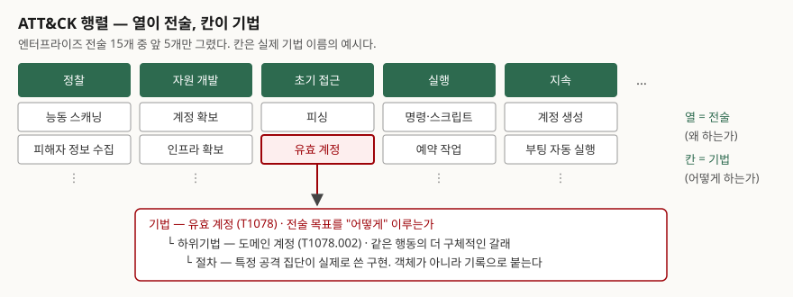
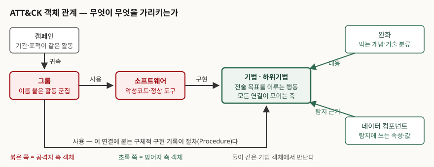

## 들어가며

보안 문항에서 ATT&CK는 두 자리에 나온다. 하나는 "TTPs를 설명하라"처럼 용어를 묻는
자리이고, 다른 하나는 "위협 기반 탐지 체계를 어떻게 수립할 것인가"처럼 **체계를 묻는
자리**다. 뒤쪽에서 답안이 갈리는 이유는 대개 ATT&CK를 **기법 목록**으로만 알고 있기
때문이다. 전술 15개를 외워 나열하면 그 뒤에 쓸 말이 없다. 실제로 쓸모가 나오는 곳은
**기법을 축으로 그룹·소프트웨어·완화·데이터가 서로 연결된 구조**이고, 조직의 탐지
역량을 점검하거나 보안 제품을 비교할 때 쓰는 것도 그 연결이다.

> 실행 검증 없음. 제품이나 코드를 돌려 확인하는 주제가 아니므로 MITRE의 공식 문서와
> ATT&CK 웹사이트의 표기를 근거로 정리했다. 본문의 개수는 전부 **content v20.0,
> 2026-10-30 확인 기준**이며 버전이 오르면 바뀐다.

---

## 정의

**MITRE ATT&CK**은 **실제 관측된 공격자 행위를 전술·기법·하위기법의 계층으로 분류해
정리한 지식 베이스**이고, **행렬(Matrix)** 은 그 분류를 **열에 전술, 칸에 기법을 놓아
한 장으로 펼친 표현**이다.

이름은 Adversarial Tactics, Techniques, and Common Knowledge의 약자다. 답안 첫 줄에
쓸 때는 **"침해지표 목록이 아니라 행위 분류 체계"** 라는 점까지 붙이는 편이 좋다. 이
구분이 뒤의 모든 서술을 떠받친다.

MITRE 자신의 설명은 더 짧다. 전술은 기법의 **'왜'** 를, 기법은 공격자가 전술적 목표를
**'어떻게'** 이루는가를 나타낸다.

## 등장 배경 — 지표 기반 탐지의 한계

이전의 탐지는 **침해지표(IoC)** 를 중심으로 돌아갔다. 악성 파일의 해시, C2 서버의 IP,
악성 도메인 같은 것들이다. 문제는 이 값들이 **공격자가 바꾸기에 가장 싼 것**이라는
점이다. 해시는 바이트 하나만 바꿔도 달라지고 IP와 도메인은 재구성하면 그만이다.

한편 높은 수준의 침해 생애주기 모형 — 록히드마틴의 사이버 킬체인, 마이크로소프트의
STRIDE 같은 것들 — 은 반대 방향의 한계를 갖는다. MITRE는 설계 문서의 **추상화
항목(§4.1.3)** 에서 이런 고수준 모형이 공격자의 목표와 큰 흐름을 이해하는 데에는
유용하지만, **개별 행동이 무엇이고 그것이 서로 어떻게 이어지며 어떤 데이터·방어
수단과 대응되는지를 전달하지는 못한다**고 적는다. 반대로 익스플로잇 데이터베이스는
특정 취약 소프트웨어의 사례를 다루므로 너무 아래쪽에 있다.

ATT&CK이 선택한 자리가 **그 둘 사이**다. 공격자가 실제로 하는 **행동** 단위이고,
그 행동은 도구를 바꿔도 잘 바뀌지 않는다. 이것이 행위 기반 탐지의 근거가 된다.

## 구성요소 — 객체 9종, 전술 15가지, 활용 6가지

### 행렬의 구조

> **출처**: [MITRE ATT&CK, Enterprise Tactics](https://attack.mitre.org/tactics/enterprise/) — 전술 목록과 "전술은 기법의 '왜'를 나타낸다"는 정의 · [MITRE ATT&CK, Enterprise Techniques](https://attack.mitre.org/techniques/enterprise/) — 기법이 전술적 목표를 '어떻게' 이루는가라는 정의 · [MITRE ATT&CK FAQ](https://attack.mitre.org/resources/faq/) — 하위기법과 절차의 정의 (전부 1차, 2026-10-30 확인)

계층은 **4단**이다.

| 계층 | 무엇인가 | 행렬에서의 위치 | 개수 (v20.0) |
|---|---|---|---|
| **전술** Tactic | 공격자의 단기 목표. '왜' | 열 하나 | 엔터프라이즈 15 |
| **기법** Technique | 그 목표를 이루는 행동. '어떻게' | 열 안의 칸 | 227 |
| **하위기법** Sub-technique | 같은 행동의 더 구체적인 갈래 | 칸을 펼친 아래 | 479 |
| **절차** Procedure | 특정 공격자가 쓴 실제 구현 | 독립 객체가 아니다 | — |

**절차가 독립 객체가 아니라는 점**이 자주 틀리는 대목이다. 절차는 그룹이나 소프트웨어가
기법을 "사용한다"는 연결에 붙는 **설명**으로 기록된다. 따라서 "절차가 몇 개인가"라는
질문은 성립하지 않는다.

### 엔터프라이즈 전술 15가지

확인 시점 v20.0 기준의 순서와 식별자다.

| 순 | ID | 전술 | 순 | ID | 전술 |
|---|---|---|---|---|---|
| 1 | TA0043 | 정찰 | 9 | TA0006 | 자격증명 접근 |
| 2 | TA0042 | 자원 개발 | 10 | TA0007 | 탐색 |
| 3 | TA0001 | 초기 접근 | 11 | TA0008 | 내부 이동 |
| 4 | TA0002 | 실행 | 12 | TA0009 | 수집 |
| 5 | TA0003 | 지속 | 13 | TA0011 | 명령·제어 |
| 6 | TA0004 | 권한 상승 | 14 | TA0010 | 유출 |
| 7 | TA0005 | 은닉 (Stealth) | 15 | TA0040 | 영향 |
| 8 | TA0112 | 방어 무력화 | | | |

**목록을 외우는 것보다 버전을 함께 적는 습관이 중요하다.** 과거 TA0005는 방어
회피(Defense Evasion)였고 지금은 은닉(Stealth)이며, 방어 무력화(TA0112)가 별도
전술로 들어와 있다. **개수만 암기하면 틀린다.** 그리고 MITRE의 FAQ는 **전술에 순서가
없으며 한 침해에서 전부 나타나지도 않는다**고 밝힌다. 킬체인처럼 단계로 읽으면 안 되는
이유가 이것이다.

### 객체 9종과 그 연결

> **출처**: [MITRE, ATT&CK Design and Philosophy §3.8 ATT&CK Object Model Relationships (March 2020)](https://attack.mitre.org/docs/ATTACK_Design_and_Philosophy_March_2020.pdf) — 객체 사이의 관계 도해와 APT28이 Mimikatz로 자격증명을 덤프하는 예시 (1차)

| 객체 | MITRE의 설명 | 개수 (v20.0) |
|---|---|---|
| **매트릭스** | 도메인별로 전술·기법을 펼친 표 | 3 (엔터프라이즈·모바일·ICS) |
| **전술** | 기법의 '왜' | 15 (엔터프라이즈) |
| **기법** | 전술 목표를 이루는 '어떻게' | 227 |
| **하위기법** | 행동의 더 구체적인 기술 | 479 |
| **그룹** | 보안 업계가 공통의 이름으로 추적하는 활동 군집 | 182 |
| **소프트웨어** | 맞춤·상용 코드, OS 유틸리티, 오픈소스 도구 | 971 |
| **캠페인** | 일정 기간 공통 표적·목표로 수행된 침해 활동 묶음 | 61 |
| **완화** | 기법의 실행을 막는 보안 개념과 기술 분류 | 44 |
| **자산** | 산업제어 환경에 흔히 있는 장치와 시스템 | 18 (ICS) |

여기에 탐지를 위한 **데이터 컴포넌트**가 120개 붙는다. 다만 이 영역은 변화가 잦다.
데이터 소스 페이지는 **v18(2025-10)에서 데이터 소스가 폐기됐고 새로 추가되지 않는다**고
알리고 있으므로, 탐지 데이터 쪽을 답안에 쓸 때는 **버전을 확인하고 쓴다.**

연결의 방향을 외워 두면 답안에서 바로 쓸 수 있다. **그룹과 소프트웨어는 기법을
'사용'하고, 완화는 기법에 '대응'하며, 데이터 컴포넌트는 기법의 '탐지 근거'가 된다.**
모든 연결이 기법 객체 하나로 모이고, **공격 측 지식과 방어 측 대책이 그 자리에서
만난다.** 이것이 ATT&CK을 매핑 기준으로 쓸 수 있는 이유다.

### MITRE가 제시하는 활용 6가지

설계 문서의 **활용 사례 절(§2)** 이 드는 여섯이다.

① **공격자 모의(Adversary Emulation)** — 특정 공격 집단의 위협정보를 적용해 그 집단의
행동을 흉내 내고, 생애주기의 각 지점에서 탐지·완화가 되는지 검증한다
② **레드 팀(Red Teaming)** — 알려진 위협정보 없이 공격자 관점으로 수행한다. 탐지되지
않고 목표를 달성해 침해의 영향을 보이는 데 목적이 있다
③ **행위 분석 개발(Behavioral Analytics Development)** — 지표나 시그니처를 넘어, 도구에
의존하지 않는 행위 기반 탐지 규칙을 만든다
④ **방어 격차 평가(Defensive Gap Assessment)** — 어느 부분에 방어나 가시성이 없는지를
공통 모형으로 평가하고, 투자 우선순위를 정한다
⑤ **SOC 성숙도 평가(SOC Maturity Assessment)** — 보안관제 조직의 역량을 같은 기준으로
가늠한다
⑥ **위협정보 보강(Cyber Threat Intelligence Enrichment)** — 그룹과 소프트웨어 정보를
기법 단위로 정리해 위협정보를 구조화한다

①과 ②의 차이가 자주 묻는 대목이다. **공격자 모의는 특정 집단의 위협정보를 쓰고, 레드
팀은 쓰지 않는다.** 모의는 "이 집단이 오면 막히는가"를 보고, 레드 팀은 "누구든 들어올 수
있는가"를 본다.

## 비교

### 다른 위협 모형과의 추상화 수준

| | 사이버 킬체인 | **ATT&CK** | 익스플로잇 DB |
|---|---|---|---|
| **단위** | 침해의 단계 | 공격자의 **행동** | 특정 취약 소프트웨어 |
| **순서** | 단계가 순서를 갖는다 | **전술에 순서가 없다** | 해당 없음 |
| **답하는 것** | 공격이 어디까지 왔는가 | 무슨 행동을 했는가 | 무엇으로 뚫는가 |
| **탐지 규칙과의 거리** | 멀다 | 매핑된다 | 시그니처 단위 |
| **공격자의 회피 비용** | — | **높다** (행동은 바꾸기 어렵다) | 낮다 |

MITRE가 설계 문서에서 적는 것도 같은 취지다. 고수준 생애주기 모형은 흐름을 이해하는
데 유용하지만 개별 행동과 방어 수단의 대응을 전달하지 못하고, 익스플로잇 데이터베이스는
그 반대쪽 끝에 있다.

### 지표(IoC)와 행위(TTPs)

| | 침해지표 | ATT&CK 기법 |
|---|---|---|
| **예** | 해시, IP, 도메인 | 유효 계정, 예약 작업 |
| **수명** | 짧다 | 길다 |
| **공격자의 교체 비용** | 거의 없다 | 도구·절차를 다시 짜야 한다 |
| **오탐** | 적다 | **많다** (정상 행위와 겹친다) |
| **쓰는 자리** | 차단·회고 조회 | 탐지 분석·헌팅 |

**둘 중 하나를 고르는 문제가 아니다.** 오탐이 적은 지표는 차단에, 수명이 긴 기법은
탐지 분석에 쓰고 **두 층을 같이 둔다**가 답안에 쓸 문장이다.

## 적용 시 고려사항

**첫째, 커버리지를 기법 개수로 세지 않는다.** 설계 문서의 **커버리지 항목(§2.1)** 은
모든 기법을 포괄하는 것이 일반적으로 비현실적이며, ATT&CK은 **전부 처리해야 하는
점검 목록으로 의도된 것이 아니다**라고 못 박는다. 문서가 드는 예가 `ipconfig.exe`다.
이 실행은 시스템 네트워크 구성 탐색 기법에 해당하지만 정상 업무에서도 자주 일어나므로,
**실행될 때마다 분석가에게 경보를 띄우는 것은 과하다.** 기록으로 남겨 두는 정도가
적절한 '커버리지'일 수 있다. 같은 문서가 **기법의 100% 커버리지가 아니라 정보 수집 →
방어 구현 → 검증 → 개선의 과정이 목표여야 한다**고 정리한다. 답안에서 "ATT&CK 기반
커버리지 90% 달성" 같은 목표를 쓰면 이 지점에서 깎인다.

**둘째, 커버리지의 정의를 조직이 먼저 정한다.** 같은 커버리지 항목이 던지는 질문이 그대로 체크
리스트가 된다. 모든 기법의 데이터를 수집한다는 뜻인가 중요한 것만인가, 경보를 띄우는
기준은 무엇인가, 분석 규칙 몇 개면 그 기법을 덮었다고 볼 것인가, 가시성만인가 예방
통제까지인가, 레드 팀 검증까지 포함하는가. **정의 없이 측정하면 숫자만 남는다.**

**셋째, 기법이 같다고 같은 집단으로 귀속하지 않는다.** 설계 문서는 여러 그룹이 같은
기법을 쓰므로 **ATT&CK 기법만으로 귀속하는 것은 권장되지 않는다**고 적는다. 귀속은
다이아몬드 모델의 모든 축을 보는 복합적인 과정이다. 침해사고 보고서에서 "이 기법을
썼으니 어느 집단"으로 넘어가는 서술은 근거가 부족하다.

**넷째, 한 기법에 절차가 여럿이라는 것을 전제한다.** 같은 커버리지 항목이 드는 예로, `ipconfig.exe`
실행을 수집해도 PowerShell의 `Get-NetIPConfiguration`으로 같은 정보를 얻을 수 있으므로
그 기법을 덮었다고 보기 어렵다. **탐지 규칙은 기법이 아니라 절차 단위로 걸리는 경우가
많고**, 그래서 매핑한 사람은 **자기가 덮은 절차를 설명할 수 있어야 한다**.

**다섯째, 버전을 고정해 쓴다.** FAQ는 ATT&CK이 **반기마다** 갱신된다고 밝힌다. 전술
이름이 바뀌고(TA0005), 전술이 추가되고(TA0112), 객체 종류가 폐기되기도 한다(데이터
소스). 보고서나 제품 비교에 쓸 때는 **버전을 명시하고, 비교 대상끼리 같은 버전을
쓰는지 확인한다.**

**여섯째, 모든 기법이 같은 무게가 아니다.** 조직의 기술 환경에 없는 플랫폼의 기법은
덮을 이유가 없고, 자산과 위협정보에 비춰 **우선순위를 매긴 뒤** 격차를 평가한다.
행렬을 그대로 펼쳐 놓고 빈칸을 채우는 방식은 자원 배분을 왜곡한다.

## 정리

- **ATT&CK은 지표 목록이 아니라 행위 분류 체계다** — 이 한 줄이 답안의 축이다
- **계층 4단** — 전술(왜) → 기법(어떻게) → 하위기법(더 구체적으로) → 절차(실제 구현).
  **절차는 독립 객체가 아니다**
- **행렬의 읽는 법** — 열이 전술, 칸이 기법. **전술에 순서가 없다**(킬체인과 다른 점)
- **객체 9종** — 매트릭스·전술·기법·하위기법·그룹·소프트웨어·캠페인·완화·자산.
  여기에 탐지용 데이터 컴포넌트가 붙는다
- **연결의 방향** — 그룹·소프트웨어는 기법을 **사용**, 완화는 기법에 **대응**,
  데이터 컴포넌트는 기법의 **탐지 근거**. 모두 기법에서 만난다
- **활용 6가지** — 공격자 모의 / 레드 팀 / 행위 분석 개발 / 방어 격차 평가 /
  SOC 성숙도 평가 / 위협정보 보강. ①과 ②는 **위협정보를 쓰느냐**로 갈린다
- **커버리지는 개수가 아니다** — MITRE 자신이 "점검 목록이 아니다", "100% 커버리지는
  비현실적"이라고 적는다. 재려면 **커버리지의 정의부터** 세운다
- **귀속은 기법만으로 하지 않는다** — 여러 그룹이 같은 기법을 쓴다
- **숫자를 쓸 때는 버전을 붙인다** — 반기 갱신이고, 전술 이름까지 바뀐다

> 기출 답안: [기출문제 — TTPs(전술·기법·절차)](../../exam/2026-10-26-ttps-tactics-techniques-procedures/index.md)

## 참고 자료

- [MITRE, ATT&CK Design and Philosophy (March 2020)](https://attack.mitre.org/docs/ATTACK_Design_and_Philosophy_March_2020.pdf) — §2 활용 사례 6가지, §2.1 커버리지와 `ipconfig.exe` 예시 및 귀속 주의, §3.8 객체 관계, §4.1.3 추상화 수준, §4.3 기법과 하위기법 (1차)
- [MITRE ATT&CK, Enterprise Tactics](https://attack.mitre.org/tactics/enterprise/) — 전술 15개 목록과 식별자, 전술의 정의 (1차, content v20.0 / 2026-10-30 확인)
- [MITRE ATT&CK, Enterprise Techniques](https://attack.mitre.org/techniques/enterprise/) — 기법 227개·하위기법 479개, 기법의 정의 (1차, 같은 날 확인)
- [MITRE ATT&CK, Mitigations](https://attack.mitre.org/mitigations/enterprise/) — 완화 44개와 완화 객체의 정의 (1차, 같은 날 확인)
- [MITRE ATT&CK, Groups](https://attack.mitre.org/groups/) · [Software](https://attack.mitre.org/software/) · [Campaigns](https://attack.mitre.org/campaigns/) · [Assets](https://attack.mitre.org/assets/) — 각 객체의 정의와 개수 (1차, 같은 날 확인)
- [MITRE ATT&CK, Data Components](https://attack.mitre.org/datacomponents/) · [Data Sources](https://attack.mitre.org/datasources/) — 데이터 컴포넌트 120개, 데이터 소스의 v18 폐기 안내 (1차, 같은 날 확인)
- [MITRE ATT&CK, Frequently Asked Questions](https://attack.mitre.org/resources/faq/) — 반기 갱신 주기, 하위기법·절차의 정의, 전술에 순서가 없다는 설명 (1차)
