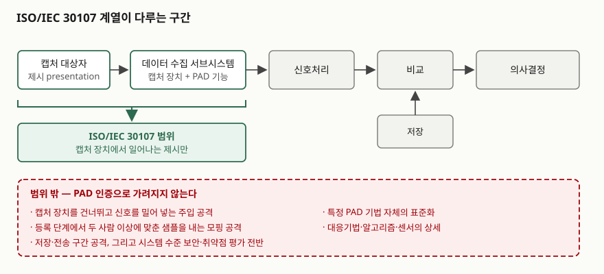
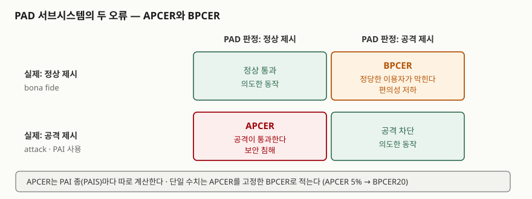

> 실행 검증 없음. 표준 기반 개념 글이므로 공개 자료 근거만으로 정리했다.
>
> 서문·서론·적용범위·용어 3.1~3.2는 발행처 공인 미리보기(VDE Verlag가 공개한
> ISO/IEC 30107-1:2023, ISO/IEC 30107-3:2023 앞부분)에서 직접 확인했고, 절 구성은
> 같은 미리보기의 목차를 따랐다. APCER·BPCER의 정의 문구와 BPCER20 표기는
> 표준 편집에 참여한 크리스토프 부쉬(Christoph Busch)가 공개한 2024년 강의자료에서
> 가져왔다. 유료 구간인 본문 수치·수식은 열지 않았다.

## 들어가며

비대면 계좌개설이나 안면인식 결제 설계서를 보면 "라이브니스 검사 적용"이라는 한 줄이
빠지지 않는다. 그런데 그 한 줄이 무엇을 막는지, 막았다는 것을 어떻게 재는지까지 적힌
설계서는 드물다. 시험에서 점수가 갈리는 자리도 거기다. 생체인식 문항은 인식률과 표준
번호를 나열하면 절반이고, **공격을 어떤 지점에서 가정하고 오류를 어떤 지표로 세는가**를
적어야 나머지 절반이 붙는다. ISO/IEC 30107 계열이 그 둘을 정의해 둔 표준이다.

## 정의

**제시공격 탐지(PAD, presentation attack detection)는 정상 제시와 생체인식 제시공격을
자동으로 구분하는 기능이다.** 여기서 **제시공격(presentation attack)은 생체인식 시스템의
동작을 방해할 목적으로 캡처 서브시스템에 무언가를 제시하는 행위**를 가리킨다. 두 정의 모두
ISO/IEC 30107-1이 두는 것이고, 답안 첫 줄에 그대로 쓸 수 있다.

답안에 한 문장을 더 붙이면 좋다. **PAD는 라이브니스 탐지와 같은 말이 아니다.** 표준이
정의하는 라이브니스는 "해부학적 특징, 불수의 반응, 생리 기능, 수의 반응, 피검자 행동 또는
이들의 조합으로 드러나는 살아 있는 상태"다. 즉 라이브니스는 **PAD가 쓰는 단서 가운데
하나**이지 PAD 자체가 아니다. 살아 있는 사람이 남의 얼굴을 흉내 내도 제시공격이고,
화장으로 외모를 바꾼 사람은 살아 있지만 여전히 공격자다.

## 등장 배경

표준의 서론이 문제를 직접 적는다. 생체인식 기술은 등장 이래 작심한 공격자가 인식을 전복할
가능성이 널리 인정돼 왔고, 그 시도를 탐지·무력화할 대응수단의 필요도 함께 인정돼 왔다.
그런데 전복은 시스템 어느 지점에서든, 내부자든 외부자든 일으킬 수 있어서 범위를 좁히지
않으면 표준이 성립하지 않는다. 그래서 30107 계열은 **캡처 대상자가 캡처 장치에서 생체
특성을 제시하는 그 순간**으로 범위를 한정했다.

이 한정에는 실무적 이유가 있다. 서론은 **운영자의 감독이 없는 환경** — 신뢰할 수 없는 망을
거치는 원격 수집 같은 경우 — 에서 생체인식 사용이 제약돼 왔다고 적는다. 전자인증 지침이
생체인식을 인증요소로 권하지 않았던 것이 그 때문이다. 감독자가 없으면 누가 무엇을
들이미는지 사람이 보지 못하므로, 그 판단을 자동화해야 비감독 환경에서 생체인식을 쓸 수
있다. PAD가 비대면 금융·전자여권 심사에서 먼저 요구된 흐름이 여기서 나온다.

초판(2016)과 제2판(2023)의 차이는 크지 않다. 서문이 적는 주요 변경은 **계열의 다른 부와
용어·정의를 조화시킨 것** 하나다. 표준의 목적 자체가 "기법을 고르는 것"이 아니라
"말을 맞추는 것"이라는 점을 보여주는 대목이다. 실제로 30107-1은 **특정 기법을 표준 PAD
도구로 지지하지 않는다**고 서론에 못 박는다.

## 구성요소

### 계열 구성 — 4부

| 부 | 무엇을 정한다 |
|---|---|
| 30107-1 | 프레임워크. 용어·정의와 공격 특성 분류, 탐지 기법의 틀 |
| 30107-2 | 데이터 형식. 쓰인 PAD 방식과 그 결과를 실어 나르는 형식. ISO/IEC 39794 계열에 통합돼 있다 |
| 30107-3 | 시험과 보고. 성능평가 원칙·방법과 지표 |
| 30107-4 | 모바일 기기에서 기기 내 생체인식을 쓸 때의 PAD 성능평가 요구사항 |

답안에서는 **"용어(-1) · 형식(-2) · 시험(-3) · 모바일(-4)"** 네 글자로 묶어 둔다.

### 공격자의 목적 — 2가지

| 구분 | 무엇을 노리는가 | 전형적 상황 |
|---|---|---|
| 사칭자 (impostor) | **남의** 생체인식 참조에 매칭되기 | 1:1 본인확인 통과, 1:N 긍정 식별로 침입 |
| 신원 은폐자 (identity concealer) | **자기** 생체인식 참조에 매칭되지 **않기** | 감시대상 명부(watchlist) 대조에서 빠져나가기 |

두 용어의 정의는 생체인식 용어 표준(ISO/IEC 2382-37)에 있다. 30107-3도 이 둘을 갈라
**사칭 공격에 쓰이는 PAI의 속성(8.1)**, **은폐 공격에 쓰이는 PAI의 속성(8.2)**,
**비정상 특성을 갖는 합성 샘플(8.3)** 로 절을 나눈다. 답안에서 이 둘을 섞으면 "라이브니스를
강화하면 된다"는 틀린 결론으로 간다. 은폐자는 자기 얼굴을 쓰므로 라이브니스를 아무리
높여도 걸리지 않는다.

### PAI와 인공물 — 포함 관계를 뒤집지 않는다

**PAI(제시공격 도구, presentation attack instrument)는 제시공격에 쓰이는 생체 특성 또는
물체**이고, **인공물(artefact)은 생체 특성의 복제본이나 합성 패턴을 제시하는 인공 물체나
표현**이다. 즉 **PAI가 인공물을 포함하는 넓은 쪽**이다. 실리콘 지문, 인쇄한 얼굴, 화면에
띄운 영상은 인공물이지만, **진짜 사람의 다른 손가락이나 화장으로 바꾼 얼굴**은 인공물이
아니면서 PAI다. 이 구분이 틀리면 "인공물 탐지 = PAD"라는 잘못된 등식이 답안에 들어간다.

같은 재료·같은 제작법으로 만든 PAI의 묶음을 **PAI 종(PAIS, PAI species)** 이라 부른다.
시험 결과를 해석할 때 이 단위가 전부를 좌우하므로 용어를 외워 둔다.

### 탐지 수단 — 챌린지-리스폰스를 축으로 3갈래

30107-1은 탐지 기법을 능동·수동으로 나누지 않는다. 대신 **챌린지-리스폰스와의 관계**로
세 경우를 갈라 적는다(5.2).

| # | 갈래 | 예 |
|---|---|---|
| ① | 라이브니스 탐지와 결부된 챌린지-리스폰스 | 눈을 깜박이라, 고개를 돌리라는 지시에 대한 반응 |
| ② | 챌린지-리스폰스와 무관한 라이브니스 탐지 | 지시 없이 재는 피부의 광 흡수, 맥파, 미세 움직임 |
| ③ | 생체인식과 무관한 챌린지-리스폰스 | 화면에 뜬 숫자를 읽게 하는 등 생체 특성과 무관한 응답 요구 |

업계에서 쓰는 **능동(active) / 수동(passive)** 은 ①·③과 ②를 거칠게 부르는 이름이다.
표준 용어가 아니므로 답안에서는 위 세 갈래로 적고, 능동·수동은 괄호로만 붙인다.

### 범위에서 빠지는 것 — 3가지 + 공격 지점 한정

적용범위 절이 **제공하지 않는 것 3가지**를 명시한다. **특정 PAD 기법의 표준화**,
**대응기법·알고리즘·센서의 상세 정보**, **시스템 수준의 보안 또는 취약점 평가**다.
여기에 공격 지점 한정이 붙는다. 다루는 공격은 **캡처 장치에서 생체 특성을 제시·수집하는
동안 일어나는 것**이고, 그 밖의 공격은 전부 범위 밖이다. 서론은 **모핑 공격** — 둘 이상의
사람에게 매칭되도록 조작한 샘플을 등록 시점에 밀어 넣는 공격 — 도 계열에서 다루지 않는다고
따로 적는다. 성능평가 방법은 비슷하지만 대상이 다르다는 단서를 달아 둔다.

## 도식

> **출처**: [ISO/IEC 30107-1:2023, Information technology — Biometric presentation attack detection — Part 1: Framework, Introduction / Clause 1 Scope / 5.4 PAD within biometric system architecture (VDE Verlag 공개 미리보기)](https://assets.vde-verlag.de/iec-normen/preview-pdf/info_isoiec30107-1%7Bed2.0%7Den.pdf) — 범위 한정 문구, 제외 항목 3가지, 모핑 공격 제외 서술

> **출처**: [ISO/IEC 30107-3:2023, Part 3: Testing and reporting, Introduction / 13.2 Metrics for PAD subsystem evaluation (VDE Verlag 공개 미리보기)](https://assets.vde-verlag.de/iec-normen/preview-pdf/info_isoiec30107-3%7Bed2.0%7Den.pdf) · [C. Busch, "ISO/IEC 30107 — Biometric Presentation Attack Detection", 2024-07-01, 17·20쪽](https://christoph-busch.de/files/Busch-PAD-240701.pdf) — 두 오류의 방향과 APCER·BPCER 정의 문구, BPCER20 표기

## 비교 — PAD 시험은 생체인식 성능시험과 어디가 다른가

30107-3의 서론이 이 차이를 **5가지**로 갈라 적는다. 시험 문항에서 "일반 성능시험을 그대로
쓰면 되지 않나"를 반박해야 할 때 그대로 쓸 수 있는 틀이다.

| # | 축 | 생체인식 성능시험 | PAD 시험 |
|---|---|---|---|
| ① | 통계적 유의성 | 대표성 있는 피험자를 충분히 모으면 오류율이 안정된다 | PAIS가 사실상 무한해 대표 집합을 고를 수 없다. 필요한 제시 횟수가 PAIS 수에 비례해 늘어난다 |
| ② | 시스템 간 비교 | 같은 샘플 코퍼스로 서로 다른 시스템을 비교할 수 있다 | 해석이 적용 환경에 크게 좌우돼 단순 비교가 성립하지 않는다 |
| ③ | 협조성 | 피험자가 협조적이고, 오류는 미숙함에서 온다 | 공격자는 비협조적이고 약점을 찾아 악용한다. 시험자의 숙련도가 결과를 바꾼다 |
| ④ | 자동화 | 기존 코퍼스로 알고리즘만 떼어 자동 시험할 수 있다 | PAD용 부가 센서가 있어 기존 코퍼스가 맞지 않고, 다변량 신호를 저장·재생하기가 어렵다 |
| ⑤ | 품질과 성능 | 품질이 낮으면 오류율이 올라간다 | 인공물 샘플이 사람보다 품질이 높을 수도 있다. 최악의 경우를 가정해 공격자가 최고 품질을 쓴다고 본다 |

②가 왜 문제인지는 표준이 든 예가 선명하다. PAIS 10종을 각 100회 제시했을 때 시스템 1은
전체의 90%, 시스템 2는 85%를 탐지했다고 하자. 그런데 시스템 1은 9종을 완전히 막고 10번째
종만 전부 놓쳤고, 시스템 2는 모든 종에서 고르게 85%를 막았다. **보안 관점에서는 시스템 2가
낫다.** 공격자가 10번째 종을 알아내는 순간 시스템 1은 항상 뚫리기 때문이다. 평균값 하나로는
이 차이가 보이지 않는다.

지표는 두 방향의 오류에 각각 이름이 붙는다.

| 지표 | 무엇의 비율인가 | 틀렸을 때 |
|---|---|---|
| **APCER** (attack presentation classification error rate) | 같은 PAI 종을 쓴 공격 제시 중 정상 제시로 잘못 분류된 비율 | 보안 침해 |
| **BPCER** (bona fide presentation classification error rate) | 정상 제시 중 공격 제시로 잘못 분류된 비율 | 정당한 이용자가 막힌다 |

## 적용 시 고려사항

- **EER과 HTER로 보고하지 않는다.** 두 오류를 하나로 평균 내면 ②의 함정에 그대로 빠진다.
  단일 수치가 필요하면 **APCER를 고정한 지점의 BPCER**로 적는다. APCER 5%에서의 BPCER을
  BPCER20, 1%에서의 값을 BPCER100으로 쓰는 표기가 그래서 쓰인다.
- **APCER는 PAIS마다 따로 계산하고, 보고는 최악값을 든다.** 평균을 내면 가장 잘 통하는
  공격 하나가 묻힌다. 공격자는 평균을 쓰지 않고 가장 잘 통하는 하나를 쓴다.
- **"APCER 0%"를 안전으로 읽지 않는다.** 표준은 **0%가 아닌 APCER는 그 PAI가 통할 수
  있다는 사실만 증명한다**고 적는다. 뒤집으면 0%도 그 시험에서 쓴 PAIS 집합에 한정된
  결과다. 다른 시험자가 재료나 제시 방법을 바꾸면 값이 달라진다.
- **시험소를 바꾸면 결과가 재현되지 않는다는 것을 표준이 인정한다.** 오류율은 PAD 기법,
  PAIS 집합, 적용 환경, 시험 방식, 시험자가 함께 정하는 값이라고 적혀 있다. 따라서
  **PAD 인증서 한 장을 "안전하다"의 근거로 삼을 수 없다.** 어떤 PAIS를 몇 번 제시해
  얻은 값인지까지 요구해야 한다.
- **주입 공격은 별도 통제로 막는다.** 캡처 장치를 건너뛰고 가상 카메라나 API로 영상을 밀어
  넣는 공격은 제시가 아니므로 30107 범위 밖이다. 기기 무결성 검증, 수집 경로 증명, 서버 측
  세션 통제가 따로 필요하다. 비대면 실명확인 설계에서 가장 자주 빠지는 칸이다.
- **모핑 공격도 따로 센다.** 등록 단계에서 합성한 사진을 넣는 공격은 계열이 다루지 않는다고
  표준이 명시한다. 등록 심사 절차와 모핑 탐지를 별도 통제로 세운다.
- **사칭과 은폐를 분리해 요구사항을 쓴다.** 결제·출입은 사칭 쪽, 감시대상 대조·중복가입
  차단은 은폐 쪽이 주된 위협이다. 같은 PAD 설정이 두 위협에 같은 효과를 내지 않는다.

## 정리

- 정의 한 줄: **PAD는 정상 제시와 제시공격을 자동으로 구분하는 기능이고, 제시공격은 시스템
  동작을 방해할 목적으로 캡처 서브시스템에 제시하는 행위다.**
- **4·2·3·3·5**로 외운다 — 계열 **4부**(용어·형식·시험·모바일), 공격 목적 **2가지**(사칭자·은폐자),
  탐지 수단 **3갈래**(결부된 챌린지-리스폰스 · 무관한 라이브니스 · 생체인식과 무관한 챌린지-리스폰스),
  범위 제외 **3가지**(기법 표준화 · 대응기법 상세 · 시스템 수준 평가), 성능시험과의 차이 **5가지**.
- 포함 관계는 **PAI ⊃ 인공물**. 진짜 신체를 쓰는 공격도 PAI다.
- 지표는 둘뿐이다. **APCER는 보안, BPCER는 편의.** 평균 내지 말고 **고정 APCER에서의 BPCER**로 적는다.
- 범위의 경계가 답안의 결론이다. **PAD는 캡처 장치 앞에서 일어나는 일만 본다.** 주입·모핑·
  저장 구간은 다른 통제가 맡는다.

> 기출 답안: [기출문제 — 안면인식 결제 서비스](../../exam/2026-10-25-facial-recognition-payment-biometric-standards/index.md)
>
> 함께 보기: [생체인식 템플릿 보호 (ISO/IEC 24745)](../2026-10-29-biometric-template-protection-iso-iec-24745/index.md) — 캡처를 통과한 뒤 저장되는 구간의 보호

## 참고 자료

- [ISO/IEC 30107-1:2023, Information technology — Biometric presentation attack detection — Part 1: Framework (ISO 카탈로그)](https://www.iso.org/standard/83828.html) — 발행 정보와 적용 범위
- [ISO/IEC 30107-1:2023 공개 미리보기 — 목차·서문·서론·적용범위·용어 (VDE Verlag)](https://assets.vde-verlag.de/iec-normen/preview-pdf/info_isoiec30107-1%7Bed2.0%7Den.pdf) — 제시공격·PAD·인공물·라이브니스의 정의, 제2판 변경 사항, 계열 4부의 역할
- [ISO/IEC 30107-3:2023, Part 3: Testing and reporting (ISO 카탈로그)](https://www.iso.org/standard/79520.html) — 시험·보고 원칙과 지표의 발행 정보
- [ISO/IEC 30107-3:2023 공개 미리보기 — 목차·서문·서론·적용범위 (VDE Verlag)](https://assets.vde-verlag.de/iec-normen/preview-pdf/info_isoiec30107-3%7Bed2.0%7Den.pdf) — 성능시험과의 차이 5가지, PAIS 단위 해석, 재현성에 대한 단서, 절 구성
- [C. Busch, "ISO/IEC 30107 — Biometric Presentation Attack Detection" 강의자료 (2024-07-01)](https://christoph-busch.de/files/Busch-PAD-240701.pdf) — APCER·BPCER 정의 문구, EER·HTER를 쓰지 말라는 권고, BPCER20·BPCER100 표기, 사칭자·은폐자 분류
- [ISO/IEC 2382-37, Information technology — Vocabulary — Part 37: Biometrics (ISO 카탈로그)](https://www.iso.org/standard/73514.html) — 사칭자·신원 은폐자 등 생체인식 용어의 기준
