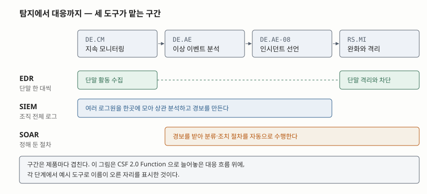

> **실행 검증 없음.** 표준·공식 문서의 정의와 절차를 정리한 개념 글이다. 출력·측정값은 싣지 않는다.

## 들어가며

보안 관제 문항은 세 약어를 나란히 놓고 "역할을 비교하라"고 묻는 형태로 자주 나온다.
답안에서 점수가 깎이는 자리는 대개 정해져 있다. 세 도구를 **탐지·분석·대응이라는
시간 순서로만** 늘어놓아, 왜 셋이 따로 존재하는지를 설명하지 못하는 경우다.

셋을 가르는 축은 시간이 아니라 **보는 범위**다. EDR은 단말 한 대 안에서 일어나는
일을 보고, SIEM은 조직 전체의 로그를 한곳에 모아 본다. SOAR는 무엇을 보는 도구가
아니라 **사람이 하던 절차를 대신 수행하는 도구**다. 이 축을 잡고 쓰면 세 도구가
같은 단계에 겹쳐 서 있는 이유도 함께 설명된다.

## 정의

**정의의 출처가 셋 다 다르고, 표준화 수준도 다르다.** 이 차이 자체가 답안에 쓸 수
있는 내용이므로 먼저 정리한다.

| 용어 | 정의 | 출처 |
|---|---|---|
| SIEM | 여러 종류의 로그에 대해 중앙 집중 로깅 기능을 제공하는 프로그램 | NIST 용어집 — NIST SP 800-92 인용 |
| EDR | 단말 데이터의 실시간 지속 모니터링·수집을, 규칙 기반 자동 대응·분석 기능과 결합한 것 | 미국 OMB 메모 M-22-01 (2021-10-08) |
| SOAR | **NIST 용어집에 정의 항목이 없다.** 약어 표기만 올라 있다 | NIST SP 800-61r3 부록 A의 약어 목록 |

세 번째 줄이 중요하다. SOAR는 업계에서 널리 쓰이지만 **표준 문서가 정의를 두지
않는다.** NIST SP 800-61r3은 이상 이벤트를 분석하는 항목(DE.AE-02)에서 SIEM과
나란히 *도구의 예시*로 이름을 들 뿐이다. 그래서 답안에 SOAR를 쓸 때는 정의를
단정하지 말고 "탐지 이후 절차를 자동화하는 도구군"처럼 기능으로 서술하는 편이 안전하다.

## 등장 배경

세 도구는 서로 다른 시점의 서로 다른 한계에서 나왔다.

- **로그가 흩어져 있었다.** 방화벽, 서버, 애플리케이션이 각자 로그를 남기면 한
  사건의 흔적이 여러 곳에 쪼개진다. 여러 출처에 흩어진 조각을 모으는 일(DE.AE-03)이
  SIEM이 맡은 자리다.
- **단말 안이 보이지 않았다.** 네트워크 경계에서 보는 트래픽만으로는 단말 안에서
  어떤 프로세스가 무엇을 실행했는지 알 수 없다. OMB 메모는 EDR이 다형성 악성코드,
  지능형 지속 위협(APT), 피싱처럼 **진화한 형태의 위협에 대응하는 데 필요한 가시성**을
  준다고 적는다.
- **경보는 사람이 감당할 양을 넘었다.** NIST SP 800-61r3은 분석해야 할 잠재적
  유해 이벤트의 양이 대체로 매우 많으므로, 조직이 **대규모 이벤트 집합을 사람이 볼 수
  있는 크기로 걸러 주는 기술적 수단에 의존해야 한다**고 권고한다(DE.AE R1). 거르고
  난 뒤에도 남는 반복 작업을 절차로 묶어 수행하는 것이 SOAR다.

## 구성요소 / 절차

현행 NIST SP 800-61r3(2025년 4월)은 이전 판의 **4단계 생애주기**(준비 / 탐지·분석 /
봉쇄·근절·복구 / 사고 후 활동)를 **CSF 2.0의 6개 Function**으로 대체했다.

| Function | 뜻 | 대응 흐름에서의 위치 |
|---|---|---|
| Govern (GV) | 위험관리 전략·기대·정책을 수립하고 전달하고 감시한다 | 준비 |
| Identify (ID) | 현재의 사이버보안 위험을 이해한다 | 준비 + 개선 |
| Protect (PR) | 위험을 관리할 보호 수단을 사용한다 | 준비 |
| Detect (DE) | 공격과 침해 가능성을 발견하고 분석한다 | 대응 |
| Respond (RS) | 탐지된 사고에 대한 조치를 수행한다 | 대응 |
| Recover (RC) | 영향받은 자산과 운영을 복구한다 | 대응 |

**6개 전부가 사고 대응에 관여하되 층이 다르다.** Govern·Identify·Protect는 사고
이전의 준비이고, Detect·Respond·Recover가 사고가 난 뒤의 대응이다. 두 층 사이를
Identify의 개선 범주(ID.IM)가 잇는다.

관제 도구가 서는 자리는 Detect와 Respond 구간이며, 세부 항목으로는 **5개**가 핵심이다.

1. **DE.CM** — 지속 모니터링. 네트워크, 물리 환경, 인원 활동, 외부 공급자, 컴퓨팅 자산을 각각 감시한다
2. **DE.AE-02** — 수집한 이벤트를 분석해 관련 활동을 파악한다. SIEM·SOAR가 예시로 오르는 자리다
3. **DE.AE-03** — 여러 출처의 정보를 상관 분석한다
4. **DE.AE-08** — 정의해 둔 기준에 맞으면 인시던트로 선언한다
5. **RS.MI-01** — 봉쇄. 악성코드 격리, 침해된 단말을 격리된 교정망으로 옮기기, 감염된 컨테이너 실행 중단이 자동 수행 대상으로 거론된다

## 도식

> **출처**: [NIST SP 800-61r3 §3, Table 3 (DE.CM / DE.AE-02 / DE.AE-08 / RS.MI-01)](https://doi.org/10.6028/NIST.SP.800-61r3), [NIST CSF 2.0 Functions](https://doi.org/10.6028/NIST.CSWP.29)

EDR이 양 끝에 두 번 나오는 것이 이 그림의 핵심이다. 같은 단말 에이전트가 **수집도
하고 조치도 한다.** SIEM은 수집·분석까지만 가고 조치를 직접 수행하지 않으며, SOAR는
수집하지 않고 경보 이후만 맡는다.

## 비교

| 구분 | SIEM | SOAR | EDR |
|---|---|---|---|
| 보는 범위 | 조직 전체의 로그 | 경보와 절차 | 단말 한 대의 내부 |
| 주된 입력 | 각 시스템이 보낸 로그 이벤트 | SIEM 등이 만든 경보 | 단말 에이전트가 모은 활동 기록 |
| 주된 출력 | 상관 분석 결과와 경보 | 수행된 조치와 처리 기록 | 탐지 결과와 단말 조치 |
| 직접 조치 | 하지 않는 것이 기본 | 한다 (절차대로) | 한다 (단말 범위 안에서) |
| CSF 단계 | DE.CM ~ DE.AE | DE.AE ~ RS | DE.CM, RS.MI |
| 표준 정의 | 있음 (NIST SP 800-92) | **없음** | 있음 (OMB M-22-01) |
| 없을 때 생기는 공백 | 사건 전체 그림이 안 그려진다 | 반복 조치를 사람이 매번 수행한다 | 단말 안에서 무슨 일이 있었는지 모른다 |

**셋은 대체재가 아니라 보완재다.** SIEM만 두면 경보가 쌓이기만 하고, SOAR만 두면
자동화할 경보 자체가 없으며, EDR만 두면 단말 밖에서 일어난 일이 보이지 않는다.

## 적용 시 고려사항

1. **자동 조치의 범위를 먼저 정한다.** NIST SP 800-61r3은 일부 봉쇄 조치의 자동
   수행을 *고려 사항*(C1)으로 둘 뿐 권고(R)로 올리지 않았다. 단말을 자동으로 격리하면
   오탐 한 번이 업무 중단으로 이어진다. 자동으로 할 것과 사람이 승인할 것을 미리 갈라 둔다.
2. **봉쇄 조치의 지속 기간을 함께 정한다.** 같은 문서는 봉쇄 수단을 고를 때 **몇 시간
   안에 걷어야 할 임시 우회, 2주 안에 걷을 임시 조치, 영구 해결**로 기간을 나눠 평가하라고
   적는다. 걷는 시점을 정하지 않은 임시 차단은 그대로 굳는다.
3. **오탐·미탐을 운영 중에 조정한다.** 지속 모니터링 기술은 오탐과 미탐을 **수용
   가능한 수준으로 낮추도록 튜닝하라**는 것이 DE.CM의 권고(R2)다. 도입 시점의 기본
   규칙을 그대로 두면 경보가 늘어 사람이 읽기를 포기한다.
4. **자동화할 수 없는 대상을 남겨 둔다.** 자동 감시로 충분히 다룰 수 없는 기술에 대해서는
   **로그를 정기적으로 수동 검토하라**는 권고(DE.AE-02 R3)가 따로 있다. 전부 자동화했다는
   전제로 설계하면 그 바깥이 사각지대가 된다.
5. **위협 인텔리전스(CTI)를 분석에 결합한다.** 로그 분석 도구에 최신 CTI를 넣어
   탐지 정확도를 올리라는 권고가 DE.AE-02·DE.AE-03·DE.AE-07에 반복해서 나온다.
   도구를 들여놓는 것과 그 도구가 무엇을 아는지는 별개 문제다.

## 정리

- 가르는 축은 **범위**다 — EDR은 단말 한 대, SIEM은 조직 전체 로그, SOAR는 절차.
- 현행 NIST SP 800-61r3은 4단계 생애주기를 **CSF 2.0의 6개 Function**으로 대체했다.
  준비 3개(GV·ID·PR) + 대응 3개(DE·RS·RC)로 외운다.
- 관제 도구가 서는 세부 항목은 **5개** — DE.CM / DE.AE-02 / DE.AE-03 / DE.AE-08 / RS.MI-01.
- 표준 정의가 있는 것은 **SIEM과 EDR 둘**이고 SOAR는 없다. 정의를 단정하지 않는다.
- 자동 조치는 권고가 아니라 **고려 사항**이다. 범위와 지속 기간을 먼저 정한다.

## 참고 자료

- [NIST SP 800-61r3, Incident Response Recommendations and Considerations for Cybersecurity Risk Management (2025-04)](https://doi.org/10.6028/NIST.SP.800-61r3)
- [NIST CSWP 29, The NIST Cybersecurity Framework (CSF) 2.0 (2024-02)](https://doi.org/10.6028/NIST.CSWP.29)
- [NIST CSRC Glossary — security information and event management](https://csrc.nist.gov/glossary/term/security_information_and_event_management)
- [NIST CSRC Glossary — security orchestration, automation, and response](https://csrc.nist.gov/glossary/term/security_orchestration_automation_and_response)
- [OMB M-22-01, Improving Detection of Cybersecurity Vulnerabilities and Incidents on Federal Government Systems through Endpoint Detection and Response (2021-10-08)](https://bidenwhitehouse.archives.gov/wp-content/uploads/2021/10/M-22-01.pdf)
- [NIST SP 800-92, Guide to Computer Security Log Management](https://doi.org/10.6028/NIST.SP.800-92)
