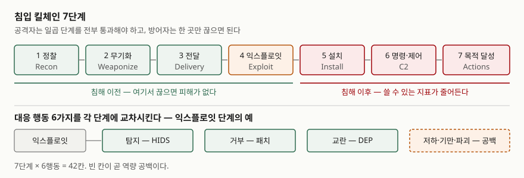
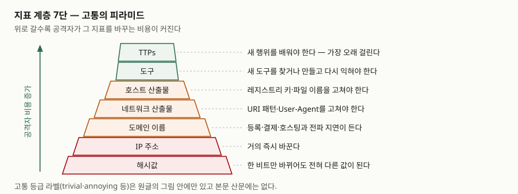

## 들어가며

보안 문항에서 킬체인은 단계 이름을 외워 적는 자리로 나오는 경우가 많다. 그런데 이 모형이
답안에서 점수를 받는 지점은 단계 나열이 아니라 **왜 단계로 쪼개면 방어자가 유리해지는가**다.
공격자는 일곱 단계를 전부 통과해야 목적을 이루지만 방어자는 한 곳만 끊으면 되고, 그
비대칭이 투자 우선순위를 정하는 근거가 된다. 여기에 침해지표를 겹쳐 놓으면 "어느 계층에
탐지를 걸 것인가"라는 설계 문제로 이어진다. 탐지 체계 수립, 위협 인텔리전스, 보안관제
문항이 모두 이 틀 위에 선다.

> **실행 검증 없음.** 원 논문·표준·공식 문서 근거로만 정리했다.

---

## 정의

**침입 킬체인(Intrusion Kill Chain)은 침입을 정찰부터 목적 달성까지 일곱 단계의 순차
진행으로 모형화하고, 각 단계에 방어 행동을 대응시켜 침입을 분석·차단하는 틀이다.**

이 모형을 제시한 록히드마틴 백서는 킬체인을 "적을 표적화하고 교전해 원하는 효과를
만드는 체계적 과정"으로 두고, 미 국방부 표적화 교리의 여섯 단계(find, fix, track,
target, engage, assess)를 침입에 맞게 확장했다. 백서는 이 모형을 **정보 주도 컴퓨터
네트워크 방어(intelligence-driven CND)** 의 뼈대로 쓴다.

**침해지표(IoC, Indicator of Compromise)** 쪽의 정의는 NIST가 분명하다. 사이버 위협정보
공유 지침(NIST SP 800-150)의 위협정보 유형 절(§2.1)은 지표를 **공격이 임박했거나 진행
중이거나 이미 침해가 일어났음을 시사하는 기술적 산출물 또는 관측 가능 대상**으로 정의한다.
같은 문서는 관측 가능 대상(observable)을 네트워크나 시스템에서 일어난 사건으로 따로 적어
둔다. 지표의 예로는 명령제어 서버로 의심되는 IP 주소, 의심스러운 DNS 도메인, 악성 콘텐츠를
가리키는 URL, 악성 실행 파일의 해시, 악성 메일의 제목 문자열을 든다.

## 등장 배경

2011년 이전의 방어는 취약점 중심이었다. 패치와 하드닝으로 노출면을 줄이는 접근인데,
백서는 이 방식이 지능형 지속 위협(APT) 앞에서 불충분하다고 적는다. 공격자가 맞춤
악성코드와 제로데이를 동원하면 안티바이러스와 패치로는 탐지도 완화도 되지 않기 때문이다.

그리고 당시의 사고 대응은 **침해 이후**에 초점이 있었다. 백서는 기존 모형들을 §2에서
훑으면서, 익스플로잇 이후 행위에 기반한 모형은 탐지와 완화를 늦은 단계에 몰아 둔다고
지적한다. 늦은 단계만 보면 쓸 수 있는 지표의 수 자체가 적고, 공격자가 백도어와 설치
파일만 바꿔도 기존 탐지가 전부 무력해진다.

여기서 관점이 뒤집힌다. 공격자는 침입을 **반복**한다. 반복은 재사용을 낳고, 재사용된
요소는 전부 방어자가 쥘 수 있는 약점이 된다. 백서의 결론 문장이 이 전환을 요약한다 —
공격자가 반복하는 구성요소는 그 자체로 부채다. 방어자가 공격자의 진화 속도보다 빠르게
대응책을 넣으면, 공격자가 목적 달성에 치러야 하는 비용이 올라간다.

## 구성요소 — 킬체인 7단계

백서는 침입 킬체인을 **7단계**로 정의한다.

| # | 단계 | 무엇이 일어나는가 |
|---|---|---|
| 1 | 정찰 (Reconnaissance) | 표적을 조사·식별·선정한다. 학회 자료나 메일링 리스트를 훑어 메일 주소, 인적 관계, 쓰는 기술을 모으는 형태 |
| 2 | 무기화 (Weaponization) | 원격 접속 트로이목마와 익스플로잇을 묶어 전달 가능한 페이로드로 만든다. 보통 자동화 도구가 한다 |
| 3 | 전달 (Delivery) | 무기를 표적 환경으로 보낸다. 백서가 2004~2010년 관측으로 꼽은 3대 경로는 메일 첨부, 웹사이트, USB 이동식 매체 |
| 4 | 익스플로잇 (Exploitation) | 전달된 무기가 침입자 코드를 발동시킨다. 응용프로그램·운영체제 취약점을 노리는 경우가 많지만 사용자 자신이나 자동 실행 기능을 이용하기도 한다 |
| 5 | 설치 (Installation) | 피해 시스템에 원격 접속 트로이목마나 백도어를 설치해 지속성을 확보한다 |
| 6 | 명령·제어 (C2) | 침해 호스트가 외부 제어 서버로 비컨을 보내 C2 채널을 연다. 채널이 서면 침입자는 대상 환경 안에서 직접 조작할 수 있다 |
| 7 | 목적 달성 (Actions on Objectives) | 앞의 여섯 단계를 통과한 뒤에야 원래 목적을 수행한다. 보통 데이터 유출이고, 무결성·가용성 침해나 내부 횡적 이동의 발판 확보일 수도 있다 |

**단계 번호를 그대로 외우되, 7단계가 "순차"라는 점을 답안에 써야 한다.** 백서의 핵심
주장이 거기서 나온다. 공격자는 모든 단계를 성공적으로 통과해야 목적을 이루지만, 완화
하나면 사슬이 끊어지고 공격자도 멈춘다.

### 지표 3종

같은 백서의 지표 절(§3.1)은 지표를 **침입을 객관적으로 기술하는 모든 정보**로 두고
**3종**으로 나눈다.

| 종류 | 정의 | 예 |
|---|---|---|
| **원자적(Atomic)** | 더 작은 조각으로 쪼개면 침입 맥락에서의 의미를 잃는 것 | IP 주소, 메일 주소, 취약점 식별자 |
| **계산된(Computed)** | 사건에 관련된 데이터에서 유도해 낸 것 | 해시값, 정규표현식 |
| **행위적(Behavioral)** | 계산된 지표와 원자적 지표를 묶은 것. 수량이나 조합 논리로 한정되는 경우가 많다 | "어떤 정규식에 맞는 트래픽을 특정 빈도로 특정 IP에 보내다가, 접근이 서면 특정 해시의 것으로 교체한다" |

지표에는 **수명주기**가 있다. 백서는 분석이나 협업으로 지표를 **드러내고(reveal)**,
도구에 태워 **성숙시키고(mature)**, 일치하는 활동이 발견되면 **활용한다(utilize)** 는
순환을 제시한다. 이 순환이 다시 새 지표를 낳는다.

### 대응 행동 6가지

백서의 대응 행동 절(§3.3)은 미 국방부 정보작전 교리에서 가져온 **6가지 행동** —
탐지(detect), 거부(deny), 교란(disrupt), 저하(degrade), 기만(deceive), 파괴(destroy) —
을 킬체인 7단계에 교차시킨 행렬을 제시한다. 7단계 × 6행동이 격자를 이루고, 빈 칸이
곧 역량 공백이다.

백서가 든 익스플로잇 단계의 예를 그대로 옮기면 이렇다. 호스트 침입탐지시스템(HIDS)은
익스플로잇을 수동적으로 **탐지**하고, 패치는 익스플로잇 자체를 **거부**하며, 데이터 실행
방지(DEP)는 발동된 익스플로잇을 **교란**한다. 같은 단계를 세 가지 다른 방식으로 막는
셈이고, 이 중복이 곧 복원력이다.

## 도식

> **출처**: [Hutchins, Cloppert, Amin, *Intelligence-Driven Computer Network Defense Informed by Analysis of Adversary Campaigns and Intrusion Kill Chains* (Lockheed Martin, 2011)](https://www.lockheedmartin.com/content/dam/lockheed-martin/rms/documents/cyber/LM-White-Paper-Intel-Driven-Defense.pdf) — §3.2 Intrusion Kill Chain의 7단계 정의, §3.3 Courses of Action의 행렬과 익스플로잇 단계 예시

답안에 옮길 때는 **상자 일곱 개와 화살표 여섯 개**가 전부다. 그 아래 침해 이전·이후를
가르는 선 하나를 긋고, 대응 행동은 한 단계만 예로 들어 가로로 펴면 된다.

## 비교 — 고통의 피라미드

킬체인이 "언제 막을 것인가"를 묻는다면, 고통의 피라미드는 **"무엇으로 막을 것인가"** 를
묻는다. 2013년에 제시되고 2014년 1월에 해시 계층이 추가된 이 모형은 지표를 **7계층**으로
세우고, 위로 갈수록 공격자가 그 지표를 바꾸는 비용이 커진다고 본다.

| 계층 (아래→위) | 무엇 | 공격자가 바꾸는 비용 |
|---|---|---|
| 1. 해시값 | 특정 파일의 MD5·SHA1 등 | 한 비트만 바뀌어도 전혀 다른 해시가 되므로 바꾸기가 매우 쉽다. 저자는 추적할 가치조차 없을 수 있다고 적는다 |
| 2. IP 주소 | IP 주소 또는 넷블록 | 매우 적은 노력으로 바꾼다. 익명 프록시를 쓰면 본인도 모르게 바뀐다. 하나를 막아도 공격자는 거의 멈추지 않는다 |
| 3. 도메인 이름 | 도메인·서브도메인 | 등록·결제·호스팅이 필요하고 전파에 하루이틀 걸려 IP보다 조금 더 성가시다. 다만 등록 규칙이 느슨한 공급자가 많아 아주 어렵지는 않다 |
| 4. 네트워크 산출물 | URI 패턴, 프로토콜 안의 C2 정보, 특징적인 User-Agent 값 등 | 여기서부터 공격자에게 실제 타격이 간다. 어떻게 탐지됐는지 알아내 도구를 고쳐야 한다 |
| 5. 호스트 산출물 | 레지스트리 키, 떨어뜨린 파일, 악성 서비스 이름 등 | 위와 같은 계층으로 다뤄진다. 수정 자체는 간단할 수 있지만 되돌아가 작업하는 시간이 든다 |
| 6. 도구 | 공격자가 목적 달성에 쓰는 소프트웨어 | 새 도구를 찾거나 만들고 다시 익혀야 한다. 저자는 이것을 큰 승리로 부른다 |
| 7. TTPs | 전술·기법·절차, 곧 행위 자체 | 가장 시간이 많이 드는 일, 곧 새 행위를 배우는 일을 강요한다 |

> **출처**: [David J. Bianco, *The Pyramid of Pain* (2013-03-01, 2014-01-17 개정)](https://detect-respond.blogspot.com/2013/03/the-pyramid-of-pain.html) — 계층 구성과 계층별로 저자가 적은 변경 비용 (2차 자료 기반, 원저자 공개 글)

저자는 꼭대기에서는 도구가 아니라 **행위 자체를 상대한다**고 적고, 순수한 효과 측면에서
이 계층이 이상적이라고 본다. 이 수준에서 대응하면 공격자에게 남는 선택지는 포기하거나
처음부터 다시 만드는 것뿐이라는 것이다.

> 피라미드의 각 계층에 붙는 "trivial·easy·annoying" 같은 고통 등급 표기는 원글의
> **그림 안에만** 있고 본문 산문에는 나오지 않는다. 답안에 등급 단어를 적을 때는
> 계층 순서가 본체이고 단어는 그림의 라벨임을 알고 쓰는 편이 안전하다.

### 두 모형의 대비

| | 침입 킬체인 | 고통의 피라미드 |
|---|---|---|
| 묻는 것 | 침입의 **어느 단계**에 대응을 걸 것인가 | **어떤 종류의 지표**로 탐지할 것인가 |
| 축 | 시간(단계 진행) | 추상화 수준(지표 계층) |
| 항목 수 | 7단계 × 6행동 | 7계층 |
| 출처 | 록히드마틴 백서 (2011) | 원저자 공개 글 (2013, 2014 개정) |
| 답안에서 쓰는 자리 | 대응 체계 설계, 투자 우선순위 | 탐지 지표 선정, 위협 인텔리전스 가치 평가 |

두 축은 겹치지 않으므로 **격자로 쓸 수 있다.** 세로에 킬체인 7단계를, 가로에 지표
7계층을 놓고 현재 탐지가 어느 칸에 들어가 있는지 표시하면 공백이 보인다. 해시 기반
탐지만 가득한 환경은 피라미드 바닥에 몰려 있는 것이고, 공격자 입장에서는 바꾸는 데
비용이 거의 들지 않는 지표만 막고 있는 셈이다.

## 적용 시 고려사항

**지표가 유효한 대상에만 적용되는지 확인한다.** 백서는 지표의 파생 경로를 추적하지
않으면 분석가가 **설계되지 않은 위협 행위자에게**, 또는 아예 정상 활동에 그 지표를
적용하게 된다고 경고한다. 지표를 어디서 얻었고 어느 캠페인에 속하는지를 같이 관리하지
않으면 오탐이 늘고, 늘어난 오탐은 탐지 체계 전체의 신뢰를 깎는다.

**탐지를 앞 단계로 밀되 막힌 침입도 분석한다.** 백서는 성공한 침해만큼 **실패한 침입의
종합(synthesis)** 이 중요하다고 적는다. 알려진 지표에 걸려 메일 하나가 차단됐을 때,
그 뒤에 이어졌을 익스플로잇과 백도어까지 재구성해 두지 않으면 다음에 다른 경로로 들어온
같은 공격을 놓친다. 차단으로 끝내면 그 침입이 품고 있던 정보를 버리는 것이다.

**제로데이를 단일 사건으로 보지 않는다.** 백서는 제로데이 익스플로잇을 "더 넓은 과정 안의
한 가지 변화"로 보고, 보안 업계가 제로데이 방어에만 초점을 맞추는 것을 근시안이라고
적는다. 실제로 백서의 사례 연구에서는 앞선 두 침입에서 얻은 지표(동일한 무기화 알고리즘,
동일한 PE 설치 파일, 동일한 C2 주소) 덕분에 **제로데이를 쓴 세 번째 침입이 전달 단계에서
차단됐다.** 익스플로잇이 새로워도 나머지가 재사용되면 막힌다.

**피라미드 상단만 좇지 않는다.** TTP 계층이 효과가 크다는 것과 해시·IP를 버려도 된다는
것은 다른 말이다. 하단 지표는 비용이 거의 들지 않고 즉시 적용되며 자동화가 쉽다. 상단
지표는 효과가 크지만 탐지 규칙을 만들기 어렵고 오탐 관리 비용이 크다. **두 계층을 같이
운영하고, 투자 증분을 상단으로 보내는 것**이 실제 설계다.

## 정리

- **킬체인 7단계**: 정찰 → 무기화 → 전달 → 익스플로잇 → 설치 → C2 → 목적 달성.
  앞 글자로 **"정무전익설C목"** 처럼 묶어 외운다
- **대응 행동 6가지**: 탐지·거부·교란·저하·기만·파괴. 7단계와 교차시켜 **7×6 격자**를
  만들고 빈 칸을 역량 공백으로 읽는다
- **지표 3종**: 원자적 / 계산된 / 행위적. 수명주기는 **드러냄 → 성숙 → 활용**의 순환
- **피라미드 7계층**: 해시 → IP → 도메인 → 네트워크 산출물 → 호스트 산출물 → 도구 → TTPs.
  위로 갈수록 공격자가 바꾸는 비용이 커진다
- 한 문장으로 닫는다면: **공격자는 모든 단계를 통과해야 하고 방어자는 한 곳만 끊으면
  된다. 반복은 공격자의 부채다**

> 기출 답안: [기출문제 — TTPs(전술·기법·절차)](../../exam/2026-10-26-ttps-tactics-techniques-procedures/index.md)

## 참고 자료

- [Hutchins, Cloppert, Amin, *Intelligence-Driven Computer Network Defense Informed by Analysis of Adversary Campaigns and Intrusion Kill Chains* (Lockheed Martin, 2011)](https://www.lockheedmartin.com/content/dam/lockheed-martin/rms/documents/cyber/LM-White-Paper-Intel-Driven-Defense.pdf) — §3.1 지표 3종과 수명주기, §3.2 킬체인 7단계 정의, §3.3 대응 행동 행렬, §3.4 늦은·이른 단계 탐지와 종합, §4 사례 연구 (1차)
- [NIST SP 800-150, *Guide to Cyber Threat Information Sharing* (2016-10)](https://nvlpubs.nist.gov/nistpubs/SpecialPublications/NIST.SP.800-150.pdf) — §2.1 지표·TTPs를 포함한 위협정보 유형 정의, 관측 가능 대상의 정의 (1차)
- [NIST CSRC Glossary, *Indicator*](https://csrc.nist.gov/glossary/term/indicator) — SP 800-150과 CNSSI 4009-2022 두 출처의 정의 병기 (1차)
- [David J. Bianco, *The Pyramid of Pain* (2013-03-01, 2014-01-17 개정)](https://detect-respond.blogspot.com/2013/03/the-pyramid-of-pain.html) — 지표 7계층과 계층별 공격자 비용, TTP 계층의 의미. 원저자가 직접 공개한 글이며 표준 문서가 아니다 (2차)
- [MITRE, *ATT&CK Design and Philosophy* (2020-03)](https://attack.mitre.org/docs/ATTACK_Design_and_Philosophy_March_2020.pdf) — TTPs 추상화 수준과 행위 기반 탐지의 근거 (1차)
