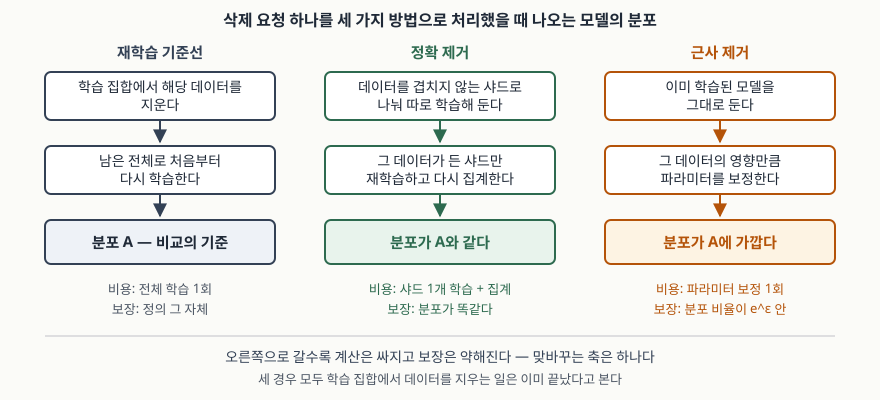

> **실행 검증 없음.** 원 논문과 표준 문서 근거로만 정리했다. 성능 수치는 모두 해당 논문이
> 보고한 값이며 이 글에서 재현하지 않았다.

## 들어가며

이용자가 "내 데이터를 지워 달라"고 하면 예전에는 행을 지우는 것으로 끝났다. 학습 모델이
끼면 그렇지 않다. 그 데이터로 학습한 모델의 파라미터에는 영향이 남아 있고, 멤버십 추론이나
모델 전도 같은 공격은 바로 그 남은 영향을 꺼내 쓴다. 행을 지운 뒤에도 모델에 질의하면
지워진 사람의 정보가 나올 수 있다는 뜻이다.

답은 단순하다. 그 데이터를 빼고 처음부터 다시 학습하면 된다. 문제는 값이다. 학습에 하루가
걸리는 모델에서 삭제 요청이 매일 수천 건 들어오면 이 방법은 쓸 수 없다. 기계 학습
제거는 **재학습과 같은 결과를 더 싸게 내는 방법**을 찾는 분야이고, 시험에서는 정확 제거와
근사 제거를 가르는 기준과 그 맞바꿈을 묻는다.

## 정의

**기계 학습 제거(Machine Unlearning)는 학습된 모델에서 특정 학습 데이터와 그 영향을
제거해, 그 데이터를 애초에 학습하지 않은 것과 같은 상태로 만드는 것이다.**

용어를 만든 것은 Cao와 Yang의 2015년 논문이며, 이들은 학습 시스템을 잊게 만드는 과정을
기계 학습 제거라 부르고, 그 쓸모를 재는 척도로 **얼마나 완전히 잊는가(completeness)**와
**얼마나 빨리 잊는가(timeliness)** 두 가지를 든다.

**보장을 분포로 적은 정의는 따로 있다.** Bourtoule 등의 2021년 논문은 제거 기법의 정의
(정의 III.1)에서, 그 데이터를 학습했다가 제거한 뒤 나오는 모델의 분포와 애초에 학습하지
않았을 때 나오는 모델의 분포가 **같을 때** 제거가 성립한다고 적는다. Ginart 등의 2019년
논문도 데이터 삭제 연산의 정의(정의 3.1)를 같은 모양으로 둔다. 데이터 D에서 i번째를 뺀
채 학습한 결과와, D로 학습한 모델에 삭제 연산을 적용한 결과가 **분포로 같아야 한다**는
것이다.

**출처에 따라 정의의 층위가 다르다는 점을 답안에 밝히는 편이 낫다.** 2015년 논문은
"완전히·빠르게 잊는 시스템"이라는 목표 수준의 정의이고, 2019년·2021년 논문은 분포 동일성
이라는 형식 정의다. 뒤쪽이 정확 제거와 근사 제거를 가르는 기준이 된다.

## 등장 배경

세 가지가 겹쳐서 이 분야가 생겼다.

**첫째, 삭제 요구권이 법으로 들어왔다.** EU 일반 개인정보보호법(GDPR)의 삭제권(제17조)과
국내 개인정보 보호법의 정정·삭제 요구권(제36조)은 정보주체가 자기 정보의 삭제를 요구할 수
있게 한다. 모델 파라미터가 이 "개인정보"에 포함되는지는 법적으로 아직 갈리지만, 모델에
영향이 남아 있다는 기술적 사실 자체는 다툼거리가 아니다.

**둘째, 남은 영향을 꺼내는 공격이 실증됐다.** 멤버십 추론은 특정 데이터가 학습에 쓰였는지를
가려내고, 모델 전도는 학습 데이터의 속성을 복원한다. NIST의 적대적 기계학습 분류 문서
(NIST AI 100-2e2025)는 프라이버시 공격을 다루면서 완화 수단 가운데 하나로 기계 학습 제거를
든다.

**셋째, 삭제 동기가 프라이버시만이 아니다.** 2015년 논문은 오염 공격을 받은 이상 탐지기가
주입된 데이터를 잊어야 보안을 되찾는다는 점, 추천 엔진에서 잘못된 항목을 빼야 추천이
쓸 만해진다는 점을 함께 든다. 보안과 사용성도 삭제를 요구한다.

## 구성요소 — 접근 2가지, SISA 4단계, 보장 2가지

### 접근 2가지

| 구분 | 정확 제거(exact) | 근사 제거(approximate) |
|---|---|---|
| 보장 | 재학습 결과와 **분포가 같다** | 재학습 결과와 **분포가 가깝다** |
| 방법 | 학습 구조를 미리 나눠 두고 일부만 재학습 | 학습된 파라미터를 보정 |
| 비용 | 샤드 하나의 재학습 | 보정 1회 |

Ginart 등의 논문은 분포가 같은 삭제를 정의한 뒤, 이 정의를 두 분포 사이의 거리에 상한을
두는 방식으로 **완화할 수 있다**고 적는다. 정확과 근사의 갈림이 여기서 형식으로 나온다.

### 정확 제거 — SISA 4단계

Bourtoule 등의 논문이 제시한 SISA는 **Sharded, Isolated, Sliced, Aggregated** 네 단어의
머리글자이고, 그대로 4단계다.

| 단계 | 하는 일 |
|---|---|
| **S**harded (분할) | 학습 데이터를 겹치지 않는 샤드로 나눈다. 한 데이터는 한 샤드에만 들어간다 |
| **I**solated (격리 학습) | 샤드마다 모델을 따로 학습한다. 한 데이터의 영향이 그 샤드의 모델에만 미친다 |
| **S**liced (슬라이스) | 샤드를 다시 조각으로 나눠 점진적으로 투입하고 매번 파라미터 상태를 저장한다. 재학습을 처음이 아니라 **그 데이터가 들어가기 직전 상태**에서 시작한다 |
| **A**ggregated (집계) | 추론할 때 샤드별 모델의 예측을 모은다. 가장 단순한 방식은 예측 라벨 다수결이다 |

제거 요청이 오면 그 데이터가 든 샤드의 모델 하나만, 그것도 해당 슬라이스 직전 체크포인트
부터 다시 학습한다. 논문은 재학습 대비 속도 향상을 Purchase 데이터셋에서 4.63배,
SVHN에서 2.45배로 보고하고, ImageNet 분류처럼 복잡한 과제에서는 1.36배로 보고한다.
슬라이스가 비용을 줄이는 대가는 **저장 공간**이다. 체크포인트를 그만큼 쌓아 둬야 한다.

### 근사 제거의 보장 2가지

Guo 등의 2020년 논문은 **인증 삭제(certified removal)** 를 정의한다. 삭제 기법을 적용한
모델이 그 데이터를 아예 보지 않은 모델과 구분되지 않아야 한다는 요구를, 두 분포의 비율에
상한과 하한을 두는 형태로 적는다.

| 보장 | 형태 |
|---|---|
| ε-인증 삭제 | 두 분포의 비율이 e-ε와 eε 사이에 있다 |
| (ε, δ)-인증 삭제 | 위 한계가 깨질 확률을 δ로 묶는다 |

ε이 0에 가까울수록 재학습과 구분하기 어렵고, 그만큼 보정 비용이 커진다.

## 도식

> **출처**: [Ginart et al., *Making AI Forget You: Data Deletion in Machine Learning*, NeurIPS 2019 (arXiv:1907.05012)](https://arxiv.org/abs/1907.05012) — 정의 3.1 데이터 삭제 연산(분포 동일성)과 근사 삭제로의 완화, [Bourtoule et al., *Machine Unlearning*, IEEE S&P 2021 (arXiv:1912.03817)](https://arxiv.org/abs/1912.03817) — SISA의 분할·격리·슬라이스·집계, [Guo et al., *Certified Data Removal from Machine Learning Models*, ICML 2020 (arXiv:1911.03030)](https://arxiv.org/abs/1911.03030) — ε-인증 삭제의 비율 한계.

## 비교

**차분 프라이버시와 무엇이 다른가** — 시험에서 가장 자주 섞이는 짝이다.

| | 차분 프라이버시 | 기계 학습 제거 |
|---|---|---|
| 적용 시점 | 학습 **전·중**에 미리 | 요청이 온 **뒤**에 사후로 |
| 대상 | 모든 학습 데이터에 일괄 | 지목된 특정 데이터에만 |
| 비용 부담 | 정확도를 상시로 깎는다 | 요청이 올 때만 계산이 든다 |
| 보장의 성격 | 어느 한 건이 있든 없든 결과가 비슷하다 | 그 한 건이 없던 것과 분포가 같거나 가깝다 |

Guo 등의 논문은 둘의 관계를 **차분 프라이버시는 인증 삭제의 충분조건이지만 필요조건은
아니라고** 적는다. 차분 프라이버시로 학습했다면 인증 삭제는 자동으로 성립하지만, 인증
삭제를 얻는 길이 차분 프라이버시뿐인 것은 아니라는 뜻이다.

**세 가지 제거 방식의 자리**

| | 재학습 | 정확 제거(SISA) | 근사 제거(인증 삭제) |
|---|---|---|---|
| 보장 | 정의 그 자체 | 분포가 같다 | 분포 비율이 eε 안 |
| 사전 준비 | 없음 | **학습 구조를 미리 나눠 둬야** 한다 | 없음 |
| 추가 저장 | 없음 | 샤드별 모델 + 슬라이스 체크포인트 | 없음 |
| 정확도 비용 | 없음 | 샤드를 늘릴수록 떨어진다 | 보정 오차만큼 |
| 적용 범위 | 모든 알고리즘 | 모든 학습 알고리즘 | 주로 볼록 목적함수·선형 분류기 |

## 적용 시 고려사항

**1. 사전 준비 여부가 선택을 가른다.** SISA는 **학습을 시작하기 전에** 데이터를 나눠 두어야
성립한다. 이미 한 덩어리로 학습해 운영 중인 모델에는 소급해 적용할 수 없고, 그 경우 남는
길은 전체 재학습이거나 근사 제거다. 삭제 요청이 들어올 가능성을 설계 단계에서 따져
구조를 정해야 한다는 뜻이다.

**2. 샤드 수가 두 값을 반대로 움직인다.** 샤드를 잘게 나눌수록 재학습 대상이 작아져 제거는
빨라지지만, 샤드마다 쓸 수 있는 데이터가 줄어 각 모델이 약해지고 집계 정확도가 떨어진다.
Bourtoule 등의 논문도 복잡한 과제에서 샤드 수를 늘리면 집계 정확도가 떨어진다고 적고,
ImageNet에서 요청 39건을 처리할 때 상위 5개 정확도가 19.45%p 떨어졌다고 보고한다. 같은
논문은 전이 학습으로 이 하락을 크게 줄일 수 있다고 덧붙인다. **단순한 과제와 복잡한 과제에서
값이 전혀 다르다**는 점을 답안에 적으면 좋다.

**3. 제거를 검증하기 어렵다.** 이것이 실무에서 가장 곤란한 지점이다. 정확 제거는 재학습과
같은 절차를 밟았다는 **구조로** 보장을 주고, 근사 제거는 분포 비율의 한계를 **분석으로**
준다. 둘 다 "정말 지워졌는가"를 모델만 보고 사후에 확인해 주지는 않는다. 멤버십 추론
공격을 걸어 보는 식의 경험적 점검이 쓰이지만, 공격이 못 찾았다는 것이 안 남아 있다는
증거는 아니다.

**4. 법이 요구하는 삭제와 기술이 주는 보장이 어긋난다.** 삭제 요구권은 기한 안에 처리하라고
정하지만, 기술 쪽 보장은 분포 동일성이나 ε 같은 통계적 형태다. 기한 안에 "지웠다"고 답하려면
조직이 어느 수준을 삭제로 인정할지를 먼저 정책으로 정해 두어야 하고, 그 기준을 처리방침과
기록에 남겨야 한다.

**5. 계보를 추적할 수 있어야 한다.** 2015년 논문이 짚은 출발점은 데이터가 데이터를 낳는
연결, 곧 계보다. 한 건의 원본이 특징(feature)과 모델과 다시 다른 시스템의 입력으로 퍼진
뒤라면, 어느 모델을 고쳐야 하는지조차 모른다. 제거 설계는 모델 쪽 기법 이전에 **어디까지
퍼졌는지 아는 체계**를 전제한다.

## 정리

- 기계 학습 제거는 **모델에 남은 영향**을 지우는 것이다. 학습 집합에서 행을 지우는 것과 다르다
- 척도 **2가지**: 얼마나 완전히 잊는가(completeness), 얼마나 빨리 잊는가(timeliness)
- 접근 **2가지**: 분포가 **같은** 정확 제거, 분포가 **가까운** 근사 제거. 가르는 기준은 보장의 형태다
- 정확 제거의 대표가 **SISA 4단계** — 분할·격리·슬라이스·집계. 머리글자 그대로 외운다
- 근사 제거의 보장은 **ε-인증 삭제**, 완화형이 **(ε, δ)-인증 삭제**
- 차분 프라이버시는 인증 삭제의 **충분조건이지 필요조건이 아니다**
- 맞바꾸는 축은 하나다: **보장이 강할수록 준비와 계산이 비싸다**

> 기출 답안: [기출문제 — 모델 전도 공격](../../exam/2026-10-27-model-inversion-attack/index.md)

> 관련 개념: [차분 프라이버시 — 프라이버시 손실 매개변수 ε과 누적 손실](../2026-10-03-differential-privacy-epsilon-composition/index.md) · [멤버십 추론 공격과 학습 데이터 암기](../2026-10-13-membership-inference-memorization/index.md) · [적대적 머신러닝 공격 분류](../2026-10-13-adversarial-ml-attack-taxonomy/index.md)

## 참고 자료

- [Cao & Yang, *Towards Making Systems Forget with Machine Unlearning*, IEEE S&P 2015](https://www.ieee-security.org/TC/SP2015/papers-archived/6949a463.pdf) — 용어의 출처, 계보(lineage) 개념, completeness·timeliness 척도, 통계적 질의 학습에 기반한 합 형태 변환, LensKit·Zozzle 재구현·OSN 스팸 필터·PJScan 네 시스템 평가 (1차)
- [Bourtoule et al., *Machine Unlearning*, IEEE S&P 2021 (arXiv:1912.03817, 2019-12-09 최초 공개)](https://arxiv.org/abs/1912.03817) — 정의 III.1 분포 동일성, SISA(Sharded·Isolated·Sliced·Aggregated) 4단계, Purchase 4.63배·SVHN 2.45배·ImageNet 1.36배, 샤드 수와 정확도의 관계 (1차)
- [Ginart et al., *Making AI Forget You: Data Deletion in Machine Learning*, NeurIPS 2019 (arXiv:1907.05012)](https://arxiv.org/abs/1907.05012) — 정의 3.1 데이터 삭제 연산, 근사 삭제로의 완화, k-평균 군집에서 6개 데이터셋 평균 100배 이상의 삭제 효율 개선 (1차)
- [Guo et al., *Certified Data Removal from Machine Learning Models*, ICML 2020 (arXiv:1911.03030)](https://arxiv.org/abs/1911.03030) — ε-인증 삭제와 (ε, δ)-인증 삭제의 정의, 차분 프라이버시와의 충분·필요 관계 (1차)
- [NIST AI 100-2e2025, *Adversarial Machine Learning: A Taxonomy and Terminology of Attacks and Mitigations* (2025-03)](https://doi.org/10.6028/NIST.AI.100-2e2025) — 프라이버시 공격과 완화 수단 가운데 기계 학습 제거의 위치 (1차)
- [Regulation (EU) 2016/679 (GDPR) Article 17 — Right to erasure ('right to be forgotten')](https://eur-lex.europa.eu/eli/reg/2016/679/oj) — 삭제권의 근거 조문 (1차)
- [개인정보 보호법 제36조(개인정보의 정정·삭제), 국가법령정보센터](https://www.law.go.kr/%EB%B2%95%EB%A0%B9/%EA%B0%9C%EC%9D%B8%EC%A0%95%EB%B3%B4%EB%B3%B4%ED%98%B8%EB%B2%95) — 국내 정정·삭제 요구권의 근거 조문 (1차)
