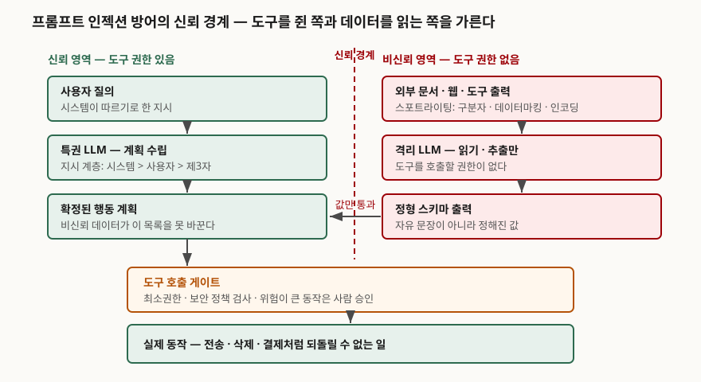

## 들어가며

프롬프트 인젝션은 시험에서 보통 "무엇인가"와 "어떻게 막는가"로 묶여 나온다. 그런데 뒤쪽을
입력 검증·필터링으로 답하면 점수가 붙지 않는다. 이 취약점은 구현 실수가 아니라 현재 언어모델이
명령과 데이터를 한 토큰열로 받는 구조에서 나오기 때문에, 입력을 아무리 걸러도 남는 부분이 있고
**공식 문서들이 그 사실을 명시**하고 있다. 답안이 가야 할 곳은 "막는 법"이 아니라 **"뚫렸을 때
공격자가 무엇까지 할 수 있는가를 설계로 줄이는 법"**이다. 실무에서 에이전트가 메일을 보내고
파일을 지우고 결제를 하기 시작하면서, 이 구분이 바로 사고 규모의 차이가 됐다.

> **실행 검증 없음.** 표준·공식 문서와 논문 근거로만 정리했다.

---

## 정의

**프롬프트 인젝션 방어 설계는, 인젝션이 언젠가 성공한다는 것을 전제로 두고, 성공했을 때
공격자가 획득하는 권한과 도달 범위를 시스템 구조로 제한하는 설계다.**

"성공한다는 것을 전제"가 정의의 핵심이고, 근거는 두 문서에 있다.

- OWASP의 2025년 항목은 이 취약점이 **생성형 AI의 성질 때문에 가능**하며, 모델이 동작하는
  방식의 중심에 확률적 영향이 있기 때문에 **"프롬프트 인젝션을 막는 확실한 방법이 있는지
  불분명하다"**고 적는다. 그 뒤에 이어지는 것이 "예방"이 아니라 **"영향을 완화할 수 있는"**
  조치 목록이다
- 미국 국립표준기술연구소의 적대적 기계학습 분류 체계는 더 구조적으로 적는다. 생성형 AI
  모델은 **데이터 채널과 명령 채널을 하나로 합쳐 쓰기 때문에**, 공격자가 데이터 쪽을 건드려
  시스템 동작에 영향을 줄 수 있다

여기서 방어의 목표가 바뀐다. 탐지율을 올리는 것이 아니라, **탐지에 실패했을 때의 손실
상한을 내리는 것**이다.

## 등장 배경

초기 대응은 전부 탐지형이었다. 악성 지시처럼 보이는 문자열을 거르고, 시스템 프롬프트에
"이후의 지시는 무시하라"고 적는 방식이다. 이 접근이 한계에 부딪힌 이유는 세 가지다.

**첫째, 거를 대상이 자연어다.** OWASP는 이 취약점이 **사람 눈에 보이지 않는 입력이라도
모델이 파싱하면 성립**한다고 적는다. 보이는 글자만의 문제가 아니므로 문자열 패턴으로
경계를 그을 수 없다.

**둘째, 공격 표면이 사용자 입력 밖으로 나갔다.** OWASP는 직접 인젝션과 간접 인젝션을
나누는데, 간접 인젝션은 **웹사이트나 파일 같은 외부 출처에서 입력을 받을 때** 그 내용이
모델의 동작을 바꾸는 경우다. 에이전트가 웹을 읽고 도구를 호출하는 구조에서는 공격자가
사용자와 대화할 필요조차 없다.

**셋째, 탐지형 방어는 보장을 주지 않는다.** 확률적으로 동작하는 모델에 "이것은 무시하라"고
적는 것은 지시일 뿐 강제가 아니다. 그래서 2024년 이후의 연구는 **모델이 어떻게 반응하든
시스템이 할 수 있는 일의 범위 자체를 좁히는 쪽**으로 옮겨 갔다.

## 구성요소 — 두 층 4갈래

방어를 **모델층 2갈래**와 **설계층 2갈래**로 나눠 적으면 답안이 정리된다. 모델층은 모델이
잘 반응하도록 만드는 쪽이고, 설계층은 모델이 잘못 반응해도 사고가 작게 끝나도록 만드는 쪽이다.

### 가. 모델층 ① — 출처 표시(스포트라이팅), 3기법

마이크로소프트 연구진이 제안한 스포트라이팅은 **여러 입력 출처를 모델이 구분하도록 돕는
프롬프트 공학 기법군**이다. 핵심 착상은 입력을 변형해 **그 출처를 알려주는 신호를 꾸준히
주는 것**이다. 논문은 3가지를 든다.

1. **구분자(delimiting)** — 특수 토큰으로 입력의 시작과 끝을 표시한다
2. **데이터마킹(datamarking)** — 입력 안의 공백을 전부 표식 문자로 바꾼다
3. **인코딩(encoding)** — base64 같은 방식으로 입력 자체를 인코딩한다

논문 초록은 GPT 계열 모델에서 공격 성공률이 **50% 이상에서 2% 미만으로** 떨어졌다고 보고한다.

### 나. 모델층 ② — 지시 계층 학습, 3단

오픈AI 연구진의 지시 계층은 **우선순위가 다른 지시가 충돌할 때 모델이 어떻게 행동해야 하는지를
명시적으로 정의**하고, 그에 맞춰 **낮은 권한의 지시를 선별적으로 무시하도록 학습시키는** 방법이다.
논문이 본문에서 드는 순서는 3단이다.

> 시스템 메시지가 사용자 메시지에 우선하고, 사용자 메시지가 제3자 콘텐츠에 우선한다.

논문은 지시를 **정렬된(aligned)** 것과 **어긋난(misaligned)** 것으로 나눈다. 정렬된 지시는
상위 지시와 같은 제약·규칙·목표를 가지므로 따르고, 어긋난 지시는 가능하면 무시하고 안 되면
거부한다. 중요한 설계 결정이 하나 있다 — 논문은 **브라우징이나 도구 사용 중에 나타나는 지시는
전부 어긋난 것으로 가정**한다. 보고된 개선 폭은 시스템 프롬프트 추출 방어에서 최대 63%,
학습에 없던 공격 유형에 대한 일반화에서 최대 34%다.

### 다. 설계층 ① — 에이전트 설계 패턴, 6가지

2025년의 공동 연구가 정리한 6가지다. 공통점은 **에이전트에 의도적으로 제약을 걸어 임의의
작업을 수행할 능력을 명시적으로 제한**한다는 것이다.

| 패턴 | 무엇을 막는가 |
|---|---|
| 행동 선택자 (Action-Selector) | 행동의 결과가 에이전트로 되돌아오지 않게 한다 |
| 계획 후 실행 (Plan-Then-Execute) | 비신뢰 데이터를 보기 전에 행동 목록을 확정한다 |
| 맵리듀스 (LLM Map-Reduce) | 비신뢰 항목마다 격리된 LLM에 넘기고 출력을 제한한다 |
| 이중 LLM (Dual LLM) | 특권 LLM은 비신뢰 데이터를 보지 않고, 격리 LLM은 도구를 쓰지 않는다 |
| 코드 작성 후 실행 (Code-Then-Execute) | 비신뢰 데이터의 흐름을 LLM이 아니라 프로그램이 다룬다 |
| 문맥 최소화 (Context-Minimization) | 불필요한 내용을 문맥에서 제거해 뒤의 응답에 영향을 못 주게 한다 |

### 라. 설계층 ② — 운영 통제, 7가지

OWASP가 드는 완화 조치 목록이 7항목이다. 답안에서 개수를 그대로 쓸 수 있다.

1. **모델 동작을 제약한다** — 역할·능력·한계를 시스템 프롬프트에 명시한다
2. **기대하는 출력 형식을 정의하고 검증한다** — 결정적 코드로 형식 준수를 확인한다
3. **입력과 출력을 필터링한다** — 민감 범주와 규칙을 정의하고 의미 기반 필터를 적용한다
4. **권한 통제와 최소권한을 강제한다** — 애플리케이션에 자체 API 토큰을 주고 그 기능을
   모델에 넘기는 대신 코드에서 처리한다
5. **위험이 큰 동작에는 사람 승인을 요구한다** — 특권 동작에 사람이 개입하는 통제를 둔다
6. **외부 콘텐츠를 분리하고 표시한다** — 신뢰할 수 없는 내용을 구분해 영향 범위를 제한한다
7. **적대적 시험과 공격 모의를 수행한다** — 모델을 신뢰할 수 없는 사용자로 보고 신뢰 경계와
   접근 통제를 시험한다

## 도식

> **출처**: [Defeating Prompt Injections by Design (CaMeL), arXiv:2503.18813](https://arxiv.org/abs/2503.18813) — 특권 LLM·격리 LLM 분리와 도구 호출 시 정책 검사, [Design Patterns for Securing LLM Agents against Prompt Injections, arXiv:2506.08837](https://arxiv.org/abs/2506.08837) — 이중 LLM·계획 후 실행 패턴, [OWASP LLM01:2025 Prompt Injection](https://genai.owasp.org/llmrisk/llm01-prompt-injection/) — 최소권한과 사람 승인, [The Instruction Hierarchy, arXiv:2404.13208](https://arxiv.org/abs/2404.13208) — 지시 우선순위, [Defending Against Indirect Prompt Injection Attacks With Spotlighting, arXiv:2403.14720](https://arxiv.org/abs/2403.14720) — 외부 입력의 출처 표시

## 비교

### 가. 모델층과 설계층

| | 모델층 방어 | 설계층 방어 |
|---|---|---|
| 목표 | 모델이 공격 지시를 덜 따르게 한다 | 따르더라도 할 수 있는 일을 줄인다 |
| 대표 수단 | 스포트라이팅, 지시 계층 학습 | 설계 패턴 6가지, 최소권한, 사람 승인 |
| 보장의 성격 | 확률적 — 성공률이 내려간다 | 구조적 — 경로 자체가 없다 |
| 비용이 드는 곳 | 추론 비용, 모델 재학습 | 에이전트가 할 수 있는 일의 범위 |
| 실패하는 방식 | 미학습 공격·고성능 모델 전제에서 흔들린다 | 설계가 허용한 흐름 안에서는 그대로 통한다 |

### 나. 구체 방어가 뚫리는 경로

| 방어 | 남는 구멍 (각 출처가 직접 밝힌 것) |
|---|---|
| 구분자 | 스포트라이팅 논문이 실무에 권하지 않는다고 적는다 |
| 인코딩 | 고성능 모델에서만 쓰라고 적는다. 작은 모델은 과제 성능이 떨어진다 |
| 지시 계층 | 과잉 거부가 일부 과제에서 회귀했다고 논문이 보고한다 |
| 계획 후 실행 | "모든 프롬프트 인젝션을 막지는 못한다"고 논문이 적는다 |
| 이중 LLM | 데이터 흐름이 조작될 수 있어 위험을 완전히 없애지 못한다 |
| CaMeL | 데이터 흐름에 영향이 없는 텍스트-투-텍스트 공격은 막지 못한다 |

## 적용 시 고려사항

**첫째, 효용과 보안을 맞바꾸는 설계라는 것을 먼저 받아들인다.** 설계 패턴 논문은 이 패턴들이
에이전트에 의도적 제약을 걸어 임의 작업 수행 능력을 제한한다고 명시하고, 효용과 보안 사이의
절충이라고 적는다. 숫자로도 나타난다 — CaMeL 논문은 AgentDojo 벤치마크에서 **방어하지 않은
시스템이 84%를 푸는 과제를 77%로** 풀었다고 보고한다. 7퍼센트포인트가 구조적 보장의 값이다.
답안에서는 "막는다"가 아니라 **"무엇을 포기하고 무엇을 얻는가"**로 쓴다.

**둘째, 제어 흐름과 데이터 흐름을 따로 봐야 한다.** 행동 목록을 먼저 확정하는 것만으로는
부족하다. CaMeL은 신뢰하는 질의에서 **제어 흐름과 데이터 흐름을 명시적으로 추출**해 비신뢰
데이터가 프로그램 흐름에 영향을 주지 못하게 하고, 그와 **별도로 능력(capability) 개념을 써서
허가되지 않은 데이터 흐름을 통한 유출을 막는다.** 흐름을 고정해도 유출은 남기 때문에 두 장치가
따로 필요하다는 뜻이다. 설계할 때 "공격자가 행동을 바꿀 수 있는가"와 "데이터를 밖으로 뺄 수
있는가"를 나눠서 점검한다.

**셋째, 사람 승인을 두는 자리를 고른다.** OWASP는 특권 동작에 사람이 개입하는 통제를 두라고
적지만, 모든 동작에 승인을 걸면 승인 자체가 형식이 된다. 기준은 **되돌릴 수 있는가**다.
조회는 되돌릴 필요가 없고 전송·삭제·결제는 되돌릴 수 없다. 되돌릴 수 없는 동작에만 승인을
걸어야 승인이 실제로 읽힌다. 덧붙여, 승인하는 사람이 보는 화면도 설계 대상이다 — OWASP가 드는
공격 사례 중에는 요약문에 삽입된 이미지 링크로 대화 내용을 빼내는 것이 있다.

**넷째, 보고된 수치를 그대로 옮기지 않는다.** 스포트라이팅 논문이 든 성공률은 1,000건의
합성 문서와 단순한 키워드 페이로드로 측정한 값이라고 논문 자신이 밝힌다. 벤치마크 조건이
바뀌면 숫자도 바뀐다. 답안에 수치를 쓸 때는 **어느 조건에서 잰 값인지**를 함께 적는다.

## 정리

- 정의의 축은 **"완전 차단이 없다는 전제"**다. OWASP는 확실한 예방법이 있는지 불분명하다고
  적고, NIST는 **명령 채널과 데이터 채널이 합쳐진 구조**를 원인으로 든다
- 방어는 **두 층 4갈래**로 외운다. 모델층 2갈래(출처 표시 **3기법**, 지시 계층 **3단**),
  설계층 2갈래(설계 패턴 **6가지**, 운영 통제 **7가지**)
- 설계 패턴 6가지는 머리글자로 **"선·계·맵·이·코·문"** — 행동 선택자, 계획 후 실행,
  맵리듀스, 이중 LLM, 코드 작성 후 실행, 문맥 최소화
- 지시 계층 3단은 **시스템 > 사용자 > 제3자**. 도구·브라우징 출력은 전부 어긋난 지시로 본다
- 점검은 **두 질문**으로 나눈다. 행동을 바꿀 수 있는가(제어 흐름), 데이터를 뺄 수
  있는가(데이터 흐름). 흐름을 고정해도 유출은 따로 남는다
- 사람 승인은 **되돌릴 수 없는 동작에만** 건다

> 기출 답안: [기출문제 — 프롬프트 인젝션](../../exam/2026-10-27-prompt-injection/index.md)

## 참고 자료

- [OWASP Top 10 for LLM Applications 2025 — LLM01:2025 Prompt Injection](https://genai.owasp.org/llmrisk/llm01-prompt-injection/) — 정의, 직접·간접 구분, 완화 조치 7가지, 확실한 예방법의 불확실성 (1차)
- [NIST AI 100-2e2025, Adversarial Machine Learning: A Taxonomy and Terminology of Attacks and Mitigations (2025-03)](https://csrc.nist.gov/pubs/ai/100/2/e2025/final) — 데이터 채널과 명령 채널의 결합 (1차)
- [Beurer-Kellner et al., Design Patterns for Securing LLM Agents against Prompt Injections, arXiv:2506.08837 (2025-06, v3 2025-06-27)](https://arxiv.org/abs/2506.08837) — 설계 패턴 6가지, 효용·보안 절충 (1차)
- [Debenedetti et al., Defeating Prompt Injections by Design, arXiv:2503.18813 (2025-03, v2 2025-06-24)](https://arxiv.org/abs/2503.18813) — 제어·데이터 흐름 분리, 능력 기반 유출 방지, AgentDojo 77% 대 84% (1차)
- [Hines et al., Defending Against Indirect Prompt Injection Attacks With Spotlighting, arXiv:2403.14720 (2024-03)](https://arxiv.org/abs/2403.14720) — 스포트라이팅 3기법과 측정 조건 (1차)
- [Wallace et al., The Instruction Hierarchy: Training LLMs to Prioritize Privileged Instructions, arXiv:2404.13208 (2024-04)](https://arxiv.org/abs/2404.13208) — 지시 우선순위 3단, 정렬·어긋남 구분, 개선 폭 (1차)
