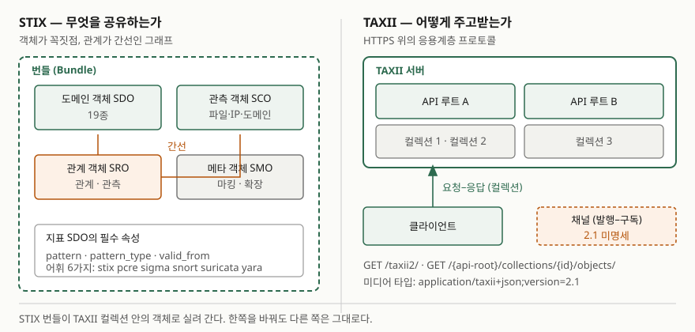

## 들어가며

위협정보 공유 문항은 "공유해야 한다"로 끝나는 답안이 많다. 그런데 실제로 공유가 막히는
자리는 의지가 아니라 **형식과 경로**다. A사가 보낸 CSV의 컬럼 이름을 B사가 다르게 읽고,
메일로 받은 PDF를 사람이 다시 입력하는 동안 지표의 수명이 끝난다. 이 두 가지를 각각
표준으로 묶은 것이 STIX와 TAXII이고, 둘의 역할 분담을 정확히 쓰는 것이 이 주제의
첫 득점 포인트다. 보안관제 체계 수립, 위협 인텔리전스, 정보공유분석센터(ISAC) 문항에서
반복해 나온다.

> **실행 검증 없음.** OASIS 표준 문서와 NIST 공식 문서 근거로만 정리했다.

---

## 정의

**STIX(Structured Threat Information Expression)는 사이버 위협 인텔리전스를 교환하기
위한 언어이자 직렬화 형식이다.** 표준 본문의 서론(§1)이 이 문장을 그대로 적는다. 뒤이어
STIX가 조직 간에 위협 인텔리전스를 일관되고 기계가 읽을 수 있는 방식으로 공유하게 한다고
설명한다.

**TAXII(Trusted Automated Exchange of Intelligence Information)는 사이버 위협정보를
단순하고 확장 가능하게 전달하기 위한 응용계층 프로토콜이다.** 이쪽도 표준 서론(§1)의
첫 문장이다.

**한 줄로 가르면 STIX는 "무엇을 공유하는가"를, TAXII는 "어떻게 주고받는가"를 정한다.**
둘 다 OASIS 사이버 위협 인텔리전스(CTI) 기술위원회가 만들었고, **2.1 버전이 2021년
6월 10일자 OASIS 표준(OASIS Standard)** 이다. 이 날짜와 지위를 답안에 적으면 근거가
선명해진다.

## 등장 배경

NIST의 사이버 위협정보 공유 지침(SP 800-150)은 공유 대상인 위협정보를 지표, TTPs,
보안 경보, 위협 인텔리전스 보고서, 도구 설정의 다섯 유형으로 나눈다(§2.1). 문제는 이
유형들이 조직마다 다른 모양으로 쌓인다는 점이다. 같은 "악성 IP"라도 어떤 곳은 단순 목록
으로, 어떤 곳은 신뢰도와 관측 시각이 붙은 레코드로 둔다. 받는 쪽에서 해석이 갈리면
자동화가 불가능하고, 사람이 다시 읽어 넣는 순간 지표의 유효 기간이 끝난다.

전달 경로도 마찬가지였다. 메일, 포털 게시판, 전용 API가 공유처마다 달라 소비자는 공급처
수만큼 연동을 만들어야 했다. 이 두 문제를 **내용의 표준화**와 **전송의 표준화**로 나눠
푼 것이 STIX와 TAXII다. 나누어 둔 덕에 한쪽을 바꿔도 다른 쪽이 흔들리지 않는다 —
TAXII는 STIX 전달을 위해 설계됐지만, 표준 본문(§1.6)은 그것이 **다른 형식을 실어
나르지 못한다는 뜻은 아니라고** 명시한다. 추가 콘텐츠 유형을 금지하지 않는다는 조항
(§1.6.10)도 따로 둔다.

## 구성요소 — STIX 2.1의 객체 모델

STIX는 위협 인텔리전스를 **객체의 그래프**로 모형화한다. 객체가 꼭짓점이고 관계가
간선이다. 표준은 객체를 크게 **5종류**로 나눈다.

| 종류 | 절 | 무엇 |
|---|---|---|
| **STIX 도메인 객체 (SDO)** | §4 | CTI에서 흔히 쓰는 개념 하나하나. **19종** |
| **STIX 사이버 관측 객체 (SCO)** | §6 | 파일·IP·도메인처럼 관측된 대상 자체 |
| **STIX 관계 객체 (SRO)** | §5 | 객체 사이의 관계. **2종** |
| **STIX 메타 객체 (SMO)** | §7 | 언어 콘텐츠, 데이터 마킹, 확장 정의 |
| **STIX 번들 (Bundle)** | §8 | 위 객체들을 한 묶음으로 싸는 그릇 |

### 도메인 객체 19종

표준 §4가 정의하는 SDO는 다음 **19종**이다.

> 공격 패턴(Attack Pattern) · 캠페인(Campaign) · 대응 조치(Course of Action) ·
> 그룹화(Grouping) · 신원(Identity) · 사건(Incident) · 지표(Indicator) ·
> 인프라(Infrastructure) · 침입 집합(Intrusion Set) · 위치(Location) · 악성코드(Malware) ·
> 악성코드 분석(Malware Analysis) · 노트(Note) · 관측 데이터(Observed Data) ·
> 의견(Opinion) · 보고서(Report) · 위협 행위자(Threat Actor) · 도구(Tool) ·
> 취약점(Vulnerability)

표준은 이 중 일부를 묶어 읽는 방법도 알려 준다(§4 서두). **공격 패턴·악성코드·도구는
전부 TTPs의 한 종류**로 볼 수 있고 — 공격자가 공격을 수행하는 데 쓰는 행위와 자원을
기술하기 때문이다 — **캠페인·침입 집합·위협 행위자는 공격자가 왜 공격하고 어떻게
조직되는지**를 기술한다. 19종을 통째로 외우기보다 이 두 묶음을 먼저 쥐는 편이 답안에서
쓸모 있다.

모든 SDO는 **필수 공통 속성 5가지** — `type`, `spec_version`, `id`, `created`,
`modified` — 를 갖는다.

### 관계 객체 2종

SRO는 **2종**뿐이다(§5).

| 객체 | 절 | 하는 일 |
|---|---|---|
| **관계(Relationship)** | §5.1 | 두 SDO 또는 SCO를 이어 서로 어떻게 관련되는지 기술한다. SDO·SCO가 그래프의 꼭짓점이면 SRO는 간선이다 |
| **관측(Sighting)** | §5.2 | CTI의 무언가가 **목격됐다는 믿음**을 나타낸다. 누가·무엇을 표적으로 삼는지, 공격이 어떻게 수행되는지를 추적한다 |

관측 객체는 관계 객체의 특수한 형태다. 표준은 **세 가지 측면**을 묶는다고 적는다 —
무엇이 목격됐는가(`sighting_of_ref`, 필수), 누가 또는 어디서 목격했는가
(`where_sighted_refs`), 실제로 무엇이 보였는가(`observed_data_refs`). 뒤의 둘은
선택이다.

관측과 관측 데이터의 차이가 시험에서 자주 갈린다. 표준의 설명을 그대로 쓰면,
**관측은 인텔리전스 주장**이고 **관측 데이터는 단순한 정보**다. "이 파일을 봤다"가
관측 데이터이고, "이 위협 행위자를 봤다"가 관측이다.

### 지표 객체와 탐지 패턴

SDO 중 탐지 체계와 가장 직접 닿는 것이 **지표(Indicator, §4.7)** 다. 표준은 지표 객체가
설명문, 그것이 탐지하는 **킬체인 단계(`kill_chain_phases`)**, 유효 시간 창, 그리고
구조화된 탐지 패턴을 담는다고 적는다.

| 속성 | 필수 | 무엇 |
|---|---|---|
| `pattern` | 필수 | 탐지 패턴 본문. 표준 §9의 STIX 패터닝 언어로 쓰거나 SNORT·YARA 같은 다른 언어로 쓸 수 있다 |
| `pattern_type` | 필수 | 그 패턴이 어느 언어로 쓰였는지. `pattern` 안의 데이터 유형과 **반드시 일치해야 한다** |
| `valid_from` | 필수 | 이 지표가 유효해지는 시각 |
| `valid_until` | 선택 | 유효 기간의 끝 |

`pattern_type`의 개방 어휘(`pattern-type-ov`, §10.19)에 적힌 값은 **6가지**다 —
`stix`, `pcre`, `sigma`, `snort`, `suricata`, `yara`. 표준은 이 목록을 **비망라적
개방 어휘**로 둔다. 목록에 없는 언어를 써도 되지만, 쓰는 쪽과 읽는 쪽이 같은 값을
쓰기로 합의해야 한다는 뜻이다.

`valid_from`·`valid_until`이 필드로 박혀 있다는 점이 중요하다. 지표에 수명이 있다는
사실이 데이터 모형에 들어와 있어서, 만료된 지표를 자동으로 내릴 수 있다.

## 도식

> **출처**: [OASIS, *STIX Version 2.1* OASIS Standard (2021-06-10)](https://docs.oasis-open.org/cti/stix/v2.1/os/stix-v2.1-os.html) — §1.2 객체 분류, §4 도메인 객체, §5 관계 객체, §8 번들 · [OASIS, *TAXII Version 2.1* OASIS Standard (2021-06-10)](https://docs.oasis-open.org/cti/taxii/v2.1/os/taxii-v2.1-os.html) — §1.6.2 API 루트, §1.6.4 컬렉션, §1.6.5 채널

답안에 옮길 때는 왼쪽에 **객체 상자 넷과 번들 테두리**, 오른쪽에 **서버-클라이언트
화살표 두 쌍**이면 된다.

## 구성요소 — TAXII 2.1의 교환 구조

TAXII는 **HTTPS(HTTP over TLS)** 위에서 도는 응용계층 프로토콜이다(§1.6.6). 전송
자체를 새로 만들지 않고 기존 웹 기술을 그대로 쓴다는 선택이다.

### 교환 모형 2가지

| 모형 | 절 | 방식 | 2.1에서의 지위 |
|---|---|---|---|
| **컬렉션(Collection)** | §1.6.4 | TAXII 서버가 제공하는 CTI 객체 논리 저장소의 인터페이스. **요청–응답** 방식으로 주고받는다 | 명세됨 |
| **채널(Channel)** | §1.6.5 | 클라이언트끼리 **발행–구독** 방식으로 주고받는다. 서버가 중계한다 | **키워드만 예약하고 서비스는 명세하지 않았다.** 다음 버전으로 미뤘다 |

**채널이 2.1에서 아직 명세되지 않았다는 점은 답안에 적을 가치가 있다.** 개념 설명에서
두 모형을 나란히 든 뒤 "현 표준에서 실제로 구현되는 것은 컬렉션"이라고 덧붙이면,
개념과 현황을 모두 쥔 답안이 된다.

### API 루트와 엔드포인트

**API 루트(API Root, §1.6.2)** 는 컬렉션·채널과 관련 기능을 묶은 논리적 묶음이다.
표준은 서로 다른 URL에서 제공되는 TAXII API의 인스턴스로 생각할 수 있다고 적는다. 한
서버가 여러 API 루트를 두고, 각 API 루트가 여러 컬렉션을 둘 수 있다.

**엔드포인트(Endpoint, §1.6.3)** 는 특정 URL과 HTTP 메서드의 조합이다. 주요 엔드포인트는
다음과 같다.

| 기능 | 절 | 경로 |
|---|---|---|
| 서버 탐색 | §4.1 | `GET /taxii2/` |
| API 루트 정보 | §4.2 | `GET /{api-root}/` |
| 비동기 작업 상태 | §4.3 | `GET /{api-root}/status/{id}/` |
| 컬렉션 목록 | §5.1 | `GET /{api-root}/collections/` |
| 매니페스트 조회 | §5.3 | `GET /{api-root}/collections/{id}/manifest/` |
| 객체 조회·추가 | §5.4, §5.5 | `GET` / `POST /{api-root}/collections/{id}/objects/` |

엔드포인트 경로는 **반드시 슬래시로 끝나야 한다**(§3.1). 매니페스트 엔드포인트가 따로
있는 이유도 짚어 둘 만하다. 객체 본문 대신 **메타데이터만 먼저 받아** 실제로 받아올
가치가 있는지 판단하게 하려는 것이다(§5.3). 대량 공유에서 대역폭을 아끼는 설계다.

콘텐츠 협상은 미디어 타입으로 한다. TAXII 2.1의 JSON 표현은
`application/taxii+json;version=2.1`이다(§1.6.8.2). 컬렉션이 담는 내용의 기본값은
`application/stix+json`이다(§5.2).

## 비교

### STIX와 TAXII

| | STIX 2.1 | TAXII 2.1 |
|---|---|---|
| 계층 | 데이터 표현 | 응용계층 전송 프로토콜 |
| 정하는 것 | 객체 종류, 속성, 관계, 패턴 문법 | 엔드포인트, 교환 모형, 인증, 미디어 타입 |
| 핵심 구성 | SDO 19종, SRO 2종, SCO, SMO, 번들 | API 루트, 컬렉션, 채널(미명세), 엔드포인트 |
| 직렬화 | JSON | HTTPS 위의 JSON |
| 상대 표준 의존 | TAXII 없이도 파일·메일로 쓸 수 있다 | STIX 전달을 위해 설계됐으나 다른 형식도 금지하지 않는다 |
| 2.1 지위 | OASIS 표준 (2021-06-10) | OASIS 표준 (2021-06-10) |

### 인접 개념과의 구분

| 개념 | 무엇 | STIX·TAXII와의 관계 |
|---|---|---|
| **MITRE ATT&CK** | 공격자 행위의 지식 베이스 | 분류 체계다. 그 내용을 STIX 객체로 표현해 TAXII로 배포한다 |
| **CVE / CVSS** | 취약점 식별자와 점수 체계 | STIX의 취약점 SDO가 외부 참조로 가리킨다 |
| **YARA / SNORT** | 탐지 규칙 언어 | STIX 지표 객체의 `pattern`에 그대로 담긴다. `pattern_type`으로 어느 언어인지 밝힌다 |
| **ISAC / ISAO** | 공유를 수행하는 조직·공동체 | 조직 체계다. 그 안에서 주고받는 데이터와 경로가 STIX·TAXII다 |

## 적용 시 고려사항

**표준이 정하지 않는 것을 공유 규약으로 메운다.** STIX는 객체의 모양을 정하지만 **무엇을
공유할지, 누구에게 공개할지는 정하지 않는다.** 표준이 주는 것은 데이터 마킹(SMO, §7)처럼
표시할 자리뿐이고, 그 자리에 들어갈 정책 — 교통신호등 규약(TLP) 같은 공개 범위 표시와
그 해석 — 은 공유 공동체가 합의해야 한다. NIST SP 800-150이 규칙 수립과 공동체 참여를
별도 지침으로 다루는 이유가 이것이다.

**개방 어휘는 합의 없이는 상호운용을 보장하지 않는다.** `pattern_type`처럼 비망라적
개방 어휘로 둔 필드가 여럿 있다. 표준이 "권장 값"을 주되 다른 값을 허용하므로, 공급처가
임의 값을 쓰면 받는 쪽이 해석하지 못한다. 연동 설계에서 **어휘 값의 화이트리스트를 먼저
맞추는 것**이 실제 작업의 절반이다.

**신뢰도와 출처를 같이 실어야 지표가 쓸모를 유지한다.** STIX는 `confidence`를 선택
공통 속성으로, 객체 생성자를 `created_by_ref`로 둔다. 이 둘이 비면 받는 쪽에서 지표의
무게를 판단할 수 없고, 결국 전부 같은 비중으로 차단 목록에 올리게 된다. 오탐이 늘고,
늘어난 오탐이 공유 자체의 신뢰를 깎는다.

**지표 수명을 운영 절차로 만든다.** `valid_from`·`valid_until`이 모형에 있어도 만료된
지표를 내리는 일은 저절로 일어나지 않는다. 받은 지표를 탐지 장비에 태우는 경로와 함께
**내리는 경로**를 같이 설계해야 하고, 그러지 않으면 차단 목록이 단조 증가한다.

**채널이 필요한 요건이면 현 표준으로 안 된다.** 긴급 경보를 다수에게 즉시 밀어내야 하는
요건은 발행–구독이 맞지만 TAXII 2.1은 채널을 명세하지 않았다. 컬렉션 폴링 주기를 줄이는
우회를 쓰게 되므로, **요건을 쓸 때 지연 허용 범위를 먼저 정해야 한다.**

## 정리

- **역할 분담 한 줄**: STIX는 **무엇을**, TAXII는 **어떻게**. 둘 다 OASIS 표준이고
  2.1 버전은 **2021년 6월 10일**자다
- **STIX 객체 5종류**: 도메인 객체(SDO) **19종** · 사이버 관측 객체(SCO) ·
  관계 객체(SRO) **2종** · 메타 객체(SMO) · 번들
- **SRO 2종**: 관계(Relationship)와 관측(Sighting). 관측은 **인텔리전스 주장**,
  관측 데이터는 **단순 정보**
- **지표 객체 필수 속성**: `pattern` · `pattern_type` · `valid_from`.
  `pattern_type` 어휘는 **6가지**(stix·pcre·sigma·snort·suricata·yara)
- **TAXII 교환 모형 2가지**: 컬렉션(요청–응답, 명세됨)과 채널(발행–구독, **2.1 미명세**).
  전송은 **HTTPS 고정**
- 암기 단서로 묶으면 — **"19·2·5·6·2"**: SDO 19종, SRO 2종, 객체 5종류,
  패턴 어휘 6가지, 교환 모형 2가지

> 기출 답안: [기출문제 — TTPs(전술·기법·절차)](../../exam/2026-10-26-ttps-tactics-techniques-procedures/index.md)

## 참고 자료

- [OASIS, *STIX Version 2.1*, OASIS Standard (2021-06-10)](https://docs.oasis-open.org/cti/stix/v2.1/os/stix-v2.1-os.html) — §1 서론의 STIX 정의, §1.2 객체 분류, §3.2 공통 속성, §4 도메인 객체 19종과 TTPs 묶음 설명, §4.7 지표 객체 속성, §5 관계 객체 2종, §5.2 관측과 관측 데이터의 구분, §10.19 Pattern Type Vocabulary (1차)
- [OASIS, *TAXII Version 2.1*, OASIS Standard (2021-06-10)](https://docs.oasis-open.org/cti/taxii/v2.1/os/taxii-v2.1-os.html) — §1 서론의 TAXII 정의, §1.6.2 API 루트, §1.6.3 엔드포인트, §1.6.4 컬렉션, §1.6.5 채널, §1.6.6 전송, §1.6.8.2 미디어 타입, §1.6.10 STIX 외 콘텐츠, §3.1 엔드포인트 공통 요건, §5.3 매니페스트 (1차)
- [NIST SP 800-150, *Guide to Cyber Threat Information Sharing* (2016-10)](https://nvlpubs.nist.gov/nistpubs/SpecialPublications/NIST.SP.800-150.pdf) — §2.1 위협정보 유형 5가지와 지표·TTPs의 정의 (1차)
- [OASIS Open, *Cyber Threat Intelligence (CTI) TC*](https://www.oasis-open.org/committees/tc_home.php?wg_abbrev=cti) — 두 표준의 관리 주체와 산출물 목록 (1차)
