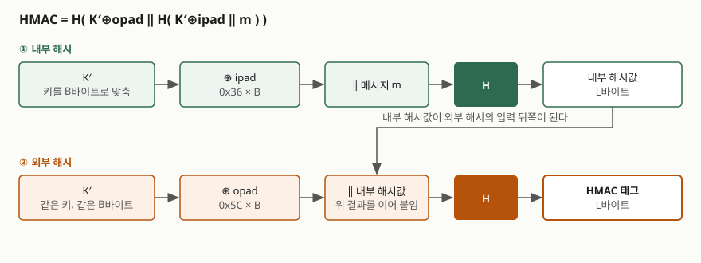
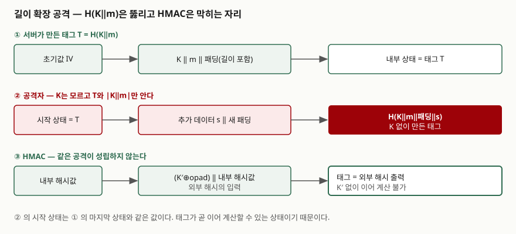

## 들어가며

해시는 데이터가 바뀌었는지 알아내는 도구이지만, 해시만 붙여 보낸 메시지는 누구든 바꿀 수 있다. 공격자가 데이터를 고치고 해시도 새로 계산해 붙이면 그만이기 때문이다. 그래서 "비밀 키를 메시지 앞에 붙여 해시하면 키를 아는 사람만 만들 수 있다"는 생각이 자연스럽게 나온다. 이 구성이 `H(key‖msg)`이고, 직관적으로는 맞아 보인다. 정보관리기술사 시험에서는 메시지 인증 코드(MAC)와 해시 응용 문항에서 이 구성이 왜 안전하지 않은지, HMAC이 무엇을 바꿨는지를 묻는다. 답안에서 점수가 갈리는 곳은 "이중 해시다"라는 외형이 아니라 **외부 해시가 내부 해시값을 가려서 이어 계산을 막는다**는 이유다.

> 실행 검증 없음. RFC 2104와 NIST 표준 문서를 근거로 정리했다. 해시 속도나 공격 비용 같은 측정값은 싣지 않았다.

---

## 정의

**HMAC(Hash-based Message Authentication Code)은 비밀 키와 반복형 해시 함수 H를 결합해, 키를 아는 당사자만 만들고 검증할 수 있는 메시지 인증 코드를 만드는 구성이다.** RFC 2104(1997년 2월, Krawczyk·Bellare·Canetti)는 이를 `H(K XOR opad, H(K XOR ipad, text))`로 정의한다. 이 RFC는 인터넷 표준이 아니라 정보 제공(Informational) 문서이고, NIST는 같은 구성을 FIPS 198-1(2008년 7월)로 표준화했다. 다만 2025년 6월 NIST 쪽 안내에 FIPS 198-1을 철회하고 내용을 SP 800-224로 옮기자는 제안이 올라와 있으므로, 인용할 때는 현재 상태를 한 번 더 확인한다.

**길이 확장 공격(Length Extension Attack)은 `H(m)`과 `m`의 길이만 알면 `m`의 내용을 모르고도 `H(m‖패딩‖추가 데이터)`를 계산해 내는 공격이다.** 해시 내부 구조(Merkle–Damgård 구조)의 성질이지, 특정 구현의 버그가 아니다.

## 등장 배경

해시 함수가 처음부터 인증용으로 설계된 것은 아니다. 인증이 필요해지자 해시에 키를 섞는 임시방편이 여럿 나왔는데, 키를 어디에 두느냐에 따라 약점이 달랐다.

첫째, 키를 앞에 붙인 `H(K‖m)`은 길이 확장 공격에 걸린다. 둘째, 키를 뒤에 붙인 `H(m‖K)`은 길이 확장은 막지만, 같은 길이의 충돌 쌍 `m1`, `m2`(`H(m1)=H(m2)`)를 찾으면 어떤 키를 붙여도 두 메시지의 태그가 같아진다. 그러면 해시의 충돌 저항성이 곧바로 인증의 약점이 된다. 셋째, 양쪽에 붙인 `H(K‖m‖K)`은 두 약점을 줄이지만 설계 근거가 약하다. 이 상황에서 RFC 2104는 해시 함수를 **수정하지 않고 블랙박스로 호출하는** 구성을 내놓았고, 보안 분석이 해시의 성질로 환원되도록 설계했다. 해시가 바뀌어도 구성을 그대로 두고 갈아 끼울 수 있다는 점(RFC 2104 §6)도 장점으로 꼽힌다.

## 구성요소 — HMAC의 7단계

RFC 2104 §2는 B를 해시의 블록 길이(바이트), L을 출력 길이(바이트)로 두고 HMAC 계산을 **7단계**로 적는다. MD5·SHA-1 예에서는 B=64다. ipad는 바이트 `0x36`을 B번 반복한 값, opad는 `0x5C`를 B번 반복한 값이다.

| 단계 | 동작 |
|---|---|
| ① | 키 K 뒤에 0을 채워 B바이트로 만든다 (K가 B보다 길면 먼저 H로 줄여 L바이트로 만든 뒤 채운다) |
| ② | ①의 결과를 ipad와 XOR한다 |
| ③ | ②의 결과 뒤에 메시지(text)를 붙인다 |
| ④ | ③에 H를 적용한다 — 내부 해시값 |
| ⑤ | ①의 결과를 opad와 XOR한다 |
| ⑥ | ⑤의 결과 뒤에 ④의 내부 해시값을 붙인다 |
| ⑦ | ⑥에 H를 적용한 값이 HMAC 태그다 |

키 길이에 대해 RFC 2104 §3은 어떤 길이도 허용하되 **L바이트보다 짧은 키는 강도를 떨어뜨리므로 권하지 않고**, L바이트보다 긴 키는 안전해도 강도가 의미 있게 늘지는 않는다고 적는다. 출력 절단(§5)은 왼쪽 t비트를 쓸 수 있으며 **t를 해시 출력 길이의 절반 이상, 그리고 80비트 이상**으로 권한다.

## 도식 — HMAC의 구조

> **출처**: [RFC 2104 §2 Definition of HMAC](https://www.rfc-editor.org/rfc/rfc2104#section-2)

답안지에는 박스 4개(`K′⊕ipad ‖ m` → `H` → `K′⊕opad ‖ 내부값` → `H`)만 옮겨도 구조가 전달된다. 같은 키가 서로 다른 두 상수로 두 번 쓰이고, **안쪽 출력이 바깥쪽 입력이 된다**는 점이 핵심이다.

## 동작 원리 — 길이 확장 공격이 성립하는 이유

SHA-1, SHA-256, SHA-512 같은 해시는 메시지를 패딩해 블록 단위로 나누고, 이전 블록까지의 내부 상태를 다음 블록 처리의 시작값으로 넘기며 계산한다. FIPS 180-4의 패딩 규칙(§5.1)은 메시지 뒤에 비트 1, 0 여러 개, 그리고 **메시지 길이를 적은 필드**를 붙이는 것이다. 마지막 블록을 처리하고 나면 내부 상태가 곧 출력값이다.

이 구조에서 `T = H(K‖m)`은 "K‖m‖패딩을 처리한 뒤의 내부 상태"를 그대로 드러낸다. 공격은 **3단계**다.

① 공격자는 `m`, `T`, 그리고 키 길이(모르면 가능한 길이를 하나씩 시도한다)를 안다. 이로부터 `K‖m`의 패딩이 어떤 바이트열인지 계산할 수 있다 — 패딩은 길이에만 의존하고 내용에는 의존하지 않기 때문이다.
② 해시의 시작 상태를 IV 대신 `T`로 놓고, 추가 데이터 `s`를 이어서 처리한다. 길이 필드는 패딩과 `s`를 합친 길이로 맞춘다.
③ 결과는 `H(K‖m‖패딩‖s)`이고, 서버가 같은 메시지 `m‖패딩‖s`에 대해 계산하는 값과 일치한다. 키를 모르는데 유효한 태그가 만들어졌다.

공격자가 만든 메시지 `m‖패딩‖s`의 중간에 패딩 바이트가 끼어 있다는 점이 한계로 보일 수 있다. 하지만 파라미터를 `&`로 이어 붙이는 요청 형식처럼 **뒤에 오는 값이 앞의 값을 덮어쓰는 규약**에서는 이 한계가 쓸모를 잃는다.

> **출처**: [FIPS 180-4 Secure Hash Standard §5.1 Padding the Message](https://csrc.nist.gov/pubs/fips/180-4/upd1/final), [RFC 2104 §2](https://www.rfc-editor.org/rfc/rfc2104#section-2)

HMAC이 이를 막는 이유는 **태그가 내부 상태의 연장선이 아니기** 때문이다. HMAC의 출력은 `K′⊕opad`가 앞에 붙은 외부 해시의 결과이므로, 공격자가 그 값에서 이어 계산하려면 외부 해시의 입력 앞부분(`K′⊕opad`)과 내부 해시값을 알아야 한다. 내부 해시값은 외부 해시 안에 들어가 밖으로 나오지 않고, `K′`는 공격자가 모른다. 이어 붙일 자리가 있어도 그 위에서 시작할 상태가 없다.

## 비교 — 키를 해시에 섞는 방법

| 구성 | 길이 확장 | 남는 약점 |
|---|---|---|
| `H(K‖m)` | 성립한다 (MD 구조 해시) | 태그에서 이어 계산할 수 있다 |
| `H(m‖K)` | 성립하지 않는다 | 해시 충돌 쌍이 있으면 어떤 키에서도 두 메시지의 태그가 같다 |
| `HMAC-H(K, m)` | 성립하지 않는다 | 해시의 충돌 저항성에 대한 의존이 직접 구성보다 낮다(RFC 2104 §6) |

SHA-3(FIPS 202)은 스펀지 구조라 출력이 내부 상태 전체가 아니고, 출력에 드러나지 않는 용량(capacity) 부분이 상태에 남는다. 그래서 길이 확장이 성립하지 않는다. SHA-2 계열 중에서도 출력을 잘라 쓰는 SHA-384, SHA-512/256은 내부 상태 일부가 출력에 나오지 않아 같은 이유로 막힌다. 그래도 관행은 해시 종류와 무관하게 HMAC을 쓰는 쪽이다. 해시를 바꿔도 키 결합 방식을 다시 검토하지 않아도 되기 때문이다.

## 적용 시 고려사항

① **해시 선택** — 새 설계에서는 SHA-256 이상의 HMAC을 쓴다. RFC 2104 §6은 구성이 해시의 충돌 저항성 전체가 아니라 그보다 약한 성질에 기대므로, 충돌이 알려진 해시로 만든 HMAC이 곧바로 무너지는 것은 아니라고 설명한다. 그렇다고 새 시스템에서 충돌이 알려진 해시를 고를 이유는 되지 못한다.

② **키 길이와 생성** — 키는 해시 출력 길이(L바이트) 이상으로, 난수 발생기에서 뽑는다. 사람이 고른 문자열을 키로 쓰면 HMAC이 아니라 키 후보를 추측하는 공격 대상이 된다. 패스워드에서 키를 만든다면 키 스트레칭(KDF)을 먼저 거친다.

③ **태그 비교** — 계산한 태그와 받은 태그를 **일정 시간(constant-time)** 비교로 맞춘다. 앞 바이트부터 비교해 처음 다른 곳에서 끝내는 일반 비교는 응답 시간 차이로 태그를 한 바이트씩 알아내는 타이밍 공격의 길을 연다.

④ **재전송 방어** — HMAC은 메시지가 바뀌지 않았음을 증명할 뿐, 같은 메시지를 다시 보내는 것은 막지 못한다. 순번, 타임스탬프, 논스를 메시지에 넣어 HMAC 안에 포함시킨다.

⑤ **절단** — 태그를 줄이면 공격자가 맞출 확률이 올라간다. 절단은 해시 길이의 절반 이상, 80비트 이상으로 한다(RFC 2104 §5).

## 정리

- **정의** — HMAC은 `H(K′⊕opad ‖ H(K′⊕ipad ‖ m))`이다. **7단계**(키 패딩 → ipad → 메시지 → 내부 H → opad → 내부값 → 외부 H).
- **약점의 원인** — `H(K‖m)`은 태그가 곧 내부 상태이므로 이어서 계산된다. **길이 확장은 3단계**(패딩 계산 → 상태 복원 → 추가 데이터 처리).
- **막는 방법 3가지** — HMAC, SHA-3(스펀지), 출력을 자른 SHA-2(SHA-384·SHA-512/256). 관행은 HMAC이다.
- **암기 단서** — "**안쪽 값은 바깥쪽 입력으로 숨는다**." 이어 붙일 시작점이 공개되지 않으면 확장도 없다.

> 기출 답안: [기출문제 — 단방향 해시 함수의 문제점과 레인보우 테이블, 솔트·키 스트레칭, 활용](../../exam/2026-11-05-one-way-hash-rainbow-salt-stretching/index.md)

## 참고 자료

- [RFC 2104 — HMAC: Keyed-Hashing for Message Authentication](https://www.rfc-editor.org/rfc/rfc2104) (1997-02)
- [FIPS 198-1 — The Keyed-Hash Message Authentication Code (HMAC)](https://csrc.nist.gov/pubs/fips/198-1/final) (2008-07)
- [FIPS 180-4 — Secure Hash Standard (SHS)](https://csrc.nist.gov/pubs/fips/180-4/upd1/final) (2015-08)
- [FIPS 202 — SHA-3 Standard](https://csrc.nist.gov/pubs/fips/202/final) (2015-08)
