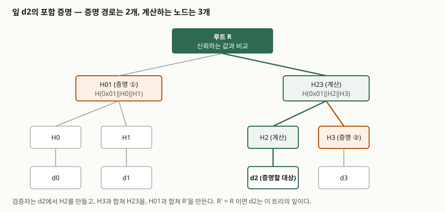

## 들어가며

데이터가 100만 건 들어 있는 집합에서 "이 한 건이 정말 그 집합에 속하는가"를 확인한다고 하자. 가장 단순한 방법은 집합 전체를 내려받아 하나로 해시한 뒤 공개된 해시와 비교하는 것이다. 100만 건을 받아야 하고, 한 건이 추가될 때마다 전체를 다시 해시한다. 머클 트리(Merkle tree)는 이 비용을 **확인하려는 건수의 로그 규모**로 줄인다. 블록체인의 경량 검증, 인증서 투명성 로그, 파일 동기화·백업의 변조 검출이 모두 이 구조를 쓰기 때문에 정보관리기술사 시험의 해시 응용·블록체인 문항에서 반복해 나온다. 답안에서는 구조 그림과 "경로 노드 몇 개로 루트를 다시 만드는가"를 설명할 수 있어야 한다.

> 실행 검증 없음. RFC 6962·RFC 9162 본문과 비트코인 백서를 근거로 정리했다. 해시 계산 시간이나 저장 용량 비교 수치는 싣지 않았다.

---

## 정의

**머클 트리(해시 트리)는 데이터 블록(잎)의 해시를 두 개씩 묶어 부모 노드의 해시를 만들고, 이를 루트 하나가 남을 때까지 반복해 만든 이진 트리 형태의 해시 구조다.** 루트 해시 하나가 모든 잎의 내용과 순서를 대표한다. RFC 6962의 **머클 해시 트리 절(§2.1)** 은 이를 Merkle Hash Tree라 부르며 재귀로 정의한다.

**포함 증명(Merkle Inclusion Proof, RFC 6962에서는 감사 경로 Merkle audit path)은 특정 잎에서 루트까지 올라가는 데 필요한, 형제 노드 해시들의 최소 목록이다.** 검증자는 이 목록과 잎 데이터만으로 루트를 다시 계산해 신뢰하는 루트와 비교한다. 같으면 그 잎은 이 트리에 들어 있다.

## 등장 배경

해시 하나로 집합 전체를 덮는 방식은 무결성은 지키지만 **부분 검증**이 안 된다. 해시를 잎마다 하나씩 따로 두는 해시 목록은 부분 검증은 되지만, 검증자가 신뢰해야 할 값이 잎 수만큼 늘어난다. 머클 트리는 그 중간 — **신뢰해야 하는 값은 루트 하나**이고, 부분 검증에 필요한 값은 트리 높이만큼이다.

이 구조는 제안자 Ralph Merkle의 이름을 따서 부르며, 오늘날에는 **대량 데이터의 포함·무결성 증명**에 널리 쓰인다. 비트코인 백서 §7은 블록 해시에 거래를 직접 넣지 않고 머클 트리를 거쳐 루트만 포함시키는 이유를 디스크 공간 회수로 든다. 오래된 거래를 가지치기해도 블록 해시가 깨지지 않기 때문이다.

## 구성요소와 절차

### 구성요소 4가지

| 요소 | 뜻 |
|---|---|
| ① 잎(leaf) | 데이터 블록의 해시. RFC 6962는 `H(0x00 ‖ 데이터)`로 정한다 |
| ② 내부 노드 | 두 자식 해시를 이어 붙여 해시한 값. RFC 6962는 `H(0x01 ‖ 왼쪽 ‖ 오른쪽)`로 정한다 |
| ③ 루트(root) | 최상위 노드. 서명되거나 블록 헤더에 실려 신뢰의 기준이 된다 |
| ④ 증명 경로(audit path) | 잎에서 루트까지 형제 노드 해시를 모은 목록 |

잎과 내부 노드의 입력 앞에 서로 다른 접두 바이트(`0x00`, `0x01`)를 붙이는 것을 **도메인 분리(domain separation)** 라 한다. RFC 6962는 이것이 제2 역상 저항성에 필요하다고 설명한다. 접두가 없으면 내부 노드 값(두 해시를 이은 것)을 잎 데이터로 내미는 위조가 가능해진다.

### 트리 구성 규칙

RFC 6962의 **같은 절(§2.1)** 은 잎이 n개일 때 **n보다 작은 2의 거듭제곱 중 가장 큰 k**를 잡아 왼쪽 k개와 오른쪽 나머지로 나눠 재귀한다. 잎이 하나면 잎 해시, 비어 있으면 빈 문자열의 해시다. 잎이 2의 거듭제곱 개가 아니어도 노드를 복제하지 않고 트리가 만들어진다.

### 포함 증명 검증 4단계

① 검증자는 증명할 잎 데이터 `d`로 잎 해시 `H(0x00‖d)`를 만든다.
② 증명 경로의 첫 노드와 위치(왼쪽 형제인지 오른쪽 형제인지)에 맞춰 `H(0x01‖왼쪽‖오른쪽)`을 계산한다.
③ 경로 끝까지 한 칸씩 올라가며 ②를 반복한다.
④ 마지막에 나온 값 `R′`을 신뢰하는 루트 `R`과 비교한다. 같으면 포함이 증명된다.

RFC 6962의 예(잎 7개)에서 증명 경로 길이는 잎에 따라 2~3개다. 잎 7개짜리 전체 목록을 보내는 것과 비교하면 경로 노드 수가 로그 규모로 줄어든다는 것이 보인다.

## 도식 — 잎 4개 트리와 포함 증명

> **출처**: [RFC 6962 §2.1.1 Merkle Audit Paths](https://www.rfc-editor.org/rfc/rfc6962#section-2.1.1)

그림은 잎 4개에서 `d2`를 증명하는 경우다. 증명자가 주는 것은 `H3`과 `H01` **두 개**이고, 검증자가 계산하는 것은 `H2`, `H23`, `R′` **세 개**다. 답안지에는 트리를 3층으로 그리고 증명 경로에 해당하는 노드 둘만 표시하면 된다.

## 쓰임 — 블록체인과 인증서 투명성

**① 블록체인의 경량 검증(SPV).** 비트코인 백서 §8은 풀 노드를 돌리지 않고 결제를 검증하는 방법을 설명한다. 사용자는 가장 긴 작업증명 체인의 **블록 헤더 사본만** 두고, 거래가 속한 블록과 거래를 잇는 머클 가지(Merkle branch)를 받는다. 거래를 직접 검증할 수는 없지만 체인의 한 지점에 연결되어 있다는 것으로 네트워크가 받아들였음을 본다. 백서 §7은 거래 없는 블록 헤더가 약 80바이트라고 적는다.

**② 인증서 투명성(Certificate Transparency).** RFC 6962(2013년 6월, 실험 문서)는 인증서 발급을 추가 전용(append-only) 로그로 공개하고 로그를 머클 트리로 만든다. 로그가 트리 해시에 서명한 값이 **서명된 트리 헤드(Signed Tree Head)** 다. 로그는 두 가지 증명을 제공한다 — 인증서가 로그에 들어 있음을 보이는 **포함 증명**(§2.1.1)과, 이전 트리가 새 트리의 앞부분임을 보이는 **일관성 증명**(consistency proof, §2.1.2)이다. 후자는 로그가 과거 항목을 지우거나 고치지 않았음을 감시자가 확인하게 한다. RFC 9162(2021년 12월, 실험 문서)가 RFC 6962를 대체하며 해시 알고리즘을 로그 파라미터로 바꾸고 검증 알고리즘을 명시했다.

## 비교 — 해시를 묶는 방법

| 구조 | 신뢰해야 하는 값 | 일부 데이터 검증에 필요한 값 | 갱신 |
|---|---|---|---|
| 전체를 하나로 해시 | 1개 | 전체 데이터 | 전체 재계산 |
| 잎별 해시 목록 | 잎 수만큼 | 잎 하나의 해시 | 해당 항목만 |
| **머클 트리** | **루트 1개** | **트리 높이만큼의 경로 해시** | **잎에서 루트까지 경로만** |
| 해시 체인(블록체인의 블록 연결) | 최신 해시 1개 | 그 사이 모든 블록 | 뒤에 붙이기 |

## 적용 시 고려사항

① **루트의 신뢰** — 증명이 맞아도 루트가 위조됐으면 의미가 없다. 루트는 서명(인증서 투명성)이나 합의(블록체인)로 보호되어야 한다.

② **도메인 분리** — 잎과 내부 노드의 입력에 구분자를 붙이지 않으면 내부 노드를 잎으로 내미는 위조가 가능해진다. 잎이 홀수일 때 마지막 노드를 복제해 짝을 맞추는 구현에서는 서로 다른 잎 목록이 같은 루트를 만들 수 있으므로, 복제 방식을 쓰면 이 점을 따로 막아야 한다.

③ **순서의 의미** — 머클 트리는 잎의 순서도 루트에 반영한다. 순서가 의미 없는 집합이라면 정렬 규칙을 먼저 고정해야 같은 집합이 같은 루트를 만든다.

④ **부재 증명은 별도 문제** — 일반 머클 트리는 "있다"를 증명하지 "없다"를 증명하지 못한다. 부재를 보이려면 잎을 정렬한 트리에서 인접한 두 잎을 증명하는 식의 변형이 필요하다.

⑤ **해시 선택** — 해시 알고리즘이 깨지면 증명도 깨진다. RFC 9162가 해시를 로그 파라미터로 둔 것은 교체 가능성을 열어 두기 위해서다.

## 정리

- **정의** — 잎 해시를 짝지어 올려 루트 하나로 만든 해시 트리. 루트가 모든 잎과 순서를 대표한다.
- **구성요소 4가지** — 잎, 내부 노드, 루트, 증명 경로. 도메인 분리 접두는 `0x00`(잎), `0x01`(내부 노드).
- **포함 증명 4단계** — 잎 해시 → 형제와 결합 → 위로 반복 → 루트 비교.
- **쓰임 2가지** — 블록체인 SPV(헤더 + 머클 가지), 인증서 투명성(포함 증명 + 일관성 증명).
- **암기 단서** — "**루트 하나 믿고, 경로만 받는다**." 증명 크기는 잎 수가 아니라 트리 높이를 따른다.

> 기출 답안: [기출문제 — 단방향 해시 함수의 문제점과 레인보우 테이블, 솔트·키 스트레칭, 활용](../../exam/2026-11-05-one-way-hash-rainbow-salt-stretching/index.md)

## 참고 자료

- [RFC 6962 — Certificate Transparency](https://www.rfc-editor.org/rfc/rfc6962) (2013-06) §2.1 Merkle Hash Trees
- [RFC 9162 — Certificate Transparency Version 2.0](https://www.rfc-editor.org/rfc/rfc9162) (2021-12)
- [Nakamoto, Bitcoin: A Peer-to-Peer Electronic Cash System](https://bitcoin.org/bitcoin.pdf) (2008-10) §7, §8
