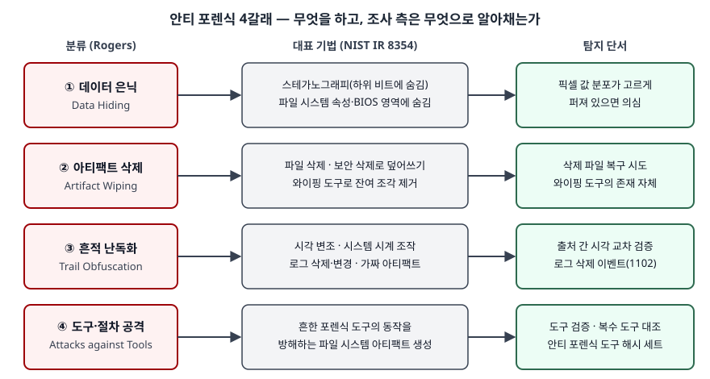

## 들어가며

포렌식 문항은 대부분 "증거를 어떻게 모으고 지키는가"를 묻는다. 그런데 실제 조사에서 결론을
흔드는 것은 수집 절차보다 **누군가 미리 손을 댄 흔적**인 경우가 많다. 지운 파일, 앞뒤가 안 맞는
시각, 중간이 빈 로그 같은 것이다. 안티 포렌식은 이런 방해를 체계로 묶은 개념이고, 기출에서는
아티팩트·디지털 포렌식 문항의 고려사항으로 나오거나 단독 1교시 문항으로 나온다. 점수는 기법
이름을 늘어놓는 데서가 아니라 **분류 체계와 탐지 단서, 시스템이 미리 할 일**을 쓰는 데서 난다.

> **실행 검증 없음.** NIST IR 8354, NIST SP 800-82r3, Microsoft 공식 문서와 학술 논문 근거로
> 정리했다. Harris·Rogers 논문은 원문을 열지 못해 2026년 SoK 논문과 Conlan 등 논문 초록이 옮긴
> 문장으로 재인용했다.

이 글은 개념과 탐지를 다룬다. 기법을 수행하는 절차는 다루지 않는다.

---

## 정의

**안티 포렌식(Anti-forensics)은 컴퓨터 사용자가 향후의 조사관을 오도하거나 조사를 방해하려고
취하는 능동적 조치와 기법이다.** NIST IR 8354 용어집의 정의이고, 같은 항목이 흔한 방법으로
**5가지**를 든다 — ① 관련 파일 삭제, ② 가짜 아티팩트 생성, ③ 시각(타임스탬프) 변조, ④ 로그 파일
변경, ⑤ 흔한 포렌식 도구의 동작을 방해하는 파일 시스템 아티팩트 생성.

정의는 출처마다 범위가 다르다. 통일하지 말고 차이를 그대로 쓰는 편이 답안에 유리하다.

| 출처 | 정의의 요지 | 무엇에 초점을 두는가 |
|---|---|---|
| Rogers (2006) | 범죄 현장 증거의 **존재·양·질**에 부정적 영향을 주려는 시도 | 증거 자체 |
| Harris (2006) | 포렌식 과정에 대해 증거의 **가용성이나 유용성**을 훼손하려는 모든 시도 | 증거의 쓸모 |
| Conlan 외 (2016) | 과학적으로 타당한 포렌식 조사를 **바꾸거나 방해하거나 무력화하는** 모든 시도 | 조사 과정 |
| NIST IR 8354 (2022) | 사용자가 향후 조사관을 **오도하거나 방해**하려는 능동적 조치와 기법 | 행위자의 의도 |

NIST가 "능동적 조치"로 범위를 좁힌 데는 이유가 있다. 같은 문서의 안티 포렌식 절(§4.7.2)은 정보를 숨기는 이유가
**사생활 보호일 수도, 부정행위 은폐일 수도, 조사관 오도일 수도 있다**고 적는다. 흔적이 없다는
사실만으로 의도를 단정할 수 없다는 뜻이다.

## 등장 배경

컴퓨터는 사용자에게 보여 주는 것보다 훨씬 많은 데이터를 저장하고, 포렌식은 그 부산물인 아티팩트로
사건을 재구성한다(NIST IR 8354 요약). 흔적이 시스템의 일상 동작에서 생긴다는 점이 포렌식의 힘인데,
같은 이유로 **흔적이 생기는 자리를 아는 사람은 그 자리를 비우거나 바꿀 수 있다.**

방해 수단은 전용 도구로 퍼졌다. Conlan 등은 안티 포렌식 도구 **308개**를 모아 분류했고, 그중 공개
도구 191개의 설치 파일 해시 2,780개를 NIST의 2016년 국가 소프트웨어 참조 라이브러리(NSRL)와
대조했더니 **423개만 일치**했다(논문 초록). 조사 측이 흔히 쓰는 알려진 파일 해시 목록으로는 이런
도구를 대부분 알아보지 못한다는 뜻이다. 여기에 암호화 프로그램이나 디스크 정리 도구처럼 **원래
안티 포렌식용이 아닌 도구**도 같은 효과를 낸다는 점이 문제를 키운다.

## 구성요소 — 분류 체계

### Harris의 4분류 (2006)

Harris는 안티 포렌식을 처음 학술적으로 다룬 연구로 꼽히고, 기본 분류를 **4가지**로 둔다.

| 분류 | 이름이 가리키는 것 |
|---|---|
| ① 증거 파괴 | 이미 있는 증거를 쓸 수 없게 만든다 |
| ② 증거 은닉 | 증거를 눈에 보이지 않는 곳에 둔다 |
| ③ 증거 출처 제거 | 증거가 생길 자리 자체를 없앤다 |
| ④ 증거 위조 | 거짓 증거를 만들거나 기존 증거를 바꾼다 |

### Rogers의 4분류 (2006)

뒤의 확장 분류가 바탕으로 삼은 것은 Rogers의 분류다. 범주 이름으로 보면 기법이 **무엇을
겨냥하는가**로 나뉜다.

| 분류 | 겨냥하는 것 | NIST IR 8354가 드는 대표 기법 |
|---|---|---|
| ① 데이터 은닉 (Data Hiding) | 데이터의 위치 | 스테가노그래피, 파일 시스템 속성이나 BIOS 영역에 숨기기 |
| ② 아티팩트 삭제 (Artifact Wiping) | 데이터의 존재 | 파일 삭제, 운영체제의 보안 삭제로 덮어쓰기, 와이핑 도구로 잔여 조각 제거 |
| ③ 흔적 난독화 (Trail Obfuscation) | 데이터의 의미 | 시각 변조, 시스템 시계 조작, 로그 삭제·변경 |
| ④ 도구·절차 공격 (Attacks against Tools) | 조사 수단 | 흔한 포렌식 도구의 동작을 방해하는 파일 시스템 아티팩트 생성 |

### Conlan 등의 확장 분류 (2016)

Conlan 등은 Rogers 분류를 바탕으로 용어를 표준화하려고 분류를 확장했다. 2026년 SoK 논문의 정리로는
**스테가노그래피와 암호화를 데이터 은닉에서 떼어 독립 범주로 두고**, 나머지 데이터 은닉·도구와
방법에 대한 공격·흔적 난독화·아티팩트 삭제를 유지해 **6개 범주**가 된다. 논문 초록은 여기에
**"안티 포렌식 활동의 가능한 징후"** 범주를 따로 두었다고 밝힌다. 원래 그런 목적이 아닌 소프트웨어,
상황, 아티팩트라도 시스템에 안티 포렌식 활동이 있었음을 가리킬 수 있다는 범주다.

## 도식

> **출처**: [NIST IR 8354 §4.7.2 Anti-Forensics, Appendix A Glossary](https://nvlpubs.nist.gov/nistpubs/ir/2022/NIST.IR.8354.pdf) — 대표 기법, 스테가노그래피 탐지, 와이핑 도구의 존재 · [Microsoft Learn — 1102(S) The audit log was cleared](https://learn.microsoft.com/en-us/previous-versions/windows/it-pro/windows-10/security/threat-protection/auditing/event-1102) · [Conlan, Baggili, Breitinger (2016)](https://digitalcommons.newhaven.edu/electricalcomputerengineering-facpubs/54) — 해시 세트. 분류 이름은 SoK 논문이 옮긴 Rogers 분류이고, 기법을 각 분류에 대응시킨 것은 분류 이름에 따라 정리한 것이다

답안에는 왼쪽 네 칸(분류)과 오른쪽 네 칸(탐지 단서)만 옮겨도 된다. 가운데 칸은 말로 풀어 쓴다.

## 탐지 — 조사 측이 보는 단서

NIST IR 8354의 결과 분석 절(§4.7)은 결과를 분석할 때 놓치기 쉬운 질문으로 **"조사를 막으려고 안티 포렌식을 썼는가",
"시각 정보는 정확한가", "기기 사용자가 아닌 누군가가 거짓 증거를 심었는가"** 를 든다. 이 질문에 답하는
단서를 분류별로 정리하면 다음과 같다.

| 분류 | 단서 | 근거 |
|---|---|---|
| 데이터 은닉 | 변조하지 않은 사진은 픽셀 색 값이 주된 색 주변에 몰리는데, 값이 **고르게 퍼져 있으면** 무언가 숨겨졌을 수 있다 | NIST IR 8354 §4.7.2 |
| 아티팩트 삭제 | 단순 삭제는 복구될 수 있다. 덮어쓰기까지 했더라도 **와이핑 도구가 설치돼 있다는 사실 자체**가 데이터를 지우려 한 노력을 시사할 수 있다 | NIST IR 8354 §4.7.2 |
| 흔적 난독화 | Windows 보안 로그를 지우면 그 자리에 **이벤트 1102**가 남고 지운 계정의 SID·이름·로그온 ID가 기록된다. Microsoft는 평소엔 볼 일이 없는 이벤트이므로 감시하라고 권고한다. 시각 변조는 **여러 출처의 시각을 시간표 도구로 한 줄에 세워** 앞뒤가 맞는지 본다 | Microsoft Learn, NIST IR 8354 §4.7.1 |
| 도구·절차 공격 | 한 도구 결과만 믿지 않고 **검증된 도구로 대조**한다. 안티 포렌식 도구 자체는 **전용 해시 세트**로 찾는다 | NIST IR 8354 §4.8, Conlan 외 |

다만 NIST는 핵심 시사점(KT #4.3)에서 **누군가 조사관을 오도하려고 디지털 증거를 바꿨다면 그 변경을
탐지하기 어려울 수 있고, 의도적 변경을 알아내는 일은 조사관의 역량에 달려 있다**고 적는다. 탐지
단서는 확증이 아니라 추가 조사의 출발점이다.

## 비교

### 세 분류 체계의 대응

| Harris (2006) | Rogers (2006) | Conlan 외 (2016) |
|---|---|---|
| 증거 은닉 | 데이터 은닉 | 데이터 은닉 · 스테가노그래피 · 암호화 |
| 증거 파괴 | 아티팩트 삭제 | 아티팩트 삭제 |
| 증거 위조 | 흔적 난독화 | 흔적 난독화 |
| 증거 출처 제거 | (해당 범주 없음) | (해당 범주 없음) |
| (해당 범주 없음) | 도구·절차 공격 | 도구와 방법에 대한 공격 |
| (해당 범주 없음) | (해당 범주 없음) | 가능한 징후 |

이 대응표는 범주 이름으로 맞춘 것이고, 원 논문들이 서로를 이렇게 대응시킨 것은 아니다. 이름으로
읽으면 Harris는 **증거에 일어난 결과**로, Rogers는 **기법이 겨냥하는 대상**으로 나눈다.

### 인접 개념과의 구분

| 개념 | 무엇 | 안티 포렌식과의 차이 |
|---|---|---|
| 디지털 포렌식 | 증거를 모으고 분석해 사건을 재구성하는 활동 | 안티 포렌식은 그 반대편에서 같은 아티팩트를 겨냥한다 |
| 개인정보 보호용 삭제·암호화 | 정당한 목적의 데이터 보호 | 기법이 같을 수 있다. NIST는 숨김의 이유가 사생활 보호일 수도 있다고 적는다. 차이는 **의도와 맥락**이다 |
| 로그 순환·보존 기간 만료 | 운영 정책에 따른 정상 삭제 | 정책 문서와 일치하면 정상이다. 정책 밖의 공백이 단서가 된다 |

## 적용 시 고려사항 — 정보시스템이 미리 갖출 대비

**로그 원본을 그 기기 밖에 둔다.** 기기 안의 로그는 그 기기의 관리자 권한을 얻은 사람이 지울 수 있다.
NIST SP 800-82r3은 네트워크·컴퓨팅 장비가 이벤트를 기록하게 하고 **중앙 로그 관리 플랫폼**으로 보존·
감시·분석을 지원하라고 권고하며, 로그 보존 기간을 정하고 저장 공간을 확보하라고 적는다(§5.2.3.2).
중앙에 사본이 있으면 원본이 지워져도 비교할 기준이 남는다.

**시각을 동기화해 둔다.** 시각 변조는 여러 출처의 시각이 서로 어긋나는 데서 드러난다. 그 비교가
뜻을 가지려면 평소에 기기 시각이 맞아 있어야 한다. 800-82r3은 시각 동기화가 **이벤트와 로그의 상관
분석**, 인증, 접근 통제에 중요하다고 적는다(§6.2.12). 동기화가 안 된 환경에서는 변조와 단순한 시계
오차를 가를 수 없다.

**로그 삭제 자체를 감시 대상으로 둔다.** 이벤트 1102처럼 로그를 지웠다는 사실이 남는 이벤트를
경보로 연결해 두면, 흔적 난독화가 오히려 가장 먼저 눈에 띄는 단서가 된다.

**알려진 파일 목록만 믿지 않는다.** Conlan 등의 대조 결과처럼 안티 포렌식 도구는 표준 해시 목록에
대부분 없다. 저자들도 초록에서 **안티 포렌식 도구 해시 데이터 세트를 망라해 만들고 유지할 필요**를
든다. 조직은 탐지 규칙에 이런 도구의 설치 흔적을 별도로 넣어야 한다.

**의도를 성급히 단정하지 않는다.** 와이핑 도구나 암호화 프로그램은 정상 업무에도 쓰인다. 조사 보고서는
단서와 결론을 구분해 쓰고, NIST IR 8354가 권하듯 **대안 가설을 검토하고 모순을 기록**한다(§4.7).

> 기출 답안: [기출문제 — 디지털 포렌식의 아티팩트](../../exam/2026-11-07-digital-forensic-artifacts/index.md)
>
> 함께 읽기: [디지털 포렌식 절차와 증거 무결성](../2026-09-28-digital-forensics-process-evidence-integrity/index.md)

## 정리

- **정의**: 사용자가 향후 조사관을 **오도하거나 방해**하려는 능동적 조치와 기법(NIST IR 8354).
  흔한 방법 **5가지** — 파일 삭제, 가짜 아티팩트, 시각 변조, 로그 변경, 도구 방해 아티팩트
- **정의는 4갈래**: 증거 자체(Rogers), 증거의 쓸모(Harris), 조사 과정(Conlan), 행위자 의도(NIST)
- **Harris 4분류**: 파괴 · 은닉 · 출처 제거 · 위조 — 암기 단서 **"파·은·출·위"**
- **Rogers 4분류**: 은닉 · 삭제 · 난독화 · 도구 공격 — 암기 단서 **"숨기고·지우고·흐리고·속인다"**
- **Conlan 확장**: 스테가노그래피·암호화 분리, **가능한 징후** 범주 추가. 도구 308개, NSRL 일치 423/2,780
- **대비 4가지**: 중앙 로그 보존 · 시각 동기화 · 로그 삭제 감시 · 전용 해시 세트

## 참고 자료

- [NIST IR 8354, *Digital Investigation Techniques: A NIST Scientific Foundation Review* (2022-11)](https://nvlpubs.nist.gov/nistpubs/ir/2022/NIST.IR.8354.pdf) — 부록 A 용어집의 안티 포렌식 정의, §4.7 결과 분석의 점검 질문, §4.7.1 시간표 도구, §4.7.2 안티 포렌식 기법과 스테가노그래피 탐지, 핵심 시사점 #4.3, §4.8 도구 검증 (1차)
- [Conlan K, Baggili I, Breitinger F (2016) *Anti-forensics: Furthering digital forensic science through a new extended, granular taxonomy*, Digital Investigation 18:S66–S75](https://digitalcommons.newhaven.edu/electricalcomputerengineering-facpubs/54) — 초록의 도구 308개, 해시 2,780개, NSRL 일치 423개, "가능한 징후" 범주 (1차, 초록만 확인)
- [Schneider J 외 (2026) *SoK: Understanding Anti-Forensics Concepts and Research Practices Across Forensic Subdomains*, arXiv 2604.05770v2](https://arxiv.org/abs/2604.05770) — §II-A의 Rogers·Harris 정의와 분류, Conlan 분류의 범주, 표 I 정의 비교 (1차 논문, Rogers·Harris는 이 논문을 통한 재인용)
- Harris R (2006) *Arriving at an anti-forensics consensus: Examining how to define and control the anti-forensics problem*, Digital Investigation 3:S44–S49 — 원문 미확인, NIST IR 8354 참고문헌 [100]과 SoK 논문을 통해 재인용
- [Microsoft Learn — 1102(S) The audit log was cleared](https://learn.microsoft.com/en-us/previous-versions/windows/it-pro/windows-10/security/threat-protection/auditing/event-1102) — 기록 필드와 감시 권고 (1차)
- [NIST SP 800-82 Rev. 3, *Guide to Operational Technology (OT) Security* (2023-09)](https://csrc.nist.gov/pubs/sp/800/82/r3/final) — §5.2.3.2 중앙 로그 관리, §6.2.12 시각 동기화 (1차)
