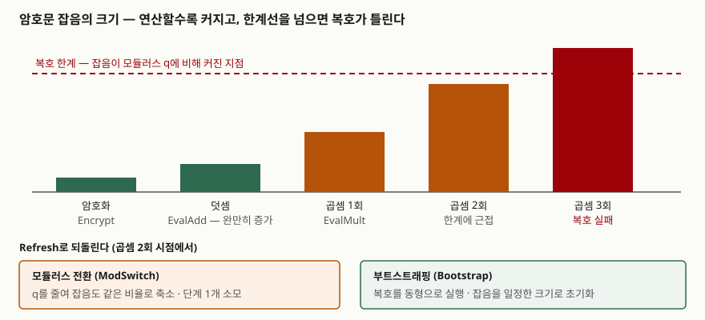

## 들어가며

데이터를 클라우드에 맡겨 분석시키려면 지금까지는 둘 중 하나를 골라야 했다. 평문을 넘기고 상대를 믿거나, 암호문을 넘기고 아무 계산도 시키지 못하거나. 동형암호는 이 사이에 세 번째 선택지를 만든다. 처리자는 암호문만 받아 연산하고, 결과도 암호문으로 돌려준다. 정보관리기술사 시험에서는 개인정보 보호 강화기술(PET) 문항에서 차분 프라이버시·합성데이터와 나란히 묻는다. 점수가 갈리는 곳은 "암호문 상태로 연산한다"는 정의가 아니라 **왜 연산 횟수에 제한이 생기고, 그것을 무엇으로 푸는가**다.

> 실행 검증 없음. HomomorphicEncryption.org 표준 v1.1(2018-11-21), ISO/IEC 18033-6:2019 소개, CKKS 원 논문 초록을 근거로 정리했다. 연산 속도나 평문 대비 배수 같은 성능 수치는 싣지 않았다.

---

## 정의

**동형암호(Homomorphic Encryption)는 암호문끼리 연산한 결과를 복호하면 평문끼리 같은 연산을 한 결과와 같아지도록 설계해, 비밀키 없이도 암호문 상태로 계산을 맡길 수 있게 한 암호 방식이다.**

HomomorphicEncryption.org 표준 v1.1(이하 HE 표준)은 이것을 정확성 조건으로 적는다. C1이 M1의 암호문이고 C2가 M2의 암호문이면, 암호문 덧셈 `EvalAdd`의 출력은 M1+M2의 암호문이어야 하고 곱셈 `EvalMult`의 출력은 M1·M2의 암호문이어야 한다(표준의 표기와 정의 절, §1.1.1). 연산을 맡은 쪽에는 공개키와 별도로 **평가 키(evaluation key)** 를 넘기며, 평가 키만 가진 쪽은 암호문에서 평문에 대한 정보를 얻지 못한다.

## 등장 배경

암호는 오래전부터 데이터를 **저장할 때와 전송할 때** 지켜 왔다. 문제는 **처리할 때**였다. 합계를 내든 모델을 돌리든 평문으로 풀어야 했고, 그 순간 처리자의 메모리에 원본이 놓였다. 외부 위탁 연산에서 가장 약한 구간이 바로 여기다.

덧셈이나 곱셈 하나만 되는 방식은 일찍부터 있었다. Paillier 암호는 암호문을 곱하면 평문이 더해진다. 그러나 덧셈과 곱셈을 **둘 다, 횟수 제한 없이** 하는 방식은 2009년 Gentry가 부트스트래핑을 제안하기 전까지 알려지지 않았다. 덧셈과 곱셈을 모두 할 수 있으면 논리회로 전체를 표현할 수 있으므로, 이론상 어떤 계산이든 암호문 상태로 할 수 있게 된다. 이후 격자 기반 방식(BGV·BFV)이 구현 가능한 수준에 이르자, 방식 설명과 안전한 매개변수 표를 한데 모은 HE 표준(2018-11 v1.1)이 나왔다.

## 구성요소 — 지원 연산에 따른 3분류와 표준 알고리즘 12개

### 분류 3가지

| 분류 | 지원 연산 | 대표 방식 | 근거 |
|---|---|---|---|
| 부분 동형 (PHE) | 덧셈 또는 곱셈 **하나만**, 횟수 제한 없음 | Paillier, 지수형 ElGamal(둘 다 덧셈) | ISO/IEC 18033-6:2019 |
| 준동형 (SHE) · 단계형 (leveled) | 덧셈·곱셈 **둘 다**, 정해진 곱셈 깊이까지 | BGV, BFV, CKKS | HE 표준 §1.1.3, §1.1.5 |
| 완전 동형 (FHE) | 덧셈·곱셈 둘 다, **깊이 제한 없음** | 부트스트래핑을 붙인 BGV·BFV, GSW 계열 | HE 표준 §1.1.4 |

준동형과 단계형은 엄밀히 다르다. 준동형은 "몇 번까지 되는지"가 방식에 묶여 있고, 단계형은 **필요한 깊이를 매개변수로 미리 정해** 그만큼의 키와 모듈러스를 만든다. 실무에서 쓰는 BGV·BFV·CKKS는 대부분 단계형으로 쓰고, 깊이가 모자랄 때만 부트스트래핑을 붙인다.

### HE 표준의 알고리즘 12개 (§1.1.1)

| 묶음 | 알고리즘 | 하는 일 |
|---|---|---|
| 준비 (3) | `ParamGen`, `PubKeygen`, `SecKeygen` | 보안 수준·평문 공간·곱셈 깊이로 매개변수를 정하고 비밀키·공개키·평가 키를 만든다 |
| 암복호 (3) | `PubEncrypt`, `SecEncrypt`, `Decrypt` | 암호화는 무작위화가 필수다. 복호는 실패를 뜻하는 `FAIL`을 낼 수 있다 |
| 연산 (4) | `EvalAdd`, `EvalAddConst`, `EvalMult`, `EvalMultConst` | 암호문+암호문, 암호문+평문 상수에 대한 덧셈·곱셈 |
| 관리 (2) | `Refresh`, `ValidityCheck` | 복잡해진 암호문을 단순한 암호문으로 바꾸고, 주어진 계산이 올바르게 복호될지 미리 판정한다 |

`ParamGen`의 입력 B가 핵심이다. 표준은 BGV에서 B를 **최대 곱셈 깊이**, 곧 연달아 일어나는 곱셈의 최대 횟수로 정의하고, `x1·x2 + x3·x4`의 깊이를 1로 예시한다. 곱셈이 둘이어도 나란히 일어나므로 깊이는 1이다.

표준은 동형암호가 갖춰야 할 성질로 **3가지**를 든다(§1.1.2). 같은 평문도 매번 다른 암호문이 되는 **의미론적 안전성(IND-CPA)**, 연산을 거듭해도 암호문 길이가 연산 복잡도에 따라 늘지 않는 **간결성(compactness)**, 복호 시간이 수행된 연산과 무관한 **효율적 복호**다.

## 도식 — 잡음이 깊이를 묶는 구조

> **출처**: [Homomorphic Encryption Standard v1.1 (2018-11-21) §1.1.1 Refresh, §1.1.3 The Full BGV Scheme, §1.1.4 The GSW Scheme and bootstrapping](https://homomorphicencryption.org/standard/)

답안지에는 막대 네 개(암호화 → 덧셈 → 곱셈 → 복호 한계선)와 그 아래 되돌리는 화살표 둘(모듈러스 전환, 부트스트래핑)만 옮기면 된다.

## 동작 원리 — 왜 깊이에 제한이 생기는가

격자 기반 동형암호의 안전성은 **오류가 섞인 학습(LWE)** 과 그 환(ring) 판인 RLWE 문제가 어렵다는 데 기댄다(HE 표준의 어려운 문제 절, §2.1.1). 그래서 암호문에는 일부러 작은 잡음 e가 들어간다. BGV는 평문을 `pe + M`처럼 잡음의 아랫자리에, BFV는 `W·M + e`(W = ⌊q/p⌋)처럼 윗자리에 싣는다. 복호는 이 잡음이 모듈러스 q에 비해 충분히 작을 때만 성공한다.

연산은 잡음을 키운다. 덧셈은 잡음끼리 더해지는 정도라 완만하다. 곱셈은 잡음끼리, 그리고 잡음과 평문이 서로 곱해지므로 훨씬 가파르게 커진다. 게다가 표준이 적듯 원소 두 개짜리 암호문을 곱하면 원소가 세 개가 되고, d차 다항식을 계산하면 d+1개가 된다. 잡음이 한계선을 넘으면 복호가 틀린 값을 낸다. 곱셈 깊이가 매개변수로 묶이는 이유가 이것이다.

표준의 `Refresh`는 이를 되돌리는 연산을 **3가지** 플래그로 둔다.

| 플래그 | 하는 일 | 대가 |
|---|---|---|
| 재선형화 (Relinearize, 키 전환) | 곱셈으로 늘어난 원소 세 개를 평가 키로 다시 두 개로 줄인다 | 평가 키가 필요하다 |
| 모듈러스 전환 (ModSwitch) | 암호문을 더 작은 모듈러스로 축소해 잡음도 같은 비율로 줄인다 | 쓸 수 있는 모듈러스 단계가 하나 줄어든다 |
| 부트스트래핑 (Bootstrap) | 잡음이 커진 암호문을 같은 평문의 **잡음이 일정한** 암호문으로 바꾼다 | 표준이 "매우 시간이 많이 드는 연산"이라고 적는다 |

부트스트래핑의 원리는 **복호 알고리즘 자체를 동형으로 실행하는 것**이다. 비밀키를 암호화해 평가 키처럼 넘겨 두면, 처리자는 그 암호화된 키로 낡은 암호문을 "암호문 상태로 복호"하고, 그 결과로 잡음이 초기화된 새 암호문을 얻는다. 표준은 BGV·BFV로 부트스트래핑을 하려면 격자 문제가 초다항식 근사 인수에서도 어렵다는 더 강한 가정이 필요하고, GSW 계열로 하면 다항식 인수 가정으로 충분하다고 적는다. 그리고 부트스트래핑은 아직 표준화할 단계가 아닐 수 있다고 밝힌다.

깊이는 결국 **키 크기**로 돌아온다. 깊이가 깊을수록 큰 q가 필요하고, 같은 보안 수준을 지키려면 q가 클수록 차수 n도 커져야 한다. HE 표준의 권장 매개변수 표(Table 1, 균등 분포 비밀키, 128비트 보안)는 n=4096에서 log q를 111비트까지, n=8192에서 220비트까지, n=32768에서 880비트까지 허용한다.

### CKKS — 실수를 근삿값으로

HE 표준은 평문 공간으로 모듈러 정수(MI)와 확장 환(EX) 둘을 두고, **근삿값(AN)** 은 다음 판에 넣겠다고 적는다. 그 자리에 들어갈 방식이 CKKS다. 원 논문(Cheon·Kim·Kim·Song, ASIACRYPT 2017)은 잡음을 평문의 유효 숫자 아래에 두고, 곱셈 뒤 **재조정(rescaling)** 으로 암호문을 작은 모듈러스로 자르면서 평문 크기와 잡음을 함께 줄인다. 그래서 복호값은 정해진 정밀도의 근삿값이고, 모듈러스 비트 수는 회로 깊이에 선형으로만 늘어난다. 잡음을 오차로 받아들이는 대신 실수 연산을 얻은 설계다.

## 비교

### 방식 3가지

| 구분 | BGV | BFV | CKKS |
|---|---|---|---|
| 평문 | 모듈러 정수 Z_p (정확) | 모듈러 정수 Z_p (정확) | 실수·복소수 (근사) |
| 평문을 싣는 자리 | 잡음 아래쪽 (`pe + M`) | 잡음 위쪽 (`W·M + e`) | 잡음 바로 위, 유효 숫자로 |
| 곱셈 후 잡음 관리 | 모듈러스 전환 | 곱셈 중 p/q로 반올림 (스케일 불변) | 재조정 |
| 맞는 계산 | 개수 세기, 정수 집계, 일치 비교 | BGV와 같다 | 통계, 기계학습 추론, 지수·로지스틱 함수 근사 |
| 표준 v1.1 수록 | 기술 (§1.1.3) | 기술 (§1.1.3) | 언급만 (§1.1.5) |

표준은 BGV와 BFV가 "매우 비슷하다"고 적고, 어느 쪽이 빠른지는 구현과 환경에 따라 달라 **열린 연구 문제**로 남긴다. 그러므로 둘 사이의 선택은 성능 우열이 아니라 쓰는 라이브러리와 모듈러스 관리 방식의 선택이다.

### 다른 암호화 상태 처리 기술과

| 구분 | 동형암호 | 다자간 연산 (MPC) | 신뢰 실행 환경 (TEE) |
|---|---|---|---|
| 신뢰 근거 | 격자 문제의 계산적 어려움 | 참여자 일부가 정직하다는 가정 | 하드웨어 제조사와 격리 구현 |
| 통신 | 암호문 전송 한 번, 연산은 처리자 혼자 | 연산 중 참여자 간 통신이 계속 필요 | 일반 연산과 같다 |
| 결과를 받는 쪽 | 비밀키 보유자만 복호 | 정해진 참여자 | 엔클레이브 밖으로 내보낸 쪽 |

## 적용 시 고려사항

① **필요한 곱셈 깊이부터 센다** — 계산을 회로로 펼쳐 연속 곱셈의 최대 횟수를 센 다음, 그 깊이로 모듈러스와 n을 정한다. 깊이를 넉넉히 잡으면 n이 커져 암호문과 키가 함께 커진다. 표준의 `ValidityCheck`가 이 판정을 위한 자리다.

② **데이터 형태로 방식을 고른다** — 정확한 정수 결과(건수, 합계, 일치 여부)가 필요하면 BGV·BFV, 실수 통계나 모델 추론이면 CKKS다. CKKS 결과는 근삿값이므로 경계값 비교(예: 기준 이상인가)에 그대로 쓰면 판정이 뒤집힐 수 있다.

③ **의미론적 안전성이 막지 못하는 것을 따로 막는다** — HE 표준은 처리자가 F 대신 다른 함수 G를 계산해 돌려주는 **능동 공격**을 의미론적 안전성이 배제하지 않는다고 적는다(추가 기능 절, §1.1.6). 결과 검증이 필요하면 별도 수단을 둔다. 또 결과는 결국 평문으로 풀리므로, 한 사람의 값만으로 계산된 결과는 그 사람의 값을 드러낸다.

④ **키 보유자를 설계한다** — 복호할 수 있는 쪽이 하나면 그쪽에 권한이 몰린다. 여러 기관이 함께 쓰는 경우 표준은 분산 키 생성·분산 복호로 t개 기관 중 d개 이상이 협력해야만 복호되는 **임계 동형암호**를 소개한다(§1.1.6).

## 정리

- **정의** — 암호문 연산 결과를 복호하면 평문 연산 결과와 같은 암호. 처리자는 평가 키만 받는다.
- **3분류** — 부분(PHE, 한 연산) · 준·단계형(SHE, 정해진 깊이) · 완전(FHE, 무제한).
- **표준 알고리즘 12개** — 준비 3 · 암복호 3 · 연산 4 · 관리 2. **성질 3가지** — IND-CPA, 간결성, 효율적 복호.
- **Refresh 3종** — 재선형화(원소 수) · 모듈러스 전환(잡음 비율) · 부트스트래핑(잡음 초기화).
- **암기 단서** — "**곱셈이 잡음을 키우고, 깊이가 키를 키운다.**" 정확한 정수는 BGV·BFV, 근사 실수는 CKKS.

> 기출 답안: [기출문제 — 개인정보 보호 강화기술(PET): 정의·분류와 동형암호·차분 프라이버시·합성데이터 비교](../../exam/2026-11-07-privacy-enhancing-technologies-he-dp-synthetic/index.md)
>
> 함께 읽기: [가명처리용 암호 기법 — 형태보존·순서보존·동형 암호가 분석에서 남기는 것과 새는 것](../2026-10-12-pseudonymization-ope-fpe-he-leakage/index.md)

## 참고 자료

- [M. Albrecht et al., Homomorphic Encryption Standard v1.1, HomomorphicEncryption.org (2018-11-21)](https://homomorphicencryption.org/standard/) — §1.1.1 Notation and Definitions, §1.1.2 Properties, §1.1.3 BGV and BFV, §1.1.4 GSW and bootstrapping, §1.1.5 Other Schemes, §1.1.6 Additional Features, §2.1.1 Hard Problems, Table 1
- [ISO/IEC 18033-6:2019, Encryption algorithms — Part 6: Homomorphic encryption](https://www.iso.org/standard/67740.html) — 덧셈 동형 2방식(지수형 ElGamal, Paillier). 본문은 확인하지 못했고 표준 소개의 범위 설명을 따랐다
- [J. H. Cheon, A. Kim, M. Kim, Y. Song, Homomorphic Encryption for Arithmetic of Approximate Numbers, ASIACRYPT 2017 (ePrint 2016/421)](https://eprint.iacr.org/2016/421) — CKKS, 재조정
- [C. Gentry, Fully Homomorphic Encryption Using Ideal Lattices, STOC 2009](https://doi.org/10.1145/1536414.1536440)
- [Z. Brakerski, C. Gentry, V. Vaikuntanathan, (Leveled) Fully Homomorphic Encryption without Bootstrapping, ITCS 2012](https://doi.org/10.1145/2090236.2090262) — BGV
