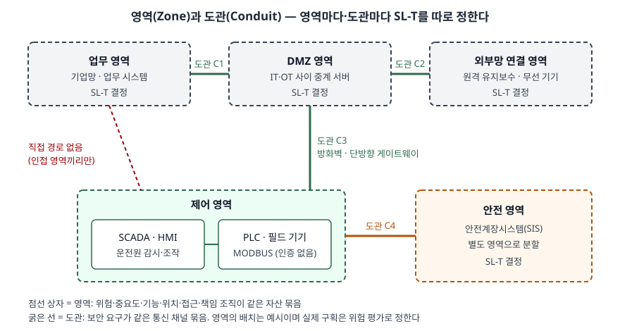
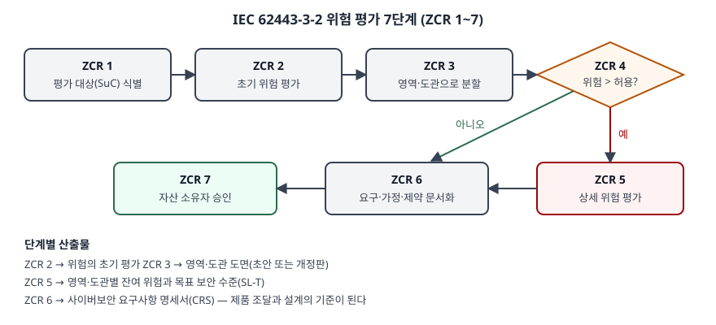

## 들어가며

공장·발전소·수처리 시설의 제어망에는 MODBUS처럼 인증 필드가 아예 없는 프로토콜이 지금도
돈다. 이런 장치는 수십 년을 쓰고 바꾸기 어려워서, 프로토콜을 고치는 대신 **망을 어떻게
나누고 나눈 칸마다 어느 수준까지 지킬지**를 정하는 쪽으로 보안이 설계된다. 그 방법을 정한
국제 표준이 IEC 62443이고, 스마트 팩토리·OT 보안·국가기반시설 문항에서 "영역과 도관",
"보안 수준"이라는 낱말로 반복해 나온다. 정보보호 관리체계(ISMS)를 이미 아는 수험자라면
**무엇이 IT 표준과 다른지**를 쓰는 데서 점수가 갈린다.

> **실행 검증 없음.** 표준 본문은 유료라 열지 못했다. 표준을 만든 ISA가 발행한 공식 개요서
> (ISAGCA Quick Start Guide)와 NIST SP 800-82 Rev. 3 근거로만 정리했다. 개요서는 일부 내용이
> ISA99 위원회 초안에 근거한다고 스스로 밝힌다.

---

## 정의

**ISA/IEC 62443은 산업 자동화·제어 시스템(IACS)의 보안을 수명 주기 전체에 걸쳐 위험 기반으로
다루는 표준 시리즈다.** 자산 소유자·제품 공급자·서비스 제공자가 함께 쓰는 공통 용어와 요구사항을
정의하고, 목표는 IACS의 안전·신뢰성·무결성·보안을 높이는 것이다(개요서 서론).

여기서 IACS는 기술만 가리키지 않는다. 개요서의 정의로 **산업 공정의 운전에 관여하고 그 안전하고
신뢰할 수 있는 운전에 영향을 줄 수 있는 인력·하드웨어·소프트웨어·정책의 집합**이다. 사람과
절차가 범위에 들어간다는 점을 정의에 같이 쓰면 답안이 정확해진다.

표준은 국제자동화협회(ISA)의 ISA99 위원회와 국제전기기술위원회(IEC)의 TC65/WG10이 함께
만든다. 어느 쪽에서 발행해도 기술 내용은 같고, 2-4편만 IEC 쪽이 작성해 ISA가 채택했다.

## 등장 배경

IACS는 지난 20년 동안 제조사 전용 기술에서 Windows·TCP/IP 같은 상용 기술로 옮겨 왔고, 공장
데이터를 업무에 쓰려고 바깥 망과 연결이 늘었다. 그 결과 공격자가 IT에서 쓰던 수단이 그대로
제어망에 닿게 됐다. ISA99 위원회는 처음에 IT 표준을 그대로 적용하려 했지만 충분하지 않다는
결론을 냈다(개요서 요약).

이유는 **피해의 종류가 다르기 때문이다.** IT 침해의 주된 결과는 정보 유출에 따른 금전·사생활
손실인데, IACS에서는 **인명·건강 위해, 환경 피해, 설비 손상, 제품 무결성 상실**이 더해진다.
개요서는 이 네 가지가 물리-사이버 시스템에만 있는 결과라고 적는다. 그 밖에 고장 양상이 더
예측 가능하고, 시간 제약이 엄격하고, 가용성 요구가 높고, 정비 간격과 부품 수명이 훨씬 길다.
그래서 우선순위도 기밀성·무결성·가용성(CIA)이 아니라 **안전·무결성·가용성·기밀성(SIAC)** 순으로
읽는다.

## 구성요소

### 문서 4그룹

시리즈는 주된 독자에 따라 **4그룹 14편**으로 나뉜다. 2025년 6월 기준으로 IEC 표준으로 발행된
것은 일부이고 나머지는 작성 중이다(개요서 표 2).

| 그룹 | 문서 | 주된 독자 |
|---|---|---|
| ① 일반 | 1-1 용어·개념·모델, 1-2 용어집, 1-3 적합성 지표, 1-4 수명 주기와 사용 사례 | 전체 |
| ② 정책·절차 | 2-1 보안 프로그램 수립, 2-2 보안 프로그램 등급, 2-3 패치 관리, 2-4 서비스 제공자 요구사항, 2-5 자산 소유자 이행 지침 | 자산 소유자·서비스 제공자 |
| ③ 시스템 | 3-1 보안 기술, **3-2 시스템 설계를 위한 위험 평가**, **3-3 시스템 보안 요구사항과 보안 수준** | 자산 소유자·통합 사업자 |
| ④ 컴포넌트 | 4-1 제품 보안 개발 수명 주기, 4-2 컴포넌트 기술 보안 요구사항 | 제품 공급자 |

### 영역과 도관

개요서가 옮긴 정의는 다음과 같다.

- **영역(Zone)**: 위험, 또는 자산의 중요도·운전 기능·물리적/논리적 위치·필요한 접근·책임 조직
  같은 기준에 따라 묶은 논리적·물리적 자산의 집합
- **도관(Conduit)**: 둘 이상의 영역을 잇고 **보안 요구가 같은** 통신 채널을 논리적으로 묶은 것

구획의 목적은 보안 특성이 같은 자산을 묶어 **공통 요구사항을 한 번에 정하는 것**이고, 공격이
성공해도 **피해 범위를 그 영역 안으로 묶어 두는** 효과도 있다. 3-2편은 다음 **5가지** 자산을
따로 나누도록 요구하거나 권고한다 — ① 업무 자산과 제어 자산, ② 안전 관련 자산, ③ 임시로
연결되는 기기, ④ 무선 기기, ⑤ 외부망으로 연결되는 기기.

### 위험 평가 7단계 — 3-2편의 ZCR

3-2편의 요구사항은 ZCR(Zone and Conduit Requirement)로 번호가 붙고, 개요서 그림 3은 이를
**7단계** 흐름으로 그린다. ① 평가 대상 시스템(SuC) 식별 → ② 초기 위험 평가 → ③ 영역·도관 분할
→ ④ 초기 위험이 허용 위험을 넘는지 판단 → ⑤ 상세 위험 평가 → ⑥ 보안 요구·가정·제약 문서화 →
⑦ 자산 소유자 승인. 3-2편은 위험 평가 **절차의 요구사항**만 정하고 구체적 방법론은 자산 소유자가
조직의 위험 평가 방법과 맞춰 정하게 둔다. 결과물은 영역·도관 모델과 영역별 목표 보안 수준이고,
이것을 **사이버보안 요구사항 명세서(CRS)** 에 적는다.

### 기본 요구사항 7가지(FR)

기술 요구사항은 모두 다음 **7가지 기본 요구사항**에서 나온다. 3-3편(시스템)과 4-2편(컴포넌트)이
이 순서로 요구사항을 정리한다.

| 번호 | 기본 요구사항 | 약어 |
|---|---|---|
| FR 1 | 식별·인증 통제 | IAC |
| FR 2 | 사용 통제 | UC |
| FR 3 | 시스템 무결성 | SI |
| FR 4 | 데이터 기밀성 | DC |
| FR 5 | 데이터 흐름 제한 | RDF |
| FR 6 | 이벤트 적시 대응 | TRE |
| FR 7 | 자원 가용성 | RA |

FR 1과 FR 2를 합치면 접근 통제인데, 요구사항 수를 감당할 만한 크기로 두려고 둘로 나눴다.
영역·도관 구획이 직접 닿는 것은 **FR 5 데이터 흐름 제한**이다.

### 보안 수준 4단계와 3유형

**보안 수준(SL)** 은 평가 대상 시스템·영역·도관에 취약점이 없고 의도대로 동작한다는 **확신의
정도**다. 3-3편은 이를 공격자의 수단·자원·기술·동기로 나눠 **4단계**로 정한다.

| SL | 막는 대상 | 수단 | 자원 | 기술 | 동기 |
|---|---|---|---|---|---|
| 1 | 우연하거나 부주의한 위반 | — | — | — | — |
| 2 | 의도적 위반 | 단순 | 적음 | 일반 | 낮음 |
| 3 | 의도적 위반 | 정교 | 중간 | IACS 특화 | 중간 |
| 4 | 의도적 위반 | 정교 | 많음 | IACS 특화 | 높음 |

SL 2와 3을 가르는 것이 **IACS 특화 기술**이라는 점이 답안에서 자주 묻는 지점이다. 그리고 같은
낱말을 세 시점에 따로 쓴다.

| 유형 | 정하는 시점 | 무엇 |
|---|---|---|
| **SL-T** 목표 | 위험 평가(3-2) | 해당 자동화 솔루션에 바라는 수준. CRS에 적고 제품 선정과 추가 대책 설계에 쓴다 |
| **SL-C** 능력 | 제품 개발(3-3·4-2) | 시스템·컴포넌트가 바르게 통합·설정됐을 때 **보완 대책 없이** 낼 수 있는 수준 |
| **SL-A** 달성 | 운영 중 | 시운전 뒤 실제로 측정한 수준. 2-2편이 운영 절차와 합쳐 보안 프로그램 등급을 매긴다 |

설계의 기본 판단은 **SL-C ≥ SL-T** 인 제품을 고르고, 모자라면 그 차이를 보완 대책으로 메우는
것이다.

## 도식

> **출처**: [ISAGCA, *Quick Start Guide: An Overview of ISA/IEC 62443 Standards*](https://isasecure.org/hubfs/2023%20ISA%20Website%20Redesigns/ISAGCA/PDFs/ISAGCA%20Quick%20Start%20Guide%20FINAL.pdf) — Zones and Conduits, Security Levels · [NIST SP 800-82 Rev. 3 §5.2.3.1 Network Architecture](https://csrc.nist.gov/pubs/sp/800/82/r3/final) — 인접 영역 사이만 허용하는 방화벽 규칙, DMZ, 단방향 게이트웨이

> **출처**: [ISAGCA, *Quick Start Guide: An Overview of ISA/IEC 62443 Standards*](https://isasecure.org/hubfs/2023%20ISA%20Website%20Redesigns/ISAGCA/PDFs/ISAGCA%20Quick%20Start%20Guide%20FINAL.pdf) — Figure 3 Risk Assessment Process (그림의 문서화 단계 번호가 "ZCR 4"로 찍혀 있으나 순서상 ZCR 6이다)

답안에는 첫 그림을 쓴다. 점선 상자 넷과 굵은 선 넷, 그리고 업무 영역에서 제어 영역으로 가는
**직접 경로가 없다는 표시**면 된다. NIST SP 800-82r3도 방화벽 규칙은 **인접한 단계·영역 사이의
연결만 허용**하라고 권고하고, 제어망에서 나가는 방향의 규칙도 들어오는 방향만큼 엄격하게 하라고
적는다.

## 비교

### 보안 수준과 성숙도 수준

| | 보안 수준(SL) | 성숙도 수준(ML) |
|---|---|---|
| 재는 것 | 기술 요구사항의 강도 | 절차(사람·정책·절차)를 얼마나 철저히 지키는가 |
| 단계 | 1~4 | 1 초기 · 2 관리 · 3 정의(실천) · 4 개선 |
| 쓰는 문서 | 3-3, 4-2 | 2-1, 2-2, 2-4, 4-1 |
| 근거 | 공격자의 수단·자원·기술·동기 | CMMI. 4·5단계를 하나로 합쳤다 |

### 인접 표준·모델과의 관계

| 대상 | 무엇 | IEC 62443과의 관계 |
|---|---|---|
| ISO/IEC 27001 | 모든 조직에 쓰는 정보보호 관리체계 요구사항 | 개요서는 IACS 보안 프로그램을 조직 전체 ISMS와 **조율**하라고 한다. ISMS가 거버넌스를, 62443이 IACS 고유 요구를 맡는다 |
| NIST SP 800-82r3 | 미국 연방 OT 보안 지침 | RMF 각 단계에 62443-2-1 요구사항을 대응시키고, 위험 평가 지침으로 3-2편을 가리킨다 |
| 퍼듀 모델·ISA-95 단계 | 기능 계층으로 망을 나누는 참조 모델 | 800-82r3은 둘 다 구획에 쓸 수 있는 모델로 든다. 계층은 기능으로, 영역은 **위험 평가**로 나눈다는 점이 다르다 |
| MODBUS/TCP Security | 기존 MODBUS를 TLS로 감싸는 명세 | TLS를 고른 근거를 62443-3-3·4-2 관점의 분석에서 가져온다 |

### 역할 4가지와 문서

| 역할 | 하는 일 | 주로 보는 문서 |
|---|---|---|
| 자산 소유자 | IACS를 책임지고 운영한다. 영역·도관 구획과 CRS 작성 | 2-1, 2-2, 2-3, 2-4, 3-2, 3-3 |
| 통합 서비스 제공자 | 설계·설치·설정·시험·시운전 후 인계. 구획과 위험 평가를 도울 수 있다 | 2-1, 2-3, 2-4, 3-2, 3-3 |
| 유지보수 서비스 제공자 | 운영 중 지원 활동 | 2-2, 2-3, 2-4 |
| 제품 공급자 | 제품을 만들고 지원한다. SL-C를 낸다 | 4-1, 3-3, 4-2, 3-2 |

## 적용 시 고려사항

**인증 없는 프로토콜은 도관에서 막는다.** MODBUS 같은 장치를 SL-C가 낮다고 당장 바꿀 수는 없다.
그 차이는 FR 5를 맡는 도관 쪽 대책으로 메운다 — 영역 경계에 방화벽이나 단방향 게이트웨이를 두고,
도관이 기업망이나 인터넷처럼 OT가 아닌 구간을 지나면 TLS·IPsec으로 암호화한다(800-82r3 구성
관리 지침, §5.2.5.4). 장치가 MODBUS/TCP Security를 지원하면 도관 안에서도 상호 인증을 쓸 수 있다.

**보안 대책이 필수 기능을 멈추면 안 된다.** 개요서는 필수 기능을 **3가지** — 안전계장 기능,
제어 기능, 운전원의 감시·조작 — 로 들고, 잃었을 때를 각각 보호 상실·제어 상실·감시 상실이라 부른다.
3-3편은 위험 평가 근거 없이 보안 대책이 이 기능을 해치지 말라고 요구한다. 접근 통제가 필수 기능
운전을 막지 않아야 하고, 경계 방화벽이 차단 모드로 들어가도 필수 기능은 유지돼야 하며, 제어망이나
SIS망에 서비스 거부가 와도 안전계장 기능은 동작해야 한다. IT식 "의심되면 차단"을 그대로 쓰면
이 조건을 어긴다.

**안전 시스템을 제어 영역에 섞지 않는다.** 800-82r3은 제어와 안전 기능을 한 구조에 합치면
제어가 뚫릴 때 안전 시스템까지 공격자 손에 들어갈 수 있다고 경고하고, 침해 위험에 맞게 분리하라고
권고한다(§4.2.2). 그림에서 안전 영역을 따로 두고 도관 C4를 주의 색으로 칠한 이유다.

**레거시는 보완 대책을 전제로 계획한다.** IACS 수명이 공급자 지원 기간보다 길어서, 2-1편은
모든 요구사항을 기존 시스템이 만족할 수 없음을 인정하고 보완 대책을 허용한다. 패치도 계획 정지
시간에 회귀 시험을 거쳐 적용하라는 것이 800-82r3의 지침이다(§6.2.11). 따라서 SL-T 달성 계획에는
**제품 교체 일정과 그 사이 보완 대책**이 같이 들어가야 한다.

**구획 결과를 문서로 남기고 다시 돈다.** 영역·도관 도면, 위협 환경, 대책은 CRS에 들어간다.
설비가 바뀌거나 임시 기기·무선 기기가 붙으면 ZCR 3부터 다시 수행해 도면을 고친다.

> 기출 답안: [기출문제 — MODBUS 프로토콜](../../exam/2026-11-07-modbus-protocol/index.md)

## 정리

- **정의 한 줄**: IACS 보안을 수명 주기 전체에서 **위험 기반**으로 다루는 ISA/IEC 공동 표준 시리즈
- **4그룹 14편**: 일반 · 정책·절차 · 시스템 · 컴포넌트. 핵심은 **3-2(위험 평가)·3-3(시스템 SL)·4-2(컴포넌트 SL)**
- **영역·도관**: 보안 특성이 같은 자산 묶음과, 보안 요구가 같은 통신 채널 묶음. 따로 나눌 자산 **5가지**
- **ZCR 7단계**: 식별 → 초기 평가 → 분할 → 허용 위험 판단 → 상세 평가 → 문서화(CRS) → 승인
- **FR 7가지**: IAC · UC · SI · DC · RDF · TRE · RA
- **SL 4단계 × 3유형**: SL 1~4, SL-T(목표) · SL-C(능력) · SL-A(달성). 설계 판단은 SL-C ≥ SL-T
- 암기 단서 — **"4·5·7·7·4·3"**: 문서 4그룹, 분할 자산 5가지, ZCR 7단계, FR 7가지, SL 4단계, SL 3유형

## 참고 자료

- [ISA Global Cybersecurity Alliance, *Quick Start Guide: An Overview of ISA/IEC 62443 Standards*](https://isasecure.org/hubfs/2023%20ISA%20Website%20Redesigns/ISAGCA/PDFs/ISAGCA%20Quick%20Start%20Guide%20FINAL.pdf) — 표준 개발 기구 ISA가 발행한 공식 개요서. IACS 정의, 문서 4그룹과 현황(표 2, 2025-06 기준), 영역·도관 정의와 분할 대상, 위험 평가 흐름(그림 3), FR 7가지, SL 정의(표 3)와 3유형, 성숙도(표 4), 필수 기능, 역할 4가지
- [NIST SP 800-82 Rev. 3, *Guide to Operational Technology (OT) Security* (2023-09)](https://csrc.nist.gov/pubs/sp/800/82/r3/final) — §4.2.2 안전 시스템 분리, §5.2.3.1 망 구조와 방화벽 규칙, §5.2.5.4 도관 암호화, §6.2.11 패치 관리, 부록 D.1.5.2 ISA99와 62443 문서 목록 (1차)
- [ISA, *ISA99, Industrial Automation and Control Systems Security*](https://www.isa.org/standards-and-publications/isa-standards/isa-standards-committees/isa99) — 표준 개발 위원회 (1차)
- [Modbus Organization, *MODBUS/TCP Security Protocol Specification* (2021-07-30)](https://www.modbus.org/file/secure/modbussecurityprotocol.pdf) — 62443 관점의 TLS 선택 근거 (1차)
