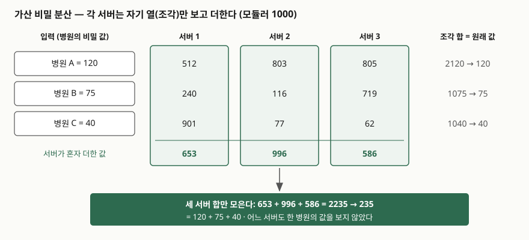
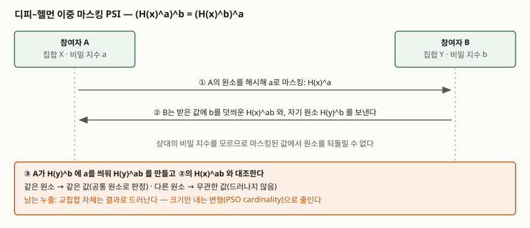

## 들어가며

병원 세 곳이 희귀질환 환자 수를 합쳐 보고 싶지만 각자의 수는 서로에게도 알리고 싶지 않다. 광고 회사와 쇼핑몰은 광고를 본 사람 중 실제로 산 사람이 몇 명인지 알고 싶지만 고객 명단을 서로 넘길 수 없다. 보통은 양쪽이 믿는 제3자에게 원본을 모아 계산시키는데, 그 제3자가 곧 한 곳에 모인 가장 큰 유출 지점이 된다. 다자간 연산(MPC)은 이 제3자를 **프로토콜로 대신한다.** 정보관리기술사 시험에서는 개인정보 보호 강화기술(PET)의 "암호화 상태 처리" 분류로 동형암호와 함께 나오며, 두 기술의 차이와 **결과가 새는 한계**를 쓸 수 있어야 한다.

> 실행 검증 없음. ISO/IEC 4922-1·4922-2의 목차·범위·서문(공개 미리보기)과 NIST PEC 프로젝트 페이지를 근거로 정리했다. 표준 본문의 세부 프로토콜은 확인하지 못했으므로 절 제목 수준까지만 인용했다. 아래 비밀 분산 예시의 숫자는 손으로 검산한 가상 값이다.

---

## 정의

**다자간 연산(Secure Multiparty Computation, MPC)은 여러 참여자가 각자의 입력을 서로에게 공개하지 않으면서, 합의한 함수의 결과만을 함께 계산해 내는 암호 기법이다.**

ISO/IEC 4922-1:2023 서문은 MPC를 개별 입력을 비밀로 유지하면서 함수의 출력을 계산하게 하는 암호 기법으로 정의하고, 이것이 **신뢰할 제3자의 기능을 흉내 내는 분산 프로토콜**이라고 설명한다. 참여자의 비밀 입력을 받고, 합의된 함수를 계산하고, 올바른 출력을 해당 참여자에게만 나눠 주는 일을 제3자 없이 한다는 뜻이다.

**사설 교집합(Private Set Intersection, PSI)은 각자 비밀 집합을 가진 참여자들이 공통 원소만 알아내고, 공통이 아닌 원소에 대해서는 아무것도 알지 못하게 하는 프로토콜이다.** NIST PEC 프로젝트는 PSI를 MPC의 **매우 특수한 경우**로 분류한다.

## 등장 배경

기존 선택지는 셋이었고 각각 막히는 곳이 있었다.

| 기존 방식 | 막히는 곳 |
|---|---|
| 원본을 서로 교환 | 경쟁사·타 기관에 원본이 넘어간다. 법적으로 넘길 수 없는 경우가 많다 |
| 신뢰할 제3자에게 집중 | 제3자가 모든 원본을 본다. 그런 제3자가 없는 경우가 대부분이다 |
| 해시값만 교환해 대조 | 전화번호·주민번호처럼 값의 범위가 작으면 상대가 전부 해시해 보고 되돌린다 |

이론의 출발은 1980년대다. Yao(1982)가 두 참여자의 보안 계산을, Goldreich·Micali·Wigderson(1987)이 임의 함수를 여러 참여자가 안전하게 계산할 수 있음을 보였다. 연산 비용이 줄어든 뒤 표준화가 이어져, ISO/IEC는 일반 모델을 4922-1(2023-07)로, 비밀 분산 기반 방식을 4922-2(2024-03)로 냈다.

## 구성요소 — ISO/IEC 4922-1의 틀

4922-1은 MPC를 **매개변수 6가지**와 **속성 3묶음**으로 기술한다(일반 모델과 매개변수 절 §4, 속성과 분석 절 §5의 절 제목 기준).

| 묶음 | 항목 | 개수 |
|---|---|---|
| 매개변수 (§4.2) | 입력 공간, 인코딩 공간, 출력 공간, 계산 참여자 수, 역할 제한, 통신 모델 | 6 |
| 기본 요구사항 (§5.1) | 정확성, 입력 프라이버시 | 2 |
| 공격자 모델 (§5.2) | 공격자 행동, 부패 참여자 수, 계산 능력, 합성·병렬 실행, 네트워크 접근 | 5 |
| 선택 속성 (§5.3) | 능동 공격자에 대한 정확성, 능동 공격자에 대한 입력 프라이버시, 공정성, 출력 보장 | 4 |
| 성능 속성 (§5.4) | 통신 효율, 계산 효율 | 2 |

공격자 행동은 두 갈래로 나눠 읽는다. **수동(semi-honest)** 공격자는 프로토콜은 그대로 따르면서 주고받은 기록으로 더 알아내려 하고, **능동(malicious)** 공격자는 임의로 프로토콜을 어긴다. 기본 요구가 수동 공격자 기준이고, 능동 공격자에 대한 정확성·프라이버시가 선택 속성으로 따로 놓인 구조가 이 구분을 그대로 보여 준다. 부패 참여자 수는 "몇 명까지 짜도 안전한가"이며, 부패한 쪽이 전체의 절반 미만이라고 가정하는 **정직한 다수(honest majority)** 모델에서 효율적인 프로토콜이 나온다.

### 비밀 분산 위의 연산 — 4922-2의 4단계

4922-2는 Shamir 비밀 분산과 복제 가산 비밀 분산 두 방식 위에서 연산을 **4단계**로 쌓는다.

| 단계 | 절 | 내용 |
|---|---|---|
| ① 선형 연산 | §6 | 덧셈, 뺄셈, 상수 곱 |
| ② 공유 난수 생성 | §7 | 어느 참여자도 모르는 난수를 조각 상태로 만든다 |
| ③ 곱셈 | §8 | GRR·DN·CHIKP·Beaver 4가지 프로토콜 |
| ④ 안전한 함수 평가 | §9 | ①~③을 조합해 임의 함수를 계산한다 |

## 도식

### 가산 비밀 분산으로 합계 내기

> **출처**: [ISO/IEC 4922-2:2024 §5.2 Secret sharing, §6.2 Addition (목차·범위, 미리보기)](https://www.vde-verlag.de/iec-normen/preview-pdf/info_isoiec4922-2%7Bed1.0%7Den.pdf), [ISO/IEC 4922-1:2023 Introduction (미리보기)](https://www.vde-verlag.de/iec-normen/preview-pdf/info_isoiec4922-1%7Bed1.0%7Den.pdf)

각 병원은 자기 값을 합이 그 값이 되는 무작위 수 세 개로 쪼개(모듈러 1000) 서버마다 하나씩 보낸다. A=120은 (512, 803, 805), B=75는 (240, 116, 719), C=40은 (901, 77, 62)다. 서버는 받은 조각만 더한다. 서버1은 653, 서버2는 996, 서버3은 586을 얻고, 이 셋을 합치면 2235, 모듈러 1000으로 235 = 120+75+40이다. 어느 서버도 한 병원의 값을 보지 못했다. 조각 하나는 균일한 난수와 구별되지 않기 때문이다.

## 동작 원리

### 덧셈은 혼자, 곱셈은 함께

덧셈이 쉬운 이유는 조각을 더한 것이 합의 조각이기 때문이다. 각 서버가 **통신 없이** 자기 조각끼리 더하면 된다. 곱셈은 다르다. 조각끼리 곱하면 교차항이 생겨 합의 조각이 되지 않는다. 그래서 4922-2가 곱셈에만 별도 절을 두고 프로토콜 4가지를 싣는다.

그중 Beaver 방식은 미리 만든 **곱셈 삼중쌍** (a, b, c=a·b)을 조각 상태로 갖고 시작한다. x·y를 구하려면 d = x−a, e = y−b를 계산해 **공개**한다. a와 b가 난수라 d와 e는 x, y에 대해 아무것도 알려 주지 않는다. 그러면 x·y = c + d·b + e·a + d·e이고, 우변은 공개값과 조각의 선형 결합이므로 각자 계산할 수 있다. 곱셈의 비용이 "난수 삼중쌍을 미리 만드는 일"과 "값 두 개를 공개하는 통신 한 번"으로 옮겨 간 것이다. MPC의 성능이 계산보다 **통신 횟수**에 묶이는 이유가 여기 있다.

### PSI — 디피–헬먼 이중 마스킹

> **출처**: [Ion et al., On Deploying Secure Computing: Private Intersection-Sum-with-Cardinality, EuroS&P 2020 (ePrint 2019/723) 초록](https://eprint.iacr.org/2019/723), [NIST PEC — PSI/PSO](https://csrc.nist.gov/projects/pec/psi)

구글이 광고 전환 측정에 배포한 PSI 계열 프로토콜은 **디피–헬먼 방식의 이중 마스킹**에 기댄다(Ion et al.). 원리는 거듭제곱의 교환법칙이다. A는 원소 x를 해시해 비밀 지수 a로 거듭제곱한 H(x)^a를 보내고, B는 그것에 다시 b를 씌워 H(x)^ab를 만든다. 반대 방향도 같다. (H(y)^b)^a = H(y)^ab이므로, 같은 원소는 양쪽에서 같은 이중 마스킹 값이 되고 다른 원소는 무관한 값이 된다. 비밀 지수를 모르면 마스킹을 벗길 수 없으므로 공통이 아닌 원소는 드러나지 않는다. 앞의 "해시값만 교환"이 막히던 이유, 곧 상대가 후보를 전부 해시해 보는 공격이 여기서는 상대 지수를 몰라 성립하지 않는다.

### 결과 자체가 새는 한계

MPC가 보장하는 것은 **출력에서 알 수 있는 것 이상을 알지 못한다**는 것뿐이다. 출력이 무엇을 드러내는지는 프로토콜이 아니라 **어떤 함수를 계산하기로 했는가**가 정한다. 두 참여자가 합계를 계산하면 각자 자기 값을 빼서 상대 값을 정확히 안다. 구글의 Private Join and Compute 저장소도 교집합 크기와 합계를 함께 내는 출력에서 정보가 샐 수 있다고 경고하고, 프로토콜을 어기는 참여자는 교집합의 특정 식별자를 알아낼 수 있다고 적는다(수동 공격자 기준 설계이기 때문이다).

## 비교

| 구분 | MPC (비밀 분산) | PSI | 동형암호 | 신뢰 실행 환경 (TEE) |
|---|---|---|---|---|
| 무엇을 계산 | 임의 함수 | 집합 교집합(과 그 변형) | 임의 함수, 깊이 제한 | 임의 함수 |
| 신뢰 가정 | 부패 참여자가 임계 이하 | 참여자 둘 또는 여럿 | 비밀키 보유자 | 하드웨어 제조사·격리 구현 |
| 연산 중 통신 | 곱셈마다 필요 | 마스킹 값 교환 몇 차례 | 거의 없음 (처리자 혼자 계산) | 없음 |
| 비용이 몰리는 곳 | 통신 횟수와 지연 | 집합 크기에 비례하는 거듭제곱 | 처리자의 연산 | 엔클레이브 메모리, 부채널 대응 |
| 결과 누출 | 막지 못한다 | 교집합 자체는 드러난다 | 막지 못한다 | 막지 못한다 |

NIST PEC 페이지는 PSI 변형으로 교집합 **크기만** 내는 것(PSO cardinality), 한쪽만 결과를 받는 비대칭 출력, 교집합 원소에 함수를 적용하는 Circuit-PSI, 여러 참여자의 임계 PSI, 합집합 등을 든다. 실무에서 "명단 대조"를 할 때는 교집합 원소 자체가 아니라 크기나 합계만 필요한 경우가 많으므로, 변형을 고르는 것이 곧 누출을 줄이는 일이다.

## 적용 시 고려사항

① **공격자 모델을 계약과 함께 정한다** — 수동 공격자 모델은 빠르지만 "참여자가 프로토콜을 어기지 않는다"는 가정이 계약·감사로 뒷받침될 때만 성립한다. 경쟁 관계의 참여자라면 능동 공격자 모델이나 입력 검증을 둔다.

② **계산 서버를 서로 다른 조직이 운영하게 한다** — 비밀 분산의 안전성은 "임계 수 이상이 짜지 않는다"에서 나온다. 서버 세 대를 한 클라우드 계정에 올리면 그 가정이 운영 단계에서 무너진다.

③ **출력 함수를 먼저 검토한다** — 참여자가 둘뿐인 합계, 한 명만 해당하는 집계처럼 출력이 입력을 되짚게 하는 질의를 막는다. 최소 집계 단위를 정하거나 결과에 차분 프라이버시 잡음을 더한다.

④ **PSI 입력 집합을 제한한다** — 상대가 후보 식별자를 대량으로 넣으면 교집합이 곧 "누가 상대 명단에 있는가"의 답이 된다. 집합 크기 상한, 질의 횟수 제한, 크기만 내는 변형으로 이를 줄인다.

⑤ **네트워크를 성능 요소로 본다** — 곱셈마다 통신이 필요하므로 참여자 간 지연이 곧 계산 시간이다. 데이터센터 간 거리와 대역폭을 설계 단계에서 잡는다.

## 정리

- **정의** — 신뢰할 제3자를 분산 프로토콜로 대신해, 입력은 숨기고 합의한 함수의 결과만 내는 계산. PSI는 그 특수한 경우로 공통 원소만 알아낸다.
- **ISO/IEC 4922-1** — 매개변수 6 · 기본 요구 2(정확성·입력 프라이버시) · 공격자 모델 5 · 선택 속성 4 · 성능 2.
- **ISO/IEC 4922-2** — 비밀 분산 2방식(Shamir·복제 가산), 연산 4단계(선형 → 난수 → 곱셈 → 함수 평가), 곱셈 프로토콜 4가지.
- **PSI** — 디피–헬먼 이중 마스킹: H(x)^ab = H(x)^ba.
- **암기 단서** — "**덧셈은 혼자, 곱셈은 함께, 결과는 샌다.**"

> 기출 답안: [기출문제 — 개인정보 보호 강화기술(PET): 정의·분류와 동형암호·차분 프라이버시·합성데이터 비교](../../exam/2026-11-07-privacy-enhancing-technologies-he-dp-synthetic/index.md)
>
> 함께 읽기: [동형암호 — 부분·준·완전 동형과 BGV·BFV·CKKS, 잡음과 부트스트래핑](../2026-11-07-homomorphic-encryption-bgv-bfv-ckks-bootstrapping/index.md)

## 참고 자료

- [ISO/IEC 4922-1:2023 (2023-07), Information security — Secure multiparty computation — Part 1: General (VDE 미리보기)](https://www.vde-verlag.de/iec-normen/preview-pdf/info_isoiec4922-1%7Bed1.0%7Den.pdf) — Introduction, §1 Scope, 목차(§4 General model and parameters, §5 Properties and analysis)
- [ISO/IEC 4922-2:2024, Information security — Secure multiparty computation — Part 2: Mechanisms based on secret sharing](https://www.iso.org/standard/80514.html) — 목차(§5~§9). 내용은 [VDE 미리보기](https://www.vde-verlag.de/iec-normen/preview-pdf/info_isoiec4922-2%7Bed1.0%7Den.pdf)로 확인했다
- [NIST, Privacy-Enhancing Cryptography (PEC) 프로젝트](https://csrc.nist.gov/projects/pec) — MPC 정의
- [NIST PEC, Private Set Intersection (PSI) and other Private Set Operations (PSO)](https://csrc.nist.gov/projects/pec/psi) — PSI 정의와 변형
- [M. Ion et al., On Deploying Secure Computing: Private Intersection-Sum-with-Cardinality, IEEE EuroS&P 2020 (ePrint 2019/723)](https://eprint.iacr.org/2019/723)
- [Google, Private Join and Compute (GitHub)](https://github.com/google/private-join-and-compute) — 보안 모델과 누출 경고
- [Y. Lindell, A. Nof, A Framework for Constructing Fast MPC over Arithmetic Circuits with Malicious Adversaries and an Honest-Majority, ACM CCS 2017](https://acmccs.github.io/papers/p259-lindellA.pdf) — 수동·능동 공격자와 정직한 다수 정의
- A. C. Yao, Protocols for Secure Computations, FOCS 1982 / O. Goldreich, S. Micali, A. Wigderson, How to Play Any Mental Game, STOC 1987
