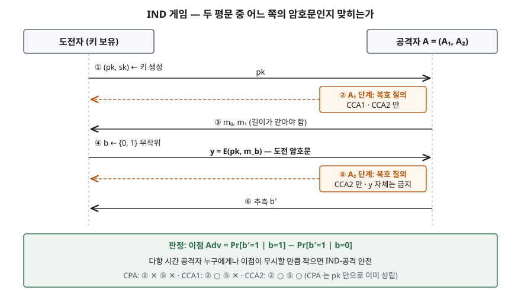
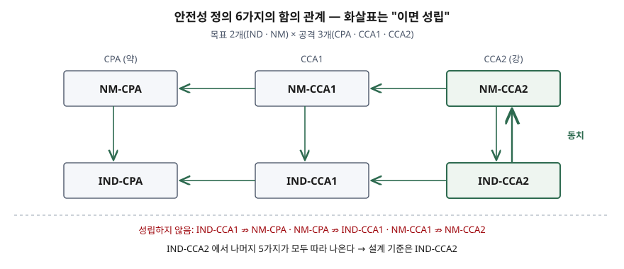

## 들어가며

"이 암호는 안전한가"라는 질문은 **누가 무엇을 할 수 있을 때** 안전한지를 정하지 않으면 답할 수 없다. 암호문만 보는 도청자에게 안전한 방식이 복호 결과나 오류 응답을 돌려주는 서버 앞에서는 깨질 수 있고, 실제로 RSA PKCS #1 v1.5 패딩이 그렇게 깨졌다. 그래서 현대 암호는 안전성을 **게임으로 정의**하고, 표준 문서는 "IND-CCA2를 만족한다"처럼 그 게임의 이름으로 안전성을 표기한다. 정보관리기술사 시험에서는 암호 공격 모델과 짝을 이뤄 나오며, 6가지 정의의 관계와 왜 CCA2가 기준인지를 쓸 수 있어야 한다.

> 실행 검증 없음. Bellare·Desai·Pointcheval·Rogaway(1998)의 정의 절, RFC 8017, FIPS 203 본문을 근거로 정리했다. Goldwasser·Micali(1984) 원문은 열람하지 못해 Bellare 등의 인용을 거쳐 적었다.

---

## 정의

**암호 안전성 정의는 공격자의 목표(무엇을 하면 깨진 것으로 보는가)와 공격 모델(공격자가 무엇에 접근할 수 있는가)을 짝지어, 다항 시간 공격자가 정해진 게임에서 무작위 추측보다 의미 있게 나은 성공률을 낼 수 없음을 요구하는 형식적 기준이다.**

Bellare 등(§1.1)은 안전성 정의를 **목표 하나와 공격 모델 하나의 쌍**으로 정리하고, 목표 2가지와 공격 3가지를 조합해 **6가지 정의**를 만든다.

- **IND-CPA** — 선택 평문 공격 하에서 암호문의 구별 불가능성. 공개키가 있으면 누구나 암호화할 수 있으므로 공개키 암호의 **최소 기준**이다
- **IND-CCA1** — 도전 암호문을 받기 **전까지만** 복호 오라클(복호 결과를 돌려주는 창구)을 쓸 수 있을 때의 구별 불가능성. 비적응적 공격, 흔히 "점심시간 공격"이라 부른다
- **IND-CCA2** — 도전 암호문을 받은 **뒤에도** 복호 오라클을 쓸 수 있을 때의 구별 불가능성. 단 도전 암호문 자체는 물을 수 없다

**의미론적 안전성(semantic security)** 은 Goldwasser·Micali가 제시한 정의로, 암호문을 보고 평문에 대해 효율적으로 알아낼 수 있는 것은 암호문 없이도 알아낼 수 있는 것뿐이어야 한다는 요구다. Bellare 등(§1.1 각주 1)은 Goldwasser·Micali가 IND-CPA를 다항 안전성이라 부르고 이것이 의미론적 안전성과 **동치**임을 보였다고 적는다. 정의하기 쉬운 IND 게임으로 증명하고, 그 결과를 "평문 정보가 새지 않는다"로 읽을 수 있는 근거가 이 동치다.

## 등장 배경

초기의 안전성 논의는 "키를 찾을 수 없다" 또는 "평문 전체를 되찾을 수 없다"를 기준으로 삼았다. 이 기준은 두 가지를 놓친다. 첫째, 평문의 **일부 정보**(성별 한 비트, 금액이 기준보다 큰지)가 새는 것을 막지 못한다. 둘째, 공격자가 **복호 결과를 얻는 경로**를 고려하지 않는다.

둘째 문제는 실제 사고로 드러났다. RFC 8017(§7.2)은 RSAES-PKCS1-v1_5가 평문을 몰라도 유효한 암호문을 만들 수 있는 구조이고, 그래서 Bleichenbacher(1998)의 **선택 암호문 공격**에 이용될 수 있다고 적는다. 복호 후 패딩이 맞았는지에 따라 서버 응답이 달라지면, 그 서버가 곧 복호 오라클이다. 키는 서버 안에 그대로 있는데도 암호문이 풀린다. 안전성 정의에 CCA를 넣어야 하는 이유가 여기 있다.

## 구성요소 — 목표 2가지 × 공격 3가지

| 축 | 항목 | 공격자가 이기는 조건 / 공격자의 능력 | 제안 |
|---|---|---|---|
| 목표 | ① IND (구별 불가능성) | 도전 암호문이 두 평문 중 어느 쪽의 것인지 맞힌다 | Goldwasser·Micali |
| 목표 | ② NM (변조 불가능성) | 도전 암호문을 고쳐 **평문끼리 의미 있게 관련된**(예: x′ = x + 1) 다른 암호문을 만든다 | Dolev·Dwork·Naor |
| 공격 | ① CPA | 공개키만. 원하는 평문을 직접 암호화할 수 있다 | — |
| 공격 | ② CCA1 | 공개키 + 도전 **전** 복호 오라클 | Naor·Yung |
| 공격 | ③ CCA2 | 공개키 + 도전 **전후** 복호 오라클(도전 암호문 제외) | Rackoff·Simon |

Bellare 등(§2.1)은 CCAi의 숫자 i를 **공격자가 복호 오라클을 쓸 수 있는 단계의 수**로 외우라고 권한다. 숫자가 클수록 강하고 시기상으로도 나중에 정식화된 공격이다.

## 도식

### IND 게임의 진행 — 6단계

> **출처**: [Bellare, Desai, Pointcheval, Rogaway, Relations Among Notions of Security for Public-Key Encryption Schemes §2.1 Framework, §2.2 Definition 2.1](https://eprint.iacr.org/1998/021)

게임은 공격자를 두 단계 알고리즘 A = (A₁, A₂)로 둔다(Definition 2.1). A₁은 공개키를 받아 **길이가 같은** 두 평문 m₀, m₁을 고르고, 도전자는 둘 중 무작위로 하나를 암호화한 y를 A₂에게 준다. A₂가 어느 쪽인지 맞히는 확률이 b와 무관하면 암호문은 평문에 대해 길이 말고는 아무것도 알려 주지 않는 것이다. 이점은 b=1일 때 1이라 답할 확률에서 b=0일 때 1이라 답할 확률을 뺀 값이고, 다항 시간 공격자 누구에게나 이 값이 무시할 만큼 작아야 안전하다. 세 공격 모델의 차이는 ②·⑤ 단계에 복호 오라클이 있는지 하나뿐이다.

길이를 같게 하는 이유는 암호문이 평문 길이를 숨기지 못하기 때문이다. Bellare 등(§2.2)도 보호 대상을 **길이를 넘어서는** 평문 정보로 정한다.

### 6가지 정의의 함의 관계

> **출처**: [Bellare et al. §1.2 Implications and Separations, Figure 1](https://eprint.iacr.org/1998/021)

화살표는 8개이고, 어떤 두 정의 사이든 화살표 경로가 있을 때에만 함의가 성립한다(§1.2). 강한 공격에서 안전하면 약한 공격에서도 안전하고(가로 화살표 4개), NM이면 IND다(세로 아래 3개). 자명하지 않은 함의는 **IND-CCA2 ⇒ NM-CCA2** 하나이며, 반대 방향과 합치면 둘은 동치다. 성립하지 않는 관계로는 IND-CCA1 ⇏ NM-CPA, NM-CPA ⇏ IND-CCA1, NM-CCA1 ⇏ NM-CCA2를 보였다. IND-CCA2에서 나머지 5가지가 모두 따라 나오므로, Bellare 등은 앞으로 "CCA"라고 하면 적응적 CCA를 뜻하도록 하자고 제안한다.

## 동작 원리 — CCA2를 만드는 두 가지 방식

**결정적 암호는 IND-CPA조차 될 수 없다.** 공개키 환경에서는 공격자가 공개키로 m₀를 직접 암호화해 도전 암호문과 비교하면 된다. 같은 평문이 늘 같은 암호문이 되는 방식은 ⑥ 단계에서 항상 이긴다. 그래서 IND-CPA 안전한 공개키 암호화는 **암호화할 때마다 난수를 섞는다.** 교과서식 RSA(c = mᵉ mod n)를 그대로 쓰면 안 되는 이유가 이것이다.

**난수만으로는 CCA2가 안 된다.** CCA2 공격자는 도전 암호문을 조금 고친 암호문을 오라클에 넣어 복호 결과로부터 원래 평문을 추론할 수 있다. 막는 방법은 **올바르게 만들어지지 않은 암호문은 아무 정보도 돌려주지 않게** 하는 것이다. 그러면 복호 오라클은 공격자가 이미 평문을 아는 암호문에만 답하게 되어 쓸모가 없어진다. Bellare 등(§1.3)이 정의한 **평문 인지성**(평문을 모르고는 유효한 암호문을 만들 수 없다)이 IND-CPA와 함께 성립하면 IND-CCA2가 따라 나온다는 결과(랜덤 오라클 모델)가 이 직관을 정리한 것이다.

**OAEP(RFC 8017 §7.1).** 평문 M 앞에 레이블 해시 lHash, 0으로 채운 PS, 구분 바이트 0x01을 붙여 DB를 만들고, 무작위 seed로 만든 마스크로 DB를 가리고, 가려진 DB로 만든 마스크로 다시 seed를 가린다(§7.1.1 2단계). 맨 앞에는 0x00 한 바이트를 둔다. 복호 측은 첫 바이트가 0인지, lHash가 일치하는지, 0x01 구분자가 있는지를 검사해 하나라도 틀리면 "decryption error"를 낸다(§7.1.2 3.g단계). 무작위로 고친 암호문은 이 검사를 통과하지 못한다. RFC는 이 방식이 **적응적 선택 암호문 공격에 대해 의미론적으로 안전**하다고 적되, 마스크 생성 함수를 랜덤 오라클로 볼 때의 결과라고 단서를 단다. 같은 절의 주석은 이 증명의 역사도 밝힌다. 원래 1994년 증명은 CCA1까지만 뒷받침했고, Shoup이 일반적인 증명이 성립하지 않음을 보인 뒤 Fujisaki·Okamoto·Pointcheval·Stern이 RSA에 한정해 CCA2 안전성을 증명했다.

**Fujisaki-Okamoto 변환(FIPS 203 §3.2).** ML-KEM은 격자 기반 공개키 암호 K-PKE를 먼저 만들고, 여기에 FO 변환을 적용해 KEM으로 바꾼다. FIPS 203은 그 결과 ML-KEM이 **IND-CCA2를 만족한다고 여겨진다**고 적는다. 핵심은 복호 뒤의 **재암호화 검사**다. 복호로 얻은 m′에서 난수 r′을 해시로 다시 유도해 m′을 재암호화하고, 결과가 받은 암호문과 다르면 거부한다(Algorithm 18). 거부할 때도 오류를 내지 않고 비밀값 z와 암호문을 해시한 **가짜 공유키**를 돌려주는 **암묵적 거부**를 쓴다. 정상 암호문과 변조 암호문의 응답 모양이 같아지므로 오류 여부 자체가 새지 않는다. 같은 이유로 FIPS 203(§3.3)은 K-PKE를 **단독 암호화 방식으로 쓰지 말라**고 정한다. 변환을 거치지 않은 K-PKE에는 이 검사가 없다.

## 비교

| 구분 | IND-CPA | IND-CCA1 | IND-CCA2 | NM-CCA2 | 의미론적 안전성 |
|---|---|---|---|---|---|
| 공격자가 이기는 조건 | 두 평문 중 어느 것인지 맞힘 | 같음 | 같음 | 관련된 평문의 다른 암호문 생성 | 평문의 어떤 함수값을 암호문 덕에 더 잘 맞힘 |
| 복호 오라클 | 없음 | 도전 전 | 도전 전후 (도전 암호문 제외) | 도전 전후 | 없음 (원래 정의) |
| 관계 | 최소 기준 | IND-CPA보다 강함 | 나머지 5가지를 모두 함의 | IND-CCA2와 동치 | IND-CPA와 동치 |
| 표준의 예 | — | — | RSAES-OAEP (RFC 8017), ML-KEM (FIPS 203) | 같음 | — |

공격 모델 쪽의 분류와 섞지 않는다. Handbook of Applied Cryptography의 암호문 단독·기지 평문·선택 평문·선택 암호문 공격은 **공격자가 손에 쥔 정보**의 분류이고, 이 글의 6가지 정의는 그중 선택 평문·선택 암호문 모델 위에 **무엇을 막아야 안전한가**라는 목표를 얹은 것이다. 공개키 암호에서 암호문 단독·기지 평문 공격은 CPA 공격자가 이미 할 수 있는 일이므로 따로 정의하지 않는다.

## 적용 시 고려사항

① **표준 문서의 안전성 표기를 확인한다** — 공개키 암호화나 키 확립 방식을 고를 때 "IND-CCA2" 또는 "적응적 선택 암호문 공격에 안전"이 명시된 것을 쓴다. RFC 8017(§7)은 새 애플리케이션에 RSAES-OAEP 지원을 필수로 두고, v1.5 방식은 호환성 때문에만 남겨 둔다.

② **증명의 가정을 함께 기록한다** — OAEP와 FO 변환의 증명은 해시 함수를 랜덤 오라클로 보는 모델에서 나온다. RFC 8017 주석은 OAEP 증명의 안전성 손실이 커서 RSA를 뒤집는 것보다 OAEP를 공격하는 편이 쉬울 가능성을 배제하지 못한다고도 적는다. 정의를 만족한다는 표기가 곧 무조건 안전하다는 뜻은 아니다.

③ **구현이 오라클을 다시 만들지 않게 한다** — 정의는 방식의 성질이고, 서버가 복호 실패 원인을 오류 메시지나 **처리 시간**으로 구별해 주면 그 서버가 오라클이 된다. RFC 8017(§7.1.2)은 OAEP 복호의 오류 조건을 공격자가 구별할 수 없게 하라고 요구하고, Manger의 공격을 근거로 든다.

④ **구성요소를 단독으로 쓰지 않는다** — FO 변환 전의 K-PKE처럼 CPA 안전성만 가진 내부 구성요소를 직접 호출하면 CCA2 성질이 사라진다. 암호 라이브러리의 저수준 API 사용을 코드 리뷰 항목에 넣는다.

⑤ **대칭 암호도 같은 기준으로 본다** — 복호 결과를 돌려주는 경로가 있으면 대칭 암호에도 선택 암호문 공격이 성립한다. 무결성을 먼저 검증해 변조된 암호문이 복호 단계에 닿지 않게 하는 인증 암호를 쓴다.

## 정리

- **정의** — 목표 × 공격을 짝지어 게임에서 공격자의 이점이 무시할 만큼 작아야 하는 형식적 기준.
- **6가지** — 목표 2개(IND·NM) × 공격 3개(CPA·CCA1·CCA2). CCAi의 i는 복호 오라클을 쓰는 단계 수.
- **IND 게임 6단계** — 키 → (오라클) → 두 평문 → 도전 암호문 → (오라클, 도전 암호문 제외) → 추측.
- **관계** — IND-CCA2 ⇔ NM-CCA2, IND-CCA2에서 나머지 전부. IND-CPA ⇔ 의미론적 안전성.
- **CCA2를 만드는 법** — 난수로 IND-CPA, 형식 검사(OAEP) 또는 재암호화 검사와 암묵적 거부(FO)로 복호 오라클을 무력화.
- **암기 단서** — "**둘 곱하기 셋, 숫자는 오라클 단계 수, 기준은 CCA2.**"

> 기출 답안: [기출문제 — 암호문 공격: 암호문 단독·기지 평문·선택 평문·선택 암호문](../../exam/2026-11-08-cryptanalysis-attack-models/index.md)
>
> 함께 읽기: [양자 내성 암호(PQC)와 전환 전략](../../emerging-tech/2026-10-15-post-quantum-cryptography-transition/index.md)

## 참고 자료

- [M. Bellare, A. Desai, D. Pointcheval, P. Rogaway, Relations Among Notions of Security for Public-Key Encryption Schemes, CRYPTO '98 (IACR ePrint 1998/021)](https://eprint.iacr.org/1998/021) — §1.1~§1.3, §2.1 Framework, §2.2 Definition 2.1, Figure 1
- [RFC 8017, PKCS #1: RSA Cryptography Specifications Version 2.2 (2016-11)](https://www.rfc-editor.org/rfc/rfc8017) — §7, §7.1 RSAES-OAEP와 주석, §7.1.1·§7.1.2 인코딩·복호, §7.2 RSAES-PKCS1-v1_5
- [NIST FIPS 203, Module-Lattice-Based Key-Encapsulation Mechanism Standard (2024-08)](https://nvlpubs.nist.gov/nistpubs/FIPS/NIST.FIPS.203.pdf) — §3.2 The ML-KEM Scheme, §3.3 Requirements for ML-KEM Implementations, Algorithm 18
- [E. Fujisaki, T. Okamoto, Secure Integration of Asymmetric and Symmetric Encryption Schemes, Journal of Cryptology 26, pp. 80–101 (2013)](https://doi.org/10.1007/s00145-011-9114-1) — FIPS 203 참고문헌 [11]
- [S. Goldwasser, S. Micali, Probabilistic Encryption, Journal of Computer and System Sciences 28(2), pp. 270–299 (1984)](https://doi.org/10.1016/0022-0000%2884%2990070-9)
- [A. Menezes, P. van Oorschot, S. Vanstone, Handbook of Applied Cryptography, Chapter 1 (CRC Press, 1997)](https://cacr.uwaterloo.ca/hac/about/chap1.pdf) — §1.13 암호 공격 모델
