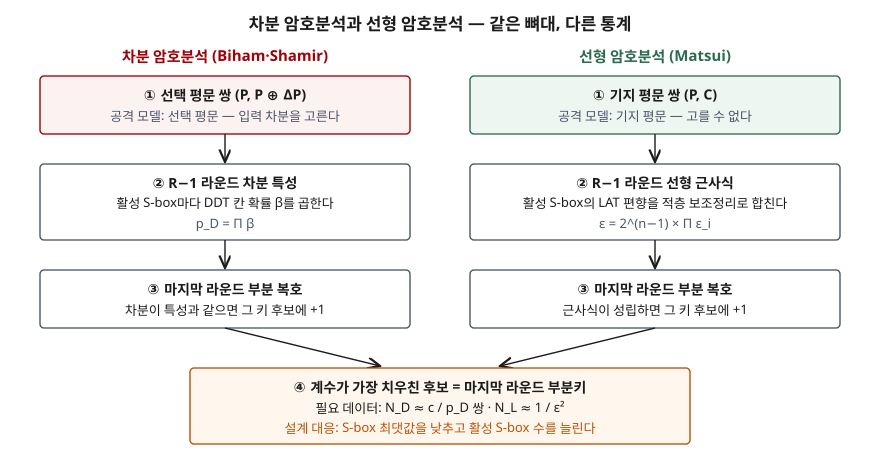

## 들어가며

암호문 공격을 공격자가 가진 정보로 나누면 기지 평문 공격과 선택 평문 공격이 나온다. 그런데 이 분류는 "무엇을 손에 쥐었는가"만 말할 뿐, 그 정보로 키를 **어떻게** 좁히는지는 말하지 않는다. 블록 암호에서 그 방법의 대표가 선형 암호분석(기지 평문)과 차분 암호분석(선택 평문)이고, 지금 쓰는 블록 암호는 모두 이 두 공격을 견디도록 설계됐다. 시험에서는 두 기법의 차이, S-box 설계 기준, 필요한 데이터 양을 함께 묻는다.

> 이 글의 표와 수치는 4비트 S-box 하나에 대해 직접 계산한 것이다. 전체 암호를 공격하는 코드는 싣지 않았다. 계산 기록은 [code/output.txt](code/output.txt)에 있다.

## 정의

**차분 암호분석**(Differential Cryptanalysis): 평문 쌍의 **차이(XOR 차분)** 가 암호의 라운드를 지나며 특정 차이로 바뀌는 확률이 균등하지 않다는 점을 이용해, 선택 평문 쌍으로 마지막 라운드 부분키를 추정하는 공격이다. Biham과 Shamir가 CRYPTO '90에서 DES를 대상으로 발표했다(Heys §1, §4.1).

**선형 암호분석**(Linear Cryptanalysis): 평문 비트·암호문 비트·키 비트의 **XOR로 된 선형 근사식**이 1/2에서 벗어난 확률로 성립한다는 점을 이용해, 기지 평문으로 키 비트를 추정하는 공격이다. Matsui가 EUROCRYPT '93에서 DES를 대상으로 발표했다(Heys §1, §3.1).

두 기법을 묶는 핵심 용어는 셋이다.

| 용어 | 뜻 |
|---|---|
| 차분 분포표(DDT) | S-box에 입력 차분 ΔX를 넣었을 때 출력 차분 ΔY가 나오는 입력 개수의 표 (Heys Table 7) |
| 선형 근사표(LAT) | 입력 마스크·출력 마스크의 XOR이 일치하는 입력 개수에서 절반을 뺀 표. 16으로 나누면 편향 (Heys Table 4) |
| 활성 S-box | 경로 위에서 차분이 0이 아니거나 근사식에 들어가는 S-box (Heys §3.6, §4.5) |

## 등장 배경

DES는 1977년에 표준이 됐고 이후 많은 분석가가 전수 조사보다 빠른 길을 찾았다. 1990년에 공개된 차분 암호분석은 그 첫 번째 일반 기법이었다. 그런데 DES 설계에 참여한 Coppersmith는 1994년 논문에서 **IBM 설계팀이 1974년에 이미 이 기법을 알고 있었고**(사내 이름 "T attack"), S-box와 치환 P의 설계 기준이 이 공격을 막으려고 정해졌다고 밝혔다. 그 결과 Biham·Shamir의 공격은 2^47.2개의 선택 평문을 요구한다.

선형 암호분석은 사정이 달랐다. Coppersmith는 같은 논문에서 이 공격이 차분보다 **두 가지 면에서 강하다**고 적는다. 필요한 텍스트가 더 적고, 고른 평문이 아니라 **알려진 평문**이면 된다는 것이다. 그리고 출력 비트의 선형 결합이 입력 비트의 선형 함수에 가까우면 안 된다는 기준은 설계 기준에 없었다고 회고한다. 이후 블록 암호 설계(AES 후보들, Rijndael)는 두 공격을 처음부터 기준으로 삼는다(Heys §1).

## 구성요소 / 절차

두 공격은 **같은 4단계 뼈대**를 쓰고, 2단계에서 어떤 통계를 쓰는지만 다르다.

| 단계 | 차분 암호분석 | 선형 암호분석 |
|---|---|---|
| ① S-box 분석 | DDT를 만들어 확률이 큰 (ΔX, ΔY) 칸을 찾는다 | LAT를 만들어 편향이 큰 (입력 마스크, 출력 마스크) 칸을 찾는다 |
| ② R−1 라운드 경로 | 활성 S-box의 확률을 곱해 **차분 특성 확률** p_D = Π β | 활성 S-box의 편향을 **적층 보조정리**로 합쳐 ε = 2^(n−1) Π ε_i |
| ③ 데이터 수집과 부분 복호 | 차분이 ΔP인 선택 평문 쌍을 암호화하고, 마지막 라운드를 키 후보마다 거꾸로 풀어 차분이 특성과 맞는지 센다 | 기지 평문 쌍마다 마지막 라운드를 키 후보마다 거꾸로 풀어 근사식이 성립하는지 센다 |
| ④ 부분키 결정 | 계수가 가장 큰 후보 | 계수가 절반에서 가장 멀리 떨어진 후보 |

필요한 데이터 양은 2단계 값으로 정해진다. Heys는 선형에서 N_L ≈ 1/ε²(Matsui의 결과를 인용, §3.6), 차분에서 N_D ≈ c/p_D(c는 작은 상수, §4.5)를 경험칙으로 든다. 활성 S-box가 하나 늘 때마다 ε와 p_D가 곱으로 줄어들기 때문에 **필요한 데이터는 거듭제곱으로 늘어난다.** 이것이 설계 대응의 근거가 된다.

## 도식



> **출처**: [Heys, A Tutorial on Linear and Differential Cryptanalysis §3.1·§3.5·§3.6 Linear Cryptanalysis, §4.1·§4.4·§4.5 Differential Cryptanalysis](https://ioactive.com/wp-content/uploads/2015/07/ldc_tutorial.pdf) (제3자 사본)

## 계산과 검산

Heys 튜토리얼의 4비트 S-box(DES 첫 S-box의 첫 행, `E 4 D 1 2 F B 8 3 A 6 C 5 9 0 7`)로 두 표를 직접 셌다. 핵심은 두 함수다.

```python
def difference_distribution_table(sbox):
    table = [[0] * 16 for _ in range(16)]
    for delta_in in range(16):
        for x in range(16):
            delta_out = sbox[x] ^ sbox[x ^ delta_in]
            table[delta_in][delta_out] += 1
    return table


def linear_approximation_table(sbox):
    # 칸 값 = (입력 마스크·x == 출력 마스크·S(x) 인 x 의 개수) - 8. 16으로 나누면 편향이다.
    table = [[0] * 16 for _ in range(16)]
    for in_mask in range(16):
        for out_mask in range(16):
            matches = sum(
                1 for x in range(16)
                if parity(x & in_mask) == parity(sbox[x] & out_mask)
            )
            table[in_mask][out_mask] = matches - 8
    return table
```

```text
== Heys S-box (DES S1 첫 행) ==
차분 균일도(DDT 최댓값)     : 8 / 16  → 최대 차분 확률 1/2
최댓값이 나온 칸 (ΔX,ΔY)    : (B,2)
ΔX≠0 인 행의 0 칸 수        : 153 / 240
LAT 절댓값 최대             : 6 / 16  → 최대 |편향| 3/8

== 아핀 S-box (x XOR 5) ==
차분 균일도(DDT 최댓값)     : 16 / 16  → 최대 차분 확률 1
최댓값이 나온 칸 (ΔX,ΔY)    : (1,1), (2,2), (3,3), (4,4), (5,5), (6,6), (7,7), (8,8), (9,9), (A,A), (B,B), (C,C), (D,D), (E,E), (F,F)
ΔX≠0 인 행의 0 칸 수        : 225 / 240
LAT 절댓값 최대             : 8 / 16  → 최대 |편향| 1/2

[선형 경로] 활성 S-box 4개 — (입력 마스크, 출력 마스크) → 편향
  (B,4) → 1/4
  (4,5) → -1/4
  (4,5) → -1/4
  (4,5) → -1/4
  적층 보조정리 2^(4-1) × Π ε = -1/32
  필요한 기지 평문 N_L ≈ 1/ε² = 1024

[차분 특성] 활성 S-box 4개 — (ΔX, ΔY) → 확률
  (B,2) → 1/2
  (4,6) → 3/8
  (2,5) → 3/8
  (2,5) → 3/8
  특성 확률 p_D = Π β = 27/1024  (= 0.02637)
  필요한 선택 평문 쌍 N_D ≈ c/p_D = c × 37.9
```

세 가지가 튜토리얼과 맞는다. DDT의 최댓값 8은 ΔX=B, ΔY=2 칸 한 곳에서만 나오고(§4.2), 3라운드 선형 경로의 편향은 -1/32(§3.4), 차분 특성 확률은 27/1024(§4.3)다. 아핀 S-box는 모든 입력 차분이 확률 1로 한 출력 차분에 대응하고 편향이 1/2에 이른다. **비선형성이 없는 S-box는 두 공격 모두에 바로 뚫린다**는 것이 표에서 그대로 보인다.

DDT의 값이 전부 짝수인 것도 눈여겨볼 만하다. 입력 x와 x⊕ΔX는 같은 출력 차분을 만드는 짝이므로 칸 값은 항상 2의 배수다. 그래서 4비트 S-box의 최대 차분 확률은 2/16 아래로 내려갈 수 없다.

## 비교

| 구분 | 차분 암호분석 | 선형 암호분석 | 전수 조사 |
|---|---|---|---|
| 공격 모델 | 선택 평문 (쌍) | 기지 평문 | 기지 평문 1~2쌍 |
| 이용하는 성질 | 차분 전파 확률의 치우침 | 선형 근사식의 편향 | 없음 (키 공간 크기) |
| S-box 통계표 | DDT | LAT | — |
| 경로 결합 | 확률의 곱 Π β | 적층 보조정리 2^(n−1) Π ε_i | — |
| 필요 데이터 | N_D ≈ c/p_D | N_L ≈ 1/ε² | 매우 적음 |
| 계산량 | 부분키 후보 × 쌍 수 | 부분키 후보 × 평문 수 | 2^(키 길이) |
| DES에 대한 결과 | 2^47.2 선택 평문 (Coppersmith 인용) | 차분보다 적은 기지 평문 (Coppersmith) | 2^56 |
| 설계 대응 | 차분 균일도를 낮춘다 | 최대 편향을 낮춘다 | 키 길이를 늘린다 |

공격 모델로 보면 선형이 현실적이다. 공격자가 평문을 고를 수 없는 환경에서도 성립하기 때문이다. 반면 같은 S-box에서 경로 하나가 주는 통계는 두 표가 다르므로, 어느 공격이 더 적은 데이터로 되는지는 암호마다 다르다.

## 적용 시 고려사항

1. **자체 설계 암호를 쓰지 않는다.** S-box를 임의로 고르면 DDT·LAT의 최댓값이 어떻게 될지 알 수 없다. 위 아핀 S-box처럼 극단적이지 않더라도, 공개 분석을 거치지 않은 S-box는 두 공격에 대한 여유를 증명받지 못한 것이다. 표준 블록 암호(AES 등)를 쓴다.
2. **"증명된 저항성"의 전제를 확인한다.** 경로 확률은 S-box들이 서로 독립이라는 가정으로 계산한 추정치이고, 같은 입출력 비트를 잇는 여러 경로가 합쳐지면(선형 껍질, linear hull) 실제 편향이 더 클 수 있다(Heys §3.6, §4.5). 경량 암호를 고를 때는 라운드 여유를 함께 본다.
3. **경량 환경에서 라운드를 줄이지 않는다.** 활성 S-box 수가 곧 데이터 요구량의 지수다. Coppersmith는 S-box를 키우거나 라운드를 늘리면 선형 공격이 약해진다고 적는다. 성능 때문에 라운드 수를 줄인 변형은 표준이 아니다.
4. **한 키로 처리하는 데이터 양을 제한한다.** 두 공격 모두 **같은 키로 암호화된** 평문·암호문을 N개 모아야 한다. Coppersmith도 텍스트가 비밀키를 가진 장비에서 암호화돼야 한다는 점을 공격의 현실적 부담으로 든다. 키 교체 주기는 이 부담을 공격자 쪽에 더 얹는다.

## 정리

- **2가지 기법**: 차분(선택 평문, DDT, 확률의 곱)과 선형(기지 평문, LAT, 적층 보조정리)
- **4단계 뼈대**: S-box 분석 → R−1 라운드 경로 → 부분 복호와 계수 → 부분키 결정
- **데이터 공식 2개**: N_D ≈ c/p_D, N_L ≈ 1/ε²
- **설계 대응 2축**: S-box 최댓값을 낮추고, 활성 S-box 수를 늘린다
- 암기 단서: "**차선 · 선기 · 표 둘 · 식 둘**" — 차분은 선택, 선형은 기지, 표는 DDT·LAT, 식은 c/p와 1/ε²

> 기출 답안: [기출문제 — 암호문 공격: 암호문 단독·기지 평문·선택 평문·선택 암호문](../../exam/2026-11-08-cryptanalysis-attack-models/index.md)
>
> 함께 보기: [암호 안전성 정의 — IND-CPA·IND-CCA1·IND-CCA2와 의미론적 안전성](../2026-11-08-ind-cpa-cca-security-notions/index.md)

## 참고 자료

- [H. M. Heys, A Tutorial on Linear and Differential Cryptanalysis, Cryptologia 26(3), 2002](https://ioactive.com/wp-content/uploads/2015/07/ldc_tutorial.pdf) (제3자 사본) — S-box(Table 1), LAT(Table 4), DDT(Table 7), 적층 보조정리(§3.2), 데이터 복잡도(§3.6, §4.5)
- [D. Coppersmith, The Data Encryption Standard (DES) and its strength against attacks, IBM Journal of Research and Development 38(3), 1994](https://simson.net/ref/1994/coppersmith94.pdf) (제3자 사본) — 1974년 "T attack", S-box 설계 기준, 2^47.2 선택 평문, 선형 공격에 대한 회고
- [E. Biham, A. Shamir, Differential Cryptanalysis of DES-like Cryptosystems, Journal of Cryptology 4(1), pp. 3–72, 1991](https://doi.org/10.1007/BF00630563)
- [M. Matsui, Linear Cryptanalysis Method for DES Cipher, EUROCRYPT '93, LNCS 765, pp. 386–397, 1994](https://doi.org/10.1007/3-540-48285-7_33)
