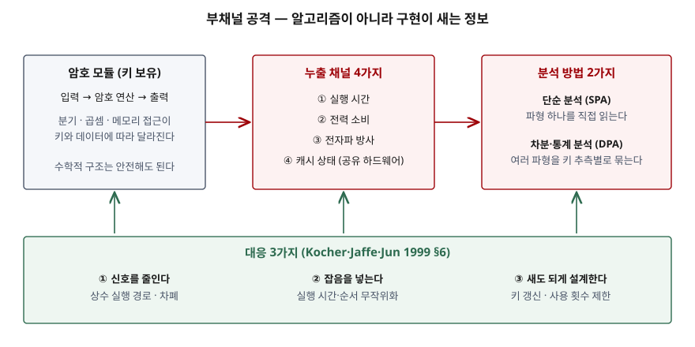

## 들어가며

차분·선형 암호분석은 암호 알고리즘의 수학적 구조를 공격한다. 그런데 AES처럼 그 공격을 견디도록 설계된 알고리즘도 스마트카드나 서버 위에서 **실제로 돌아가는 순간** 실행 시간과 전력 소비가 키에 따라 달라지고, 그 차이를 재면 키가 나온다. 이것이 부채널 공격이고, 시험에서는 "암호문 공격과 무엇이 다른가", "대응 방안을 쓰라"는 형태로 나온다. 실무에서는 비밀값 비교 함수, 공유 클라우드의 캐시, IC 카드·HSM 인증 시험에서 바로 부딪히는 주제다.

> 실행 검증 없음. Kocher의 두 원 논문(1996, 1999), Spectre 논문(2019), NIST FIPS 140-3 근거만으로 정리했다. 공격 수행 절차는 다루지 않고 분류와 대응까지만 쓴다.

## 정의

**부채널 공격**(Side-Channel Attack): 암호 알고리즘의 입출력이 아니라, 암호 연산을 수행하는 **구현이 의도치 않게 내보내는 정보**(실행 시간, 전력 소비, 전자파, 캐시 상태)를 측정·분석해 비밀키를 알아내는 공격이다.

근거는 두 원 논문이다. Kocher(1996)는 암호 시스템이 입력에 따라 처리 시간이 조금씩 다르고, 그 특성이 **키와 입력 데이터 양쪽에 의존**하므로 시간을 재서 키 전체를 찾을 수 있다고 보였다(§1). Kocher·Jaffe·Jun(1999)은 실제 컴퓨터와 칩이 처리하는 연산에 관한 정보를 **새어 내보낸다**고 적고, 전력 측정으로 변조 방지 장치의 키를 찾는 방법을 다뤘다(초록).

NIST FIPS 140-3은 암호 모듈 요구 영역에 **비침투 보안**(non-invasive security)을 별도 항목으로 둔다. 장치를 뜯지 않고 바깥에서 재는 공격이라는 점이 부채널 공격의 실무상 위험이다.

## 등장 배경

1990년대 초까지 암호의 안전성 평가는 알고리즘을 따로 떼어 보는 방식이었다. DPA 논문 §1은 차분·선형 암호분석이 **시스템의 한 부분, 즉 알고리즘의 수학적 구조만 분석해** 적용할 수 있어서 잘 연구됐다고 짚은 뒤, **강한 프로토콜을 올바로 구현해도 안전한 것은 아니다**라고 적는다. 설계자·소프트웨어 개발자·하드웨어 엔지니어가 서로의 가정을 검토하지 않으면 그 사이에서 결함이 생긴다는 것이다.

전자파 누출은 그보다 앞서 알려져 있었다. 같은 절은 미국 정부가 전자파 방사로 정보가 새는 것을 막으려고 기밀 프로그램 TEMPEST에 큰 자원을 들였다고 적는다. 1996년 타이밍 공격과 1999년 전력 분석은 이 문제를 **값싼 장비로 누구나 재현할 수 있는 공격**으로 바꿨다. 2018년 공개된 Spectre는 투기 실행으로 읽은 비밀값을 **캐시 타이밍**(Flush+Reload)으로 꺼내, 부채널이 하드웨어를 공유하는 소프트웨어 사이에서도 성립함을 보였다.

## 구성요소 — 누출 채널 4가지, 분석 방법 2가지

| 누출 채널 | 무엇이 달라지는가 | 근거 |
|---|---|---|
| ① 실행 시간 | 최적화로 건너뛰는 연산, 조건 분기, 캐시 적중, 고정 시간이 아닌 곱셈·나눗셈 명령 | Kocher 1996 §1 |
| ② 전력 소비 | 트랜지스터 게이트에 전하가 걸리고 빠질 때의 전류 | Kocher 1999 §2 |
| ③ 전자파 방사 | 같은 전류가 내는 전자파. 키가 버스를 지나는 장치에서 특히 심각 | Kocher 1999 §2, §7 |
| ④ 캐시 상태 | 피해자가 접근한 캐시 줄을 공격자가 재접근 시간으로 알아냄 | Spectre §II-E (Flush+Reload) |

| 분석 방법 | 방식 | 근거 |
|---|---|---|
| 단순 전력 분석 (SPA) | 암호 연산 중의 측정 파형(trace)을 **직접 해석**한다. 분기 같은 연산 순서가 드러난다 | Kocher 1999 §2 |
| 차분 전력 분석 (DPA) | 많은 파형을 키 일부의 추측값에 따라 나눠 평균의 차를 구하고, 맞는 추측에서만 나타나는 상관을 **통계로** 찾는다 | Kocher 1999 §4 |

SPA는 큰 차이(어떤 명령이 실행됐는가)를 읽고, DPA는 측정 잡음에 묻히는 작은 차이(어떤 데이터 값을 처리했는가)를 통계로 끌어낸다. DPA 논문의 관련 공격 절(§7)은 SPA·DPA와 같은 계열의 통계 기법을 전자파처럼 잡음이 많은 다른 신호에도 쓸 수 있다고 적는다.

## 도식

> **출처**: [Kocher·Jaffe·Jun, Differential Power Analysis §2 Introduction to Power Analysis, §6 Preventing DPA, §7 Related Attacks](https://paulkocher.com/doc/DifferentialPowerAnalysis.pdf) · [Kocher, Timing Attacks §1 Introduction](https://paulkocher.com/doc/TimingAttacks.pdf) · [Kocher et al., Spectre Attacks §II-E Microarchitectural Side-Channel Attacks](https://spectreattack.com/spectre.pdf)

## 대응 3가지

DPA 논문 §6은 대응을 **3가지 범주**로 나눈다.

1. **신호를 줄인다** — 상수 실행 경로 코드, 전력에 덜 드러나는 연산 선택, 해밍 가중치와 상태 전이의 균형, 물리적 차폐. 한계도 함께 적는다. 신호를 0으로 만들 수는 없으므로 표본이 무한한 공격자는 약해진 신호로도 분석할 수 있다.
2. **잡음을 넣는다** — 측정에 잡음을 더하고 실행 시간과 순서를 무작위로 바꾼다. 필요한 표본 수를 늘릴 뿐이고, 시간 무작위화는 우회 기법이 많아 신중해야 한다고 적는다.
3. **새도 견디게 설계한다** — 하드웨어가 샌다는 현실적 가정에서 출발한다. 비선형 키 갱신(키를 해시로 갱신해 거래 사이 파형이 상관되지 않게), 키 사용 횟수 제한, 허용 누출량을 정하고 맞추는 누출 내성 설계가 여기 든다.

타이밍 공격 논문은 공개키 연산에 대해 따로 두 가지를 다룬다. 모든 연산을 같은 시간에 끝내는 방법은 컴파일러 최적화·캐시·명령 시간 때문에 **만들기 어렵고 느리다**고 적고(§9), 더 나은 방법으로 **블라인딩**을 든다(§10). 지수 연산 전에 입력에 무작위 값을 곱해 공격자가 실제 연산 입력을 알 수 없게 하는 것이다.

## 비교

| 구분 | 부채널 공격 | 수학적 암호분석 (차분·선형) | 결함 주입 공격 |
|---|---|---|---|
| 공격 대상 | 구현 (소프트웨어·하드웨어) | 알고리즘 구조 | 구현 |
| 공격자 행동 | 수동 관찰 (측정) | 평문·암호문 수집 | 능동 (전압·클록·레이저로 오류 유발) |
| 필요 접근 | 근접 측정 또는 같은 하드웨어 공유 | 평문·암호문 쌍 | 장치에 물리 접근 |
| 알고리즘이 안전하면 | 여전히 성립 | 막힌다 | 여전히 성립 |
| 대응 위치 | 코드·회로·차폐·프로토콜 | 알고리즘 설계 (S-box, 라운드) | 오류 검출·중복 계산 |
| 시험 체계 | FIPS 140-3 비침투 보안, ISO/IEC 17825 | 공개 분석, 표준화 경쟁 | FIPS 140-3 물리 보안 |

결함 주입은 DPA 논문 §1이 결함 계산으로 인한 실패를 별도 위협으로 언급하는 데서 가져왔다. 세 공격은 대응하는 층이 달라서, 한 층의 대응이 다른 층을 대신하지 못한다.

## 적용 시 고려사항

1. **비밀값을 다루는 코드는 검증된 상수 시간 구현을 쓴다.** MAC·토큰 비교를 일반 문자열 비교로 하면 첫 불일치 위치에서 끝나 시간이 샌다. Kocher가 지적했듯 상수 시간 코드는 컴파일러와 캐시 때문에 직접 만들기 어려우므로, 언어·암호 라이브러리가 제공하는 비교·연산 함수를 쓴다.
2. **무작위 지연을 해결책으로 보지 않는다.** 타이밍 논문 §9의 계산으로는 필요한 표본 수가 잡음 표준편차의 **제곱**에 비례해 늘 뿐이고, 표준편차 1초 지연으로 1,000개가 10^7개가 되는 정도의 안전 계수는 충분하다고 보지 않는다. 오류 응답도 처리 시간까지 통일한다.
3. **하드웨어를 공유하는 환경을 위협 모델에 넣는다.** 캐시 채널은 공격자가 같은 물리 코어·캐시를 쓰기만 하면 성립한다(Spectre). 다중 테넌트 클라우드에서 키를 다루는 작업은 전용 호스트·HSM 분리를 검토한다.
4. **물리 장치는 인증 등급과 시험 범위를 확인한다.** IC 카드·HSM·IoT 모듈은 FIPS 140-3 비침투 보안 요구를 받는다. ISO/IEC 17825:2024는 ISO/IEC 19790 보안 레벨 3·4 요구사항 적합성을 판정하는 비침투 공격 완화 시험 지표를 정하고, NIST SP 800-140F가 CMVP에서 쓸 지표를 지정한다. 시험 때는 시간 무작위화를 끌 수 있어야 한다는 DPA 논문의 권고도 함께 본다.
5. **키 사용 횟수와 갱신 주기를 정한다.** 통계 분석은 같은 키로 처리한 파형이 많을수록 쉬워진다. 사용 횟수 제한과 키 갱신은 공격자가 모을 수 있는 표본 자체를 줄인다.

## 정리

- **정의 한 줄**: 알고리즘이 아니라 **구현이 새는 정보**로 키를 찾는 공격
- **채널 4가지**: 시간 · 전력 · 전자파 · 캐시 → "**시전전캐**"
- **분석 2가지**: 단순(SPA, 파형 직접 해석) · 차분(DPA, 통계)
- **대응 3가지**: 신호 줄이기 · 잡음 넣기 · 새도 견디게 설계 → "**줄·섞·견**". 공개키 연산은 블라인딩
- **시험 체계**: FIPS 140-3 비침투 보안 → ISO/IEC 17825 시험 지표

> 기출 답안: [기출문제 — 암호문 공격: 암호문 단독·기지 평문·선택 평문·선택 암호문](../../exam/2026-11-08-cryptanalysis-attack-models/index.md)
>
> 함께 보기: [차분 암호분석과 선형 암호분석 — S-box의 차분 분포표와 선형 근사표를 직접 세어 보기](../2026-11-09-differential-linear-cryptanalysis-ddt-lat/index.md)

## 참고 자료

- [P. C. Kocher, Timing Attacks on Implementations of Diffie-Hellman, RSA, DSS, and Other Systems, CRYPTO '96](https://paulkocher.com/doc/TimingAttacks.pdf) — §1 시간 차이의 원인, §9 고정 시간과 무작위 지연의 한계, §10 블라인딩
- [P. Kocher, J. Jaffe, B. Jun, Differential Power Analysis, CRYPTO '99](https://paulkocher.com/doc/DifferentialPowerAnalysis.pdf) — §2 SPA, §4 DPA, §6 대응 3범주, §7 전자파
- [P. Kocher et al., Spectre Attacks: Exploiting Speculative Execution, IEEE S&P 2019](https://spectreattack.com/spectre.pdf) — §II-E Flush+Reload 캐시 채널
- [NIST FIPS 140-3, Security Requirements for Cryptographic Modules (2019-03-22)](https://csrc.nist.gov/pubs/fips/140-3/final) — 비침투 보안 요구 영역
- [NIST SP 800-140F, CMVP Approved Non-Invasive Attack Mitigation Test Metrics (2020-03)](https://csrc.nist.gov/pubs/sp/800/140/f/final)
- [ISO/IEC 17825:2024, Testing methods for the mitigation of non-invasive attack classes against cryptographic modules](https://www.iso.org/standard/82422.html)
