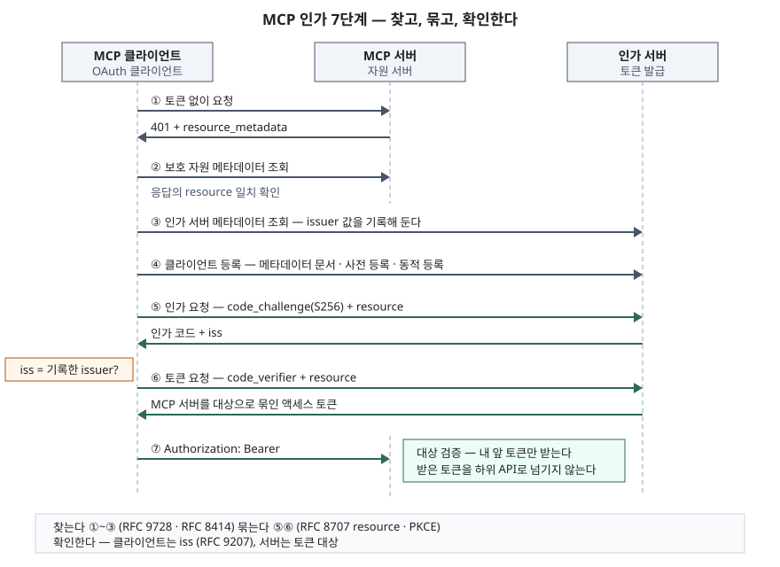

## 들어가며

MCP(Model Context Protocol)로 AI 서비스를 붙이는 문제가 출제되면 프롬프트 인젝션은 누구나 쓰고, 점수가 갈리는 곳은 **인가 구간**이다. 원격 MCP 서버는 사용자의 메일·저장소·사내 시스템에 접근하는 토큰을 받는데, 그 토큰이 **누구에게 어디에 쓰라고 발급됐는지**를 확인하지 않으면 한 서버에 준 토큰이 다른 서버나 하위 API에서 그대로 쓰인다. MCP 사양은 이 문제를 새 방식을 만들지 않고 기존 OAuth 표준 여러 개를 조합해 푼다. 그래서 답안에는 표준 이름과 각 표준이 맡은 일을 짝지어 쓸 수 있어야 한다.

> **실행 검증 없음.** MCP 공식 사양 2026-07-28 개정판의 인가·보안 모범 사례 절과 IETF RFC 원문을 근거로 정리했다. 요구 수준(MUST·SHOULD·MAY)은 사양 원문 표기를 그대로 옮겼다.

## 정의

**MCP 인가는 원격 MCP 서버를 OAuth 2.1 자원 서버로, MCP 클라이언트를 OAuth 2.1 클라이언트로 두고, 클라이언트가 보호 자원 메타데이터로 인가 서버를 찾아 그 서버 하나만을 대상으로 묶인 액세스 토큰을 받으며, 서버는 자기 앞으로 발급된 토큰만 받아들이게 하는 HTTP 기반 전송의 인가 구조다.**

사양은 이 절차가 **선택 사항**이라고 적는다. 인가를 쓰는 HTTP 기반 전송은 이 사양을 따라야 하고(SHOULD), 표준 입출력(stdio)으로 붙는 로컬 서버는 따르지 말고(SHOULD NOT) **환경에서 자격 증명을 읽는다.**

## 등장 배경

1. **연결할 서버를 미리 알 수 없다.** 기존 OAuth 연동은 개발자가 상대 API의 인가 서버 주소를 코드에 적고 클라이언트를 미리 등록한다. MCP 클라이언트는 사용자가 실행 중에 고른 임의의 서버에 붙으므로, **서버가 스스로 "내 인가 서버는 여기다"를 알려 주는 방법**이 필요했다. 이것이 보호 자원 메타데이터(RFC 9728)다.
2. **토큰이 여러 서버를 오간다.** 한 클라이언트가 서버 여러 개에 붙으면, A 서버용으로 받은 토큰을 B 서버가 받아 쓰거나 B 서버가 그 토큰을 하위 API로 넘기는 일이 생길 수 있다. 사양은 후자를 **토큰 전달(Token Passthrough)** 이라는 금지 패턴으로 정하고, 하위 API의 호출량 제한·감사 기록이 우회되고 누가 호출했는지 추적이 끊긴다는 위험을 든다.
3. **기존 OAuth 2.0 의 약한 부분을 떼어 낸다.** OAuth 2.1 초안은 암묵적 승인(Implicit)과 자원 소유자 비밀번호 승인(ROPC)을 명세에서 빼고, 인가 코드 방식에 PKCE(인가 코드 가로채기를 막는 일회용 검증값)를 의무로 둔다. MCP 사양은 인가 서버가 OAuth 2.1 을 구현하도록(MUST) 정해 이 정리를 그대로 가져온다.

## 구성요소 — 3역할과 6표준

### 역할 3가지

| 역할 | MCP 에서 맡는 것 | 사양 문구의 요지 |
|---|---|---|
| 자원 서버 | 보호된 원격 MCP 서버 | 토큰을 받아 요청을 수락한다 |
| 클라이언트 | MCP 클라이언트(호스트 안) | 사용자를 대신해 보호 자원에 요청한다 |
| 인가 서버 | 사용자와 상호작용해 토큰을 발급 | 자원 서버와 같은 곳에 둘 수도, 따로 둘 수도 있다 |

### 표준 6가지와 요구 수준

| # | 표준 | 맡는 일 | MCP 사양의 요구 수준 |
|---|---|---|---|
| 1 | OAuth 2.1 (IETF 초안) | 인가 코드·PKCE·토큰 전송 규칙의 뼈대 | 인가 서버 MUST 구현 |
| 2 | RFC 9728 보호 자원 메타데이터 | 서버가 자기 인가 서버를 공표 | 서버 MUST 구현, 클라이언트 MUST 사용 |
| 3 | RFC 8414 인가 서버 메타데이터 (또는 OIDC Discovery) | 인가 서버의 엔드포인트·지원 기능 공표 | 인가 서버 MUST 둘 중 하나 이상, 클라이언트 MUST 둘 다 지원 |
| 4 | RFC 8707 자원 지시자 | 토큰을 쓸 대상 서버를 `resource` 로 지정 | 클라이언트 MUST 구현 |
| 5 | 클라이언트 등록 — Client ID 메타데이터 문서 / RFC 7591 동적 등록 | 처음 보는 인가 서버에 클라이언트 ID 확보 | 메타데이터 문서 SHOULD, 동적 등록 MAY(폐지 예정, 하위 호환용) |
| 6 | RFC 9207 인가 서버 발급자 식별 | 인가 응답에 `iss` 를 실어 어느 인가 서버의 응답인지 표시 | 인가 서버 SHOULD 포함, 클라이언트 MUST 검증 |

클라이언트 등록은 세 경로 중 하나로 클라이언트 ID 를 얻어야 한다(MUST). Client ID 메타데이터 문서, 미리 받아 둔 ID, 동적 등록이다. 2025-11-25 개정판까지 MAY 로만 두던 동적 등록은 2026-07-28 개정판에서 "폐지 예정, 하위 호환 목적으로 유지"로 바뀌었다.

## 절차 — 7단계

> **출처**: [MCP 사양 2026-07-28 — Authorization §Authorization Server Discovery·§Authorization Flow Steps·§Authorization Response Validation](https://modelcontextprotocol.io/specification/2026-07-28/basic/authorization#authorization-server-discovery), [RFC 9728 §3.3 Protected Resource Metadata Validation](https://www.rfc-editor.org/rfc/rfc9728.html#section-3.3), [RFC 8707 §2 Resource Parameter](https://www.rfc-editor.org/rfc/rfc8707.html#section-2), [RFC 9207 §2.4 Validating the Issuer Identifier](https://www.rfc-editor.org/rfc/rfc9207.html#section-2.4)

사양의 흐름도는 번호 없이 19개 화살표로 그려져 있다. 아래 7단계는 그것을 답안에 쓸 수 있게 묶은 것이다.

1. **401 응답** — 토큰 없이 요청하면 서버가 401 과 함께 `WWW-Authenticate` 헤더의 `resource_metadata` 로 메타데이터 주소를 알려 준다. 헤더가 없으면 클라이언트는 `/.well-known/oauth-protected-resource` 로 직접 찾아간다. 클라이언트는 두 방식을 모두 지원해야 한다(MUST)
2. **보호 자원 메타데이터 조회** — 응답의 `authorization_servers` 에서 인가 서버를 고른다. 이때 응답의 `resource` 값이 **클라이언트가 요청한 주소와 똑같아야 한다**(RFC 9728 의 검증 규칙). 다른 서버의 메타데이터를 내세워 인가 서버를 바꿔치기하는 공격을 막는 장치다
3. **인가 서버 메타데이터 조회** — 엔드포인트와 지원 기능을 받고, 검증된 `issuer` 값을 **기록해 둔다**(MUST). 6단계의 비교 기준이 된다
4. **클라이언트 등록** — 위 세 경로 중 하나
5. **인가 요청** — 브라우저로 인가 서버에 보낸다. PKCE `code_challenge`(가능하면 S256, MUST)와 `resource` 를 싣는다. 인가 서버 메타데이터에 `code_challenge_methods_supported` 가 없으면 클라이언트는 **진행을 거부한다**(MUST). 돌아온 응답에서 `iss` 를 3단계에서 기록한 값과 비교한다
6. **토큰 요청** — 인가 코드와 `code_verifier`, 그리고 **다시 `resource`** 를 보낸다. `resource` 는 인가 요청과 토큰 요청 양쪽에 들어가야 한다(MUST). 인가 서버는 그 서버만 대상으로 하는 토큰을 발급한다
7. **보호 자원 접근** — `Authorization: Bearer` 헤더로만 토큰을 보낸다. URL 질의 문자열에 넣으면 안 된다(MUST NOT). 서버는 **토큰이 자기 앞으로 발급됐는지 검증한다**(MUST)

권한이 모자라면 서버는 403 과 `error="insufficient_scope"`, 필요한 `scope` 를 돌려주고(SHOULD), 사용자를 대신하는 클라이언트는 그 범위로 다시 인가를 받는 **단계적 상향**을 시도한다(SHOULD). 처음 받는 401 이 아니라 **403** 이라는 점이 답안에서 틀리기 쉽다.

## 비교

### 네 표준이 각각 막는 것

| | RFC 9728 | RFC 8414 | RFC 8707 | RFC 9207 |
|---|---|---|---|---|
| 누가 공표·전송하나 | 자원 서버(MCP 서버) | 인가 서버 | 클라이언트 | 인가 서버 |
| 무엇을 | 자원 식별자, 인가 서버 목록, 지원 scope | 엔드포인트, `issuer`, 지원 기능 | `resource` = 토큰을 쓸 서버 | `iss` = 응답한 인가 서버 |
| 어느 단계 | 1·2 | 3 | 5·6 | 5 |
| 무엇을 막나 | 인가 서버 바꿔치기(`resource` 일치 검사) | 클라이언트가 엔드포인트를 짐작하는 일 | 토큰을 다른 서버에서 쓰는 일 | 혼합 공격(Mix-Up) |
| 확인하는 쪽 | 클라이언트 | 클라이언트 | 인가 서버(발급), MCP 서버(대상 검증) | 클라이언트 |

### 토큰 대상 검증 · 토큰 전달 금지 · 혼동된 대리인

세 가지는 답안에서 한 문장으로 뭉뚱그려지기 쉽지만 **사양에서는 서로 다른 항목**이다.

| | 토큰 대상 검증 | 토큰 전달 금지 | 혼동된 대리인 문제 |
|---|---|---|---|
| 사양의 위치 | 인가 절 Token Handling | 인가 절 + 보안 모범 사례 Token Passthrough | 보안 모범 사례 Confused Deputy Problem |
| 상황 | 다른 서버용 토큰이 이 서버에 들어온다 | 이 서버가 받은 토큰을 하위 API 에 넘긴다 | 제3자 API 앞에 선 **프록시 MCP 서버**가 고정 클라이언트 ID 를 쓰고, 이전 동의 쿠키가 남아 있다 |
| 피해 | 한 서버용 권한이 다른 서버에서 쓰인다 | 하위 API 의 호출량 제한·감사가 우회된다 | 사용자가 동의하지 않은 클라이언트가 인가 코드를 받는다 |
| 막는 장치 | `resource` 로 묶어 발급 + 서버의 대상 검증(MUST) | 하위 API 에는 별도 토큰(MUST NOT 전달) | 프록시가 클라이언트마다 동의를 받는다 |

대상 검증과 전달 금지는 **같은 원칙의 양면**이다. 서버는 자기 앞 토큰만 받고(입구), 받은 토큰을 남에게 넘기지 않는다(출구). 반면 사양의 "혼동된 대리인"은 동의 화면을 건너뛰게 만드는 **동의 우회** 문제라서 막는 장치가 다르다. 대상 검증만으로 막힌다고 쓰면 틀린다.

## 적용 시 고려사항

1. **`resource` 는 정규 URI 로 쓴다.** 사양은 소문자 스킴·호스트, 프래그먼트 없음(`https://mcp.example.com/mcp`)을 정규형으로 든다. RFC 8707 도 절대 URI 이고 프래그먼트를 넣지 말라고 정한다. 서버 쪽 대상 검증이 이 문자열 비교로 이뤄지므로, 경로 끝 `/` 하나로 검증이 실패하는 일을 운영에서 미리 맞춰 둔다.
2. **`iss` 검증은 아직 과도기다.** 2026-07-28 개정판의 판단표는 인가 서버 메타데이터가 `authorization_response_iss_parameter_supported` 를 `true` 로 공표했는데 응답에 `iss` 가 없으면 거부하고, 공표하지 않았고 `iss` 도 없으면 **그대로 진행한다.** 사양은 다음 개정에서 `iss` 포함을 SHOULD 에서 MUST 로 올릴 예정이라고 적는다. 인가 서버를 고를 때 이 값을 공표하는지 확인한다. 사양은 PKCE 만으로는 혼합 공격을 막지 못한다고 따로 적는다.
3. **scope 는 좁게 시작한다.** 사양은 401 에 `scope` 가 없을 때 `scopes_supported` 의 scope 를 전부 요청하라고 하는데, RFC 9728 은 이 목록이 "클라이언트가 전부 요청하라는 뜻이 아니다"라고 적는다. 보안 모범 사례도 모든 scope 를 `scopes_supported` 에 올려 두는 것을 흔한 실수로 든다. 서버는 401 에 필요한 최소 scope 를 실어 주고, 나머지는 403 단계적 상향으로 받는 편이 두 문서와 다 맞는다.
4. **stdio 로컬 서버는 이 구조 밖이다.** 로컬 서버는 환경 변수 등에서 키를 읽으므로 대상 검증 같은 장치가 없다. 로컬 서버에 주는 키는 그 서버 전용·최소 권한으로 따로 발급한다.
5. **OAuth 2.1 은 아직 초안이다.** MCP 사양은 `draft-ietf-oauth-v2-1-13` 을 인용하고, 새로 붙은 리프레시 토큰 절은 `-14` 를 인용한다. IETF 최신 초안은 `-17`(2026-10-31)이다. 절 번호가 판마다 달라질 수 있으므로 답안에는 절 번호보다 "PKCE 의무, 암묵적 승인 제거" 같은 내용으로 쓴다.

## 정리

- **3역할**: MCP 서버 = 자원 서버, MCP 클라이언트 = OAuth 클라이언트, 인가 서버
- **6표준**: OAuth 2.1 · RFC 9728 · RFC 8414 · RFC 8707 · 클라이언트 등록(메타데이터 문서/동적 등록) · RFC 9207
- **7단계를 세 동사로**: **찾는다**(401 → 보호 자원 메타데이터 → 인가 서버 메타데이터), **묶는다**(`resource` + PKCE 로 인가·토큰 요청), **확인한다**(클라이언트는 `iss`, 서버는 토큰 대상)
- 서버의 원칙 두 줄: **내 앞 토큰만 받는다(대상 검증 MUST), 받은 토큰을 넘기지 않는다(전달 MUST NOT)**
- 혼동된 대리인은 동의 우회 문제라 **클라이언트별 동의**로 막는다. 대상 검증과 섞지 않는다

> 관련 답안: [기출문제 — MCP로 AI 서비스를 구축할 때의 보안 취약점과 대응 방안](../../exam/2026-11-11-mcp-ai-service-security-threats-and-controls/index.md)
>
> 관련 개념: [프롬프트 인젝션 방어 설계 — 신뢰 경계와 최소권한](../2026-11-02-prompt-injection-defense-design/index.md) · [비인간 신원과 워크로드 신원](../2026-09-28-non-human-identity-workload-identity/index.md)

## 참고 자료

- [Model Context Protocol 사양 2026-07-28 — Authorization](https://modelcontextprotocol.io/specification/2026-07-28/basic/authorization) — Roles, Overview(표준 목록과 요구 수준), Authorization Server Discovery, Client Registration, Authorization Flow Steps, Authorization Response Validation, Resource Parameter Implementation, Access Token Usage, Scope Challenge Handling
- [MCP 사양 2026-07-28 — Authorization: Security Considerations](https://modelcontextprotocol.io/specification/2026-07-28/basic/authorization/security-considerations) — Token Audience Binding and Validation, Access Token Privilege Restriction, Authorization Code Protection(PKCE S256)
- [MCP 사양 2026-07-28 — Security Best Practices](https://modelcontextprotocol.io/specification/2026-07-28/basic/security_best_practices) — Confused Deputy Problem, Token Passthrough, Mix-Up Attacks, Scope Minimization
- [RFC 9728, OAuth 2.0 Protected Resource Metadata (2025-04)](https://www.rfc-editor.org/rfc/rfc9728.html) — 메타데이터 항목(§2), well-known 경로(§3), `resource` 일치 검사(§3.3), `WWW-Authenticate` 의 `resource_metadata`(§5.1), `scopes_supported` 의 뜻(§7.2)
- [RFC 8707, Resource Indicators for OAuth 2.0 (2020-02)](https://www.rfc-editor.org/rfc/rfc8707.html) — `resource` 매개변수와 대상 제한(§2), `invalid_target` 오류
- [RFC 9207, OAuth 2.0 Authorization Server Issuer Identification (2022-03)](https://www.rfc-editor.org/rfc/rfc9207.html) — `iss` 응답 매개변수(§2), 클라이언트 검증(§2.4), `authorization_response_iss_parameter_supported`(§3)
- [RFC 8414, OAuth 2.0 Authorization Server Metadata (2018-06)](https://www.rfc-editor.org/rfc/rfc8414.html)
- [The OAuth 2.1 Authorization Framework, draft-ietf-oauth-v2-1-17 (2026-10-31)](https://datatracker.ietf.org/doc/draft-ietf-oauth-v2-1/) — 암묵적 승인·ROPC 제외(§1.8), PKCE 의무(§4.1.1), redirect URI 완전 일치(§2.3.1)
