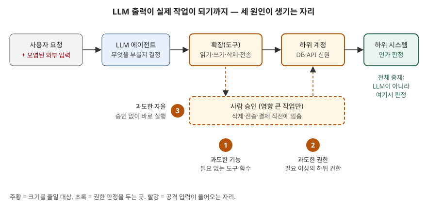

## 들어가며

LLM 보안 문제는 "프롬프트 인젝션을 어떻게 막는가"로 자주 나오지만, 답안의 점수는 그 뒤에 붙는다.
인젝션은 완전히 막을 방법이 알려져 있지 않으므로, 실제로 묻는 것은 **모델이 잘못 판단했을 때
무엇까지 할 수 있게 열어 두었는가**다. OWASP는 이것을 과도한 에이전시라는 별도 위험으로 떼어
냈다. 실무에서는 메일을 읽기만 하면 되는 비서 기능에 전송 권한까지 붙여 두는 식의 설계가 이
위험을 만든다.

> **실행 검증 없음.** OWASP 위험 목록과 보안 설계 원칙 원문을 근거로 정리했다.

## 정의

**과도한 에이전시는 LLM의 예상 밖·모호·조작된 출력에 반응해 피해를 주는 작업이 실행될 수 있게
만드는 취약점이다.** (OWASP LLM06:2025)

정의의 초점은 출력이 **왜** 잘못됐는지가 아니다. OWASP는 원인을 두 갈래로 든다. 프롬프트가
허술하거나 모델 성능이 낮아 생기는 **환각(hallucination)**, 그리고 악의적 사용자·오염된 확장·
다중 에이전트 환경의 다른 에이전트를 통해 들어오는 **직접·간접 프롬프트 인젝션**이다. 어느 쪽이든
잘못된 출력이 생긴다는 전제를 두고, 그 출력이 **실제 작업으로 이어지는 통로의 크기**를 문제 삼는다.

같은 목록의 부적절한 출력 처리(LLM05)와 혼동하기 쉽다. LLM05는 출력을 받는 쪽의 검증이 모자란
문제이고, LLM06은 출력이 부를 수 있는 기능과 권한이 넓은 문제다.

## 등장 배경

LLM을 챗봇으로만 쓸 때는 잘못된 출력이 화면에 잘못된 문장으로 남는 데서 끝났다. 에이전트가
확장(extension, 도구·플러그인)을 통해 메일 전송·파일 삭제·DB 갱신을 하기 시작하면서, 잘못된
출력이 **되돌릴 수 없는 작업**이 됐다.

기존 소프트웨어에서는 개발자가 호출 순서를 코드에 적었다. 에이전트에서는 **LLM이 실행 중에
무엇을 부를지 정한다.** 그래서 "이 프로그램이 이 기능을 부를 리 없다"는 가정이 성립하지 않는다.
붙어 있는 기능은 언젠가 불릴 수 있는 기능이다.

이 문제의 바탕 원칙은 새로운 것이 아니다. 1975년 Saltzer와 Schroeder가 정리한 보호 설계 원칙
8가지 중 **최소 권한**(모든 프로그램은 일에 필요한 최소 권한으로 동작한다)과 **전체 중재**(모든
객체에 대한 모든 접근을 권한 검사한다)가 그대로 적용된다. 바뀐 것은 호출 주체가 확률적으로
판단하는 모델이 됐다는 점이다.

## 구성요소 — 원인 3가지, 예방 전략 8가지

### 가. 원인 3가지

| 원인 | 뜻 | OWASP가 든 예 |
|---|---|---|
| ① 과도한 기능 | 시스템에 필요 없는 기능이 확장에 들어 있다 | 문서 읽기용 확장에 수정·삭제 함수도 있음 / 개발 중 시험하던 확장이 남음 / 명령 하나만 쓰려던 셸 확장이 다른 명령도 허용 |
| ② 과도한 권한 | 확장이 하위 시스템에 붙는 계정의 권한이 넓다 | 읽기용 확장이 SELECT 외에 UPDATE·INSERT·DELETE 권한 계정으로 접속 / 사용자별 기능이 전체 사용자 파일에 접근하는 공용 고권한 계정 사용 |
| ③ 과도한 자율 | 영향 큰 작업을 독립 확인·승인 없이 실행한다 | 사용자 확인 없이 문서를 삭제 |

OWASP는 원인별 예를 모두 **6가지**로 든다(기능 3, 권한 2, 자율 1).

### 나. 예방 전략 8가지

| 번호 | 전략 | 줄이는 원인 |
|---|---|---|
| 1 | 확장 최소화 — 꼭 필요한 확장만 붙인다 | ① |
| 2 | 확장 기능 최소화 — 확장 안의 함수도 필요한 것만 구현한다 | ① |
| 3 | 개방형 확장 회피 — 셸 실행·URL 가져오기 대신 용도가 좁은 도구를 쓴다 | ① |
| 4 | 확장 권한 최소화 — DB·서비스 권한으로 하위 신원의 권한을 좁힌다 | ② |
| 5 | 사용자 맥락 실행 — 공용 계정이 아니라 그 사용자의 최소 권한(예: 좁은 OAuth 범위)으로 실행한다 | ② |
| 6 | 사용자 승인 — 영향 큰 작업은 사람이 확인한다(human-in-the-loop) | ③ |
| 7 | 전체 중재 — 허용 여부를 LLM이 아니라 하위 시스템이 정책으로 판정한다 | ①②③ |
| 8 | LLM 입출력 정제 — OWASP ASVS 기반 보안 코딩, SAST·DAST·IAST 적용 | 입력 경로 |

여기에 **피해를 줄이는 보조 수단 2가지**가 붙는다. 확장과 하위 시스템의 활동을 남기는
**로깅·모니터링**, 단위 시간당 작업 수를 묶는 **속도 제한**이다. OWASP는 이 둘이 과도한 에이전시를
막지는 못하고 피해 규모만 줄인다고 구분한다.

## 도식

> **출처**: [OWASP Top 10 for LLM Applications 2025 — LLM06:2025 Excessive Agency (Common Examples of Risks, Prevention and Mitigation Strategies)](https://genai.owasp.org/llmrisk/llm062025-excessive-agency/)

답안에서는 상자 5개를 가로로 잇고, 확장·하위 계정 아래에 ①②, 승인 게이트 옆에 ③을 적는다.
마지막 상자에 "인가 판정"을 쓰는 것이 핵심이다.

### 전체 중재를 하위 시스템에서 거는 이유

OWASP가 든 예는 받은 메일을 요약하는 비서 에이전트다. 고른 메일 확장에 전송 기능도 들어 있었고,
공격자가 보낸 메일 본문의 지시문(간접 인젝션)을 따라 에이전트가 받은편지함의 민감 정보를
공격자에게 전달한다.

이때 "민감한 메일은 보내지 마라"를 시스템 프롬프트에 적어 두는 것은 통제가 아니다. **그 판정을
하는 주체가 방금 조작된 LLM 자신이기 때문이다.** 공격 입력과 판정 규칙이 같은 콘텍스트에 들어
있으므로 판정이 같이 무너진다. 반면 메일 서버가 이 토큰에 읽기 범위만 주었다면, LLM이 무엇을
결정하든 전송 요청은 하위 시스템에서 거부된다. OWASP가 이 사례에 내놓은 대응도 세 가지 —
읽기 전용 확장, 읽기 범위 OAuth, 전송 전 사용자 검토 — 이고 모두 LLM 바깥에 있다.

## 비교

| 구분 | 과도한 에이전시 (LLM06) | 프롬프트 인젝션 (LLM01) | 부적절한 출력 처리 (LLM05) |
|---|---|---|---|
| 묻는 것 | 잘못된 출력이 **무엇까지 할 수 있나** | 출력을 **어떻게 조작하나** | 출력을 **받는 쪽이 검증하나** |
| 문제 위치 | 확장·권한·승인 구조 | 모델 입력 | 출력을 쓰는 코드(브라우저·셸·SQL) |
| 대표 대응 | 최소 기능·최소 권한·사람 승인·전체 중재 | 입력 분리 표시, 적대적 시험 | 출력 인코딩·검증 |
| 완전 차단 | 설계로 피해 범위를 한정 가능 | 확실한 예방책 없음 | 일반 웹 보안 기법으로 가능 |

| 원칙 | 출처 | 과도한 에이전시와의 대응 |
|---|---|---|
| 최소 권한 | Saltzer & Schroeder(1975), NIST SP 800-53 AC-6 | 원인 ①② |
| 전체 중재 | Saltzer & Schroeder(1975) | 전략 7 |
| 권한 분리(두 조건 요구) | Saltzer & Schroeder(1975) | 전략 6 — LLM 결정 + 사람 승인 |
| 실패 시 안전한 기본값 | Saltzer & Schroeder(1975) | 허용 목록에 없는 도구는 부르지 못함 |

## 적용 시 고려사항

1. **승인 대상을 좁힌다.** 모든 호출에 확인 창을 띄우면 사용자가 내용을 보지 않고 누르게 된다.
   삭제·외부 전송·결제처럼 되돌릴 수 없는 작업만 승인에 걸어야 승인이 통제로 남는다.
2. **사용자 맥락 실행은 신원 연계를 요구한다.** 에이전트가 공용 서비스 계정으로 붙으면 감사 기록에
   "에이전트가 했다"만 남는다. 사용자별 위임 토큰을 쓰려면 인가 서버와의 연계가 먼저 설계돼야 한다.
3. **개방형 도구는 기능 최소화를 무력화한다.** 셸 실행 도구 하나가 붙어 있으면 다른 도구를 아무리
   좁혀도 그 도구로 같은 일을 할 수 있다. 도구 목록을 셀 때 "그 도구로 할 수 있는 일"까지 센다.
4. **개발 단계의 도구가 남지 않게 관리한다.** OWASP 예에 들어 있듯, 시험용 확장이 운영에 남는
   것이 흔한 원인이다. 배포 전 도구 목록을 허용 목록과 대조한다.
5. **로그는 피해 범위를 확인하는 수단이다.** 속도 제한과 함께 두어야, 이상 행동을 탐지하기 전에
   벌어지는 작업 수가 제한된다.

## 정리

- 정의: LLM의 잘못된 출력이 **피해를 주는 작업으로 실행될 수 있게 열린 구조**
- 원인 **3가지 — 기·권·자**: 기능, 권한, 자율 (예시 6가지 = 3·2·1)
- 예방 **8가지**: 확장 최소화, 기능 최소화, 개방형 회피, 권한 최소화, 사용자 맥락, 사용자 승인,
  전체 중재, 입출력 정제 + 보조 **2가지**(로깅·속도 제한)
- 핵심 문장: **허용 판정은 LLM이 아니라 하위 시스템이 한다** — 조작된 판단자에게 판정을 맡기지 않는다
- 바탕 원칙: Saltzer & Schroeder의 최소 권한·전체 중재(1975)

> 기출 답안: [기출문제 — MCP로 AI 서비스를 구축할 때의 보안 취약점과 대응 방안](../../exam/2026-11-11-mcp-ai-service-security-threats-and-controls/index.md)
>
> 관련 개념: [프롬프트 인젝션 방어 설계 — 신뢰 경계와 최소권한](../2026-11-02-prompt-injection-defense-design/index.md)

## 참고 자료

- [OWASP Top 10 for LLM Applications 2025 — LLM06:2025 Excessive Agency](https://genai.owasp.org/llmrisk/llm062025-excessive-agency/) — 정의, 원인 3가지와 예 6가지, 예방 전략 8가지, 보조 수단 2가지, 메일 비서 공격 시나리오
- [OWASP Top 10 for LLM Applications 2025 — LLM01:2025 Prompt Injection](https://genai.owasp.org/llmrisk/llm01-prompt-injection/)
- [OWASP Top 10 for LLM Applications 2025 — LLM05:2025 Improper Output Handling](https://genai.owasp.org/llmrisk/llm052025-improper-output-handling/)
- [J. H. Saltzer, M. D. Schroeder, "The Protection of Information in Computer Systems", Proceedings of the IEEE 63(9), 1975 — Basic Principles of Information Protection, Design Principles](https://www.cs.virginia.edu/~evans/cs551/saltzer/)
- [NIST SP 800-53 Rev. 5, Security and Privacy Controls for Information Systems and Organizations — AC-6 Least Privilege](https://csrc.nist.gov/pubs/sp/800/53/r5/upd1/final)
